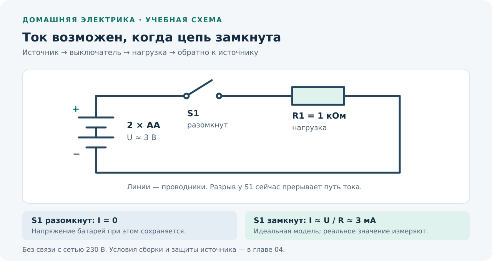

# Домашняя электрика: от нуля к осознанной практике

Курс на русском о квартирной электрике: ток и напряжение, инструменты, измерения, проводка, розетки, выключатели, автоматы, УЗО и поиск неисправностей.

**Формат: один разговор — одна законченная глава в Markdown.** Репозиторий хранит содержание, иллюстрации и точку продолжения между разговорами.

## С чего продолжать

Открой [PROGRESS.md](PROGRESS.md): это единственный источник актуального статуса и номера следующей главы. Начать чтение можно с [главы 01 — «Безопасность и устройство курса»](chapters/01-safety.md). Все опубликованные учебные главы собраны в [chapters/](chapters/README.md).

**Если школьная физика забылась:** после безопасности прочитай [вводную главу A1 — «Физика с нуля: вольты, амперы, омы и ватты»](chapters/a1-physics-from-zero.md). Она объясняет смысл единиц, формулы и бытовые примеры без предварительных знаний. Затем переходи к главам 02–03. Нумерация 18 основных глав сохраняется.

Для следующего разговора достаточно такого запроса:

> Продолжаем курс https://github.com/Talonmortem/elca. Прочитай AGENTS.md, README.md и PROGRESS.md, затем карту и черновик нужной главы. Напиши следующую главу со схемами, реальными фотографиями, практикой и разбором ответов. Сохрани её в репозиторий и обнови прогресс. В этом разговоре делаем одну главу.

## Что здесь лежит

| Файл или каталог | Назначение |
|---|---|
| [ROADMAP.md](ROADMAP.md) | Карта 18 глав: темы, результат, практика и порядок прохождения |
| [PROGRESS.md](PROGRESS.md) | Следующая глава, готовность текстов, отдельно — подтверждённая практика |
| [COURSE_DRAFT.md](COURSE_DRAFT.md) | Содержательный черновик всего курса: тезисы, задания, схемы и фотографии |
| [chapters/01-safety.md](chapters/01-safety.md) | Безопасность: объяснения, две схемы, три реальные фотографии, практика и ответы |
| [chapters/a1-physics-from-zero.md](chapters/a1-physics-from-zero.md) | Физика с нуля: U/I/R/P, единицы, кВт·ч, три SVG, три настоящих фото, пять заданий и восемь вопросов с ответами |
| [chapters/02-circuit-basics.md](chapters/02-circuit-basics.md) | Цепь и закон Ома: четыре SVG-иллюстрации, два новых фото, четыре упражнения и самопроверка с ответами |
| [chapters/03-power-energy.md](chapters/03-power-energy.md) | Мощность, энергия и нагрев: три SVG-иллюстрации, два фото шильдиков, пять упражнений и восемь вопросов со всеми ответами |
| [drafts/01-safety.md](drafts/01-safety.md) | Исходный черновик первой главы, сохранённый для истории разработки |
| [chapters/](chapters/README.md) | Законченные главы после проверки |
| [templates/chapter.md](templates/chapter.md) | Единый шаблон главы |
| [references/SOURCES.md](references/SOURCES.md) | Проверенные источники и правила проверки норм |
| [assets/PHOTO_ATLAS.md](assets/PHOTO_ATLAS.md) | Фотоатлас реального оборудования и деталей, включая шильдик USB-адаптера из A1 |
| [assets/ATTRIBUTION.md](assets/ATTRIBUTION.md) | Авторы, источники и лицензии изображений |
| [AGENTS.md](AGENTS.md) | Инструкция для продолжения работы в новом разговоре |

## Чему научит курс

- Объяснять, что происходит в электрической цепи, и считать простые нагрузки.
- Различать назначение L, N и PE, понимать ограничения старой проводки.
- Пользоваться мультиметром на отдельном батарейном стенде и понимать границы каждого измерения.
- Читать маркировку проводов, розеток и аппаратов защиты; находить паспорт конкретного изделия.
- Понимать, от чего защищают автомат, УЗО, дифавтомат и дополнительные устройства.
- Разбирать типовые симптомы без опасных экспериментов: «выбивает», «греется», «нет питания», «мигает».
- Составить понятную карту электрических групп и предметное задание электрику.

Практический итог — знания, учебные измерения и документация по квартире. Прочитанный курс сам по себе не подтверждает квалификацию для электромонтажа.

## Как устроена практика

| Уровень | Примеры |
|---|---|
| **Наблюдение** | Прочитать доступную маркировку, изучить фото, переписать мощность с шильдика; без снятия крышек |
| **Учебный стол** | Отдельная цепь от батареек 3–6 В с ограничением тока; измерения и механические упражнения на отдельных деталях |
| **Квартирная установка** | Планирование и разбор устройства; работы, требующие доступа к проводникам, безопасного отключения или испытаний, — с квалифицированным специалистом |

Учебный стенд никогда не подключается к розетке или квартирной проводке. Небольшое напряжение не отменяет риск нагрева при коротком замыкании. Условия каждого опыта будут указаны в соответствующей главе.

При повреждённой изоляции, оплавлении, искрении или запахе гари нужно прекратить использование оборудования. Положение рычага автомата, цвет провода и молчание бесконтактного индикатора не заменяют проверку отсутствия напряжения. Опорные материалы: [МЧС и руководства по измерениям](references/SOURCES.md).

## Схемы и фотографии

Это иллюстрация для будущих глав 02, 04 и 05, а не задание на подключение к сети. Все схемы сопровождаются назначением и ограничениями. Фотографии показывают реальные изделия; источник, автор и лицензия указаны в [реестре](assets/ATTRIBUTION.md). Марка на учебном фото не означает рекомендацию к покупке.

## Ритм обучения

Ориентир для одной главы: 30–60 минут чтения и 20–60 минут упражнений. Это планируемый объём, который можно менять по обратной связи. В конце каждой главы будут вопросы для самопроверки, ответы с объяснениями и критерий готовности к следующей теме.

Тексты и выполненная практика учитываются отдельно. Если пользователь не сообщал о выполнении задания, в прогрессе остаётся «не сообщено».

**Область курса:** бытовые установки в РФ; конкретные нормы, модели приборов и условия монтажа проверяются при подготовке соответствующей главы. Разбор старой установки не означает, что она соответствует современным требованиям.
