# Фотоатлас курса

[Главная](../README.md) · [Авторы и лицензии](ATTRIBUTION.md)

Настоящие фотографии для знакомства с предметами курса. Это учебные примеры внешнего вида, не рекомендации конкретной модели и не заключение об исправности показанного оборудования.

## 1. Автоматические выключатели

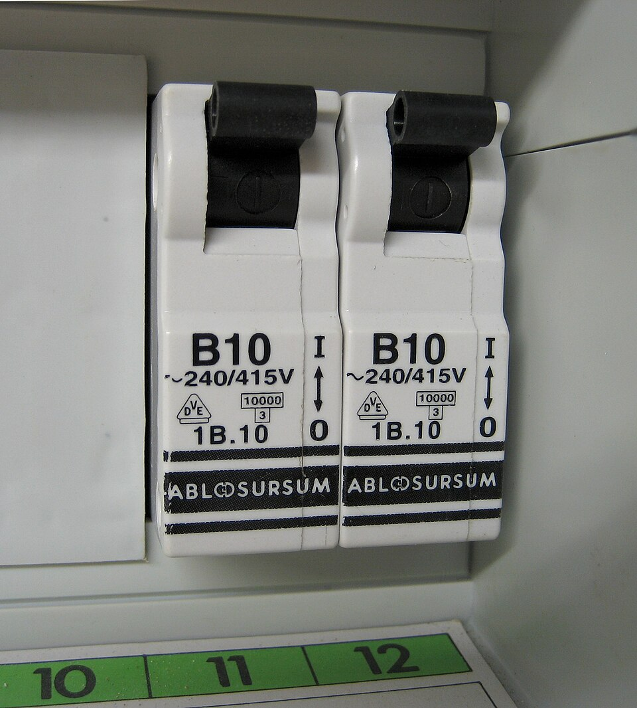

**Что рассмотреть:** рычаги, надпись `B10`, обозначения напряжения и другие маркировки. Полный разбор — в главе 12. Фотография показывает лицевые части; состояние проводов и соединений по ней не установлено.

Фото **Nogo**, 2010, [Wikimedia Commons](https://commons.wikimedia.org/wiki/File:Circuit_breaker_10amps.jpg), общественное достояние (PD-self). Скачана готовая уменьшенная версия Wikimedia; дополнительных изменений нет. Старый образец не задаёт номиналы современной квартирной сети.

## 2. Цифровой мультиметр

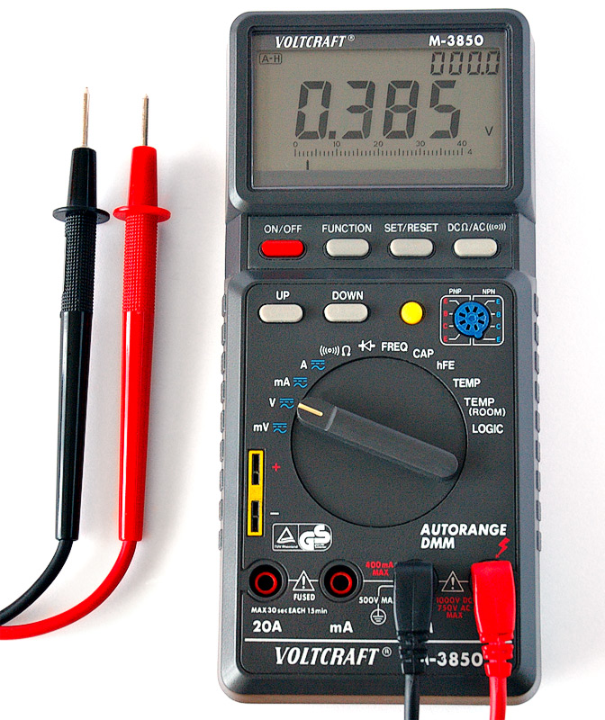

**Что рассмотреть:** экран, переключатель, отдельные входы, провода и щупы. Разбор назначения — в [главе 04](../chapters/04-tools-workbench.md); измерения на батарейном стенде — тема главы 05. Перед использованием другого прибора нужна именно его инструкция; фотография не подтверждает пригодность для измерений в квартирной сети.

Фото **André Karwath aka Aka**, 2005, [Wikimedia Commons](https://commons.wikimedia.org/wiki/File:Digital_Multimeter_Aka.jpg), [CC BY-SA 2.5](https://creativecommons.org/licenses/by-sa/2.5/). Без изменений. Автор не связан с курсом и не заявлял его одобрение.

## 3. Детали розетки Schuko

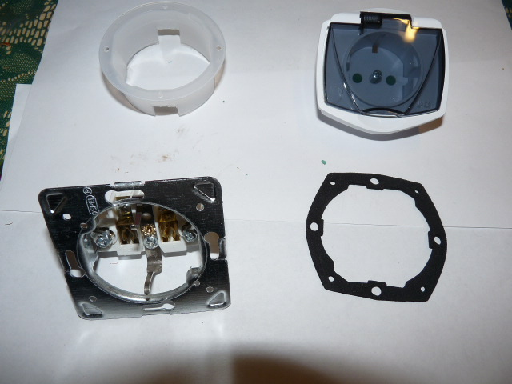

**Что рассмотреть:** механизм с металлическими частями, лицевая часть, отдельные элементы корпуса и уплотнение. Подробный разбор — в главе 10.

Это фотография отдельного изделия на столе. Она не является инструкцией по снятию розетки со стены и не доказывает безопасное отключение какой-либо установки.

Фото **Dmitry G**, 2009, [Wikimedia Commons](https://commons.wikimedia.org/wiki/File:Schuko_socket.JPG), общественное достояние (PD-self). Без изменений.

## 4. Держатель двух элементов AA

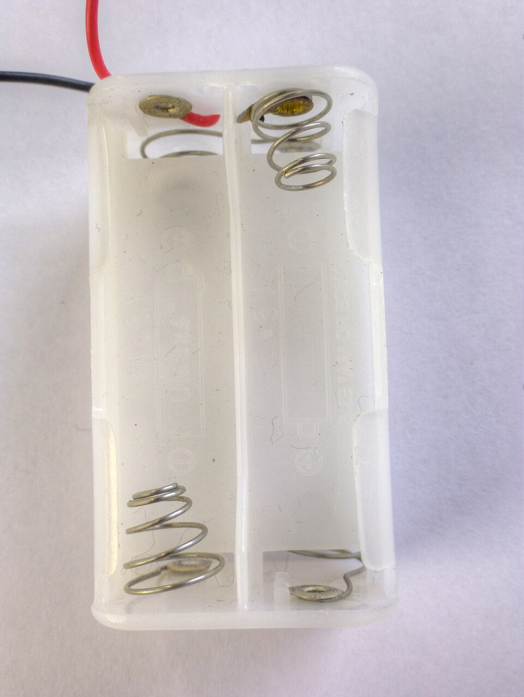

**Что рассмотреть:** места под элементы, контакты и два внешних провода. Пустой держатель сам не создаёт напряжение. Цвет проводов не подтверждает фактическую полярность; качество контактов по снимку не установлено. Связь предмета с принципиальной схемой разобрана в [главе 02](../chapters/02-circuit-basics.md#81-держатель-двух-элементов-aa), выбор деталей и пошаговая сборка — в [главе 04](../chapters/04-tools-workbench.md). Для её стенда требуется держатель с крышкой и штатным выключателем; наличие этих частей на фотографии не показано.

Фото **© Nevit Dilmen**, 2014, [Wikimedia Commons](https://commons.wikimedia.org/wiki/File:Battery_holder_box_2xAA_3V_1480283_4_5_HDR_Enhancer.jpg), [CC BY-SA 3.0](https://creativecommons.org/licenses/by-sa/3.0/). Скачана уменьшенная версия Wikimedia 960 × 1276; при подготовке курса дополнительных изменений нет.

## 5. Выводные резисторы

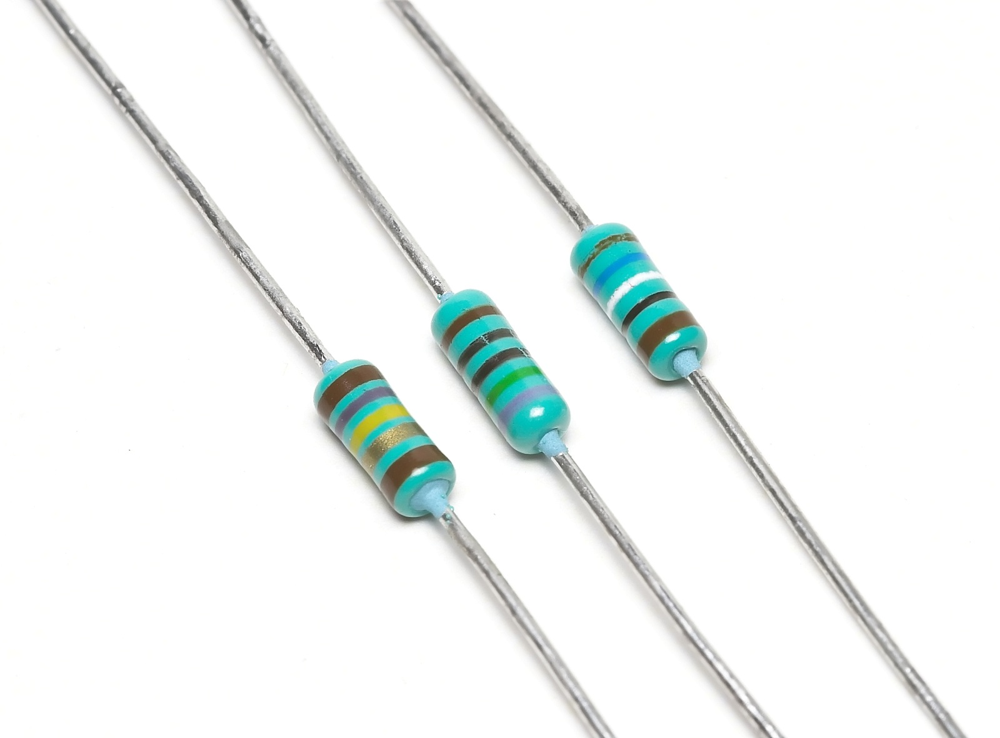

**Что рассмотреть:** корпус, две проволочные ножки каждого компонента и цветные полосы. Эти предметы соответствуют прямоугольному символу резистора на наших схемах. Число 1 кОм относится к условиям задач, а не ко всем предметам в кадре. Разбор — в [главе 02](../chapters/02-circuit-basics.md#82-выводные-резисторы).

Фото **Afrank99**, 2005-07-16, [Wikimedia Commons](https://commons.wikimedia.org/wiki/File:3_Resistors.jpg), [CC BY-SA 2.5](https://creativecommons.org/licenses/by-sa/2.5/). Оригинал 1600 × 1182, без изменений.

## 6. Шильдик электрического утюга

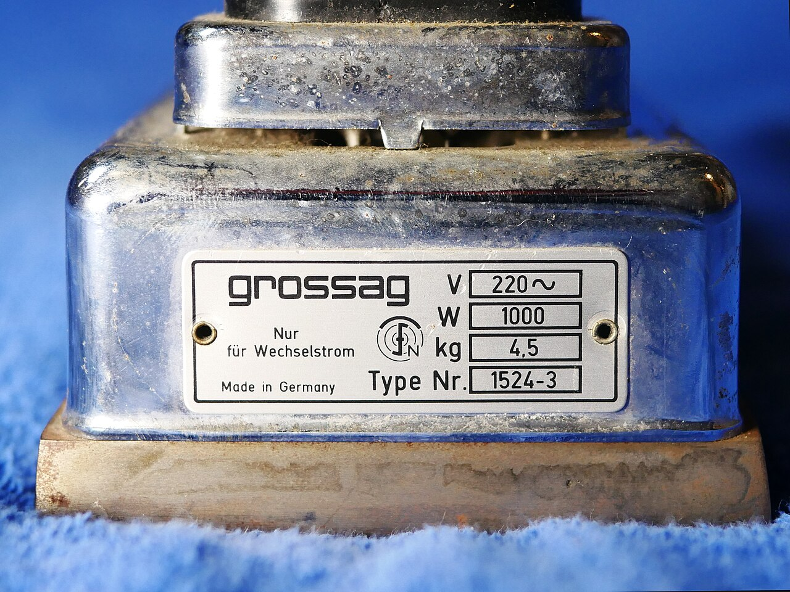

**Что рассмотреть:** строки напряжения `220 V ~` и мощности `1000 W`. `W` — ватты, `kg` — масса, `Type Nr.` — обозначение модели. Значение `1000 W` не является расходом за час; расход энергии зависит ещё и от времени работы нагревателя. Снимок показывает маркировку старого изделия, но не подтверждает его исправность или пригодность для подключения. Это учебный пример, не утверждение о номинальном напряжении современной сети. Разбор — в [главе 03](../chapters/03-power-energy.md).

Фото **HelgeRieder**, 2024-01-20, [Wikimedia Commons](https://commons.wikimedia.org/wiki/File:433GrossesElektrobuegeleisenGrossagH3a.jpg), [CC0 1.0](https://creativecommons.org/publicdomain/zero/1.0/). Готовая уменьшенная версия Wikimedia 1280 × 960; дополнительных изменений нет.

## 7. Вход и выход сетевого адаптера

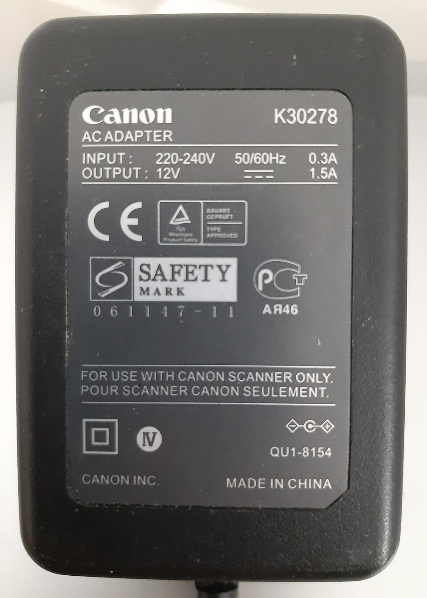

**Что рассмотреть:** отдельные строки `INPUT` — вход, и `OUTPUT` — выход. На входе указаны `220–240 V`, `50/60 Hz`, `0.3 A`; на выходе — `12 V` постоянного тока и `1.5 A`. Произведение выходных номиналов даёт `18 W` на стороне выхода при соответствующем режиме. Это не измеренная мощность из розетки; ток `1.5 A` нельзя переносить на сетевой вход. По одной надписи `0.3 A` нельзя установить активную мощность при фактической нагрузке. Фото не подтверждает исправность или безопасность внутренних частей. Разбор — в [главе 03](../chapters/03-power-energy.md).

Фото **Daniele Pugliesi**, 2019-09-26, [Wikimedia Commons](https://commons.wikimedia.org/wiki/File:Etichetta_di_identificazione_su_adattatore_AC_Canon.jpg), [CC BY-SA 4.0](https://creativecommons.org/licenses/by-sa/4.0/). Готовая уменьшенная версия Wikimedia 960 × 1343; дополнительных изменений нет. Автор и производитель не заявляли одобрения курса.

## 8. Токовые клещи

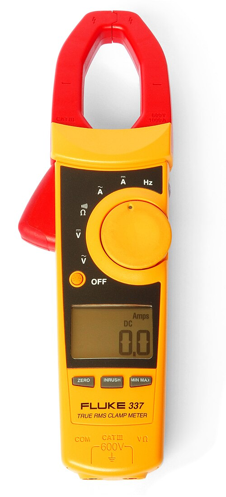

**Что рассмотреть:** губки сверху, рычаг открытия слева, обозначения режимов переменного и постоянного тока, входы `COM` и `VΩ`. Поддержку DC нельзя переносить с этого образца на любые клещи. Фото не демонстрирует измерение и не подтверждает исправность или точность при миллиамперных токах. Принцип работы и ограничения — в [главе 04](../chapters/04-tools-workbench.md).

Фото **Harke**, 2009-08-28; текущая версия обработана **Editor at Large**, [Wikimedia Commons](https://commons.wikimedia.org/wiki/File:Clampmeter_Fluke_337.jpg), общественное достояние (PD-self). Скачана уменьшенная версия Wikimedia 500 × 1096; дополнительных изменений нет. Изображённая модель не является рекомендацией к покупке.

## 9. Стриппер и его рабочие зоны

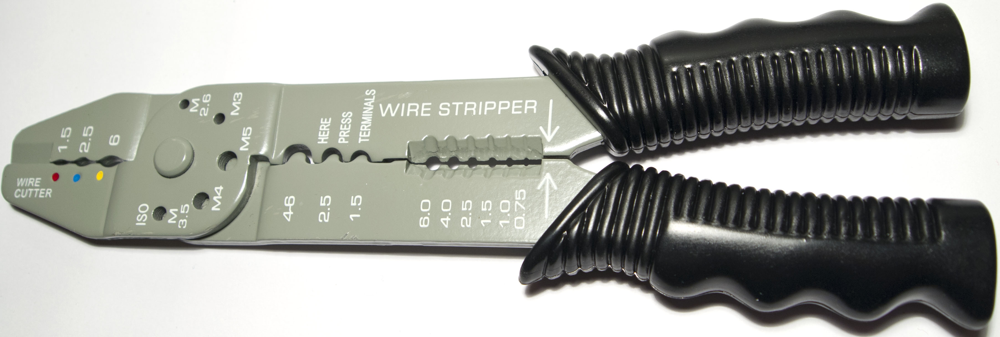

**Что рассмотреть:** калиброванные вырезы возле рукояток и маркировку их размеров. Минимальное видимое обозначение — `0.75`: этот образец нельзя рекомендовать для провода около 0,33 мм² из стенда. Диапазон собственного инструмента должен соответствовать проводу. Маркировки `M3`, `M4` в другой зоне не обозначают сечение жилы; пластиковая рукоятка сама по себе не подтверждает электрозащитные свойства. Разбор выбора и подготовка отдельных проводов — в [главе 04](../chapters/04-tools-workbench.md).

Фото **Tiia Monto**, 2012-12-22, [Wikimedia Commons](https://commons.wikimedia.org/wiki/File:Wire_stripper2.jpg), [CC BY-SA 3.0](https://creativecommons.org/licenses/by-sa/3.0/). Оригинал 3608 × 1216 скопирован без новых изменений. Сохранять атрибуцию и условия лицензии при дальнейшем использовании.

## 10. Беспаечная макетная плата

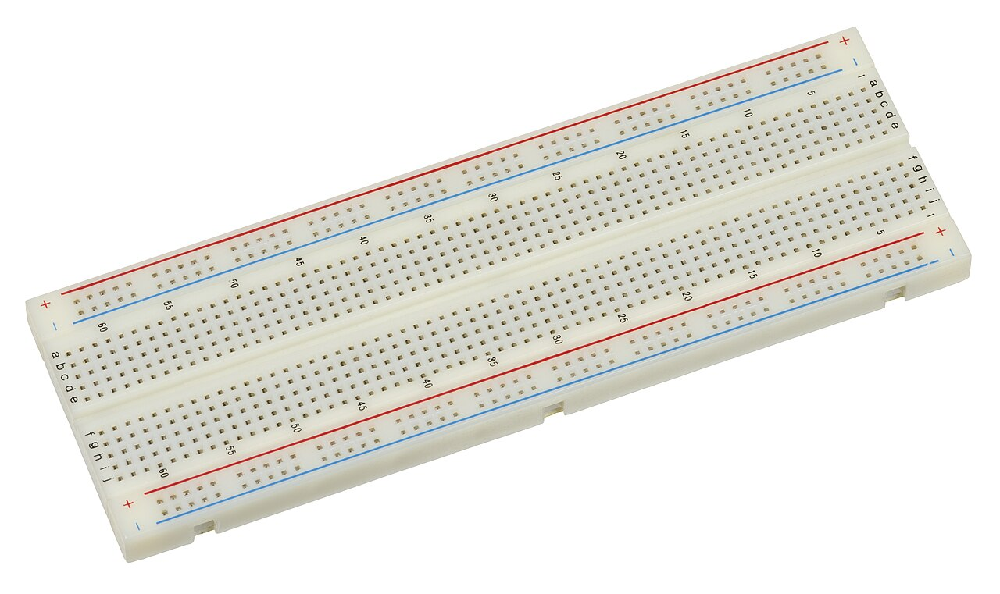

**Что рассмотреть:** буквы и номера отверстий, центральную канавку и внешние шины с цветной маркировкой. Фото показывает общий вид; скрытые соединения и возможные разрывы шин проверяют по документации собственной платы, позднее — прозвонкой без источника. Красная и синяя полосы не создают напряжение и не доказывают полярность. В начальном опыте [главы 04](../chapters/04-tools-workbench.md) шины не используются; там приведены отдельная схема контактов и точные координаты деталей.

Фото **Evan-Amos**, 2018-08-01, [Wikimedia Commons](https://commons.wikimedia.org/wiki/File:Electronics-White-Breadboard.jpg), общественное достояние (PD-self). Скачана уменьшенная версия Wikimedia 1280 × 761; дополнительных изменений нет. Это пустая плата, не фотография собранного стенда курса.

## 11. Мультиметр с отдельными токовыми входами

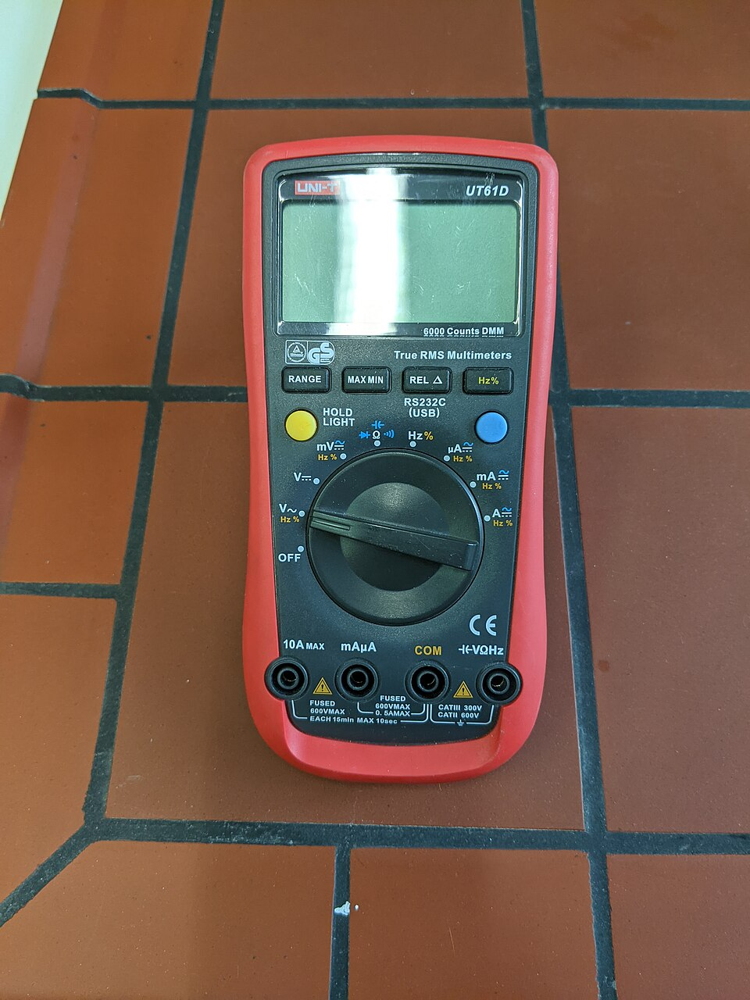

**Что рассмотреть:** отдельные входы `10A`, `mA μA`, `COM`, `V Ω`; кнопки RANGE и HOLD. Ручка находится у **V~**, экран пуст. Фотография показывает панель, а не готовую настройку для батарейного опыта. Расположение и функции своего прибора проверяют по его инструкции. Разбор — в [главе 05](../chapters/05-multimeter.md).

Фото **Anselm Schüler**, 2021-05-05, [Wikimedia Commons](https://commons.wikimedia.org/wiki/File:UT61D_digital_multimeter_front.jpg), [CC BY-SA 4.0](https://creativecommons.org/licenses/by-sa/4.0/). Использована уменьшенная версия Wikimedia 960 × 1280, без дополнительных изменений.

## 12. Мультиметр с ручными пределами

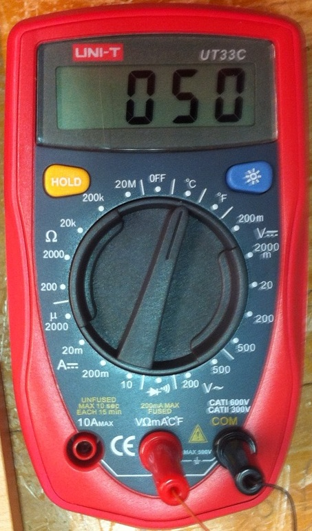

**Что рассмотреть:** группы числовых пределов, совмещённый вход `VΩmA`, COM справа, надписи FUSED/UNFUSED. В кадре подключён температурный датчик и выбрано °C: `050` не означает 50 В. Фото не подтверждает исправность или фактический предохранитель внутри. Как читать гнездо вместе с режимом, объясняет [глава 05](../chapters/05-multimeter.md).

Фото **Neo139**, 2010-10-24, [Wikimedia Commons](https://commons.wikimedia.org/wiki/File:Multimeter_ut33c.JPG), общественное достояние (PD-self). Оригинал 453 × 772 без изменений. Полные сведения о двух новых фотографиях — в [ATTRIBUTION.md](ATTRIBUTION.md).

## 13. Вилка с защитными контактами Schuko

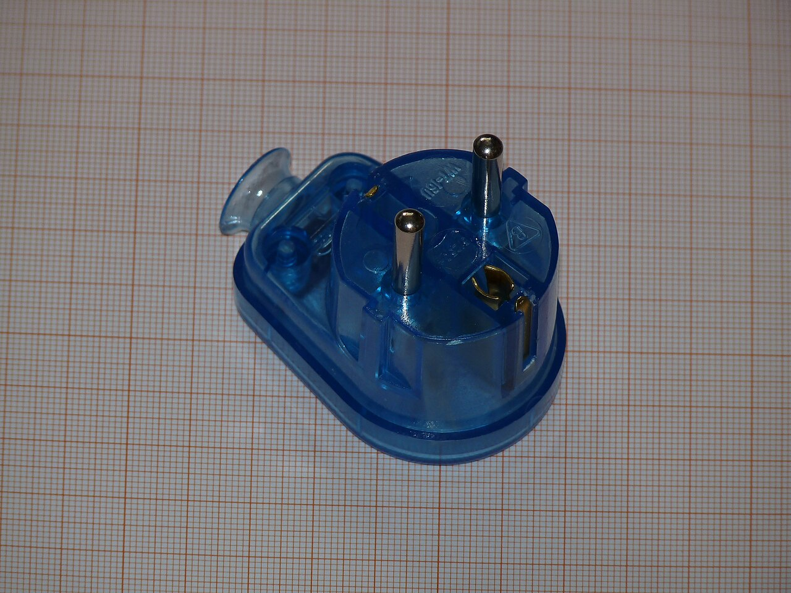

**Что рассмотреть:** рабочие штыри и отдельные защитные контактные поверхности. У показанной вилки E/F также есть отверстие под защитный штырь розетки типа E. Наличие деталей не доказывает исправность или даже наличие полной защитной цепи в установке. По положению штыря у поворачиваемой в Schuko вилки нельзя закрепить L или N. Разбор — в [главе 06](../chapters/06-ac-and-earthing.md).

Фото **Dmitry G**, 2015-10-26, [Wikimedia Commons](https://commons.wikimedia.org/wiki/File:Schuko_plug_VT-16-US.JPG), [CC BY-SA 3.0](https://creativecommons.org/licenses/by-sa/3.0/). Готовая уменьшенная версия Wikimedia 1280 × 960; дополнительных изменений нет.

## 14. Цвета изоляции трёхжильного кабеля

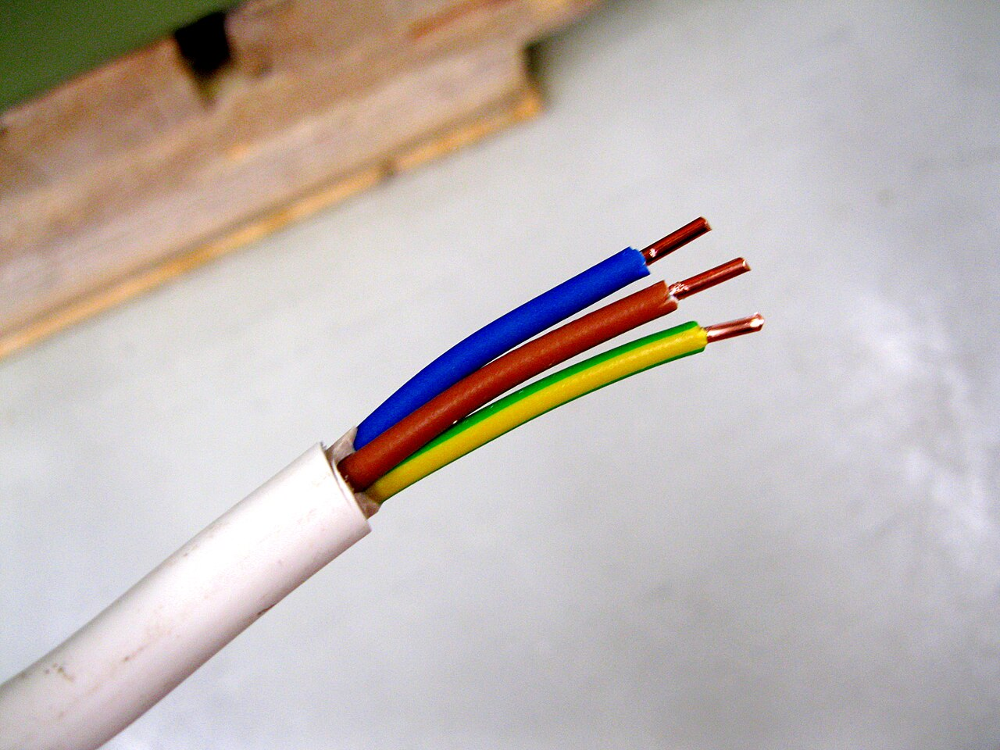

**Что рассмотреть:** общую оболочку, отдельную изоляцию и металлические концы монопроволочных жил. Это монтажный кабель, не гибкий шнур. Фотография показывает цвета, но не другой конец, схему соединений и результаты испытаний. Маркировка не является доказательством фактического назначения и исправности PE. Обозначение MMJ 3×2,5 S относится к описанию снимка, а не к выбору кабеля для квартиры. Разбор — в [главе 06](../chapters/06-ac-and-earthing.md).

Фото **Santeri Viinamäki**, 2016-05-26, [Wikimedia Commons](https://commons.wikimedia.org/wiki/File:Installation_Cable_MMJ_3x2,5S.jpg), [CC BY-SA 4.0](https://creativecommons.org/licenses/by-sa/4.0/). Готовая уменьшенная версия Wikimedia 1280 × 960; дополнительных изменений нет. Полные URL и сведения — в [ATTRIBUTION.md](ATTRIBUTION.md).

## Дополнение A1. Вход и выход USB-адаптера

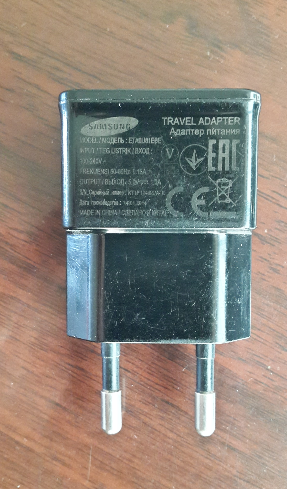

**Что рассмотреть:** отдельные строки `INPUT / ВХОД` и `OUTPUT / ВЫХОД`, единицы V и A, признаки переменного и постоянного питания. На выходе читаются 5,0 В и 1,0 А; 5 Вт получается расчётом и не написано на корпусе. Не смешивать входные амперы с выходными вольтами. Разбор и упражнение — в [главе A1](../chapters/a1-physics-from-zero.md#11-как-это-выглядит-на-настоящих-предметах).

Фото **Slcreza**, 2018-02-27, [Wikimedia Commons](https://commons.wikimedia.org/wiki/File:Samsung_Travel_Adapter_2.jpg), [CC BY-SA 4.0](https://creativecommons.org/licenses/by-sa/4.0/). Оригинал 2219 × 3775, без изменений; [открыть крупно](photos/a1-usb-adapter-label.jpg). Фото не подтверждает исправность, подлинность или совместимость адаптера. Полные данные — в [ATTRIBUTION.md](ATTRIBUTION.md).

## Использование в главе 07

В [главе о схемах и группах](../chapters/07-schematics-groups.md#6-как-это-выглядит-в-жизни) повторно использованы фотографии макетной платы, двух автоматов и трёхжильного кабеля. Они показывают соответственно переход от отверстий к узлам, различие маркировки изделия и позиции на панели, несколько проводников внутри одной оболочки. Страницы происхождения и файлы проверены **2026-11-09**; новых изменений изображений нет. По этим снимкам нельзя установить электрические группы реальной квартиры. Атлас по-прежнему содержит 15 фотографий.

## Как будет расширяться атлас

В соответствующих главах появятся фото двухполюсного указателя, кабелей и соединителей, УЗО и дифавтомата, других шильдиков и дефектов. Новые материалы добавляются после проверки изображения и прав на публикацию. Отсутствующую фотографию нельзя считать готовой иллюстрацией только по записи в плане.
