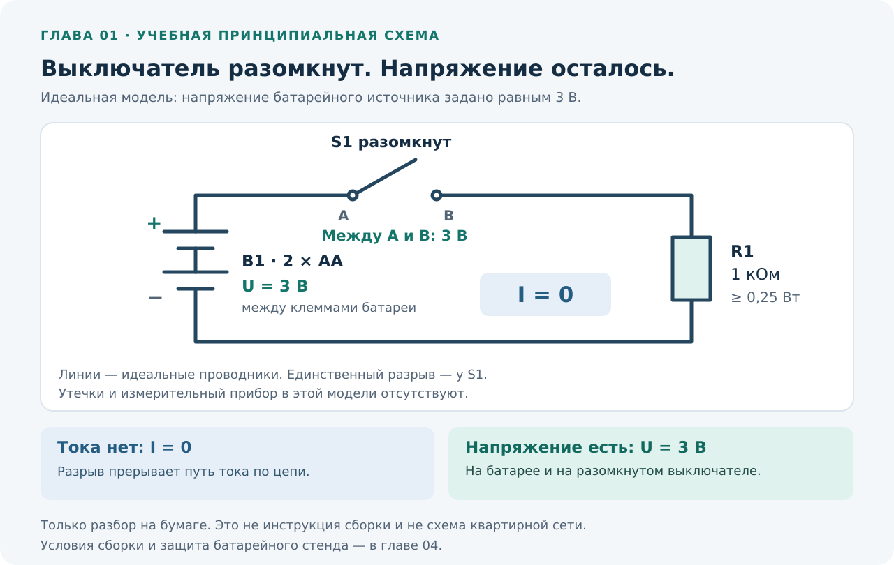
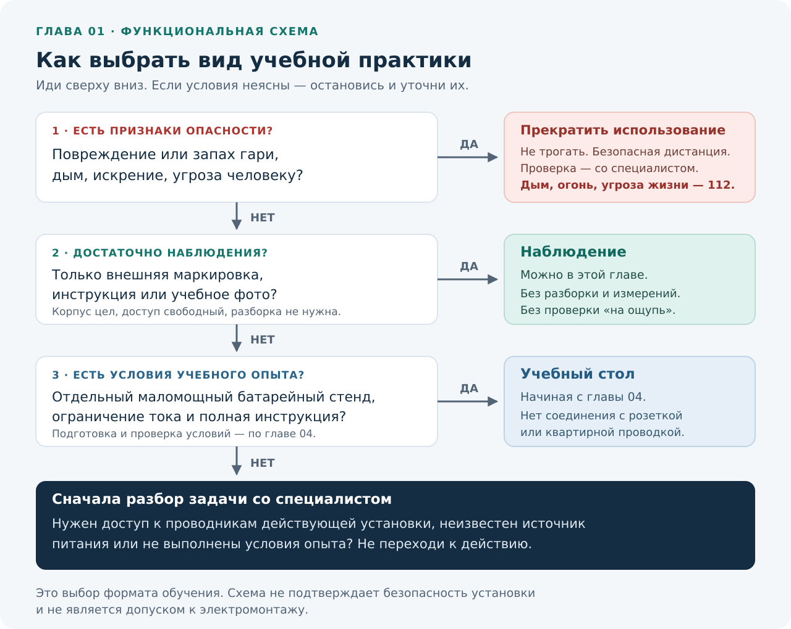
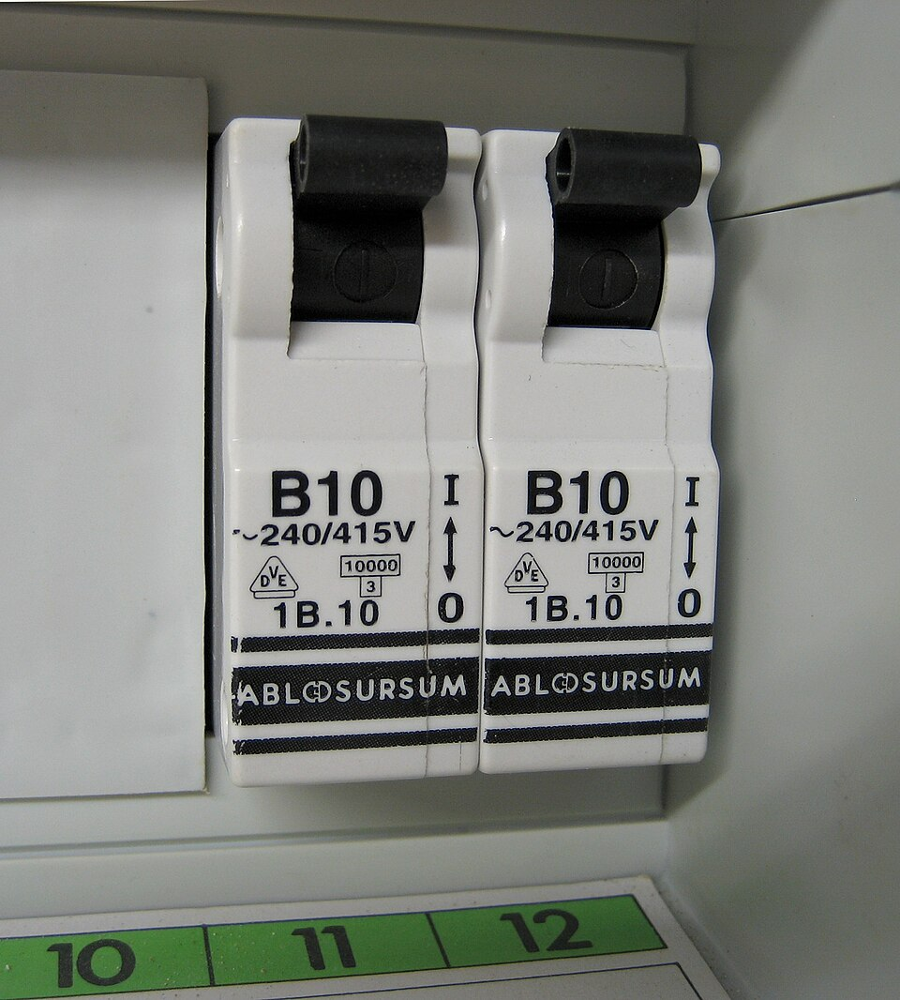
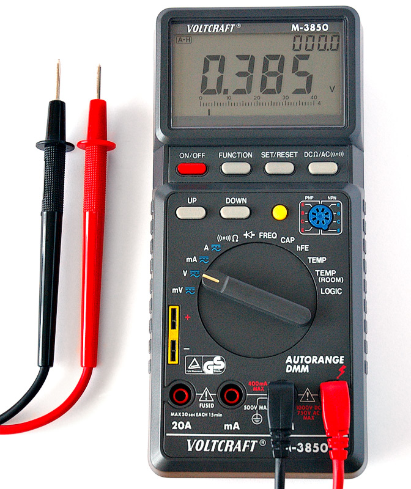
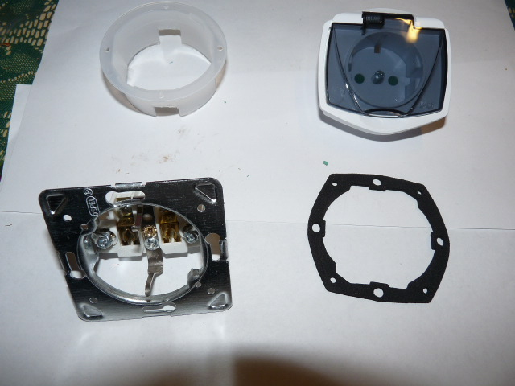

# Глава 01. Безопасность и устройство курса

[Главная](../README.md) · [Карта курса](../ROADMAP.md) · [Прогресс](../PROGRESS.md) · [Все главы](README.md)

**Дата технической проверки:** 2026-11-06.  
**Нужные предыдущие главы:** нет.  
**Практика:** фотографии, бумажные схемы, документы и доступная внешняя маркировка.  
**Время:** примерно 30–40 минут на чтение и 25–40 минут на задания.

## После главы ты сможешь

1. Различать четыре опасности: поражение током, перегрев, электрическую дугу и сохранённую энергию.
2. Объяснять, почему «прибор не работает» и «напряжение отсутствует» — разные утверждения.
3. Выбирать подходящий вид учебной практики и замечать, когда задача требует специалиста.
4. Читать фотографию оборудования, отделяя видимые признаки от предположений.
5. Записать наблюдения так, чтобы по ним можно было продолжать обучение или обсуждать проблему с электриком.

**Для этой главы достаточно телефона или компьютера и листа бумаги. Покупать инструмент, открывать щит и вставлять щупы в розетку не требуется.**

## 1. Первая ситуация: розетка потемнела, но всё работает

Представь учебную ситуацию: возле отверстия розетки появилось потемнение, при работе чайника чувствовался запах гари. Чайник продолжал греть, автомат в щите не отключался.

Что из этого известно?

| Наблюдение | Что можно утверждать | Чего пока нельзя утверждать |
|---|---|---|
| Чайник нагревал воду | В тот момент прибор получал энергию | Розетка, вилка и проводка исправны |
| Автомат не отключился | Отключения не наблюдали | Опасности нет или автомат обязательно неисправен |
| Есть потемнение и запах гари | Есть признаки возможного перегрева; использование нужно прекратить | Найдена точная причина и достаточно заменить одну деталь |

Уже этих признаков достаточно, чтобы прекратить использование и вызвать электрика. При дыме, огне или угрозе человеку действуй по памятке раздела 7. Основа рекомендации — [МЧС России](https://69.mchs.gov.ru/deyatelnost/press-centr/novosti/5841129).

Полезное описание для специалиста: «Во время работы чайника появился запах гари около розетки; видно потемнение; автомат не отключался; после этого розеткой не пользовались». Это учебный пример. В своём сообщении записывай наблюдения, не воспроизводя неисправность ради подробностей.

К этой ситуации мы вернёмся в главах про нагрев, соединения и автоматы. Первый навык курса — **делать вывод ровно той силы, которую позволяют имеющиеся данные**.

## 2. Откуда берётся опасность

### 2.1. Поражение током: тело становится частью цепи

Электрический ток — направленное движение электрического заряда. Если между двумя точками есть напряжение и тело соединяет их, через него может потечь ток. Для этого не обязательно касаться двух оголённых проводов: при неисправности опасным может стать и доступный металлический корпус. Подробные определения тока и напряжения будут в главе 02.

Последствия зависят от силы и пути тока через тело, длительности воздействия, состояния кожи и окружающих условий. Возможны ожоги, нарушение работы сердца и потеря контроля над мышцами. Поэтому рассчитывать «если что, быстро отпущу» нельзя: человек может оказаться не способен разжать руку. Эти механизмы описаны в материалах [HSE об электрических травмах](https://www.hse.gov.uk/electricity/injuries.htm) и [рисках испытаний, с. 2](https://www.hse.gov.uk/pubns/indg354.pdf).

Проверять цепь прикосновением нельзя. Учебные измерения будем выполнять на подготовленном батарейном стенде.

### 2.2. Перегрев: опасность может развиваться в одной точке

Соединение — место, где ток переходит между проводниками: например, между контактом розетки и штырём вилки. При ухудшении контакта энергия может выделяться в небольшом участке, нагревая окружающий материал. Прибор при этом способен продолжать работать.

Обычный автоматический выключатель защищает от **сверхтока**: перегрузки и короткого замыкания. Его реакция связана с величиной тока и временем, а не с температурой каждого соединения в квартире. Локальный дефект не обязательно создаёт условия для его отключения. Назначение защиты поясняет [Schneider Electric](https://www.electrical-installation.org/enwiki/Overcurrent_protection_principles), а нагрев повреждённых соединений и ограничения обычных защит — [раздел о дуговых повреждениях](https://www.electrical-installation.org/enwiki/Arc_Fault_Detection_Devices_%28AFDD%29).

По одному пятну нельзя определить, виновата ли розетка, вилка или соединение за ней.

### 2.3. Электрическая дуга: ток может идти через газ

Дуга — электрический разряд через проводящий газ, в том числе воздух в промежутке между частями цепи. Она может выделять много тепла. Аварийное замыкание металлическим инструментом способно вызвать ожог и другие травмы; повреждённые контакты могут создавать условия для дугового повреждения. [HSE, с. 2](https://www.hse.gov.uk/pubns/indg354.pdf); [Schneider Electric: происхождение дуговых повреждений](https://www.electrical-installation.org/enwiki/Arc_Fault_Detection_Devices_%28AFDD%29).

Намеренно замыкать источник для проверки защиты нельзя.

### 2.4. Сохранённая энергия: вилка вынута, внутри ещё есть риск

**Конденсатор** — компонент, способный накапливать электрический заряд и энергию. В некоторых приборах заряд сохраняется после отключения питания. Кроме того, внутренние напряжения могут отличаться от напряжения на внешнем разъёме. Поэтому отключённый сетевой блок питания или микроволновая печь не становятся учебным образцом для вскрытия. [HSE INDG354, с. 1–2 и 7](https://www.hse.gov.uk/pubns/indg354.pdf).

Универсального безопасного времени ожидания нет. Остаточную энергию проверяет и устраняет подготовленный специалист по документации изделия.

### Что дают аппараты защиты

Автомат, УЗО и другие защитные устройства выполняют определённые функции. **УЗО — устройство защитного отключения**: оно реагирует на дифференциальный ток и при заданных условиях отключает цепь. В простом однофазном примере дифференциальный ток — разница между током, ушедшим в цепь, и током, вернувшимся через аппарат. Наличие УЗО не делает любое прикосновение безопасным. УЗО без встроенной защиты от сверхтока также не заменяет автомат. Пример разделения этих функций — [руководство IEK ВД1-63 типа A](https://cdn-01.iek.ru/media/original/3c1317d0b1ea7b7997286bc42c84a12823384a10c0f90b2478c2197b9aea1d8e.pdf); ограничения дополнительной защиты рассмотрены в [HSE INDG354, с. 8](https://www.hse.gov.uk/pubns/indg354.pdf).

Подробности — в главах 12–14. Пока запомни: отсутствие срабатывания не подтверждает исправность всей установки.

## 3. Что именно означает «выключено»

В бытовом разговоре этим словом называют несколько разных состояний.

| Ситуация | Что произошло | Что ещё остаётся неизвестным |
|---|---|---|
| Нажали кнопку на приборе | Изменили его режим работы | Какие внутренние части продолжают получать питание |
| Лампа погасла | Прекратилось свечение | Почему это случилось и есть ли напряжение на доступных при разборке частях |
| Перевели рычаг аппарата в положение «выключено» | Воздействовали на конкретный аппарат | Та ли это цепь, исправно ли отключение, есть ли другое питание |
| Специалист подготовил место работы | Выполнил меры для конкретной задачи и проверил результат | Эти меры не распространяются автоматически на соседние цепи |

Источник энергии бывает не один. **ИБП — источник бесперебойного питания** — может продолжать питать подключённое оборудование после отключения внешней сети. Поэтому подготовка работы начинается с определения всех источников, а положение одного переключателя само по себе недостаточно. [Fluke: безопасное отключение](https://www.fluke.com/en-us/learn/blog/safety/safe-isolation-procedures).

### Что нужно понимать о работе специалиста

Для конкретного места работы специалист определяет нужную цепь и источники питания, организует отключение и защиту от случайного включения, проверяет отсутствие напряжения подходящим прибором и учитывает соседние опасные части. Это описание задач, а не инструкция новичку по вскрытию щита. [Fluke](https://www.fluke.com/en-us/learn/blog/safety/safe-isolation-procedures).

**Двухполюсный указатель напряжения** имеет две контактные части и предназначен для проверки напряжения между точками. Прибор для подтверждения отсутствия напряжения проверяют на работоспособность до и после применения. Однополюсная индикаторная отвёртка и бесконтактный индикатор не дают достаточного доказательства отсутствия напряжения. Это прямо разобрано в [HSE GS38, п. 13 и 19–20](https://www.hse.gov.uk/pubns/priced/gs38.pdf).

Мультиметр и его режимы сначала изучим на батарейном стенде в главе 05. Наличие прибора само по себе не даёт навыка сетевых измерений.

## 4. Схема: ток прекратился, напряжение осталось

**Это принципиальная схема:** она показывает электрические соединения, а не расположение деталей на столе. Источник — два элемента AA; в модели принято ровно 3 В. Здесь только разбор на бумаге; сборка с защитой источника описана в главе 04.

Разберём обозначения:

| Обозначение | Значение |
|---|---|
| `B1`, «+» и «−» | Батарейный источник создаёт напряжение между двумя выводами |
| `U` | Напряжение; измеряется в вольтах, В |
| `I` | Ток; измеряется в амперах, А |
| `S1` | Первый выключатель; на рисунке его контакты разомкнуты |
| `A` и `B` | Точки на двух контактах выключателя; между ними можно задать напряжение |
| `R1` | Первый резистор — элемент с заданным сопротивлением; здесь 1 кОм, то есть 1000 Ом |
| `≥ 0,25 Вт` | Заданный номинал допустимой мощности резистора; подробно разберём его позже |
| Линии | Идеальные соединительные проводники |

Проследи путь от плюса батареи. У `S1` есть разрыв: замкнутого пути через резистор обратно к батарее нет. В этой идеальной установившейся модели **`I = 0`**, но между выводами батареи по-прежнему **`U = 3 В`**. Между двумя контактами разомкнутого `S1` в этой схеме тоже 3 В: на резисторе без тока падения напряжения нет.

В модели не учитываются утечки, переходные процессы и влияние измерителя. Её главный вывод: **нагрузка не работает — напряжение всё равно может присутствовать**. Фактическую схему и состояние квартирного светильника по этому примеру установить нельзя.

## 5. Как будем практиковаться

| Вид работы | Примеры в курсе | Результат |
|---|---|---|
| **Наблюдение и бумага** | Прочитать доступную надпись, разобрать фото, нарисовать путь тока, решить задачу | Объяснение и запись проверяемых фактов |
| **Отдельный учебный стенд** | Опыты по полной инструкции с маломощной батарейной цепью, заданными деталями и ограничением тока | Измерение в известных условиях |
| **Действующая установка** | Выяснить устройство линии, проверить защитные меры, устранить неисправность | Работа специалиста; для ученика — понимание задачи и её результатов |

Стенд начнётся с обычных батареек и не будет соединяться с розеткой или проводкой квартиры. Малое напряжение само по себе не устраняет риск нагрева при коротком замыкании: батареи способны отдать ток, достаточный для нагрева проводника. Поэтому мощный аккумулятор и случайный адаптер не заменяют источник, заданный в инструкции. [HSE: тепловые ожоги и батареи](https://www.hse.gov.uk/electricity/injuries.htm).

**Это функциональная схема решения:** стрелки показывают выбор действия, а не электрические соединения. «Наблюдение» здесь ограничено внешней маркировкой, документами и фото.

### Четыре вопроса перед упражнением

1. **Что я хочу узнать?** Например, переписать модель прибора, а не «вообще разобраться внутри».
2. **Какие действия для этого нужны?** Чтение инструкции и снятие крышки — разные задачи.
3. **Что заставит меня остановиться?** Повреждение, опасный доступ или непонятное условие нельзя заменять догадкой.
4. **Что докажет результат?** Прочитанная маркировка сообщает о заявленных характеристиках изделия; состояние всей линии она не подтверждает.

## 6. Как это выглядит в жизни

Все три фотографии настоящие. Полные сведения об авторах, лицензиях и изменениях — в [реестре изображений](../assets/ATTRIBUTION.md). Марки на фото служат учебными примерами.

### 6.1. Автоматические выключатели

**Рассмотри:** два отдельных рычага, надпись `B10`, обозначения около рычагов, подписи внизу панели. Можно точно переписать видимый текст. Расшифровка характеристики `B` и номинала — тема главы 12.

**Граница вывода:** соединения за панелью не видны. Назначение групп, обоснованность номинала и исправность защиты по кадру не установить.

Фото: **Nogo**, 2010; [оригинальная страница](https://commons.wikimedia.org/wiki/File:Circuit_breaker_10amps.jpg), общественное достояние, PD-self. Использована уменьшенная версия Wikimedia; других изменений нет.

### 6.2. Цифровой мультиметр

**Рассмотри:** дисплей, переключатель, нижние гнёзда, щупы с металлическими наконечниками. На двух свободных входах видны разные обозначения тока: `20A` и `mA`. Это подсказка, что способ подключения имеет значение; входы нельзя выбирать по удобству.

**Граница вывода:** по фото неизвестны исправность прибора и причина числа на экране. Настройку для своей задачи выбирают по инструкции, а не копируют с фотографии.

Опасная ошибка — подключить токовый вход непосредственно к обоим выводам источника напряжения: так можно создать короткое замыкание. Запрет описан в [инструкции Fluke, с. 3 PDF](https://media.fluke.com/67fa3ef8-72a0-424a-8ff6-b10800c0e635_original%20file.pdf); это источник общего принципа, а не руководство к изображённому Voltcraft.

Фото: **André Karwath aka Aka**, 2005; [оригинальная страница](https://commons.wikimedia.org/wiki/File:Digital_Multimeter_Aka.jpg), [CC BY-SA 2.5](https://creativecommons.org/licenses/by-sa/2.5/). Без изменений; автор не заявлял одобрения курса.

### 6.3. Отдельные детали розетки

**Рассмотри:** внизу слева находится механизм с металлическими частями; вверху справа — лицевая часть с отверстиями; рядом лежат детали корпуса и уплотнение. Фото позволяет связать слово «розетка» с несколькими частями изделия.

**Граница вывода:** отдельные детали на столе не показывают процедуру безопасного демонтажа. Наличие защитных контактов не доказывает их правильного подключения в установленной розетке. Назначение проводников изучим в главе 06, устройство розеток — в главе 10.

Фото: **Dmitry G**, 2009; [оригинальная страница](https://commons.wikimedia.org/wiki/File:Schuko_socket.JPG), общественное достояние, PD-self. Без изменений.

## 7. Если обнаружил опасную ситуацию

### Есть потемнение, повреждение или запах гари

Прекрати пользоваться подозрительным оборудованием. Не ощупывай место, чтобы проверить нагрев, не разбирай его и не повторяй включение. Организуй проверку специалистом; не повышай номинал автомата как способ убрать отключения.

Если питание можно отключить заранее известным штатным органом управления **без приближения к дыму, воде, повреждённым частям и без открытия защитных панелей**, это можно сделать. Если нужное отключение или безопасный доступ непонятны, не пытайся выяснить их разборкой или перемещением опасного предмета. Основа действий — [памятка МЧС](https://69.mchs.gov.ru/deyatelnost/press-centr/novosti/5841129).

### Есть дым, огонь или непосредственная угроза

Отойди в безопасное место, предупреди находящихся рядом и звони **112**. Не задерживайся ради снимка или отключения в опасных условиях. Не трогай горящий прибор и не применяй воду к оборудованию, которое может находиться под напряжением. [МЧС: действия при возгорании электроприбора](https://69.mchs.gov.ru/deyatelnost/press-centr/novosti/5841129).

### Человек мог попасть под действие тока

Не касайся пострадавшего и связанных с ним проводящих предметов, пока воздействие электричества не прекращено и место не стало безопасным. Не используй самодельные способы отделения человека от источника. Зови помощь и звони **112**, сообщи об электрической опасности и следуй указаниям диспетчера. Если возможно безопасное штатное отключение, соблюдай условия из начала этого раздела: без приближения к дыму, воде и повреждённым частям, без вскрытия защитных панелей. [МЧС: личная безопасность при первой помощи](https://mchs.gov.ru/deyatelnost/bezopasnost-grazhdan/lichnaya-bezopasnost-pri-okazanii-pervoy-pomoshchi_5).

После устранения электрической опасности сразу сообщи диспетчеру, в сознании ли человек и дышит ли он нормально; выполняй его указания по первой помощи. Подробные приёмы первой помощи требуют отдельного обучения. Для вызова подготовь адрес и ориентиры, число пострадавших, что произошло и что видно сейчас; не прерывай разговор раньше диспетчера. [МЧС: как вызвать скорую помощь](https://mchs.gov.ru/deyatelnost/bezopasnost-grazhdan/kak-pravilno-vyzvat-skoruyu_5).

## 8. Практика

Все три упражнения можно выполнить по материалам курса, без измерений. Личные фотографии и сведения о квартире публиковать не требуется. Если знак или условие непонятны, вернись к объяснению; при реальной опасности действуй по разделу 7.

### Упражнение A. Шесть ситуаций

**Цель:** выбрать действие по описанию ситуации. **Понадобится:** бумага или заметка. Ситуации разбираем только на бумаге.

Используй четыре категории: **Н** — наблюдение сейчас; **С** — будущий стенд по полной инструкции; **М** — работа специалиста; **О** — остановка из-за признаков опасности.

1. Прочитать `B10` на фотографии выше и записать вопрос о букве.
2. Лампа погасла после выключателя; хочется снять светильник и посмотреть его провода.
3. По полной инструкции главы 04 собрать отдельную маломощную батарейную цепь с предусмотренным ограничением тока.
4. У розетки обнаружены оплавление и запах гари; подключённый прибор пока работает.
5. Блок питания вынут из розетки; хочется открыть корпус, чтобы потренироваться с мультиметром.
6. Модель прибора доступна в его инструкции; хочется найти раздел с электрическими характеристиками.

**Порядок:** назначь категорию каждой ситуации, затем допиши одну фразу «что сделаю» и одну «чего это не доказывает».

**Ожидаемый результат:** шесть решений с причинами.

Ответы к упражнению A

| № | Категория | Объяснение |
|---|---|---|
| 1 | Н | Фото можно изучать сейчас. Видимая надпись не подтверждает пригодность аппарата для конкретной линии. |
| 2 | М | Предложенное действие открывает доступ к проводникам установки. Погасшая лампа не подтверждает безопасную подготовку места. Учебная альтернатива — разобрать схему светильника на бумаге. |
| 3 | С | Подходящий формат после полной инструкции и подготовки главы 04. Сейчас сборку не начинаем; одна картинка не описывает все условия опыта. |
| 4 | О | Нужна остановка использования и действия по разделу 7. Затем — проверка специалистом. Продолжающаяся работа прибора не опровергает повреждение. |
| 5 | М | Сетевой прибор не подходит для такого первого опыта: возможна остаточная энергия. Замена задания — фото деталей или отдельный учебный резистор в будущих главах. |
| 6 | Н | Документ позволяет узнать заявленные данные модели. Фактическое состояние твоего экземпляра и проводки по нему не устанавливается. |

### Упражнение B. Таблица наблюдений

**Цель:** отделить прочитанные данные от догадок.  
**Понадобится:** заметка; три фото из раздела 6 или инструкции к трём доступным приборам. Камера необязательна.  
**Условия:** при работе с настоящим предметом читаем только доступные снаружи надписи в сухом, хорошо освещённом месте; ничего не разбираем и не включаем ради задания.  
**Когда остановиться:** надпись скрыта, нужно тянуться за прибор, двигать тяжёлую технику, касаться повреждения или снимать крышку. В таком случае используй инструкцию или учебное фото. При признаках опасности — раздел 7.

1. Выбери три источника сведений. Самый простой вариант — три фотографии этой главы.
2. Для каждого перепиши одну точную надпись или опиши одну видимую деталь.
3. Укажи, откуда взяты сведения: фотография, шильдик или конкретная инструкция. **Шильдик** — табличка или наклейка с данными изделия.
4. Запиши один вопрос и одно утверждение, которое эти данные не подтверждают.

| Предмет | Что видно или прочитано | Источник | Мой вопрос | Чего не установил |
|---|---|---|---|---|
| 1 | … | … | … | … |
| 2 | … | … | … | … |
| 3 | … | … | … | … |

Если символ неразборчив, так и напиши: «не читается». Это лучше, чем восстановить его по памяти от похожей модели.

**Ожидаемый результат:** три заполненные строки, по которым другой человек сможет отличить факт от вопроса. Таблица не является актом проверки безопасности. Если все строки сделаны по фотографиям, это полноценное выполнение именно этого упражнения.

Пример заполнения по фотографиям главы

| Предмет | Наблюдение | Источник | Вопрос | Чего не установил |
|---|---|---|---|---|
| Автомат | На лицевой стороне написано B10 | Фото Nogo, раздел 6.1 | Что означает B? | Какой провод и какую нагрузку он защищает |
| Мультиметр | На свободных входах видны 20A и mA | Фото André Karwath, раздел 6.2 | Почему входов для тока несколько? | Исправность прибора и нужную настройку для будущего измерения |
| Розетка | Механизм и лицевая часть показаны отдельно | Фото Dmitry G, раздел 6.3 | Как эти детали соединяются в изделии? | Как подготовить к демонтажу установленную розетку |

Ответы могут отличаться. Оценивается точность наблюдения и честное обозначение неизвестного, а не количество переписанных символов.

### Упражнение C. Прочитай разрыв цепи

**Цель:** различить ток и напряжение. **Понадобится:** схема раздела 4 и бумага. **Условия:** идеальный источник 3 В, один разрыв, только бумажный разбор.

1. Обведи источник и найди оба контакта `S1`.
2. Проведи карандашом путь от плюса источника. Отметь, где он прерывается.
3. Запиши ток в цепи и напряжение между выводами батареи.
4. Закончи фразу: «Нагрузка не работает, поэтому я могу утверждать…, но не могу утверждать…».

**Ожидаемый результат:** помеченный разрыв, ток и напряжение с единицами, фраза с пределом вывода.

Ответ к упражнению C

Путь прерывается на `S1`; в установившемся состоянии замкнутой цепи нет, ток равен нулю. Источник продолжает создавать 3 В между своими выводами. Возможная фраза: «В заданной схеме через резистор ток не идёт; я не могу сказать, что напряжение исчезло везде». На разомкнутых контактах выключателя этой модели также 3 В.

## 9. Частые ошибки

| Ошибка | Чем заменить |
|---|---|
| «Начну откручивать, а дальше разберусь» | Сначала назвать цель и допустимые действия; при необходимости доступа к проводникам выбрать работу со специалистом |
| «Похожий прибор у меня уже был» | Найти инструкцию точной модели; внешнее сходство не устанавливает одинаковые входы и пределы |
| «Прибор показывает ноль — вопрос закрыт» | Выяснить, какая величина и как проверялась; ноль на экране не является универсальным выводом о безопасности |
| «На фотографии есть нужная деталь — всё правильно подключено» | Отделить наличие детали от подтверждённого соединения и его состояния |
| «Не читается, но наверняка там стандартное значение» | Записать неизвестное и найти надёжный источник, не подставлять догадку |
| «Для отчёта надо повторить искрение» | Описать уже замеченное; опасные симптомы не воспроизводить |

## 10. Самопроверка

Ответь своими словами, затем открой разбор.

1. Назови четыре разные опасности из главы. Какая может сохраняться у отключённого сетевого прибора?
2. Почему погасшая лампа не доказывает, что её светильник готов к разборке?
3. На схеме `S1` разомкнут. Каковы ток в цепи и напряжение между выводами источника? Противоречат ли эти ответы друг другу?
4. Бесконтактный индикатор не подал сигнал. Какой вывод о безопасности прикосновения можно сделать?
5. Розетка оплавлена, автомат не отключился. Можно ли продолжить использование до следующего отключения? Почему?
6. Что можно установить по фото мультиметра, а для чего требуется инструкция и подготовка к конкретному измерению?
7. В чём разница между будущим батарейным стендом курса и любым устройством с надписью «12 В»?
8. Каким будет первый безопасный план действий при дыме возле электрооборудования? Что сообщить по телефону?

Ответы с объяснениями

**1.** Поражение током, перегрев, электрическая дуга и сохранённая энергия. После отключения питания заряд внутренних компонентов может сохраняться.

**2.** Мы наблюдали только отсутствие свечения. Возможны разные причины; сама лампа не проверяет всю цепь. Подготовка конкретного места работы и подтверждение отсутствия напряжения — задачи, описанные в разделе 3.

**3.** `I = 0 А`, `U = 3 В`. Противоречия нет: ток требует замкнутого пути, а источник может создавать напряжение и при разрыве. Ответ относится к идеальной схеме с указанными условиями.

**4.** Безопасность прикосновения не установлена. Молчание индикатора не доказывает отсутствия напряжения.

**5.** Нет. Наблюдаемое повреждение требует остановки использования. Автомат не оценивает состояние каждой точки соединения; причина дефекта и работа защиты ещё не установлены. Подробности — разделы 1, 2.2 и 7.

**6.** Видны органы управления и надписи. Исправность и настройку для конкретной задачи фото не устанавливает; нужны инструкция точной модели и понимание измерения.

**7.** У стенда заранее определены источник, детали, ограничение тока и отсутствие связи с сетью. Надпись «12 В» не описывает все эти условия. Поэтому случайный источник не подставляют вместо указанного. Сборка начинается в главе 04.

**8.** Отойти, предупредить окружающих и из безопасного места вызвать 112. Сообщить адрес, что дымит, есть ли пострадавшие и электрическая опасность. Отключение допустимо только при безопасном доступе; полная памятка — раздел 7.

## 11. Готовность двигаться дальше

К главе 02 можно переходить, если ты без подсказки:

- объясняешь на схеме, как при нулевом токе сохраняется напряжение;
- отличаешь внешнее наблюдение от доступа к проводникам;
- в ситуациях с повреждением выбираешь остановку использования;
- можешь записать факт, источник сведений и оставшийся вопрос;
- понимаешь, почему у будущего опыта должны быть заданы источник и ограничения.

Если затруднение возникло со схемой — перечитай раздел 4; с выбором действия — разделы 5 и 7.

Для обратной связи пришли решения шести ситуаций, таблицу из трёх строк и ответ по схеме. Практика отмечается в [PROGRESS.md](../PROGRESS.md) только после твоего сообщения; готовность текста не означает её выполнения.

## Источники и пределы применения

Все материалы ниже просмотрены **2026-11-06**. Это источники физических принципов, правил использования приборов и общей безопасности. Они не заменяют проект квартиры и не подтверждают соответствие конкретной установки нормативам. Британские документы HSE и международное руководство Schneider Electric не представлены здесь как обязательные нормы РФ.

| Источник | Проверенная редакция или дата | Использование в главе |
|---|---|---|
| [МЧС: «Безопасное электричество»](https://69.mchs.gov.ru/deyatelnost/press-centr/novosti/5841129) | 17.10.2026 | Внешние признаки неисправности, прекращение использования, безопасное отключение, вызов помощи |
| [МЧС: личная безопасность при первой помощи](https://mchs.gov.ru/deyatelnost/bezopasnost-grazhdan/lichnaya-bezopasnost-pri-okazanii-pervoy-pomoshchi_5) | На доступной странице дата редакции не указана | Сначала безопасность места и прекращение воздействия опасного фактора |
| [МЧС: как вызвать скорую помощь](https://mchs.gov.ru/deyatelnost/bezopasnost-grazhdan/kak-pravilno-vyzvat-skoruyu_5) | На доступной странице дата редакции не указана | Телефон вызова, сведения диспетчеру, дальнейшие указания |
| [HSE: Electrical injuries](https://www.hse.gov.uk/electricity/injuries.htm) | Обновлена 15.04.2025 | Воздействие тока, потеря мышечного контроля, нагрев от батарей |
| [HSE: GS38](https://www.hse.gov.uk/pubns/priced/gs38.pdf) | 4-е изд., 2015; п. 13, 19–20 | Ограничения индикаторов и проверка работоспособности указателя |
| [HSE: INDG354](https://www.hse.gov.uk/pubns/indg354.pdf) | rev1, 10/2013; с. 1–2, 7–8 | Открытые части, дуга, сохранённая энергия и пределы дополнительной защиты |
| [Fluke: Safe isolation procedures](https://www.fluke.com/en-us/learn/blog/safety/safe-isolation-procedures) | Веб-статья; явная дата редакции не указана | Правильная цепь, дополнительные источники, защита от повторного включения |
| [Fluke: Safety Information 110/113/114/115/116/117](https://media.fluke.com/67fa3ef8-72a0-424a-8ff6-b10800c0e635_original%20file.pdf) | PN5073105, 12/2019; с. 2–3 PDF | Режимы и входы; запрет токового входа поперёк источника. Это не руководство к изображённому Voltcraft |
| [IEK: ВД1-63 типа A](https://cdn-01.iek.ru/media/original/3c1317d0b1ea7b7997286bc42c84a12823384a10c0f90b2478c2197b9aea1d8e.pdf) | Доступное руководство; обозначение редакции проверять для конкретной поставки | Пример УЗО без встроенной защиты от сверхтока; устройство не подбирается для квартиры |
| [Schneider Electric: Overcurrent protection principles](https://www.electrical-installation.org/enwiki/Overcurrent_protection_principles) | Дата правки страницы 05.08.2026 | Назначение сверхтоковой защиты |
| [Schneider Electric: Arc Fault Detection Devices](https://www.electrical-installation.org/enwiki/Arc_Fault_Detection_Devices_%28AFDD%29) | Дата правки страницы 05.08.2026 | Местный нагрев, дуговые повреждения и ограничения обнаружения обычными защитами; нормативные требования к AFDD из этой страницы в РФ не переносятся |

Схемы созданы для курса. Числа в батарейной схеме — условия учебной модели, а не измерения. Источники фотографий приведены под изображениями и в [ATTRIBUTION.md](../assets/ATTRIBUTION.md); общий реестр технических материалов — [SOURCES.md](../references/SOURCES.md).

## Навигация

Предыдущей главы нет. **Если школьная физика забылась:** сначала [A1 — Физика с нуля](a1-physics-from-zero.md). **Следующая основная глава:** [02 — Цепь, напряжение, ток и сопротивление](02-circuit-basics.md). Точка продолжения — в [PROGRESS.md](../PROGRESS.md).
