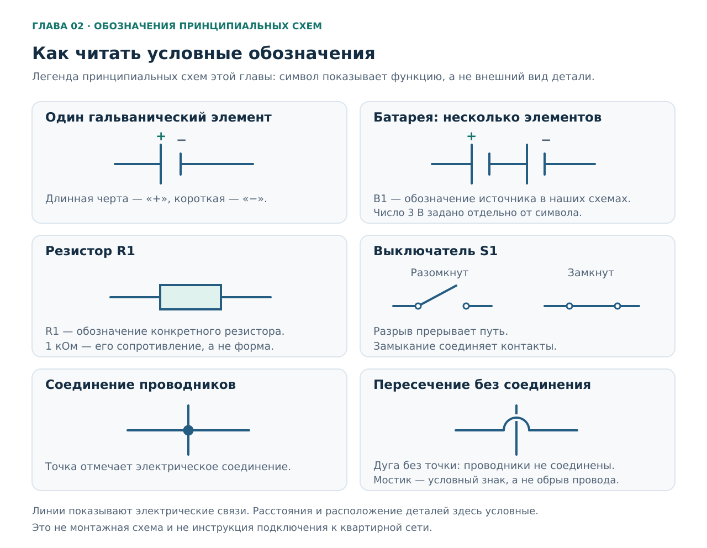
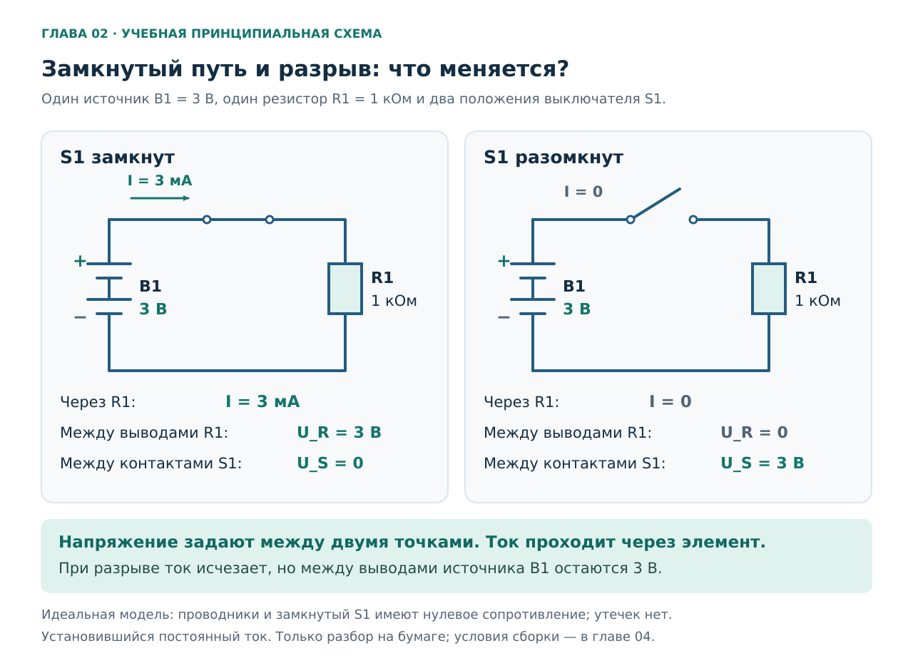
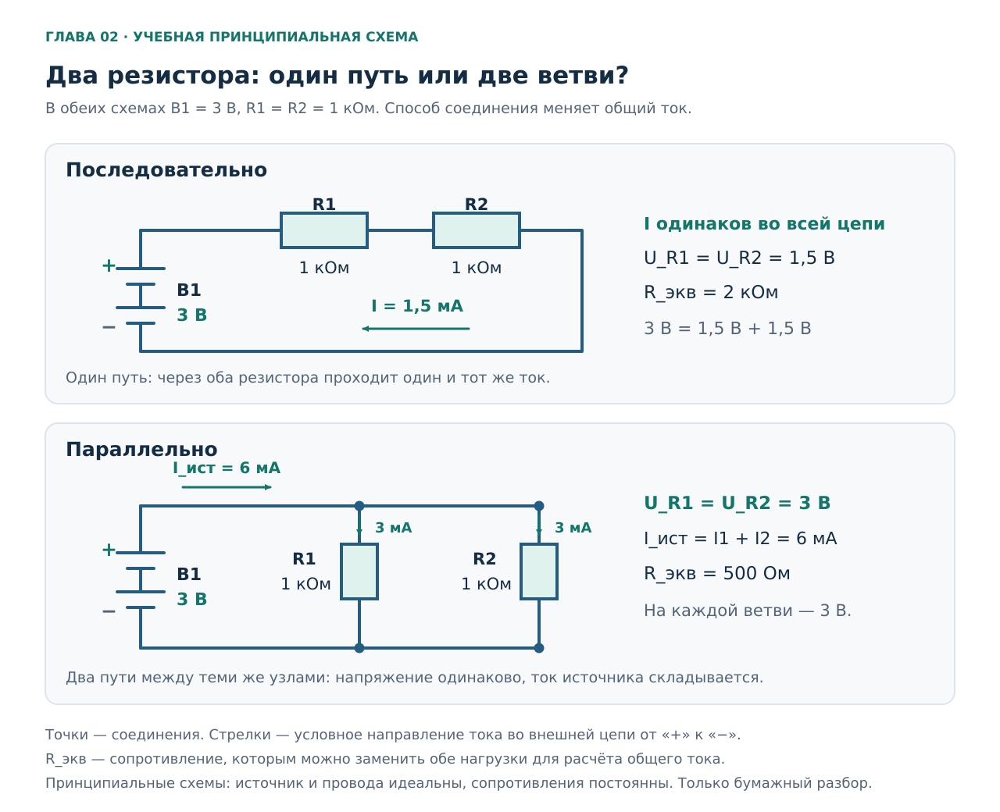
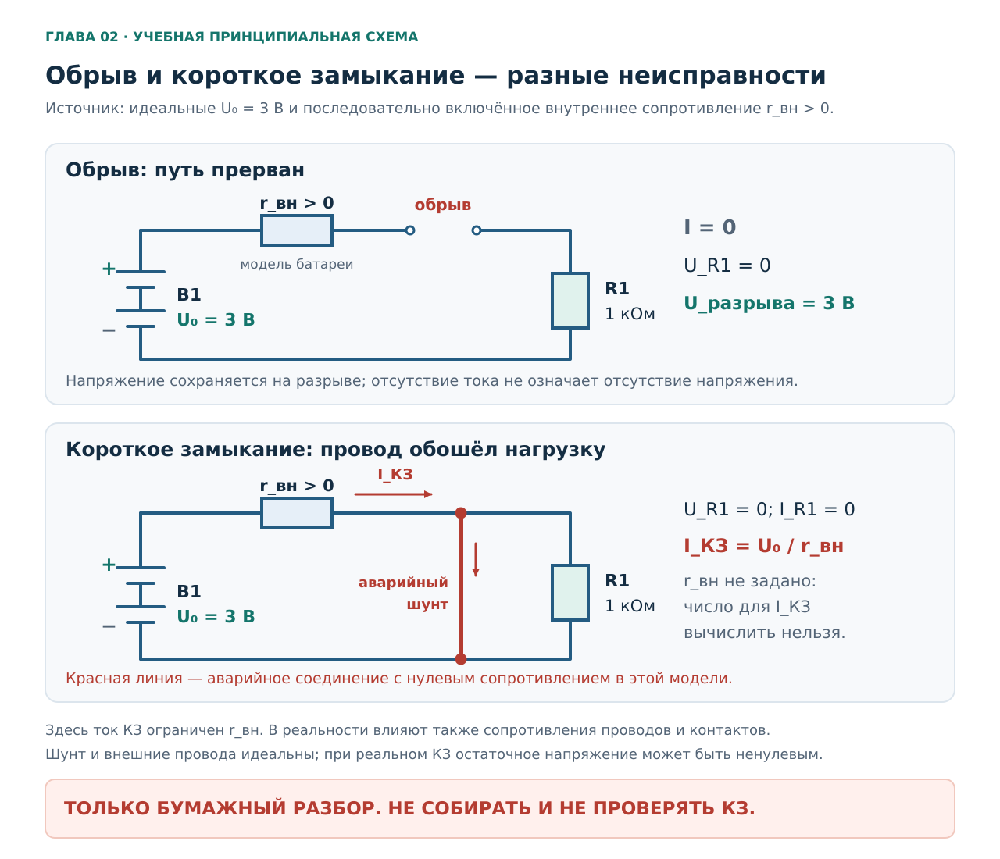
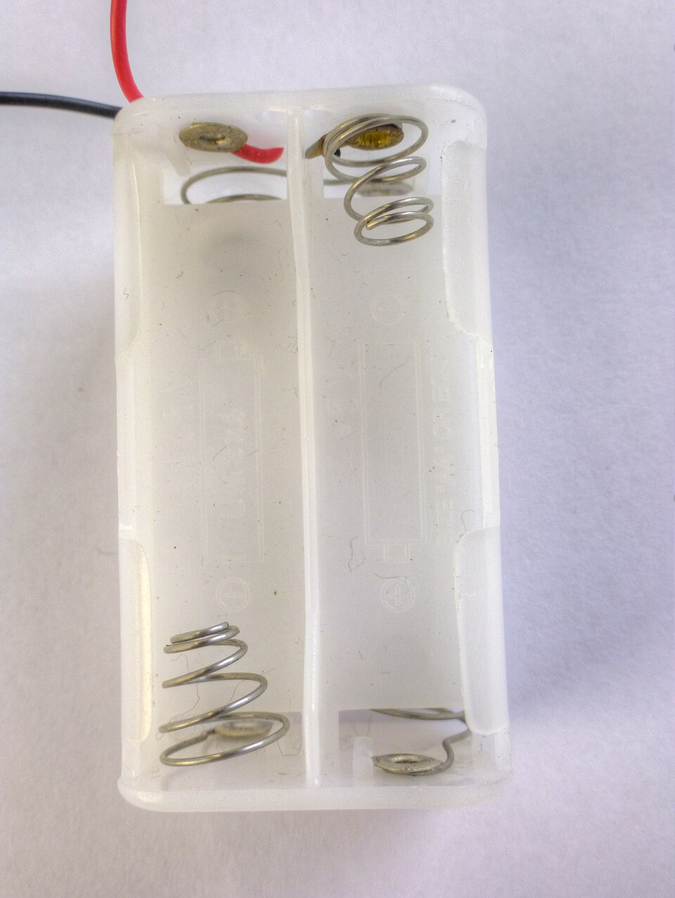
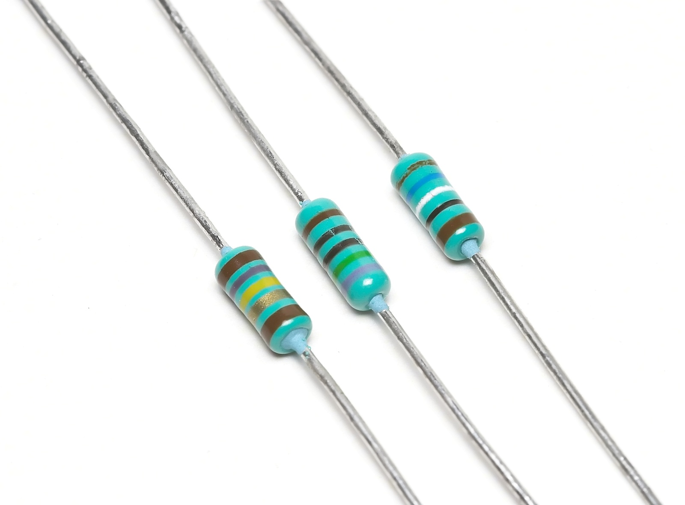

# Глава 02. Цепь, напряжение, ток и сопротивление

[Главная](../README.md) · [Карта курса](../ROADMAP.md) · [Прогресс](../PROGRESS.md) · [Все главы](README.md)

**Дата технической проверки:** 2026-11-06.  
**Нужная предыдущая глава:** [01 — Безопасность и устройство курса](01-safety.md).  
**Практика:** чтение фотографий, рисование схем и расчёты на бумаге.  
**Время:** примерно 35–50 минут на чтение и 30–45 минут на задания; можно разделить на два занятия.

## После главы ты сможешь

1. Найти источник, нагрузку и замкнутый путь на простой принципиальной схеме.
2. Объяснить напряжение **между двумя точками**, ток **через элемент** и сопротивление элемента.
3. Посчитать ток резистора по закону Ома и перевести амперы в миллиамперы, килоомы в омы.
4. Отличить последовательное соединение от параллельного и предсказать, что изменится при разрыве одной ветви.
5. Различить обрыв и короткое замыкание, не подменяя учебным расчётом проверку реального оборудования.

Понадобятся текст главы, бумага и калькулятор. Все численные значения здесь — **условия учебных моделей**, а не показания приборов. Сборка отдельного батарейного стенда начнётся в главе 04; измерения — в главе 05.

## 1. Бытовой вопрос: выключили фонарик — куда делось электричество?

Представь простой батарейный фонарик с механическим выключателем. Его выключили, свет погас. Батарейки при этом остались внутри.

Возникают три разных вопроса:

- Есть ли напряжение между выводами батарей?
- Проходит ли ток через лампу?
- Что изменил выключатель в соединениях?

Чтобы ответить, будем разбирать ещё более простую модель: источник **3 В**, выключатель и **резистор 1 кОм**. Резистор — деталь с заданным электрическим сопротивлением. Он не светится, зато позволяет начать с понятной зависимости тока от напряжения. У реального фонарика могут быть светодиод и электронный управляющий узел; их нельзя автоматически заменить одним постоянным сопротивлением.

В нашей модели выключатель разрывает единственный путь тока. Ток прекращается, но источник продолжает поддерживать напряжение между своими выводами. Именно это различие нужно понять до знакомства с мультиметром. Основа такого разбора — [ток в замкнутой цепи](https://openstax.org/books/university-physics-volume-2/pages/9-1-electrical-current) и [модель источника напряжения](https://openstax.org/books/university-physics-volume-2/pages/10-1-electromotive-force).

## 2. Из чего состоит цепь

**Электрическая цепь** — соединённые элементы, через которые может проходить электрический ток. В нашем первом примере у каждого элемента есть задача.

| Часть | Задача в учебной цепи | Пример |
|---|---|---|
| Источник | Поддерживать напряжение между выводами и передавать энергию подключённой нагрузке | Батарейный источник `B1` |
| Нагрузка | Преобразовывать полученную электрическую энергию | Резистор `R1`; позднее — лампа или другой прибор |
| Соединительные проводники | Соединять выводы элементов в нужном порядке | Провода, показанные линиями |
| Выключатель | Замыкать или размыкать предусмотренный участок пути | Контакт `S1` |

Батарея поддерживает разность потенциалов за счёт химических процессов; в нагрузке энергия преобразуется, например, в тепло. Это объясняет, зачем нужен источник, но пока не требует расчёта мощности. Мощность и энергия — тема главы 03. [OpenStax: источник и замкнутая цепь](https://openstax.org/books/university-physics-volume-2/pages/10-1-electromotive-force).

### Как проследить путь

На бумаге начни у плюса источника, пройди по соединительному проводнику, через замкнутый выключатель, через резистор и по обратному проводнику к минусу. Внешняя цепь соединяет оба вывода; внутри источника процессы переноса заряда завершают полный контур.

Если один из последовательных участков разорван, непрерывного пути через нагрузку нет. Если же соединить выводы источника почти без сопротивления нагрузки, путь будет замкнут, но получится аварийный режим. Поэтому **«есть замкнутый путь» ещё не означает «схема собрана правильно»**.

### Какие упрощения мы приняли

Основные схемы и расчёты этой главы используют следующие условия:

- Источник поддерживает ровно **3 В** между своими выводами, если в задании не указано другое значение.
- Проводники и замкнутый выключатель считаем идеальными: их сопротивление равно нулю.
- Резистор имеет указанное постоянное сопротивление; нагревом и допуском номинала пренебрегаем.
- Рассматриваем установившийся постоянный ток: краткие процессы сразу после переключения уже закончились.
- У разомкнутого выключателя нет проводящей перемычки или другого пути в обход контактов.

Это **расчётная модель**, а не перечень деталей для сборки. В разделе про короткое замыкание отдельно добавим внутреннее сопротивление источника: без него идеальная модель не позволяет описать аварийный ток.

## 3. Три величины: U, I и R

| Величина | Обозначение в курсе | Единица | Как правильно задать вопрос |
|---|---|---|---|
| Напряжение | `U` | вольт: `В`, международное `V` | Какое напряжение **между этими двумя точками**? |
| Сила тока; далее просто ток | `I` | ампер: `А`, международное `A` | Какой ток проходит **через этот элемент или ветвь**? |
| Электрическое сопротивление | `R` | ом: `Ом`, международное `Ω` | Какое сопротивление **у этого элемента в заданных условиях**? |

Названия единиц и приставки сверены по [брошюре SI BIPM, таблицам 2, 4 и 7](https://www.bipm.org/documents/20126/41483022/SI-Brochure-9.pdf). Латинская `U` обозначает величину; кириллическая `В` после числа — её единицу. В англоязычных учебниках напряжение часто обозначено `V`; физический смысл от выбора буквы не меняется.

### 3.1. Напряжение — между точками

**Напряжение — разность электрических потенциалов двух точек.** Потенциал связывает положение заряда в электрическом поле с его потенциальной энергией. Для первой цепи достаточно понимать: напряжение характеризует изменение энергии на единицу переносимого заряда. Один вольт соответствует одному джоулю на кулон: `1 В = 1 Дж/Кл`. Джоуль — единица энергии, кулон — единица заряда. Считать кулоны в бытовых заданиях этой главы не потребуется. [OpenStax: электрический потенциал и его разность](https://openstax.org/books/university-physics-volume-2/pages/7-2-electric-potential-and-potential-difference).

Фраза «на батарее 3 В» сокращает более точную: «между её плюсовым и минусовым выводами 3 В». А фраза «в проводе 3 В» неполна: относительно какой второй точки?

Внутри схемы можно условно принять потенциал минусового вывода за ноль. Тогда потенциал плюсового вывода идеального источника выше на 3 В. Выбор такого нуля — способ описания схемы. Он не означает соединения с землёй, защитным проводником или корпусом квартиры.

**Наличие напряжения не требует, чтобы через нагрузку уже шёл ток.** У отключённой от нагрузки батареи сохраняются два вывода и разность потенциалов между ними. Это пригодится при разборе открытого выключателя.

### 3.2. Ток — через элемент

Ток показывает, какой электрический заряд проходит через выбранное сечение проводника за единицу времени. Для постоянного тока можно записать:

`I = Q / t`, где `Q` — прошедший заряд, `t` — время.

`1 А = 1 Кл/с`. Ток — не скорость движения одного электрона и не количество «электричества, лежащего в проводе». [OpenStax: определение электрического тока](https://openstax.org/books/university-physics-volume-2/pages/9-1-electrical-current); [Fluke: ток и его единицы](https://www.fluke.com/en-us/learn/blog/electrical/what-is-current).

В установившейся цепи без разветвлений через все последовательные элементы проходит один и тот же ток. Если через резистор идёт 3 мА, то по проводу перед ним и по проводу после него тоже идут 3 мА. **Нагрузка преобразует энергию; заряд в ней не расходуется.** Иначе заряд непрерывно накапливался бы в одном месте, что не соответствует выбранному установившемуся режиму. [OpenStax: последовательная цепь](https://openstax.org/books/university-physics-volume-2/pages/10-2-resistors-in-series-and-parallel).

Стрелки на наших схемах показывают **условное направление тока**: во внешней цепи от плюса источника через нагрузку к минусу. Электроны в металлических проводах перемещаются в противоположную сторону. Для расчёта этих цепей пользуйся условным направлением последовательно; переворачивать все стрелки из-за электронов не нужно. [OpenStax: направление тока](https://openstax.org/books/university-physics-volume-2/pages/9-1-electrical-current).

### 3.3. Сопротивление — свойство элемента в определённых условиях

У двух резисторов при одинаковом напряжении могут быть разные токи. У резистора с большим сопротивлением ток меньше. Сопротивление измеряется в омах; `1 Ом = 1 В/А`.

У реального проводника сопротивление зависит от материала, размеров и температуры. У резистора значение тоже имеет допуск и может изменяться при нагреве. Поэтому надпись `1 кОм` — номинальное значение, а в учебном расчёте мы отдельно принимаем его равным ровно 1000 Ом. [Fluke: сопротивление и допуск](https://www.fluke.com/en-us/learn/blog/electrical/what-is-resistance); [OpenStax: физическое объяснение сопротивления](https://openstax.org/books/university-physics-volume-2/pages/9-3-resistivity-and-resistance).

Важно различать два слова:

- **Сопротивление** — физическая величина. Оно есть и у провода, и у контакта, хотя их обычно хотят сделать хорошо проводящими.
- **Резистор** — специально изготовленный компонент с заданными электрическими параметрами.

Малое сопротивление провода не превращает любой замкнутый контур в короткое замыкание: ток нормальной цепи ограничивает нагрузка. Опасная ситуация появляется, когда этот ограничивающий участок обходят или между точками с разными потенциалами возникает ненормальный путь с малым сопротивлением.

### 3.4. Единицы без ошибки в тысячу раз

| Запись | То же значение |
|---|---|
| `1 А` | `1000 мА` |
| `1 мА` | `0,001 А` |
| `3 мА` | `0,003 А` |
| `1 кОм` | `1000 Ом` |
| `2,2 кОм` | `2200 Ом` |
| `0,47 кОм` | `470 Ом` |

Приставка **милли-** означает тысячную долю, **кило-** — тысячу. Не теряй их при переписывании условия. Полезная проверка: `0,003 А` и `3 мА` должны описывать один результат, а не разные токи. В англоязычной маркировке встретятся `mA`, `kΩ` и точка вместо десятичной запятой. [BIPM: приставки SI](https://www.bipm.org/documents/20126/41483022/SI-Brochure-9.pdf).

### 3.5. Аналогия с водой — только первая подсказка

Можно мысленно сопоставить напряжение с **перепадом давления**, ток — с расходом воды, сопротивление — с трудностью прохождения потока через участок. Закрытый кран помогает представить разрыв: потока нет, а перепад давления может сохраняться.

На этом полезность аналогии ограничим. Электрический ток — перенос заряда, напряжение не является механическим давлением, а резистор не «съедает электроны». По водяной картинке нельзя выбирать электромонтаж, объяснять любую электронику или рассчитывать воздействие на человека. Дальше будем опираться на электрическую схему и формулы.

## 4. Читаем принципиальную схему

**Это таблица условных обозначений**, а не готовая цепь. На принципиальной схеме важны электрические связи. Длина нарисованной линии не задаёт длину провода, а положение элемента справа или слева не описывает его место на столе. Для реальной сборки дополнительно понадобятся монтажное представление и условия опыта из главы 04.

| Знак или надпись | Как читать |
|---|---|
| Пара параллельных линий разной длины | Элемент питания; длинная линия обозначает положительный вывод, короткая — отрицательный |
| Несколько таких пар | Батарея из нескольких элементов; в наших схемах источник помечен `B1` |
| Прямоугольник `R1` | Резистор; `1` отличает его от возможного `R2`, а значение сопротивления написано отдельно |
| Два контакта и подвижная черта `S1` | Выключатель: черта касается второго контакта — замкнут; не касается — разомкнут |
| Линия между выводами | Электрическое соединение |
| Закрашенная точка на соединении линий | Общий узел: эти проводники соединены |
| Пересечение с показанным обходом, без точки | Проводники проходят раздельно; электрического соединения нет |
| Стрелка `I` рядом с проводом | Выбранное направление тока; это не дополнительная деталь |

На наших рисунках соединения отмечены однозначно. Если на чужом рисунке пересечение неразборчиво, сначала уточни соединение: догадка о точке способна полностью изменить схему. Обозначения выше — легенда иллюстраций этого курса, а не полный справочник стандартов.

### Один выключатель — два состояния

**Принципиальные схемы постоянного тока.** В обеих источник `B1` идеальный, 3 В; сопротивление `R1` равно 1 кОм. Соединения идеальные. Рассматриваем установившееся состояние; схемы служат бумажному разбору.

Обозначение `U_R` означает напряжение **между двумя выводами резистора**, `U_S` — **между контактами выключателя**. Индекс сообщает, о каком элементе речь; `I` — ток единственного последовательного пути.

| Величина | `S1` замкнут | `S1` разомкнут |
|---|---|---|
| Напряжение между выводами источника | 3 В | 3 В |
| Ток через резистор | 3 мА | 0 А |
| Напряжение на резисторе `U_R` | 3 В | 0 В |
| Напряжение между контактами `S1`, `U_S` | 0 В | 3 В |

**Почему при открытом выключателе на резисторе ноль, а на разрыве 3 В?** Через резистор не проходит ток. В данной модели падение напряжения на нём равно `I × R = 0`. Значит, оба его вывода имеют одинаковый потенциал. Один контакт выключателя связан с плюсом источника, другой — через резистор с минусом. Между этими контактами остаётся напряжение источника.

Этот ответ относится к **конкретной схеме с одним разрывом и одним источником**. Если добавить ещё один разрыв, другую ветвь, конденсатор или второй источник, распределение напряжений нужно разбирать заново. Не делай из таблицы правило «на любом выключенном приборе везде ноль». Физическая основа — [закон Ома для резистора](https://openstax.org/books/university-physics-volume-2/pages/9-4-ohms-law) и [модель источника](https://openstax.org/books/university-physics-volume-2/pages/10-1-electromotive-force).

## 5. Закон Ома: считаем и проверяем смысл

Для **омического резистора с постоянным сопротивлением в заданных условиях** напряжение и ток связаны:

**`U = I × R`**

Отсюда:

- Если ищем ток: **`I = U / R`**.
- Если ищем сопротивление при ненулевом токе: **`R = U / I`**.
- Если ищем напряжение: **`U = I × R`**.

Здесь `U` — напряжение на рассматриваемом резисторе, `I` — ток через **этот же** резистор. Нельзя взять напряжение одного элемента и ток другой ветви просто потому, что оба числа известны. Три формы записи приведены у [Fluke](https://www.fluke.com/en-us/learn/blog/electrical/what-is-ohms-law); омическая модель и её ограничения разобраны в [OpenStax, § 9.4](https://openstax.org/books/university-physics-volume-2/pages/9-4-ohms-law).

### Пример 1. Сквозная задача главы

Выключатель замкнут. На резисторе 3 В, его сопротивление 1 кОм.

1. Переводим сопротивление: `1 кОм = 1000 Ом`.
2. Выбираем формулу: `I = U / R`.
3. Подставляем: `I = 3 В / 1000 Ом = 0,003 А`.
4. Переводим результат: `0,003 А = 3 мА`.
5. Проверяем обратной подстановкой: `0,003 А × 1000 Ом = 3 В`.

Ток через резистор — **3 мА**. Это же значение проходит через выключатель и оба соединительных участка в нашей цепи без разветвлений.

### Пример 2. Увеличили сопротивление

В той же модели заменили 1 кОм на 2 кОм, напряжение осталось 3 В:

`I = 3 В / 2000 Ом = 0,0015 А = 1,5 мА`.

Сопротивление удвоилось, ток уменьшился вдвое. Чтобы проверить направление изменения, калькулятор не нужен: при прежнем напряжении большему сопротивлению соответствует меньший ток.

### Пример 3. Изменили напряжение

Для другого бумажного условия возьмём 6 В на том же идеальном резисторе 1 кОм:

`I = 6 В / 1000 Ом = 0,006 А = 6 мА`.

Напряжение удвоилось, ток удвоился. Это изменение **условия задачи**. Оно не является разрешением менять питание будущего стенда без проверки допустимой мощности элементов.

### Пример 4. Нужно найти сопротивление

По условию на резисторе 3 В, через него проходят 2 мА:

`2 мА = 0,002 А`.

`R = 3 В / 0,002 А = 1500 Ом = 1,5 кОм`.

Типичная ошибка — разделить `3 / 2` и записать `1,5 Ом`. Число 2 было дано **в миллиамперах**. Результат `1,5 кОм` верен, а `1,5 Ом` меньше нужного в тысячу раз.

### Когда одной формулы недостаточно

Закон Ома с постоянным `R` описывает выбранную модель резистора. Он не означает, что любое устройство имеет одно неизменное сопротивление при любых условиях. У светодиода зависимость тока от напряжения нелинейна; у нити лампы сопротивление меняется с температурой. Даже обычный резистор нужно использовать в допустимом режиме. [OpenStax: омические и неомические элементы](https://openstax.org/books/university-physics-volume-2/pages/9-4-ohms-law).

Поэтому расчёт этой главы отвечает на вопрос «какой ток будет **в заданной модели**?». Для ответа «можно ли так подключить реальную деталь?» потребуются её параметры, допустимая мощность, условия нагрева и источник питания. До этих вопросов дойдём последовательно.

## 6. Две нагрузки: последовательно и параллельно

Две одинаковые детали можно соединить по-разному и получить разные токи. Поэтому начинать расчёт нужно со схемы соединений.

**Принципиальные схемы.** В обоих вариантах идеальный источник поддерживает 3 В, каждый резистор имеет сопротивление 1 кОм. Сопротивлением соединений пренебрегаем. Это сравнение двух учебных цепей, а не схема квартирной разводки.

### 6.1. Последовательно: один путь

При последовательном соединении ток проходит через `R1`, затем через `R2`; между ними нет ответвления. Эквивалентное сопротивление — сопротивление одного резистора, который дал бы источнику такой же ток при том же напряжении.

`R_экв = R1 + R2 = 1000 + 1000 = 2000 Ом`.

`I = 3 В / 2000 Ом = 1,5 мА`.

Через оба резистора идут **1,5 мА**. Напряжение источника распределяется между ними:

`U_R1 = 0,0015 А × 1000 Ом = 1,5 В`.

`U_R2 = 1,5 В`.

Проверка: `1,5 В + 1,5 В = 3 В`. Напряжения одинаковы здесь потому, что одинаковы сопротивления. Для разных последовательных сопротивлений одинаковым останется ток, а напряжения будут различаться.

Если в единственном пути появляется обрыв, ток прекращается через обе нагрузки. Правила последовательного соединения: [OpenStax, § 10.2](https://openstax.org/books/university-physics-volume-2/pages/10-2-resistors-in-series-and-parallel).

### 6.2. Параллельно: отдельные пути между общими узлами

У параллельных резисторов первые выводы соединены с одним общим узлом, вторые — с другим. **Узел** — место электрического соединения проводников; соединённые идеальным проводом участки относятся к одному электрическому узлу, даже если на рисунке они далеко друг от друга. **Ветвь** — отдельный путь между узлами; здесь каждая ветвь содержит свой резистор.

Оба резистора подключены к одной и той же паре выводов источника, поэтому на каждом **3 В**:

`I1 = 3 В / 1000 Ом = 3 мА`.

`I2 = 3 В / 1000 Ом = 3 мА`.

Ток общего участка равен сумме токов ветвей:

`I_ист = I1 + I2 = 6 мА`.

Для источника такое соединение эквивалентно:

`R_экв = U / I_ист = 3 В / 0,006 А = 500 Ом`.

Общее сопротивление стало **меньше каждого отдельного**: добавился второй проводящий путь. Общая формула для параллельных резисторов — `1/R_экв = 1/R1 + 1/R2`. Пока можно обходиться расчётом токов ветвей и их суммы. [OpenStax: параллельное соединение](https://openstax.org/books/university-physics-volume-2/pages/10-2-resistors-in-series-and-parallel).

### 6.3. Ток идёт не только по «самому лёгкому» пути

Пусть в параллельной схеме `R1 = 1 кОм`, а `R2 = 2 кОм`. На обоих по-прежнему 3 В:

`I1 = 3 мА`, `I2 = 1,5 мА`, `I_ист = 4,5 мА`.

Обе ветви проводят ток. В ветви с меньшим сопротивлением он больше, но вторая ветвь не исчезает из схемы. Фраза «весь ток выбирает путь наименьшего сопротивления» дала бы здесь неверный ответ.

Если разорвать только ветвь `R2`, через неё станет идти 0 А. Ветвь `R1` сохранит замкнутый путь и ток 3 мА, а общий ток уменьшится до 3 мА. Это верно при нашем условии: **источник продолжает поддерживать 3 В**. У реального источника изменение общей нагрузки может изменить и напряжение на выводах; к этому ограничению вернёмся ниже.

### Полезное сравнение

| Вопрос | Последовательно | Параллельно |
|---|---|---|
| Что одинаково у элементов? | Ток | Напряжение между общими узлами |
| Что складывается? | Сопротивления; падения напряжения | Токи ветвей; обратные сопротивления |
| Добавили ещё один резистор тем же способом, источник прежний | Общее сопротивление выросло, ток уменьшился | Общее сопротивление уменьшилось, общий ток вырос |
| Разорвали один из путей через резистор | Прервали единственный путь всей цепи | Отключили одну ветвь, если остальные пути и общий источник сохранены |

Это первый шаг к пониманию нескольких нагрузок на одном питании. Назначение проводников квартирной сети и реальные электрические группы будем разбирать в главах 06–07.

## 7. Обрыв и короткое замыкание — противоположные изменения пути

**Принципиальные схемы для анализа неисправностей на бумаге.** Сверху — разомкнутый путь. Снизу — аварийная перемычка параллельно резистору. В обеих схемах источник описан более подробно: напряжение без нагрузки `U₀ = 3 В` и внутреннее сопротивление `r_вн > 0`. Перемычка показана как неисправность; собирать её для проверки не нужно.

### 7.1. Обрыв: нужного пути нет

Обрыв — прекращение предусмотренного электрического соединения. В одной последовательной цепи он останавливает установившийся ток через нагрузку. Обрыв может быть намеренным — например, открытый выключатель — или вызванным неисправностью.

Напряжение источника при этом не обязано исчезать. В нашем примере с единственным разрывом на нём сохраняются 3 В. По отсутствию работы нагрузки нельзя отличить штатное выключение от повреждения и нельзя сделать общий вывод об отсутствии напряжения.

### 7.2. Короткое замыкание: появился нежелательный путь с малым сопротивлением

Теперь мысленно соединим два вывода резистора дополнительным идеальным проводом. Это **шунт** — параллельный обход элемента. В нашей цепи он фактически замыкает внешние выводы источника, обходя единственную нагрузку, ограничивавшую ток.

Если шунт идеальный, оба вывода резистора относятся к одному узлу: `U_R = 0`, следовательно, `I_R = 0`. Однако ток источника не равен нулю: он проходит через аварийный обход. У реальной перемычки сопротивление ненулевое, поэтому остаточное напряжение на резисторе и ток через него могут быть ненулевыми. **Нулевой ток одной нагрузки не описывает все остальные пути цепи.**

Обход выключателя и обход резистора — тоже разные изменения. Перемычка только через открытый выключатель восстановила бы обычный путь через резистор; это не то же самое, что замкнуть оба вывода источника. Такое различие изучаем по рисунку, без изготовления перемычек.

### 7.3. Почему нельзя ответить «3 В / 0 Ом = бесконечный ток»

Идеальный источник без внутреннего сопротивления и идеальный провод непосредственно между его выводами — несовместимые условия для обычного установившегося расчёта: источник требует 3 В, провод требует нулевую разность потенциалов. Деление на ноль не даёт пригодного физического ответа.

Чтобы объяснить реальную батарею, используют приближение: идеальный источник последовательно с **внутренним сопротивлением**. Обозначим напряжение без нагрузки `U₀`, внутреннее сопротивление — `r_вн`, суммарное сопротивление внешнего пути — `R_внеш`.

`I = U₀ / (r_вн + R_внеш)`.

На нижней схеме провода и шунт идеальные, поэтому внешний путь имеет нулевое сопротивление и модель даёт `I_КЗ = U₀ / r_вн`. Числа для `r_вн` у нас нет, поэтому **численный ток короткого замыкания не определён**. В реальности на него влияют также проводники, контакты, состояние батареи и изменение её параметров во времени. Если источник имеет электронное ограничение или защиту, нужно учитывать и их работу.

Это объяснение следует из [модели источника с внутренним сопротивлением в OpenStax, § 10.1](https://openstax.org/books/university-physics-volume-2/pages/10-1-electromotive-force). Оно не является способом проверять батарейку коротким замыканием. Сильный нагрев возможен и у низковольтных источников при замыкании; общие риски описывает [HSE](https://www.hse.gov.uk/electricity/injuries.htm).

### 7.4. Что будет отличаться в настоящем опыте

Когда дойдём до стенда, источник не обязан давать ровно 3,000 В при любой нагрузке. У деталей будут допуски, у соединений — небольшое сопротивление, у измерений — погрешность. Поэтому небольшое отличие результата от идеального расчёта ещё не доказывает ошибку закона Ома или поломку прибора.

В главе 04 зададим конкретную конструкцию, а в главе 05 — процедуру измерения и способ объяснять отклонения. Сейчас наша задача — уверенно посчитать идеальную модель и назвать её ограничения. Если бумажный ответ получился неожиданным, сначала проверь схему, единицы и арифметику; физический эксперимент для исправления расчёта не требуется.

## 8. Как элементы выглядят в жизни

### 8.1. Держатель двух элементов AA

**Что рассмотреть:** два места под элементы питания, пружинные и плоские контакты, два выходящих провода. **Держатель сам напряжение не создаёт:** это механическое крепление и электрические контакты. В модели источник появляется вместе с установленными и соединёнными элементами; надпись «3 В» в нашей задаче задаётся условием, а не одним внешним видом держателя.

Фото помогает узнать предмет. По нему нельзя подтвердить качество контактов, фактическую полярность внешних проводов, напряжение или пригодность держателя для будущего опыта. Цвет проводов сам по себе не считается проверкой полярности. Это не рекомендуемая модель для покупки и не образец подтверждённой исправности.

Фото **© Nevit Dilmen**, 2014, [Wikimedia Commons](https://commons.wikimedia.org/wiki/File:Battery_holder_box_2xAA_3V_1480283_4_5_HDR_Enhancer.jpg), [CC BY-SA 3.0](https://creativecommons.org/licenses/by-sa/3.0/). Использована уменьшенная версия 960 × 1276; при подготовке курса дополнительных изменений нет.

### 8.2. Выводные резисторы

**Что рассмотреть:** корпус каждой детали расположен между двумя металлическими выводами; на корпусах есть цветовые полосы. На принципиальной схеме такой компонент представлен прямоугольником `R1`, а не реалистичной картинкой.

Значение **1 кОм** относится к нашей учебной схеме; мы не утверждаем, что все резисторы на фотографии имеют такой номинал. Для выбора настоящей детали нужно прочитать её маркировку и характеристики; идентификацию подготовим вместе со стендом. Фото не заменяет проверку сопротивления по процедуре главы 05 и не устанавливает допустимый режим работы.

Фото **Afrank99**, 2005-07-16, [Wikimedia Commons](https://commons.wikimedia.org/wiki/File:3_Resistors.jpg), [CC BY-SA 2.5](https://creativecommons.org/licenses/by-sa/2.5/). Оригинал 1600 × 1182, без изменений. Полные сведения об обоих изображениях — в [ATTRIBUTION.md](../assets/ATTRIBUTION.md).

## 9. Практика: четыре упражнения

Все задания выполняются по материалам главы. Реальные источники и приборы не нужны. Сначала запиши свой ответ, потом открывай разбор; в ответе оставляй не только число, но и единицу с объяснением.

### Упражнение A. Дорисуй цепь и объясни выключатель

**Цель:** прочитать соединения и различить напряжение и ток.  
**Понадобится:** бумага, карандаш и схема из раздела 4.  
**Исходные условия:** только рисунок; идеальный источник 3 В, `R1 = 1 кОм`, один выключатель, никаких дополнительных путей.  
**Когда остановиться:** если не можешь однозначно назвать выводы или понять знак выключателя, вернись к легенде; не заменяй рисунок сборкой.

1. Перерисуй источник, выключатель и резистор, оставив пока неподключённым один вывод резистора.
2. Дорисуй проводник так, чтобы при замыкании `S1` получился путь через резистор от плюса к минусу без обхода нагрузки.
3. Покажи стрелкой условное направление тока при замкнутом `S1`.
4. Заполни две строки: для замкнутого и разомкнутого `S1` запиши `I`, `U_R`, `U_S` и напряжение источника.
5. Одним предложением объясни, почему «тока нет» не означает «напряжения нет».

**Ожидаемый результат:** замкнутый маршрут через нагрузку, правильная стрелка и две строки с величинами. Рисунок подтверждает понимание этой схемы, но не готовность к монтажу реальной цепи.

Разбор упражнения A

Проводники должны соединять источник, `S1` и `R1` последовательно в один контур. У резистора не должно появиться параллельного провода. Во внешней цепи стрелка направлена от плюса через выключатель и резистор к минусу; порядок этих двух последовательных элементов можно поменять, если соединения остаются теми же по смыслу.

| `S1` | `I` | `U_R` | `U_S` | Напряжение источника |
|---|---|---|---|---|
| Замкнут | 3 мА | 3 В | 0 В | 3 В |
| Разомкнут | 0 А | 0 В | 3 В | 3 В |

Пример фразы: «В нашей разомкнутой цепи через резистор нет тока, но между выводами источника и между контактами единственного разрыва остаются 3 В».

Если при закрытом выключателе получилось `U_S = 3 В`, проверь, не перепутал ли ты напряжение **между контактами** с потенциалом каждого контакта относительно минуса. Идеально соединённые контакты находятся при одном потенциале, поэтому разность между ними нулевая.

### Упражнение B. Шесть расчётов

**Цель:** выбрать формулу и не потерять приставки единиц.  
**Понадобится:** бумага и калькулятор.  
**Исходные условия:** в каждой строке отдельный идеальный омический резистор; напряжение указано именно на нём. Строки не являются вариантами сборки стенда.  
**Когда остановиться:** если неясно, чему соответствует величина или как перевести единицу, вернись к разделам 3.4 и 5; значение не угадывай.

1. Для каждой строки выпиши известные величины.
2. Переведи сопротивления в омы, токи — в амперы.
3. Найди неизвестное. Ток запиши и в амперах, и в миллиамперах.
4. Проверь результат обратной подстановкой или сравнением с соседней строкой.

| № | Напряжение `U` | Сопротивление `R` | Ток `I` | Что найти |
|---|---|---|---|---|
| B1 | 3 В | 1 кОм | ? | Ток |
| B2 | 3 В | 2 кОм | ? | Ток |
| B3 | 3 В | 470 Ом | ? | Ток, округлить до сотых мА |
| B4 | 6 В | 2 кОм | ? | Ток |
| B5 | 3 В | ? | 2 мА | Сопротивление |
| B6 | ? | 1 кОм | 5 мА | Напряжение |

**Ожидаемый результат:** шесть решений с единицами. Число в таблице описывает модель, но не устанавливает допустимую мощность настоящего резистора.

Разбор упражнения B

| № | Расчёт | Ответ |
|---|---|---|
| B1 | `3 / 1000` | `0,003 А = 3 мА` |
| B2 | `3 / 2000` | `0,0015 А = 1,5 мА` |
| B3 | `3 / 470` | примерно `0,006383 А = 6,38 мА` |
| B4 | `6 / 2000` | `0,003 А = 3 мА` |
| B5 | `3 / 0,002` | `1500 Ом = 1,5 кОм` |
| B6 | `0,005 × 1000` | `5 В` |

У B2 сопротивление вдвое больше, чем у B1, поэтому при тех же 3 В ток вдвое меньше. В B4 по сравнению с B1 удвоены и напряжение, и сопротивление; отношение `U/R` осталось прежним. В B3 сопротивление меньше 1 кОм, поэтому ток должен быть больше 3 мА: это быстрая проверка порядка величины.

Результат B3 округлён только в конце расчёта. Ответ «6,38 А» означал бы ошибку перевода в тысячу раз. Если получил странный результат, проверь исходные единицы до изменения самих чисел условия.

### Упражнение C. Разветвление и один разрыв

**Цель:** определить, где ток общий, а где ток отдельной ветви.  
**Понадобится:** схема раздела 6 и калькулятор.  
**Исходные условия:** только бумажная модель; идеальный источник неизменно поддерживает 3 В; `R1 = 1 кОм`, `R2 = 2 кОм`; провода идеальные.  
**Когда остановиться:** если неизвестно, какие выводы соединены с общими узлами, сначала перерисуй их по схеме. До вычислений обозначь обе ветви.

1. Соедини резисторы на рисунке последовательно. Найди общий ток и напряжение на каждом резисторе.
2. Соедини те же резисторы на другом рисунке параллельно. Найди ток каждой ветви, общий ток и эквивалентное сопротивление.
3. В параллельном варианте обозначь обрыв только ветви `R2`. Запиши новые токи.
4. Сравни результат с обрывом общего провода между источником и разветвлением.
5. Объясни, почему в исходном параллельном варианте неверно утверждать, что ток проходит только через `R1`.

**Ожидаемый результат:** две схемы и четыре состояния с объяснением. Слова «вторая ветвь продолжает работать» должны сопровождаться условием сохранённого общего питания.

Разбор упражнения C

**Последовательно.** `R_экв = 1000 + 2000 = 3000 Ом`, `I = 3 / 3000 = 0,001 А = 1 мА`. На `R1`: `0,001 × 1000 = 1 В`; на `R2`: `0,001 × 2000 = 2 В`. Сумма напряжений — 3 В; ток одинаков.

**Параллельно.** На обоих резисторах 3 В. `I1 = 3 мА`, `I2 = 1,5 мА`; `I_ист = 4,5 мА`. `R_экв = 3 / 0,0045 ≈ 666,7 Ом`. Это меньше 1000 Ом, то есть меньше сопротивления любой отдельной ветви, как и должно быть.

**Обрыв только ветви `R2`.** `I2 = 0`, `I1 = 3 мА`, `I_ист = 3 мА`. Ветвь `R1` всё ещё подключена к источнику 3 В. Напряжение между общими узлами не исчезло.

**Обрыв общего провода.** Полные пути от источника через обе ветви прерваны: `I1 = I2 = I_ист = 0`. Между собственными выводами источника сохраняются 3 В. Место разрыва принципиально меняет результат.

Через `R2` до разрыва шли 1,5 мА, поскольку на его конечном сопротивлении было 3 В. Соседняя ветвь с меньшим сопротивлением не отменяет этого напряжения. Это и опровергает правило о «единственном самом лёгком пути».

### Упражнение D. Узнай элемент и отдели факт от вывода

**Цель:** связать фотографию со схемой и различить неисправности по соединениям.  
**Понадобится:** обе фотографии раздела 8, схема раздела 7, бумага.  
**Исходные условия:** используем только изображения и заданную модель. Реальные детали не подключаем и не разбираем.  
**Когда остановиться:** если для ответа хочется замкнуть источник, «попробовать на искру» или проверить сопротивление случайного прибора, вернись к рисунку; таких действий в задании нет.

1. Для каждой фотографии назови видимый предмет, две видимые детали и один параметр, который фото не подтверждает.
2. Объясни, какой части схемы соответствует резистор и почему пустой держатель не равен готовому источнику 3 В.
3. Разбери четыре изменения начальной цепи `B1 — S1 — R1`: открыли `S1`; оборвали обратный провод; добавили идеальный провод параллельно `R1` при закрытом `S1`; заменили `R1` с 1 кОм на 2 кОм.
4. Для каждого изменения напиши: обрыв, короткое замыкание в данной цепи или обычное изменение нагрузки. Укажи, можно ли получить численный ток из имеющихся данных.

**Ожидаемый результат:** две строки наблюдений и четыре классификации с пределом вывода. Пример с коротким замыканием требует ответа «численный ток не определён», если внутреннее сопротивление не задано.

Разбор упражнения D

| Фото | Два наблюдения | Что не подтверждено |
|---|---|---|
| Держатель AA | Есть два посадочных места; видны пружинные контакты и внешние провода | Напряжение установленного источника, качество контактов и фактическая полярность внешних проводов |
| Резисторы | На корпусах есть цветные полосы; у каждой детали два металлических вывода | Что любая из деталей имеет ровно 1 кОм и подходит для выбранного режима |

На схеме `R1` обозначает резистор. Пустой держатель обеспечивает крепление и соединения, но не содержит элементов питания; подставлять ему 3 В из заголовка фотографии нельзя.

| Изменение | Классификация | Ток и объяснение |
|---|---|---|
| Открыли `S1` | Разрыв единственного пути | `I = 0`; напряжение источника сохраняется |
| Оборвали обратный провод | Обрыв | `I = 0`; обратный участок так же необходим, как провод от плюса |
| Добавили идеальный обход `R1` при закрытом `S1` | Короткое замыкание источника в этой схеме | `I_R = 0`, но есть аварийный ток обхода. Его численное значение неизвестно без параметров источника; модель идеального источника здесь нужно уточнить |
| Заменили 1 кОм на 2 кОм | Обычное изменение нагрузки модели | `I = 1,5 мА` при сохранённых 3 В; это не обрыв и не КЗ |

При реальном повреждении не нужно воспроизводить ситуацию, чтобы выбрать действие. Используется граница практики и памятка из [главы 01](01-safety.md#7-если-обнаружил-опасную-ситуацию), а не аварийная перемычка из учебной картинки.

## 10. Частые ошибки

| Ошибка | В чём проблема | Как себя проверить |
|---|---|---|
| «Через провод течёт 3 вольта» | Смешаны напряжение и ток | Назови пару точек для `U`; для `I` укажи провод или элемент |
| «Резистор забрал часть тока» | Перенос заряда перепутан с преобразованием энергии | Сравни ток до и после резистора в одной последовательной цепи: они равны |
| «Выключили — везде ноль» | Отсутствие тока перенесено на все напряжения | Отдельно назови напряжение источника и напряжение на конкретной нагрузке |
| «На каждом из двух последовательных резисторов по 3 В» | Напряжение всего участка ошибочно приписано каждому элементу | Сложи падения напряжения; при одном источнике 3 В и наших условиях сумма должна быть 3 В |
| «Параллельно добавил нагрузку — общий ток уменьшился» | Взято правило последовательного соединения | При прежнем напряжении посчитай ток новой ветви и добавь к прежнему общему току |
| «Весь ток идёт по меньшему сопротивлению» | Вторая конечная ветвь необоснованно исключена | Рассчитай её ток по её напряжению и сопротивлению |
| «3 / 1 = 3 А, ведь резистор 1 кОм» | Потеряна приставка кило- | Сначала запиши 1000 Ом; результат должен быть 0,003 А |
| «КЗ — это просто очень большой конечный ток, число можно угадать» | Не заданы параметры источника и аварийного пути | Назови недостающие сопротивления и ограничения; не заменяй их экспериментом |
| «На фото подходящая деталь, значит можно сразу собирать» | Внешний вид заменил параметры и условия опыта | Сверь номинал, характеристики и полную инструкцию будущего стенда |

## 11. Самопроверка

Ответь без просмотра решений. Здесь важнее объяснение, чем заученное обозначение.

1. Чем отличаются вопросы «какое напряжение на резисторе?» и «какой ток через резистор?» Какие точки или элементы нужно указать?
2. Известно только, что между выводами источника 3 В. Можно ли определить ток нагрузки? Каких данных не хватает?
3. В основной схеме `S1` открыт. Каковы `I`, `U_R` и `U_S`? Почему ненулевое `U_S` не противоречит нулевому току?
4. Переведи `0,004 А` в миллиамперы, а `4,7 кОм` в омы. Какой ток будет через 1,5 кОм при напряжении 3 В на этом резисторе?
5. Два одинаковых резистора 1 кОм соединены последовательно с источником 3 В. Какой ток через каждый и почему он не уменьшается после первого?
6. Ветви 1 кОм и 2 кОм подключены параллельно к идеальному источнику 3 В. В какой ветви ток больше? Останется ли ток в первой, если разорвать только вторую?
7. Резистор зашунтирован идеальным проводом, а у источника показано внутреннее сопротивление без численного значения. Можно ли сказать «ток всей цепи ноль, потому что на резисторе ноль вольт» или вычислить ток КЗ численно?
8. На фотографии пустой держатель, в названии исходного снимка есть «3V». Доказывает ли это наличие 3 В на его проводах и готовность будущего стенда к подключению?

Ответы с объяснениями

**1.** Напряжение задаётся между двумя выводами резистора, ток — через резистор. Это разные величины и разные единицы: вольты и амперы. Одного указания «в этой точке» для напряжения недостаточно без второй точки отсчёта.

**2.** Нет. Нужны схема соединений, состояние пути и свойства нагрузки. При единственном разрыве в нашей модели ток равен нулю; при закрытой цепи с 1 кОм он равен 3 мА; с 2 кОм — 1,5 мА. Одно и то же напряжение совместимо с разными токами.

**3.** `I = 0`, `U_R = 0`, `U_S = 3 В`. Через разомкнутые контакты нет проводящего пути, но они связаны с разными полюсами источника через оставшиеся элементы. Напряжение характеризует разность потенциалов, поэтому может существовать без установившегося тока через разрыв.

**4.** `0,004 А = 4 мА`; `4,7 кОм = 4700 Ом`. Для задачи: `I = 3 / 1500 = 0,002 А = 2 мА`.

**5.** Общие 2 кОм дают `I = 3 / 2000 = 1,5 мА` через каждый резистор. Заряд не расходуется внутри нагрузки; в установившейся последовательной цепи нет места для постоянного накопления разницы токов. На каждом резисторе при этом по 1,5 В.

**6.** В первой ветви 3 мА, во второй 1,5 мА. При разрыве только второй ветви первая сохраняет 3 мА, если её соединения целы и источник по-прежнему держит 3 В. Общий ток уменьшится с 4,5 до 3 мА.

**7.** Оба вывода неверны. Ноль вольт на резисторе даёт нулевой ток **через него**, но ток проходит через шунт. В модели с идеальным внешним обходом `I_КЗ = U₀/r_вн`; без значения `r_вн` численного ответа нет. Проверять эту недостающую величину замыканием батареи не является заданием.

**8.** Нет. Держатель пуст, а число в названии фотографии не является показанием прибора. Для стенда нужны выбранные элементы питания, подтверждённая схема соединений, подходящие компоненты и ограничение тока по инструкции главы 04. Сейчас фото помогает узнать предмет и отделить видимое от предполагаемого.

## 12. Готовность двигаться дальше

Переходи к главе 03, когда можешь:

- показать на схеме полный путь тока и объяснить роль обратного проводника;
- задать напряжение между двумя точками и ток через выбранный элемент;
- получить `3 мА` из `3 В / 1 кОм`, сохранив единицы;
- объяснить нулевой ток при открытом `S1` вместе с ненулевым напряжением между его контактами;
- различить общий ток и токи параллельных ветвей;
- узнать обрыв и шунт на рисунке и назвать границы идеальной модели.

Если путаются единицы — повтори раздел 3.4 и упражнение B. Если непонятно распределение тока — раздел 6 и упражнение C. Если напряжение кажется невозможным без тока — вернись к двум состояниям `S1` в разделе 4.

Для обратной связи достаточно прислать таблицу упражнения A, шесть ответов B, расчёт C и наблюдения D. Выполнение отмечается в [PROGRESS.md](../PROGRESS.md) только после твоего сообщения; наличие готовой главы не означает, что практика уже пройдена.

В следующей главе добавим **мощность и энергию**: почему один и тот же ток имеет разные последствия при разном сопротивлении участка, чем ватты отличаются от киловатт-часов и что расчёт нагрузки позволяет узнать о бытовой ситуации.

## Источники и пределы применения

Все ссылки ниже просмотрены **2026-11-06**. Это источники физических определений и учебных моделей. Глава не устанавливает монтажных требований РФ, не выбирает сечения кабелей и не рассчитывает защиту квартиры. Собственные примеры и SVG подготовлены для курса; численные условия не являются данными реальной установки.

Для разделов OpenStax использован исходный учебник **Samuel J. Ling, William Moebs, Jeff Sanny, University Physics Volume 2**, OpenStax / Rice University; дата публикации книги — **2016-10-06**. Отдельная дата последнего технического пересмотра каждого веб-раздела не указана. Английское обозначение напряжения `V` в курсе заменено привычным `U`; примеры и иллюстрации учебника не копируются.

| Источник | Проверенная часть и применение |
|---|---|
| [BIPM, The International System of Units](https://www.bipm.org/documents/20126/41483022/SI-Brochure-9.pdf) | 9-е изд., 2019; версия **4.01, июнь 2026**. Раздел 2.3, таблицы 2, 4 и 7: ампер, вольт, ом и приставки. Это документ о единицах, не о правилах монтажа |
| [OpenStax, 7.2 Electric Potential and Potential Difference](https://openstax.org/books/university-physics-volume-2/pages/7-2-electric-potential-and-potential-difference) | Напряжение между точками, энергия на единицу заряда, условность выбора нуля потенциала |
| [OpenStax, 9.1 Electrical Current](https://openstax.org/books/university-physics-volume-2/pages/9-1-electrical-current) | Определение тока, замкнутый путь и условное направление. Бытовые номиналы из зарубежных примеров не переносятся в курс |
| [OpenStax, 9.3 Resistivity and Resistance](https://openstax.org/books/university-physics-volume-2/pages/9-3-resistivity-and-resistance) | Сопротивление, материал, размеры и температура; без подбора проводки |
| [OpenStax, 9.4 Ohm’s Law](https://openstax.org/books/university-physics-volume-2/pages/9-4-ohms-law) | `U = IR`, омическое поведение и ограничения постоянного сопротивления; пример 9.8 — влияние температуры |
| [OpenStax, 10.2 Resistors in Series and Parallel](https://openstax.org/books/university-physics-volume-2/pages/10-2-resistors-in-series-and-parallel) | Равенство токов последовательной цепи, общие напряжения параллельных ветвей и эквивалентное сопротивление |
| [OpenStax, 10.1 Electromotive Force](https://openstax.org/books/university-physics-volume-2/pages/10-1-electromotive-force) | Идеальный источник и внутреннее сопротивление. Выражение для КЗ — следствие упрощённой модели, не паспорт конкретной батареи |
| [Fluke: ток](https://www.fluke.com/en-us/learn/blog/electrical/what-is-current), [сопротивление](https://www.fluke.com/en-us/learn/blog/electrical/what-is-resistance), [закон Ома](https://www.fluke.com/en-us/learn/blog/electrical/what-is-ohms-law) | Обозначения, единицы, допуск сопротивления и перестановки формулы. Явные даты редакций не указаны; рекомендации по сетевым измерениям из этих страниц не являются упражнениями главы |
| [HSE, Electrical injuries](https://www.hse.gov.uk/electricity/injuries.htm) | Тепловая опасность короткого замыкания батарей. Дата редакции не указана; это объяснение риска, а не российский нормативный документ |

Фотографии, авторы, лицензии и сведения об изменениях перечислены под изображениями и в [ATTRIBUTION.md](../assets/ATTRIBUTION.md). Общий реестр дополнен в [SOURCES.md](../references/SOURCES.md).

## Навигация

**Предыдущая глава:** [01 — Безопасность и устройство курса](01-safety.md).  
**Следующая глава:** [03 — Мощность, энергия и нагрев](03-power-energy.md). Актуальные статусы текстов и практики — в [PROGRESS.md](../PROGRESS.md).
