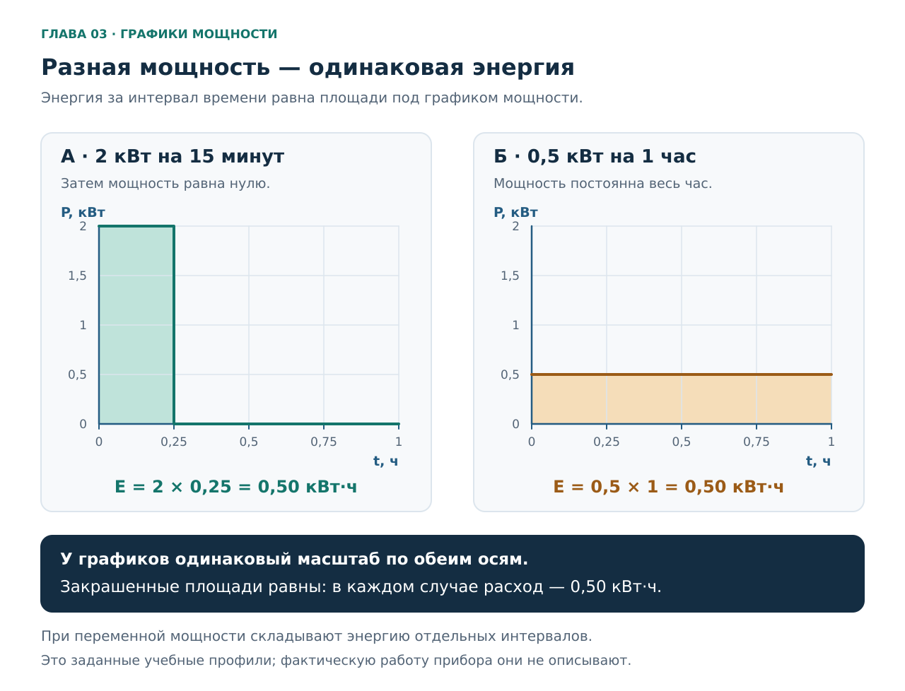
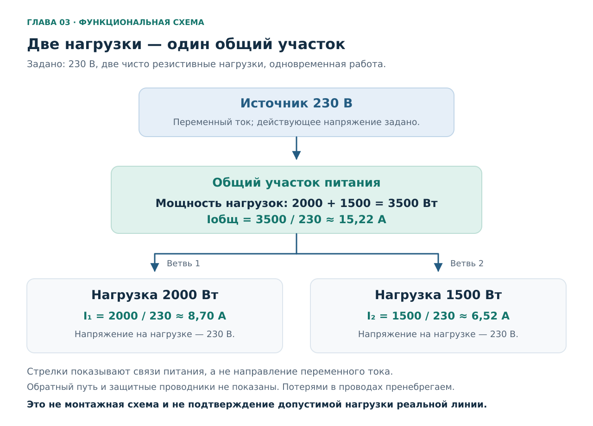
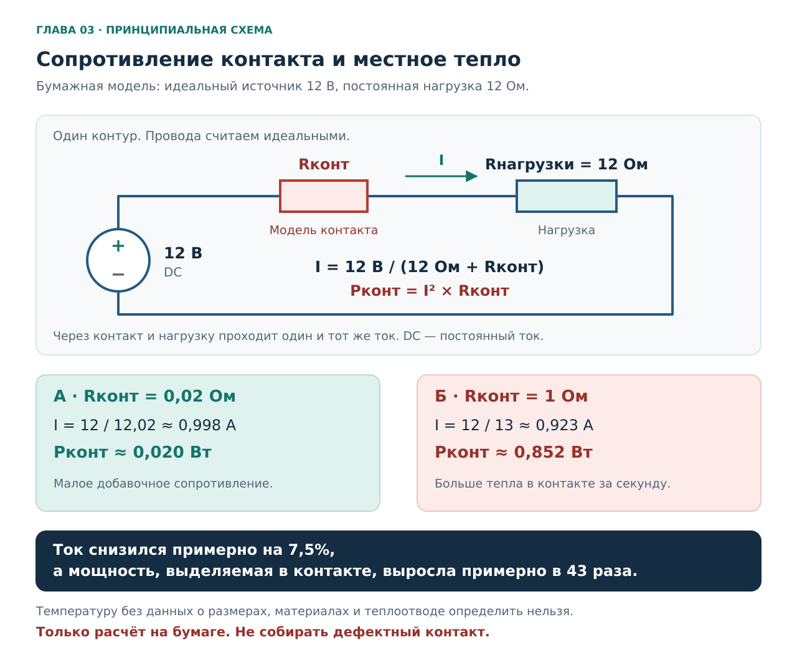
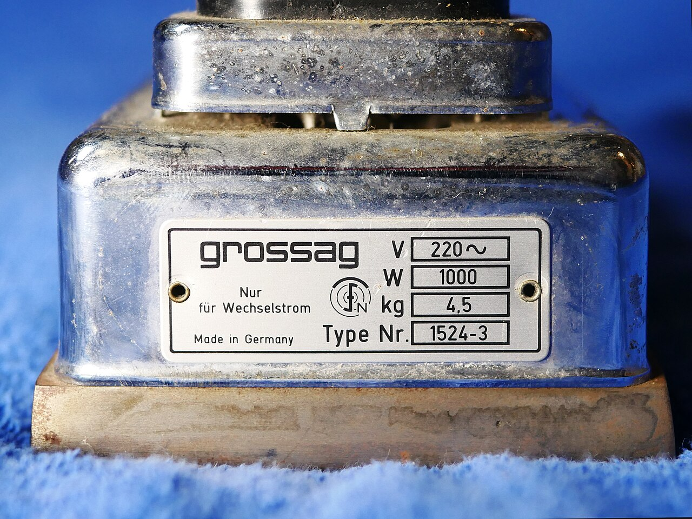

# Глава 03. Мощность, энергия и нагрев

[Главная](../README.md) · [Карта курса](../ROADMAP.md) · [Прогресс](../PROGRESS.md) · [Все главы](README.md)

**Дата технической проверки:** 2026-11-06.\
**Нужные предыдущие главы:** [01 — Безопасность](01-safety.md), [02 — Цепь, напряжение, ток и сопротивление](02-circuit-basics.md).\
**Практика:** расчёты на бумаге, чтение фотографий и доступной наружной маркировки.\
**Время:** примерно 40–55 минут на чтение и 30–50 минут на упражнения; можно разделить на два занятия.

## После главы ты сможешь

1. Различать мощность в ваттах и энергию в киловатт-часах.
2. Считать мощность простой батарейной цепи, ток заданной резистивной нагрузки и расход энергии за известное время.
3. Находить общий участок питания нескольких приборов и объяснять, почему количество розеток не определяет доступную нагрузку.
4. Читать входные и выходные параметры шильдика, замечать недостающие данные и ограничения расчёта.
5. Объяснять нагрев плохого контакта и почему отсутствие отключения автомата не подтверждает исправность соединения.

Для обязательной части достаточно этой главы, бумаги и калькулятора. Все расчётные числа — **условия учебных задач**. Они не описывают твою квартиру и не задают разрешённую нагрузку. Реальные цепи здесь не собираем; подготовка батарейного стенда начнётся в главе 04.

## 1. Бытовой вопрос: два исправных прибора — одна общая проблема?

Представь чайник и обогреватель. На первом написано 2000 Вт, на втором — 1500 Вт. Каждый по отдельности работает. Означает ли это, что их можно одновременно включить в любые два свободных гнезда?

Пока ответить нельзя. Нужно понять, какие участки питания у них общие, каковы допустимые режимы этих участков и в каком состоянии соединения. Но мы уже можем выполнить **учебный расчёт**, явно задав модель: обе нагрузки резистивные, работают одновременно на указанной мощности, напряжение на каждой равно 230 В.

Тогда суммарная мощность — 3500 Вт, а ток общего участка — примерно 15,2 А. Далее разберём, откуда берутся эти числа и почему они ещё не подтверждают пригодность установки.

Есть и другой вопрос: сколько энергии приборы израсходуют? Здесь потребуется время работы. Чайник на несколько минут и небольшой прибор на весь день нельзя сравнить только по числу ватт на корпусе. Для оценки расхода нужна связь мощности со временем, а для оценки нагрева проводов и контактов — ещё и ток с сопротивлением участка.

## 2. Мощность: с какой скоростью передаётся энергия

**Мощность `P` — скорость передачи или преобразования энергии.** Её единица — ватт: `Вт`, международное обозначение `W`. Один ватт соответствует одному джоулю в секунду: `1 Вт = 1 Дж/с`. Джоуль — единица энергии. [BIPM, брошюра SI, таблица 4](https://www.bipm.org/documents/20126/41483022/SI-Brochure-9.pdf).

| Величина | Вопрос, на который она отвечает | Единицы в этой главе |
|---|---|---|
| Напряжение `U` | Какова разность потенциалов между точками? | В |
| Ток `I` | Какой заряд проходит через элемент за единицу времени? | А |
| Мощность `P` | Как быстро передаётся энергия? | Вт, кВт |
| Энергия `E` | Сколько передано за выбранное время? | Дж, Вт·ч, кВт·ч |

Приставки работают так же, как в предыдущей главе: `1 кВт = 1000 Вт`; `1 мВт = 0,001 Вт`. Поэтому 2000 Вт и 2 кВт — одна мощность.

### 2.1. Начнём с постоянного тока

Для установившегося постоянного тока электрическая мощность, получаемая нагрузкой:

`P = U × I`.

Здесь `U` — напряжение **на этой нагрузке**, `I` — ток **через неё**. При напряжении в вольтах и токе в амперах результат получится в ваттах. Для резистора, используя закон Ома, получаем ещё две формы:

`P = I² × R` и `P = U² / R`.

Все величины в каждой формуле должны относиться к **одному и тому же участку**. Формы через сопротивление применяем к выбранной модели резистора; не заменяем ими описание любого электронного прибора. [OpenStax, § 9.5: электрическая мощность](https://openstax.org/books/university-physics-volume-2/pages/9-5-electrical-energy-and-power).

Вернёмся к модели главы 02: идеальный источник 3 В, резистор 1 кОм, идеальные провода, замкнутый выключатель.

1. `I = 3 В / 1000 Ом = 0,003 А`.
2. `P = 3 В × 0,003 А = 0,009 Вт = 9 мВт`.
3. Проверка другой формой: `P = 3² / 1000 = 0,009 Вт`.

Это мощность, превращающаяся в тепло в резисторе нашей модели. При разомкнутой цепи ток и мощность резистора равны нулю, хотя между выводами источника остаётся напряжение.

### 2.2. Потребление и полезный результат — разные параметры

Электрическая входная мощность сообщает, сколько энергии за секунду получает прибор. Часть может выполнять нужную работу, часть — теряться в его элементах. Для двигателя полезным результатом может быть механическая мощность на валу; для источника питания — электрическая мощность на выходе. Поэтому надпись о выходной мощности нельзя автоматически использовать как потребление из розетки.

Коэффициент полезного действия, **КПД**, связывает выходную и входную мощности в определённом рабочем режиме:

`η = P_выход / P_вход`, следовательно, `P_вход = P_выход / η`.

Например, **в условной задаче** источник отдаёт 60 Вт при КПД 0,90: входная мощность равна примерно 66,7 Вт. Разница 6,7 Вт — потери в принятом установившемся режиме. Но у реального блока КПД зависит от условий, в том числе нагрузки; число 0,90 нельзя присваивать произвольному адаптеру. [TDK-Lambda: рабочий и усреднённый КПД источника питания](https://blog.uk.tdk-lambda.com/uk/2019/06/07/%EF%BB%BFwhat-is-the-difference-between-power-supply-operating-efficiency-and-average-efficiency/).

## 3. Энергия: мощность нужно связать со временем

Если мощность постоянна на протяжении выбранного интервала:

`E = P × t`.

Выбор единиц определяет единицу результата:

| Подстановка | Результат |
|---|---|
| Вт × секунды | Дж |
| Вт × часы | Вт·ч |
| кВт × часы | кВт·ч |

**Киловатт-час — единица энергии.** Запись `кВт·ч` означает умножение мощности на время, а не деление. `1 кВт·ч = 1000 Вт·ч = 3 600 000 Дж`. Если мощность меняется, энергию складывают за отдельные интервалы либо используют среднюю мощность за всё рассматриваемое время. [OpenStax, § 9.5: энергия и мощность](https://openstax.org/books/university-physics-volume-2/pages/9-5-electrical-energy-and-power).

### 3.1. Переводи минуты в часы до умножения

Условный нагреватель потребляет ровно 2 кВт в течение 15 минут:

`t = 15 / 60 = 0,25 ч`;

`E = 2 × 0,25 = 0,50 кВт·ч`.

Число `15` без перевода дало бы результат для **пятнадцати часов**. Запись `0,15 ч` тоже неверна: это девять минут. Полчаса — `0,5 ч`, пять минут — `5/60 ч`, а не `0,05 ч`.

**Это график мощности во времени, не электрическая схема.** По горизонтали — часы, по вертикали — киловатты. Одинаковый масштаб позволяет сравнить площади закрашенных прямоугольников: обе равны 0,50 кВт·ч. В первом случае после четверти часа мощность равна нулю; во втором она сохраняется весь час.

Одинаковая энергия не означает одинаковый ток в каждый момент. В этих примерах при одном напряжении и резистивных нагрузках первый прибор во время работы потребляет вчетверо больший ток. Следовательно, расчёт общего расхода энергии не заменяет оценку одновременной нагрузки.

### 3.2. Прибор включён три часа — нагреватель работает не обязательно три часа

Термостат может периодически включать и отключать нагреватель. Компьютер меняет потребление в зависимости от работы. Поэтому мощность с шильдика и фактическая средняя мощность за вечер могут различаться. [Virginia Tech, Energy Series: маркировка, режимы и циклическая работа](https://www.pubs.ext.vt.edu/2901/2901-9014/2901-9014.html).

Рассмотрим **заданный**, а не измеренный режим: нагреватель мощностью 2 кВт находился включённым три часа, но нагрев работал в сумме 45 минут. В остальное время мощность по условию равна нулю.

`E = 2 × (45 / 60) = 1,5 кВт·ч`.

Средняя мощность за три часа:

`P_ср = E / t = 1,5 / 3 = 0,5 кВт`.

Во время нагрева всё равно потреблялись 2 кВт. Среднее 0,5 кВт не означает, что провода всё время нагружались так же, как одним постоянным прибором на 500 Вт. Для резистивного участка тепловая мощность связана с квадратом тока, поэтому усреднять ток до возведения в квадрат нельзя.

У настоящего прибора могут отдельно потреблять энергию электроника, вентилятор и режим ожидания. Тогда составляют сумму `E = P₁t₁ + P₂t₂ + …`, учитывая каждый режим. Если длительности режимов неизвестны, точного расхода по одному шильдику нет. Не назначай произвольный коэффициент вроде «любая техника работает треть времени».

### 3.3. Как появляется стоимость

При одном известном тарифе `T` в рублях за кВт·ч:

`Стоимость = E × T`.

Для энергии 0,50 кВт·ч получим `0,50 × T` рублей. **Тариф в главе не задан**, поэтому денежное число мы не придумываем. Если расчёт использует несколько тарифных зон, нужно знать энергию в каждой и посчитать `E₁T₁ + E₂T₂ + …`. Это арифметическая модель платы за энергию, а не проверка полного начисления в квитанции.

## 4. Когда мощность можно просто разделить на напряжение

### 4.1. Резистивный нагреватель: удобная первая модель

Для заданной нагрузки, которую можно считать обычным резистором, получаем `I = P / U`. При переменном токе здесь используются **действующие значения** напряжения и тока: значения, связанные с тем же тепловым действием на резисторе, что и соответствующий постоянный ток. Обозначение в документации — `RMS`. Подробно переменный ток рассмотрим в главе 06. [Fluke: смысл RMS и нелинейные нагрузки](https://www.fluke.com/en/learn/blog/electrical/true-measurements-of-non-linear-loads-require-a-true-rms-measurement-tool).

В наших сетевых задачах **230 В — заданное действующее напряжение**, а не результат измерения и не заявление о параметрах конкретной квартиры. Для 2000 Вт при 230 В:

`I = 2000 / 230 ≈ 8,70 А`.

Так можно оценить ток нагревательного элемента в принятом установившемся режиме. Если устройство содержит электронный регулятор, двигатель или несколько узлов, модель всего прибора может быть сложнее.

### 4.2. Для произвольного прибора переменного тока нужен коэффициент мощности

В однофазной цепи вводят три связанные величины:

| Параметр | Запись | Смысл |
|---|---|---|
| Активная мощность | `P`, Вт | Средняя скорость передачи энергии нагрузке |
| Полная мощность | `S = U × I`, В·А | Произведение действующих напряжения и тока |
| Коэффициент мощности | `PF = P / S` | Отношение активной мощности к полной |

Отсюда `P = U × I × PF`, а при известном ненулевом `PF`:

`I = P / (U × PF)`.

Для идеального резистора `PF = 1`. Для других потребителей это значение нельзя назначать без оснований. **Коэффициент мощности не является КПД**: это отношение к полной электрической мощности, а не отношение полезного выхода к потреблённой энергии. [Schneider Electric: определение Power Factor](https://www.electrical-installation.org/enwiki/Definition_of_Power_Factor).

Условный прибор: активная мощность 100 Вт, напряжение 230 В, `PF = 0,60` в этом режиме.

`I = 100 / (230 × 0,60) ≈ 0,725 А`.

Если проигнорировать `PF`, получится лишь `100 / 230 ≈ 0,435 А`. Это не ток заданного прибора. Его полная мощность в модели равна примерно 167 В·А, активная — по-прежнему 100 Вт. За час такого режима он получает 0,100 кВт·ч активной энергии; умножать эти 100 Вт ещё раз на `PF` не требуется.

В паспортах встречается также `cos φ` — косинус угла сдвига фаз. При синусоидальных напряжении и токе он совпадает с `PF`. При искажённой форме тока, характерной для части электроники, одного сдвига недостаточно: **`PF` и `cos φ` нельзя всегда подменять друг другом**. Пока достаточно понимать это ограничение; расчёт гармоник для задач главы не нужен. [Schneider Electric: PF и искажения](https://www.electrical-installation.org/enwiki/Harmonic_distortion_indicators_-_Power_factor).

### 4.3. Рабочий ток и ток включения

При включении некоторых нагрузок ток кратковременно отличается от установившегося: например, при запуске двигателя. Это **пусковой ток**. Его величина и длительность зависят от устройства и условий. Номинальные ватты на корпусе не задают универсальный множитель для его расчёта. [Fluke: пусковой ток и отличие от рабочего](https://www.fluke.com/en-us/learn/blog/clamps/how-and-why-to-measure-inrush-current).

Поэтому таблица ватт полезна для первого разбора, но по ней нельзя полностью предсказать срабатывание защиты. В этой главе не измеряем пусковые токи и не выбираем автомат; к его характеристикам вернёмся в главе 12.

## 5. Общий участок питания: складываются нагрузки

**Это функциональная схема, не монтажная и не проект щита.** Линии показывают общие участки питания и разветвление. Обратный путь, защитные проводники и аппараты защиты здесь не изображены; по этой картинке нельзя соединять проводники. Упрощения: две параллельные резистивные нагрузки, 230 В на каждой, сопротивлением соединений пренебрегаем.

Для этих условий:

- первая ветвь: `I₁ = 2000 / 230 ≈ 8,70 А`;
- вторая ветвь: `I₂ = 1500 / 230 ≈ 6,52 А`;
- общий участок: `I_общ = (2000 + 1500) / 230 ≈ 15,22 А`.

Через общий участок проходит сумма токов ветвей. Это продолжение разбора параллельных резисторов из главы 02. Сумму здесь можно считать по действующим значениям, потому что обе нагрузки резистивные и подключены к одному напряжению; для произвольной смеси электронных и двигательных нагрузок нельзя безусловно складывать численные RMS-токи так же. [OpenStax: параллельные цепи](https://openstax.org/books/university-physics-volume-2/pages/10-2-resistors-in-series-and-parallel); [Schneider Electric: PF всей нагрузки](https://www.electrical-installation.org/enwiki/Definition_of_Power_Factor).

3500 Вт на рисунке — мощность, передаваемая двум нагрузкам. Это не 3500 Вт тепла в общем проводе: его собственные потери определяются сопротивлением и током, а в этой идеальной модели приняты равными нулю.

### Что меняет перестановка вилки

Если в задаче два гнезда относятся к одному удлинителю, общими остаются как минимум его входная вилка и шнур. Перестановка в соседнее гнездо не устраняет суммарную нагрузку этих участков. Две настенные розетки тоже могут иметь общий участок линии. По расстоянию между розетками или названию комнаты принадлежность к группе не определяется.

Числа `15,22 А` недостаточно, чтобы объявить установку пригодной. Нужно знать допустимые параметры каждого изделия, устройство и состояние линии, соединения, условия прокладки и согласованность защиты. Эти факторы рассматриваются в главах 08–12. Общий принцип согласования нагрузки, проводников и защиты описан в [Electrical Installation Guide](https://www.electrical-installation.org/enwiki/Conductor_sizing%3A_methodology_and_definition); его таблицы не являются готовым подбором для квартиры в РФ.

Даже условие «расчётный ток меньше числа на автомате» отвечает только на часть вопроса. Следующий раздел объясняет, почему местная проблема может существовать при обычном токе нагрузки.

## 6. Плохой контакт: тепло выделяется в маленьком месте

### 6.1. Контакт тоже имеет сопротивление

У соединения есть электрическое сопротивление. В учебных схемах мы часто приравнивали его нулю, чтобы сначала разобраться с нагрузкой. Теперь выделим его отдельно как `R_конт`.

В резистивной модели мощность нагрева контакта:

`P_конт = I² × R_конт`.

При **одинаковом токе** увеличение сопротивления повышает тепловую мощность; при одинаковом сопротивлении удвоение тока увеличивает её в четыре раза. Но когда меняется сопротивление реальной цепи, ток тоже может измениться. Нельзя одновременно молча считать его постоянным и утверждать, что мы полностью рассчитали цепь от источника напряжения.

### 6.2. Посчитаем всю цепь, включая контакт

**Это принципиальная схема для бумажного расчёта.** Источник постоянного напряжения поддерживает ровно 12 В; нагрузка имеет постоянное сопротивление 12 Ом; провода идеальные. Прямоугольник `R_конт` представляет сопротивление соединения в модели, а не деталь, которую надо намеренно ставить в сетевой провод. Этот пример не относится к стенду главы 04 и **не предлагается для сборки**.

Используем:

`I = 12 / (12 + R_конт)`;

`U_конт = I × R_конт`;

`P_конт = I² × R_конт`.

| Состояние модели | `R_конт` | Ток всей цепи | Напряжение на контакте | Мощность на контакте |
|---|---:|---:|---:|---:|
| Малое сопротивление | 0,02 Ом | ≈ 0,998 А | ≈ 0,020 В | ≈ 0,020 Вт |
| Повышенное сопротивление | 1 Ом | ≈ 0,923 А | ≈ 0,923 В | ≈ 0,852 Вт |

Числа округлены только после расчёта. **Ток уменьшился, а мощность нагрева контакта выросла примерно в 43 раза.** Нагрузка продолжает получать энергию; сам факт её работы не обнаруживает качество соединения.

Мы не подставляли 12 В в выражение `U² / R_конт`: на контакте действует лишь часть напряжения источника. Если использовать эту форму, нужно брать именно `U_конт` из таблицы. Формулы и последовательная модель опираются на [OpenStax, § 9.5](https://openstax.org/books/university-physics-volume-2/pages/9-5-electrical-energy-and-power) и [§ 10.2](https://openstax.org/books/university-physics-volume-2/pages/10-2-resistors-in-series-and-parallel); все числа выбраны для этого курса.

### 6.3. Почему «автомат не выбило» недостаточно

Автоматическая защита от сверхтока оценивает ток по своей характеристике; она не измеряет температуру каждого удалённого соединения. При местном дефекте ток может оставаться недостаточным для её срабатывания. Ослабленные соединения способны создавать локальные горячие точки, а при развитии повреждения — дуговые процессы, которые уже не описываются одним постоянным резистором. [Schneider Electric: местные повреждения соединений и ограничения обычной защиты](https://www.electrical-installation.org/enwiki/Arc_Fault_Detection_Devices_%28AFDD%29).

По расчёту `0,852 Вт` нельзя назвать температуру, время до повреждения или границу безопасного контакта. Нужны геометрия, материалы, теплоотвод, окружающая температура и длительность режима. На нагрев влияет не только количество ватт, но и **где они выделяются и как отводится тепло**. В этой модели мы показали механизм, а не воспроизвели конкретную аварийную розетку.

Если в быту уже обнаружены запах гари, оплавление, искрение или потемнение соединения, прекрати использование. Не включай повторно для проверки и не ощупывай подозрительное место под нагрузкой. Отключение допустимо только при безопасном доступе; при дыме или пожаре действуй по [памятке главы 01](01-safety.md) и вызывай 112. Установить причину и возможность дальнейшего использования должен специалист. [МЧС России: безопасное электричество](https://69.mchs.gov.ru/deyatelnost/press-centr/novosti/5841129).

## 7. Как читать настоящий шильдик

**Шильдик** — табличка или маркировка с данными конкретного изделия. Сначала найди модель и подпись к числу, затем единицу и условия. Одно крупное число на упаковке может означать выходную мощность, эквивалент яркости или другой параметр, который не равен потреблению из сети.

| Запись | Что выяснить |
|---|---|
| `W`, `Вт`, `Power`, `Rated power` | Входная это мощность или выходная? Для какого режима и напряжения? |
| `INPUT`, `Вход` | Параметры питания самого устройства |
| `OUTPUT`, `Выход` | Параметры, которые устройство отдаёт нагрузке |
| `V~`, `AC` | Переменное напряжение; число не является текущим измерением |
| `V⎓`, `DC` | Постоянное выходное или входное напряжение согласно подписи |
| `A`, `А`, `MAX` | Какой ток указан, на какой стороне и является ли он пределом? |
| `Hz`, `Гц` | Частота переменного питания; не мощность и не расход энергии |

Фотографии ниже служат упражнением на чтение маркировки, а не рекомендацией моделей или подтверждением их исправности. Значения конкретных шильдиков не переносятся на расчётные приборы из разделов 1 и 5.

### 7.1. Шильдик утюга: ватты уже указаны

На настоящем снимке читаются **GROSSAG**, `Type Nr. 1524-3`, напряжение `220 V ~`, мощность `1000 W` и масса `4.5 kg`. Обрати внимание на единицы: килограммы не описывают электрическую нагрузку; 1000 Вт — это 1 кВт, а не 1 кВт·ч.

Если **в условной задаче** этот прибор получает постоянную во времени активную мощность 1000 Вт в течение получаса, энергия составит `1 × 0,5 = 0,5 кВт·ч`. Фотография сама не сообщает длительность работы, текущий режим или фактическое потребление. На ней также нельзя проверить внутреннюю изоляцию и соединения.

Это старый образец маркировки: надпись **220 В** относится к изображённому изделию и не задаёт современное нормативное напряжение сети. Изучаем табличку, а не возможность включить этот утюг.

Фото **HelgeRieder**, 2024-01-20, [Wikimedia Commons](https://commons.wikimedia.org/wiki/File:433GrossesElektrobuegeleisenGrossagH3a.jpg), [CC0 1.0](https://creativecommons.org/publicdomain/zero/1.0/). Использована готовая уменьшенная версия 1280 × 960; дополнительных изменений нет.

### 7.2. Адаптер: вход и выход находятся на одной наклейке

У адаптера **Canon K30278** две отдельные строки:

| Сторона | Что видно на фото | Что можно записать |
|---|---|---|
| `INPUT` — вход | `220–240 V`, `50/60 Hz`, `0.3 A` | Параметры сетевого входа; активная мощность в ваттах здесь не указана |
| `OUTPUT` — выход | `12 V`, знак постоянного тока, `1.5 A` | Выходные параметры: 12 В и 1,5 А |

Произведение выходных значений даёт `12 × 1,5 = 18 Вт`. Это мощность **выходного режима при указанных напряжении и токе**, а не результат измерения потребления из розетки. Для фактического выхода нужно знать ток подключённой нагрузки; для фактического входа — ещё и потери преобразования.

Ошибкой было бы умножить сетевые 230 В на выходные 1,5 А: они относятся к разным сторонам устройства. Входные `0,3 А` также не позволяют без знания условий и `PF` назвать постоянное потребление в ваттах. По фотографии неизвестны текущая нагрузка, КПД, время работы и исправность адаптера. Остальные знаки на наклейке не заменяют проверку этих свойств.

Фото **Daniele Pugliesi**, 2019-09-26, [Wikimedia Commons](https://commons.wikimedia.org/wiki/File:Etichetta_di_identificazione_su_adattatore_AC_Canon.jpg), [CC BY-SA 4.0](https://creativecommons.org/licenses/by-sa/4.0/). Использована готовая уменьшенная версия 960 × 1343; без дополнительной обработки. Использование не означает одобрения курса автором. Полные URL файлов и условия повторного использования — в [ATTRIBUTION.md](../assets/ATTRIBUTION.md).

### 7.3. Номинал не является непрерывным измерением

На корпусе блока питания может быть указан максимальный выходной ток. Он характеризует предусмотренный режим устройства, но не означает, что подключённая нагрузка постоянно берёт именно столько. Например, производитель MEAN WELL в паспорте GST60A12 отдельно приводит выход 12 В, номинальный ток 5 А, рабочий диапазон 0–5 А и параметры входа. Смешивать эти строки нельзя. [MEAN WELL, GST60A, таблица спецификации](https://www.meanwell.com/Upload/PDF/GST60A/GST60A-SPEC.PDF).

Из надписи об AC-входе только в вольтах и амперах нельзя получить точную активную мощность умножением: потребуется коэффициент мощности и понимание режима, к которому относятся значения. А выходные ватты не дают входные без учёта потерь. Если данных мало, правильная запись в таблице — **«не определено по шильдику»**.

## 8. Практика: пять упражнений

Во всех заданиях сначала запиши своё решение, затем открой разбор. Сохраняй единицы и условия: верное число с неверным объяснением ещё не означает понимания.

### Упражнение A. Собери таблицу пяти шильдиков

**Цель:** отличать вход, выход, мощность и ток.\
**Понадобится:** фотографии этой главы, бумага или заметка; для личной части — только доступные наружные маркировки и инструкции именно к своим моделям.\
**Исходные условия:** чтение снаружи, без крышек и измерений. Перемещать разрешается только отдельный небольшой исправный прибор, уже отсоединённый от сети, остывший и безопасный для обращения.\
**Когда остановиться:** для чтения нужно выдвигать тяжёлую технику, вскрывать корпус, тянуть кабель, подходить к повреждённой вилке или горячему прибору. Выбери другой предмет или паспорт; недостающую строку оставь неизвестной.

1. По каждому из двух фото раздела 7 выпиши входное напряжение и мощность либо ток, если именно он указан. Для адаптера отдельно выпиши выходные данные.
2. Ответь: можно ли только по фото адаптера определить его фактическое потребление за прошедшие сутки?
3. Составь таблицу для пяти доступных приборов. Достаточно инструкции или наружной маркировки: включать приборы ради задания не требуется. Если пяти безопасно доступных примеров нет, выполни часть по фотографиям, а остальные строки пометь как не собранные.
4. Для каждой строки запиши, является ли мощность входной, выходной, максимальной или неясной. Сохрани неизвестное вместо догадки.

| Прибор и точная модель | Источник данных | Вход: В, Вт или А | Выход, если есть | Режим / что неизвестно |
|---|---|---|---|---|
| 1 | | | | |
| 2 | | | | |
| 3 | | | | |
| 4 | | | | |
| 5 | | | | |

**Ожидаемый результат:** отдельные записи входа и выхода, единицы у всех чисел, отметки о неизвестном. Таблица помогает планировать дальнейший разбор, но не измеряет потребление и не подтверждает допустимость совместного подключения. Личные фото, серийные номера и данные квартиры не нужно публиковать в репозитории.

Разбор упражнения A

Утюг GROSSAG: на маркировке `220 V ~`, `1000 W`, модель `1524-3`. Мощность — 1 кВт; время работы и расход энергии не указаны. Масса 4,5 кг не участвует в расчёте электрической мощности.

Адаптер Canon K30278: вход `220–240 V`, `50/60 Hz`, `0.3 A`; выход `12 V DC`, `1.5 A`. Произведение выходных значений — 18 Вт. Это не входное потребление и не измеренная текущая мощность. Для энергии за сутки нет данных о нагрузке и режиме во времени; одной наклейки недостаточно.

Для личной таблицы единственного набора чисел нет. Правильность проверяется по соответствию **твоим** источникам: модель совпадает, вход не смешан с выходом, все диапазоны и единицы переписаны, неизвестные величины отмечены. Пять строк — цель задания, а не утверждение, что они уже собраны.

### Упражнение B. Добавь мощность к знакомому резистору

**Цель:** связать закон Ома с тепловой мощностью.\
**Понадобится:** калькулятор и бумага.\
**Исходные условия:** только расчёт; идеальный источник, один резистор 1 кОм с постоянным сопротивлением, идеальные провода и замкнутая цепь.\
**Когда остановиться:** если получилась энергия в ваттах или ток в килоомах, проверь единицы до продолжения. Не подбирай реальные детали по этому заданию.

1. Для 3 В вычисли ток и мощность резистора.
2. Повтори расчёт для 6 В, сохранив сопротивление.
3. Во сколько раз изменились ток и мощность?
4. Для первого режима найди энергию за 10 минут в джоулях и ватт-часах.

**Ожидаемый результат:** два режима в таблице и совпадающая энергия при переводе единиц. Эти расчёты описывают модель, а не допустимый режим произвольного резистора.

Ответы и проверка единиц

| Напряжение | Ток | Мощность |
|---:|---:|---:|
| 3 В | `3/1000 = 0,003 А = 3 мА` | `3 × 0,003 = 0,009 Вт = 9 мВт` |
| 6 В | `6/1000 = 0,006 А = 6 мА` | `6 × 0,006 = 0,036 Вт = 36 мВт` |

Ток увеличился в два раза, мощность — в четыре: при постоянном `R` она пропорциональна квадрату напряжения.

Первый режим за десять минут: `E = 0,009 × 600 = 5,4 Дж`. В часах: `E = 0,009 × (10/60) = 0,0015 Вт·ч`. Проверка: `0,0015 × 3600 = 5,4 Дж`. Это `0,0000015 кВт·ч`; маленькое число закономерно для милливаттной нагрузки.

### Упражнение C. Найди нагрузку общего участка

**Цель:** посчитать заданные сочетания и ограничить вывод.\
**Понадобится:** схема раздела 5, бумага и калькулятор.\
**Исходные условия:** три условные резистивные нагрузки A = 2000 Вт, B = 1500 Вт, C = 1000 Вт; каждая получает ровно 230 В. Все подключены параллельно после одного общего участка.\
**Когда остановиться:** если хочется проверить ответ реальным включением приборов — вернись к бумажной схеме. Для квартиры неизвестны допустимые параметры линии.

1. Найди суммарную мощность и ток для A; A + B; A + B + C.
2. Что станет с током общего участка, если B переместить в другое гнездо того же условного удлинителя, сохранив режимы?
3. Перечисли не менее трёх данных, которых не хватает для решения о допустимости реального подключения.

**Ожидаемый результат:** три строки чисел и отдельный перечень неизвестного. Расчёт определяет нагрузку модели, а не выбирает розетку, провод или автомат.

Ответы с объяснениями

| Сочетание | Суммарная мощность | Ток общего участка |
|---|---:|---:|
| A | 2000 Вт | `2000/230 ≈ 8,70 А` |
| A + B | 3500 Вт | `3500/230 ≈ 15,22 А` |
| A + B + C | 4500 Вт | `4500/230 ≈ 19,57 А` |

Перестановка внутри того же удлинителя не меняет общие входные участки и сумму токов при прежних условиях. Это не разгрузка его вилки или шнура.

Нужно выяснить, например: состав и устройство общей линии; материал, сечение и условия прокладки проводов; допустимые параметры изделий; состояние контактов; характеристики и согласованность защиты. Подходят и сведения о других нагрузках на той же группе. Число гнёзд само по себе в этот список электрических пределов не входит.

### Упражнение D. Энергия за разные промежутки времени

**Цель:** переводить время, учитывать режимы и не выдумывать тариф.\
**Понадобится:** калькулятор.\
**Исходные условия:** ниже заданы именно активные мощности и длительности; прочие потребители отсутствуют. Это четыре независимых бумажных случая.\
**Когда остановиться:** если неизвестен реальный режим или тариф, не подменяй его предположением. В задаче недостающий тариф оставляем буквой `T`.

1. Нагрузка 2 кВт работает 5 минут. Найди энергию.
2. Нагрузка 100 Вт работает 5 часов. Найди энергию и сравни с первым случаем.
3. Нагреватель 2 кВт за три часа суммарно нагревал 45 минут; в остальное время потребление равно нулю. Найди энергию и среднюю мощность за три часа.
4. Показания **условного** счётчика активной энергии изменились с 1234,60 до 1235,10 кВт·ч. Найди расход и его стоимость при одном тарифе `T` руб./кВт·ч. Можно ли по двум этим числам определить максимальную мощность за интервал?

**Ожидаемый результат:** энергия в кВт·ч, средняя мощность в кВт и выражение стоимости. Пример со счётчиком не требует доступа к реальному щиту.

Ответы с расчётом

1. `E = 2 × (5/60) = 1/6 ≈ 0,167 кВт·ч`.
2. `100 Вт = 0,1 кВт`; `E = 0,1 × 5 = 0,50 кВт·ч`. Несмотря на меньшую мощность, энергия втрое больше, чем в первом случае, благодаря времени работы.
3. `E = 2 × 0,75 = 1,50 кВт·ч`; `P_ср = 1,50/3 = 0,50 кВт`. В периоды нагрева мощность равна 2 кВт. Ответ 6 кВт·ч соответствовал бы непрерывному трёхчасовому нагреву на 2 кВт.
4. `E = 1235,10 − 1234,60 = 0,50 кВт·ч`; стоимость — `0,50T` рублей. Максимальная мощность неизвестна: одну и ту же энергию можно получить при разных профилях мощности, как на рисунке раздела 3. Даже среднюю мощность нельзя найти, пока не указана длительность интервала.

### Упражнение E. Объясни контакт, который греется без роста общего тока

**Цель:** рассчитать локальную мощность и выбрать обоснованный вывод.\
**Понадобится:** схема раздела 6 и калькулятор.\
**Исходные условия:** только изображение; источник 12 В, нагрузка 12 Ом, контакт 0,02 Ом либо 1 Ом. Реальные контакты не ослабляем и нагрев не воспроизводим.\
**Когда остановиться:** если для формулы берёшь всё напряжение источника как напряжение контакта — сначала вернись к последовательной цепи.

1. Рассчитай ток, напряжение и мощность контакта в обоих состояниях, не округляя ток до последнего шага.
2. Объясни, как сочетаются уменьшение тока и рост мощности на контакте.
3. Можно ли из таблицы найти температуру контакта?
4. В отдельной бытовой ситуации розетка потемнела, а автомат не отключался. Нужно ли включить мощный прибор и проверить розетку рукой? Какой следующий шаг обоснован?

**Ожидаемый результат:** числа из таблицы раздела 6, объяснение механизма и границ. Это не способ определить сопротивление реальной розетки без обследования.

Ответы с объяснениями

При `R_конт = 0,02 Ом`: `I = 12/12,02 ≈ 0,998336 А`; `U_конт ≈ 0,019967 В`; `P_конт ≈ 0,019933 Вт`.

При `R_конт = 1 Ом`: `I = 12/13 ≈ 0,923077 А`; `U_конт ≈ 0,923077 В`; `P_конт ≈ 0,852071 Вт`.

Второе сопротивление контакта в 50 раз больше первого. Ток уменьшился лишь примерно на 7,5 %, поэтому увеличение сопротивления в выбранной паре режимов перевесило снижение квадрата тока. Отношение мощностей — примерно 42,75. Это сравнение двух заданных состояний, а не правило о бесконечном росте нагрева при любом увеличении сопротивления.

Температуру определить нельзя: нет тепловых характеристик и времени. Во втором бытовом случае повторное включение и проверка рукой не нужны. Следует прекратить использование повреждённой точки и организовать проверку специалистом; отключать питание — только при безопасном доступе. Отсутствие срабатывания не устанавливает ни причину потемнения, ни исправность защиты.

## 9. Частые ошибки

| Ошибка | Что в ней потерялось | Как проверить себя |
|---|---|---|
| «Чайник потребляет 2 кВт в час» | Смешаны мощность и энергия | Скажи: «мощность 2 кВт; за 15 минут такого режима — 0,5 кВт·ч» |
| Умножить киловатты на минуты и записать кВт·ч | Перевод времени | Сначала раздели минуты на 60 |
| Считать мощность с шильдика средней за сутки | Время работы и режимы | Отдельно запиши интервалы или признай, что они неизвестны |
| Получить входные ватты из выходных В и А | Смешаны стороны преобразователя | Найди `INPUT` и `OUTPUT`, учти потери |
| Для любого AC-прибора писать `I = P/U` | Коэффициент мощности | Укажи модель резистора либо известный `PF` |
| Принять `PF = 0,6` за КПД 60 % | Разные отношения мощностей | `PF = P/S`; КПД — полезный выход / вход |
| Считать, что соседнее гнездо даёт независимую линию | Общие участки питания | Найди разветвление и участок до него |
| «Ток меньше номинала автомата, значит контакты исправны» | Локальное сопротивление и теплоотвод | Раздели расчёт нагрузки и оценку состояния соединения |
| Подставить напряжение всей цепи в `U²/R_конт` | Напряжение выбранного элемента | Сначала найди падение напряжения на контакте |

## 10. Самопроверка

1. Что означают 1500 Вт и 1,5 кВт·ч? При каком условии первый прибор израсходует второе количество энергии за час?
2. Идеальный резистор 2 кОм подключён к источнику 6 В постоянного тока. Найди ток и мощность.
3. Достаточно ли входной надписи `230 V~ 1 A` для вывода «прибор постоянно потребляет 230 Вт»?
4. Условный AC-прибор имеет `P = 100 Вт`, `U = 230 В`, `PF = 0,60`. Найди ток. Что означает коэффициент мощности в этом примере?
5. Две резистивные нагрузки 1200 и 800 Вт питаются от общего участка при 230 В. Какой общий ток? Что изменит перенос в соседнее гнездо того же удлинителя при сохранении режимов?
6. Нагрузка 500 Вт работает 40 минут. Сколько это кВт·ч? Запиши стоимость при тарифе `T`.
7. У резистивного контакта при неизменном сопротивлении ток вырос с 2 до 4 А. Во сколько раз выросла его тепловая мощность? Следует ли отсюда рост температуры в столько же раз?
8. Обогреватель подключён весь вечер, на вилке замечены следы оплавления, автомат не отключался. Какие два вывода делать нельзя и что нужно сделать?

Ответы с объяснениями

**1.** 1500 Вт — мощность, 1,5 кВт·ч — энергия. За час получится 1,5 кВт·ч, если средняя входная активная мощность за этот час равна 1500 Вт; частный случай — постоянные 1500 Вт весь час. Одна надпись на корпусе такой режим не доказывает.

**2.** `I = 6/2000 = 0,003 А = 3 мА`; `P = 6 × 0,003 = 0,018 Вт = 18 мВт`. Напряжение и ток относятся к одному резистору.

**3.** Нет. Нужно понимать назначение указанного тока и режим. Даже если в конкретном режиме действующие значения действительно равны 230 В и 1 А, их произведение даёт 230 В·А полной мощности. Для активной мощности нужен `PF`; слово «постоянно» требует сведений о работе во времени.

**4.** `I = 100/(230 × 0,60) ≈ 0,725 А`. `PF` — отношение активной мощности к полной. Он не сообщает, что 40 % входной активной энергии обязательно потерялись внутри прибора, и не является его КПД.

**5.** `I_общ = (1200 + 800)/230 ≈ 8,70 А`. Перестановка после того же общего участка не меняет его ток при сохранении заданных мощностей и напряжения. Пригодность реальных соединений этим не установлена.

**6.** `E = 0,5 × (40/60) = 1/3 ≈ 0,333 кВт·ч`. Стоимость равна `T/3` рублей. Округлять лучше после вычисления.

**7.** В четыре раза: `(4/2)² = 4`. Изменение температуры так не определяется: оно зависит от теплоотвода, материалов, времени и начальных условий. Температура и тепловая мощность — разные величины.

**8.** Нельзя заключить, что соединение исправно из-за отсутствия отключения, и нельзя считать расход за вечер простым произведением максимальной мощности на всё время подключения без знания режима. Повреждённый прибор и соединение перестают использовать; не проверяют повторным включением или прикосновением. Нужна оценка специалиста, а при дыме или пожаре — действия по главе 01 и вызов 112.

## 11. Готовность двигаться дальше

Проверь, можешь ли ты без подсказки:

- получить 0,5 кВт·ч из 2 кВт и 15 минут, не потеряв единицы;
- посчитать ток двух заданных резистивных нагрузок и указать их общий участок;
- объяснить, почему для произвольной AC-нагрузки может понадобиться `PF`;
- на шильдике отделить входные параметры от выходных и номинал от фактического режима;
- объяснить рост мощности на плохом контакте без роста общего тока;
- назвать, что расчёт позволяет узнать, а какие свойства установки остаются неизвестными.

Если путаются единицы — повтори раздел 3 и упражнение D. Если непонятен расчёт контакта — раздел 6 и упражнение E вместе с последовательной цепью из главы 02. Если все числа на корпусе кажутся потреблением — раздел 7 и упражнение A.

Для обратной связи можно прислать расчёты B–E и обезличенную таблицу A. Готовность текста и выполненная практика учитываются отдельно в [PROGRESS.md](../PROGRESS.md); до твоего сообщения выполнение не отмечается.

Следующая глава — [04 «Инструменты и учебный стенд»](04-tools-workbench.md). В ней определены состав отдельной маломощной батарейной цепи, ограничение тока, подходящие детали и условия первой сборки. Схема с повышенным сопротивлением контакта из этой главы в сборку не переносится.

## Источники и пределы применения

Ссылки и использованные материалы проверены **2026-11-06**. Здесь разбираются физические величины, учебные модели и чтение маркировки. Нормативные значения напряжения РФ, допустимые токи проводов, подбор защиты и монтажные требования в этой главе не устанавливаются. Число 230 В задаётся условиями задач. Расчётные примеры и схемы разработаны для курса и не являются измерениями реальной установки.

| Источник | Проверенная часть и границы |
|---|---|
| [BIPM, The International System of Units](https://www.bipm.org/documents/20126/41483022/SI-Brochure-9.pdf) | 9-е изд., 2019; версия 4.01, июнь 2026. Таблицы 4, 7, 8: ватт, джоуль, приставки, час. Документ об единицах |
| [OpenStax, 9.5 Electrical Energy and Power](https://openstax.org/books/university-physics-volume-2/pages/9-5-electrical-energy-and-power) | `P = UI`, мощность резистора, связь энергии со временем. Samuel J. Ling, William Moebs, Jeff Sanny, University Physics Volume 2, 2016-10-06; дата пересмотра веб-раздела не указана |
| [OpenStax, 10.2 Resistors in Series and Parallel](https://openstax.org/books/university-physics-volume-2/pages/10-2-resistors-in-series-and-parallel) | Последовательная модель контакта и общий ток резистивных параллельных ветвей; та же библиография |
| [Schneider Electric: Definition of Power Factor](https://www.electrical-installation.org/enwiki/Definition_of_Power_Factor) и [Harmonic distortion indicators — Power factor](https://www.electrical-installation.org/enwiki/Harmonic_distortion_indicators_-_Power_factor) | `P/S`, действующие значения, отличие от `cos φ` при искажениях. Обе страницы изменены 2026-08-05. Компенсация мощности и монтаж не рассматриваются |
| [Fluke: RMS и нелинейные нагрузки](https://www.fluke.com/en/learn/blog/electrical/true-measurements-of-non-linear-loads-require-a-true-rms-measurement-tool) и [How to Measure Inrush Current](https://www.fluke.com/en-us/learn/blog/clamps/how-and-why-to-measure-inrush-current) | Смысл действующего значения и отличие пускового тока от рабочего. Даты редакций не указаны; процедуры сетевых измерений не включены в практику |
| [Virginia Tech, Estimating Appliance and Home Electronic Energy Use](https://www.pubs.ext.vt.edu/2901/2901-9014/2901-9014.html) | Robert Grisso, Martha Walker, John Ignosh; 2020-02-26. Только зависимость потребления от режима и циклической работы. Американские напряжения, тарифы, усредняющие коэффициенты и упрощённое приравнивание В·А к Вт не используются |
| [TDK-Lambda: operating efficiency and average efficiency](https://blog.uk.tdk-lambda.com/uk/2019/06/07/%EF%BB%BFwhat-is-the-difference-between-power-supply-operating-efficiency-and-average-efficiency/) | David Buck, 2019-06-07. КПД источника питания и его зависимость от условий; пример с 90 % в главе условный |
| [MEAN WELL, GST60A specification](https://www.meanwell.com/Upload/PDF/GST60A/GST60A-SPEC.PDF) | Редакция 2026-04-03; страница таблицы спецификации: отдельные параметры входа, выхода и диапазон тока. Данные привязаны к модели GST60A12, не к фотографии другого адаптера |
| [Schneider Electric: conductor sizing](https://www.electrical-installation.org/enwiki/Conductor_sizing%3A_methodology_and_definition) и [местные повреждения соединений](https://www.electrical-installation.org/enwiki/Arc_Fault_Detection_Devices_%28AFDD%29) | Нагрузка, проводники, защита; локальный нагрев и ограничения обнаружения повреждений. Нормативные таблицы и требования IEC не переносятся на РФ; подбор AFDD не выполняется |
| [МЧС России: «Безопасное электричество»](https://69.mchs.gov.ru/deyatelnost/press-centr/novosti/5841129) | Памятка от 2026-10-17: повреждения, прекращение использования, безопасный доступ при отключении и экстренные действия |

Происхождение фотографий, лицензии и сведения об изменениях приведены под ними и в [ATTRIBUTION.md](../assets/ATTRIBUTION.md). Общий реестр источников дополнен в [SOURCES.md](../references/SOURCES.md).

## Навигация

**Предыдущая глава:** [02 — Цепь, напряжение, ток и сопротивление](02-circuit-basics.md).\
**Следующая глава:** [04 — Инструменты и учебный стенд](04-tools-workbench.md); актуальные статусы — в [PROGRESS.md](../PROGRESS.md).
