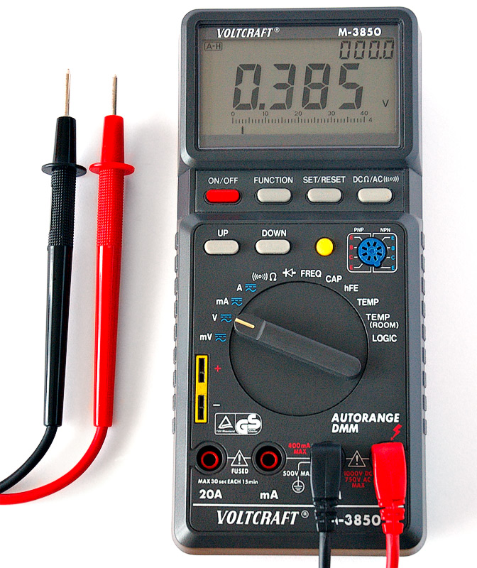
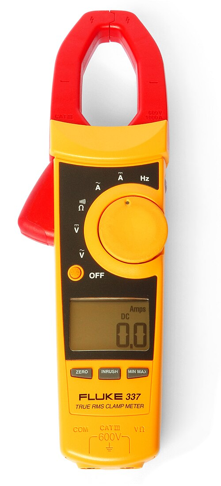
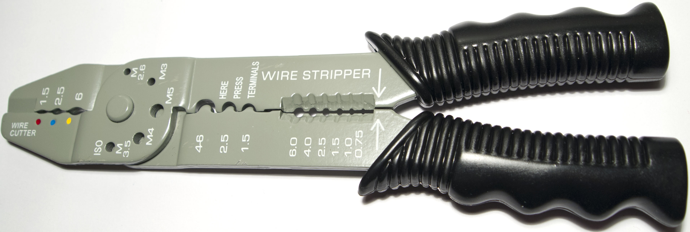
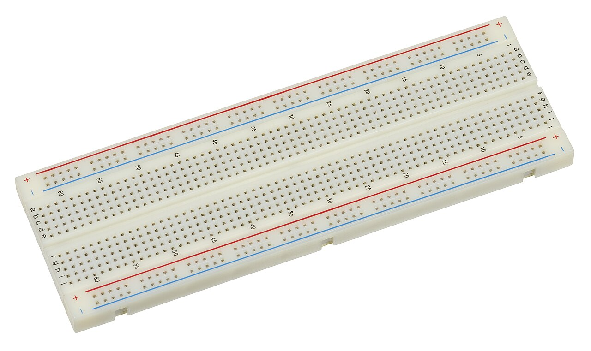
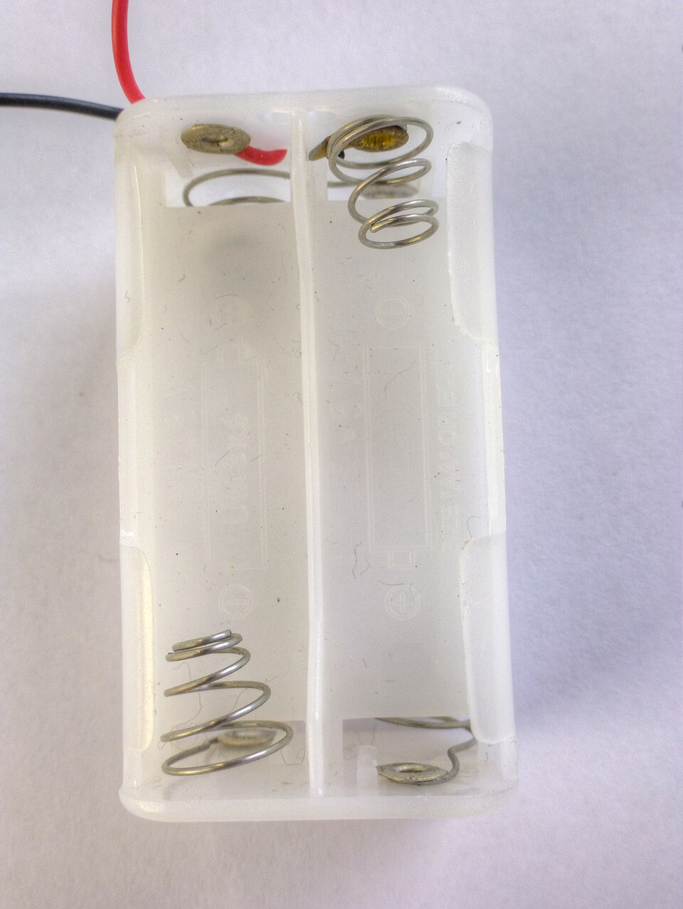
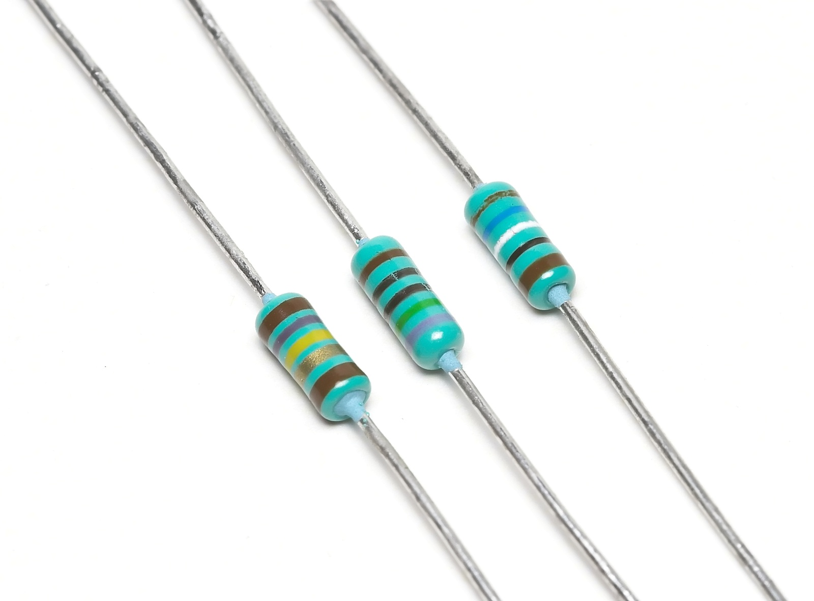
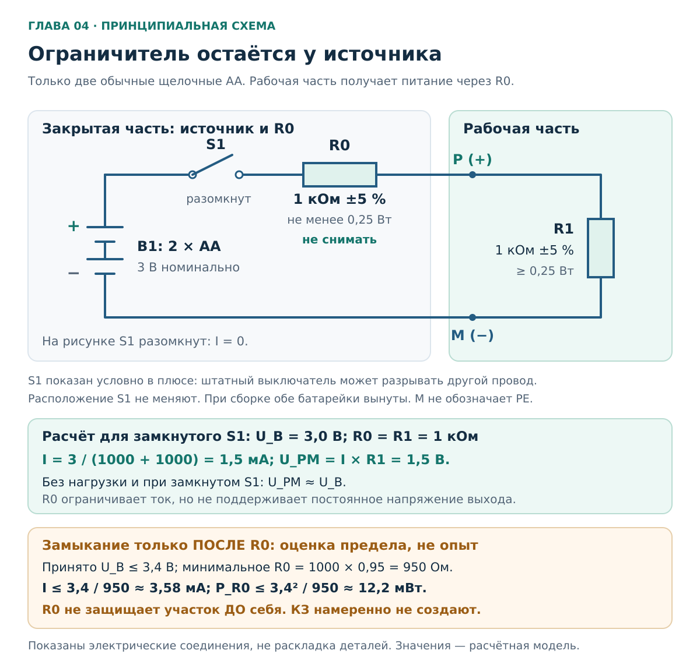
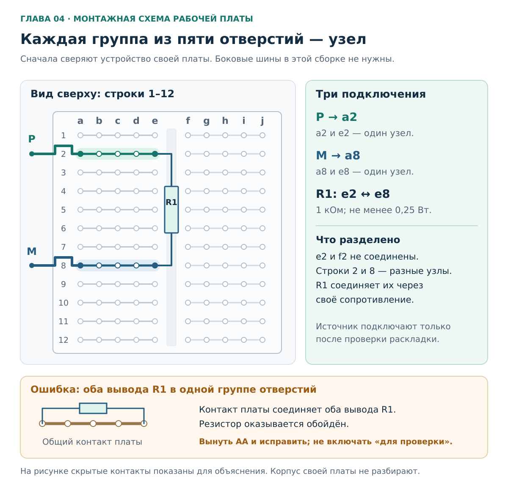
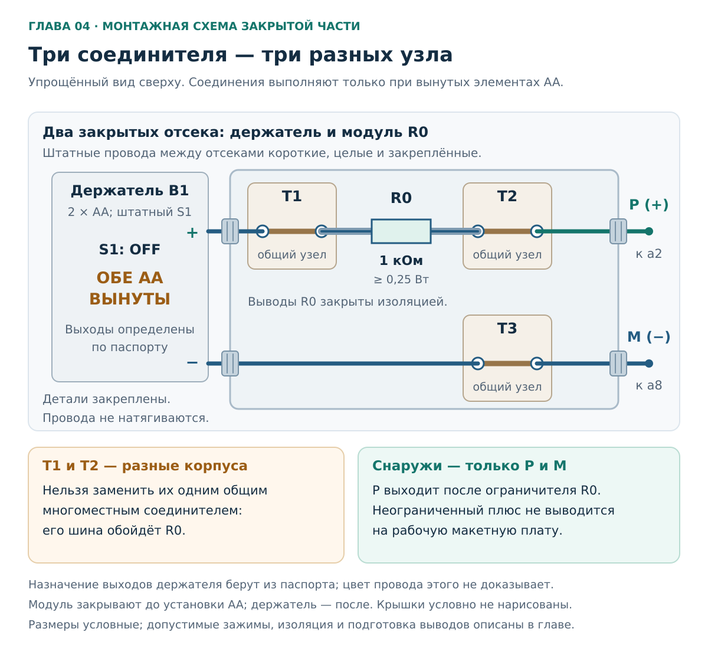
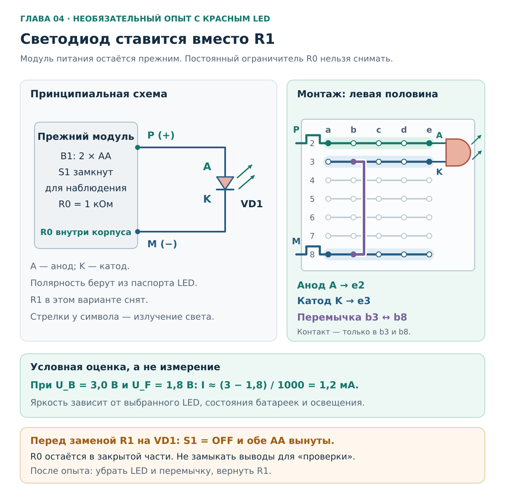

# Глава 04. Инструменты и учебный стенд

[Главная](../README.md) · [Карта курса](../ROADMAP.md) · [Прогресс](../PROGRESS.md) · [Все главы](README.md)

**Дата технической проверки:** 2026-11-06.\
**Нужные предыдущие главы:** [01 — Безопасность](01-safety.md), [02 — Цепь, U, I, R](02-circuit-basics.md), [03 — Мощность и нагрев](03-power-energy.md). Если обозначения забылись, пригодится [вводная физика A1](a1-physics-from-zero.md).\
**Практика:** выбор инструмента по документации, отдельные обесточенные детали, маломощный батарейный макет на столе.\
**Время:** 35–45 минут чтения; 40–70 минут на подготовку и сборку при наличии подходящих деталей. Упражнения можно разделить на два занятия.

## После главы ты сможешь

1. Объяснить, чем отличаются мультиметр, двухполюсный указатель, бесконтактный индикатор и токовые клещи.
2. Читать сочетание категории CAT и напряжения, проверять назначение щупов и механического инструмента.
3. Составить небольшой набор для первых опытов, используя подходящие детали из Arduino-набора.
4. По схеме собрать отдельную цепь от двух AA с постоянным ограничителем тока и объяснить границы его действия.
5. Отличить правильное расположение деталей на макетной плате от внешне похожего ошибочного соединения.

**Результат — подготовленный макет для измерений в главе 05.** Сначала разберись с инструментами и списком деталей, затем выполни задания A–D. Опыт E со светодиодом необязателен. Если деталей пока нет, выполни A–C на бумаге; покупать весь перечень показанных инструментов не требуется.

## 1. Зачем вообще отдельный стенд, если дома есть розетки

В предыдущих главах цепь была рисунком. Теперь соберём её из настоящих деталей, чтобы проследить каждый провод и подготовиться к измерениям.

Выберем две щелочные батарейки AA: около 3 В, без связи с квартирной проводкой. Постоянный резистор у источника ограничит ток доступного выхода несколькими миллиамперами. Соединения до него закроем: прямое замыкание контактов батарей всё ещё способно вызвать нагрев и течь. [Energizer: обращение с батареями](https://energizer.com/about-batteries/battery-care/).

На стенде удобно изучать обрыв, последовательную цепь, падение напряжения и подключение мультиметра. Переменный ток, работу PE, автомата и УЗО он не воспроизводит.

### Если уже есть набор Arduino

Используй его как коробку компонентов: могут пригодиться плата, перемычки, резисторы и LED. **Сам контроллер подключать не нужно.** Какие детали подойдут и что докупить, разберём в [разделе 5](#5-готовые-решения-и-что-взять-из-набора-arduino); кроме номинала проверим совместимость выводов с зажимами.

## 2. Инструмент выбирают под вопрос

Для стенда понадобятся мультиметр, подходящий инструмент для провода и линейка. Остальные приборы в таблице нужно пока научиться различать; покупать их для этой главы не нужно.

| Инструмент | Что делает | Что важно сейчас |
|---|---|---|
| **Мультиметр** | Измеряет, например, напряжение, сопротивление и ток | Нужны правильные гнёзда, режим и подключение. Входы тока и напряжения устроены по-разному |
| **Двухполюсный указатель напряжения** | Проверяет напряжение между двумя точками контактными щупами | Для работы в установке нужны подходящий прибор и освоенная процедура проверки |
| **Бесконтактный индикатор, NCV** | Реагирует на электрическое поле в заданных условиях | Молчание не доказывает отсутствия напряжения |
| **Токовые клещи** | Определяют ток по магнитному полю проводника | Диапазон и поддержка постоянного/переменного тока зависят от модели |
| **Стриппер** | Снимает изоляцию | Должен подходить к проводу и сохранять металлическую жилу целой |
| **Бокорезы** | Откусывают провода и выводы | Зачищать ими тонкую жилу неудобно: легко надрезать металл |
| **Подходящая отвёртка** | Передаёт усилие крепежу | Профиль и размер должны совпадать: PH, PZ и плоский шлиц не взаимозаменяемы |

Подбор зачистки объясняет [KNIPEX](https://blog.knipex.com/en/en/blog/strippingcables), профили отвёрток — [Wera](https://www.wera.de/en/tools/tool-types/screwdriver/). Ограничения измерительных приборов разберём ниже по руководствам производителей.

### 2.1. Мультиметр: главное — понимать вход

На типичном приборе есть общий вход `COM`, вход напряжения/сопротивления `V/Ω` и отдельные токовые входы `mA`, `µA`, `A`. Их расположение и объединение функций зависят от модели.

Напряжение измеряют между двумя точками, ток — включая прибор последовательно в цепь. Красный щуп в токовом гнезде при подключении поперёк источника может создать путь с малым сопротивлением. **До главы 05 токовые входы не используем.** [Fluke Safety Information, с. 2–3](https://media.fluke.com/67fa3ef8-72a0-424a-8ff6-b10800c0e635_original%20file.pdf).

Для ближайших опытов нужны постоянное напряжение нескольких вольт, сопротивление около 1 кОм и прозвонка. Точное подключение будем разбирать по руководству твоего прибора.

### 2.2. Двухполюсный указатель и бесконтактный «карандаш»

У двухполюсного указателя два контактных щупа. Бесконтактный индикатор реагирует на электрическое поле; его молчание может объясняться экранированием или условиями применения. **«Карандаш не пищит» не доказывает отсутствия напряжения.** [Fluke: ограничения NCV](https://www.fluke.com/en-my/learn/blog/electrical/part-1-electrical-testing-safety-preparing-for-absence-of-voltage-testing).

У любого указателя есть диапазон. Например, у Fluke T90–T150 LED-шкала начинается с 12 В, а LCD у T130/T150 — с 6 В. **Стенд 3 В не подходит для проверки этих указателей:** отсутствие показания ожидаемо даже у исправного прибора. [Fluke T90–T150, Features и Specifications](https://media.fluke.com/142b1262-d5e0-4e7a-8144-b10800c0a68a_original%20file.pdf).

Специалист проверяет работоспособность указателя до и после применения. Наша задача сейчас — сравнить руководства и диапазоны, не открывая квартирные коробки и щит.

### 2.3. Почему клещи нельзя просто надеть на любой шнур

Для измерения тока нагрузки клещи охватывают **один проводник**. Прямой и обратный проводники с равными токами внутри губок дают взаимную компенсацию; малое показание вокруг целого шнура не означает отсутствия тока. Шнур ради этого опыта не вскрывают. [Fluke: использование клещей](https://www.fluke.com/en-us/learn/blog/clamps/using-accessory-current-clamps-with-fluke-dmms).

Поддержка постоянного тока и чувствительность к миллиамперам зависят от модели. Для нашего стенда силовые клещи не нужны. [Fluke: клещи с датчиком Холла](https://www.fluke.com/en-ie/learn/blog/clamps/inside-hall-effect-clamp-meters).

## 3. CAT, щупы и исправность: три разных вопроса

### 3.1. Что означает CAT

`CAT` — категория измерений. Она связана с местом измерения в установке и ожидаемыми переходными перенапряжениями. Это **не класс точности**. Читают сочетание категории и напряжения: например, **CAT III 600 V**.

| Обозначение | Ориентир по области применения |
|---|---|
| CAT II | Цепи подключаемой бытовой техники и переносного инструмента |
| CAT III | Стационарная установка здания: распределительная проводка, щиты, постоянно подключённое оборудование |
| CAT IV | Начало, или вводная часть, низковольтной установки |

Это ориентиры по [Fluke, с. 5–6](https://media.fluke.com/67fa3ef8-72a0-424a-8ff6-b10800c0e635_original%20file.pdf) и примерам [HSE GS38, с. 4](https://www.hse.gov.uk/pubns/priced/gs38.pdf). Из слова «розетка» нельзя вывести пригодность CAT II: розетка как часть стационарной установки и включённый в неё прибор — разные точки измерения. Для конкретной задачи нужны категория, напряжение, режим и подходящие аксессуары. Британское руководство здесь объясняет принцип, а не устанавливает нормы РФ.

**Пример:** прибор CAT III 600 V со щупами CAT II 600 V не образует сборку CAT III. Предел задаёт слабее рассчитанная часть. Одна надпись «1000 V» без категории тоже не подтверждает пригодность для щита. [Fluke: ограничения сборки](https://media.fluke.com/67fa3ef8-72a0-424a-8ff6-b10800c0e635_original%20file.pdf).

Для отдельного маломощного макета специально искать CAT IV не нужно. Пригодность к батарейному опыту не переносится автоматически на сеть.

### 3.2. Что посмотреть до подключения

Прибор и щупы **ни к чему не подключены**. Найди модель и руководство; осмотри корпус, кабели, места их выхода, штекеры и защитные упоры для пальцев. Трещина, оголённый провод или разболтанный контакт — причина отложить подключение. Изолента не восстанавливает подтверждённые характеристики щупа. [Fluke Safety Information](https://media.fluke.com/67fa3ef8-72a0-424a-8ff6-b10800c0e635_original%20file.pdf).

Вскрывать прибор и подбирать замену предохранителя сейчас не нужно. Внешний осмотр не проверяет точность; к функциональной проверке перейдём в главе 05.

### 3.3. Изолированная ручка и изолированный инструмент

Пластиковая ручка может быть обычной накладкой. Защитные свойства устанавливают по маркировке и документации, а не по её цвету; пример специального исполнения — [KNIPEX 11 06 160](https://www.knipex-tools.com/products/insulated-tools/wire-strippers-and-dismantling-tools/end-type-wire-stripper-1000v-insulated/1106160).

В наших упражнениях механический инструмент работает с отдельными деталями **при вынутых батареях**. Изоляция ручек не меняет это условие.

## 4. Как инструменты и детали выглядят в жизни

Фотографии ниже показывают реальные предметы. Они помогают их узнать; подходящая комплектация и исправность по снимку не устанавливаются. Полные сведения о правах и файлах — в [атрибуции](../assets/ATTRIBUTION.md).

### 4.1. Мультиметр

Найди экран, переключатель и отдельные токовые входы. На другой модели расположение может отличаться; положение переключателя с фотографии не копируют.

Фото **André Karwath aka Aka**, [Wikimedia Commons](https://commons.wikimedia.org/wiki/File:Digital_Multimeter_Aka.jpg), [CC BY-SA 2.5](https://creativecommons.org/licenses/by-sa/2.5/). Файл повторно использован без изменений.

### 4.2. Токовые клещи

Сверху — размыкаемые губки, слева — рычаг. Здесь видны режимы AC/DC, но по виду губок нельзя установить поддержку DC или точность при миллиамперах.

Фото **Harke**, текущая версия обработана **Editor at Large**, [Wikimedia Commons](https://commons.wikimedia.org/wiki/File:Clampmeter_Fluke_337.jpg), общественное достояние, PD-self. Использована уменьшенная версия Wikimedia; дополнительных изменений нет.

### 4.3. Стриппер: смотри на рабочую шкалу

Возле рукояток — вырезы зачистки; минимальное видимое обозначение **0.75**. Для нашего провода около **0,33 мм²** нужен инструмент с подходящим диапазоном. `M3`, `M4` в другой зоне не обозначают сечение жилы.

Фото **Tiia Monto**, [Wikimedia Commons](https://commons.wikimedia.org/wiki/File:Wire_stripper2.jpg), [CC BY-SA 3.0](https://creativecommons.org/licenses/by-sa/3.0/). Оригинал без новых изменений.

### 4.4. Беспаечная макетная плата

В отверстиях — пружинные контакты; центральная канавка разделяет группы. Цветные линии обозначают шины, но не создают питание. Разводку своей платы сверяют по документации; боковые шины в этом опыте не используем.

Фото **Evan-Amos**, [Wikimedia Commons](https://commons.wikimedia.org/wiki/File:Electronics-White-Breadboard.jpg), общественное достояние, PD-self. Уменьшенная версия Wikimedia без дополнительных изменений.

### 4.5. Держатель AA и резисторы

Держатель знаком по главе 02. Для сборки нужен **вариант с крышкой и выключателем**, которых этот снимок не подтверждает. Выводы определяют по своему изделию и его документации.

Фото **© Nevit Dilmen**, [Wikimedia Commons](https://commons.wikimedia.org/wiki/File:Battery_holder_box_2xAA_3V_1480283_4_5_HDR_Enhancer.jpg), [CC BY-SA 3.0](https://creativecommons.org/licenses/by-sa/3.0/). Повторно использована уменьшенная версия без новых изменений.

У резистора две ножки и нет полярности. Номинал и мощность узнают по маркировке и документации; показанные детали не являются автоматически резисторами 1 кОм.

Фото **Afrank99**, [Wikimedia Commons](https://commons.wikimedia.org/wiki/File:3_Resistors.jpg), [CC BY-SA 2.5](https://creativecommons.org/licenses/by-sa/2.5/). Без изменений.

## 5. Готовые решения и что взять из набора Arduino

### 5.1. Сначала проверь то, что уже есть

Для рабочей части нужны макетная плата, перемычки и резистор R1 1 кОм; LED — по желанию. Они часто есть в наборах Arduino. Например, в перечне официального [Starter Kit](https://store.arduino.cc/products/arduino-starter-kit-multi-language) есть плата на 400 контактов, перемычки и резисторы 1 кОм. Но комплектный разъём рассчитан на **9 В**, а мощность резисторов в перечне не установлена. Состав и характеристики своего набора всё равно нужно проверить.

Для питания понадобится отдельный закрытый узел с двумя AA и постоянным R0. Его можно собрать по упражнению D или поручить сборку человеку с навыком монтажа. Это одна и та же электрическая схема; приобретать редкую марку резистора ради названия в примере не требуется — важны параметры раздела 6.

### 5.2. Что считать готовым решением

| Вариант | Что он даёт | Подходит ли для этой схемы |
|---|---|---|
| Имеющийся Arduino-набор | Плату и часть деталей | Используем подходящие компоненты, добавляем батарейный узел |
| [Adafruit 4193](https://www.adafruit.com/product/4193), пример закрытого держателя 2 AA с выключателем | Держатель и разъём JST-PH | Нужны R0, закрытый монтаж и совместимая ответная часть разъёма. Ограничитель на несколько мА не заявлен |
| [Snap Circuits Junior SC100](https://www.elenco.com/sc100-manuals/) | Соединяемые блоки и штатные опыты | Можно учиться по руководству своей версии. Фиксированный R0 1 кОм у источника не следует считать частью набора |
| Лабораторный источник с регулируемым ограничением тока | Настраиваемые напряжение и предел тока | Будущий вариант с отдельной проверкой малых токов и настройкой; сейчас покупать не требуется |

В [руководстве SC100](https://elenco.com/wp-content/uploads/2021/11/SC-100_Manual.pdf) резистор внутри LED-модуля D8 защищает только его ветвь. Это пример того, почему «есть защита» ещё не означает ограничение тока всех выходов.

**Сначала используй имеющийся набор.** Ссылки показывают типы изделий; стоимость, наличие и доставка не проверялись. Держатель аналогичной конструкции можно выбрать по параметрам, не заказывая именно зарубежный образец.

### 5.3. Почему пока не питаем макет от USB или контакта 5 V Arduino

Arduino подходит для обучения электронике, но её питание требует разбора конкретной платы. Например, USB-polyfuse у [UNO Rev3 with Long Pins](https://docs.arduino.cc/retired/boards/arduino-uno-rev3-with-long-pins/) имеет уровень порядка 500 мА — это защита другого масштаба, чем наши несколько миллиампер. Она не поддерживает такой малый токовый предел.

Стабилизатор 3,3/5 В тоже не обязательно ограничивает ток на нужном уровне: [модуль Adafruit](https://learn.adafruit.com/adjustable-breadboard-power-supply-kit) использует регулятор на 1,25 А. Эти параметры не относятся автоматически к MB102 и другим платам.

Для этой сборки оставляем единственный источник — описанный батарейный узел. **USB, Arduino и адаптеры к макету не подключаем.** Это сохраняет известную схему и расчёт; опыт с конкретной Arduino можно подготовить отдельно.

## 6. Конкретный список деталей

**Для этой сборки — две щелочные AA последовательно, номинально 3 В.** Другие батареи, аккумуляторы и блоки питания меняют условия расчёта и здесь не подставляются.

| Обозначение | Что приготовить | Проверяемое условие |
|---|---|---|
| B1 | Два новых щелочных элемента AA / LR6 по 1,5 В | Одинаковые тип и марка, целые оболочки, без течи; не аккумуляторы и не литиевые элементы |
| Держатель, S1 | Закрытый держатель **2 AA последовательно**, со штатным выключателем | Известны назначение двух выходов, способ установки элементов и полярность по инструкции/маркировке |
| R0 | Постоянный ограничитель **1 кОм**, допуск ±5 % или лучше, мощность не менее 0,25 Вт | Обычный выводной резистор; материал и размеры выводов совместимы с выбранными зажимами |
| R1 | Нагрузка **1 кОм**, ±5 % или лучше, не менее 0,25 Вт | Подходит к контактам макетной платы; можно взять из набора с известной комплектацией |
| T1, T2, T3 | **Три отдельных** двухгнездных рычажных соединителя одного потенциала | Ниже разобран пример WAGO 221-412; в каждом корпусе его два гнезда соединены друг с другом |
| Корпус узла | Изолирующий корпус с крышкой, креплениями и вводами под используемый провод | Вмещает T1–T3 и R0; предпочтительны готовые отверстия и прижимы проводов |
| Изоляция и крепление | Отдельные изолирующие трубки для выводов R0, крепления и разгрузка натяжения | Металл между корпусом R0 и входом зажима не остаётся открытым; натяжение внешнего провода не передаётся на резистор |
| Рабочая плата | Беспаечная плата с рядами `a–e` и `f–j` | Схема контактов известна; отверстия и пружины не повреждены |
| Выходные провода P/M | Два изолированных однопроволочных медных провода 22 AWG, примерно 0,33 мм², длиной около 15–20 см | Подходят и к зажиму, и к плате; подписаны `P` и `M`. Цвет лишь помогает различать уже установленные функции |
| Для работы | Подходящий стриппер, бокорезы, линейка, защитные очки, наклейки | Инструмент подходит к тонкому проводу; провода и выводы режут без батарей, удерживая обрезок |
| Для главы 05 | Мультиметр с руководством и исправными щупами | Сейчас достаточно установить модель и найти нужные разделы инструкции |

Обычный AA LR6 имеет номинал 1,5 В; пример паспортных характеристик — [Energizer EN91](https://data.energizer.com/pdfs/en91_industrial_na.pdf). Правила не смешивать элементы и не заряжать одноразовые батареи приведены в [Energizer Battery Care](https://energizer.com/about-batteries/battery-care/).

### 6.1. Почему для R0 важны ещё и ножки

В примере используются WAGO 221-412: медные однопроволочные проводники 0,2–4 мм², тонкопроволочные 0,14–4 мм²; зачистка 11 мм. Это относится ко **всем** проводникам в T1–T3, включая провода держателя. Тонкая ножка, попавшая в отверстие, ещё не обязательно удерживается. [Диапазоны WAGO](https://www.wago.com/global/products/electrical-interconnections/discover-installation-terminal-blocks-and-connectors/221), [221-412](https://www.wago.com/global/installation-terminal-blocks-and-connectors/splicing-connector-with-levers/p/221-412), [длина зачистки в данных WAGO](https://wago-embedded.customer-domain.wago.com/3d-cad-models/221-412-splicing-connector-with-levers-for-all-conductor-types-max-4-mm-2-conductor-transparent-housing-surrounding-air-temperature-max-85-c-t85-wago?info=wago/pg07/serie221/0221-0412_0999-0962.prj).

Документированный пример R0 — **Vishay MRS25, 1 кОм**: ±1 %, 0,6 Вт при паспортных условиях, лужёные медные выводы диаметром 0,6 мм. Их расчётное сечение около 0,28 мм² попадает в диапазон зажима. Подойдёт и другой резистор с требуемыми электрическими параметрами и совместимыми выводами. [Vishay MRS16/MRS25, с. 1–3](https://www.vishay.com/docs/28724/mrs16m25.pdf).

Если материал или размер выводов неизвестен, совместимость не установлена. Не утолщай их скруткой: подбери подходящую деталь либо другой документированный способ соединения с пересмотром монтажа. У держателя Adafruit 4193 сечение шнура не указано; его карточка сама по себе не подтверждает совместимость с 221-412.

Правильная посадка, удержание и фиксация остаются обязательными. Сочетание компонентов по параметрам — наш учебный монтаж, а не сертифицированный производителями батарейный блок.

### 6.2. Необязательное дополнение для видимого результата

Для опыта E подготовь двухвыводный малоточный красный LED и одну изолированную перемычку. LED временно **заменит R1**, постоянный R0 останется. Пример — [Kingbright WP7113LID](https://www.kingbrightusa.com/images/catalog/SPEC/WP7113LID.pdf), для которого производитель задаёт свечение при 2 мА и указывает полярность. В нашей цепи свечение может быть слабым. Без LED основная резисторная сборка остаётся законченной.

## 7. Принципиальная схема и расчёт ограничения

**Тип изображения — принципиальная электрическая схема.** Она показывает соединения. Место установки деталей будет на отдельной монтажной схеме. Провода и контакты при расчёте считаем идеальными, внутреннее сопротивление батарей не учитываем. Выключатель показан разомкнутым для подготовки; расчёт ниже относится к его замкнутому состоянию.

На рисунке S1 условно находится в плюсовом проводе. В реальном готовом держателе он может разрывать другой провод. Мы не переделываем его: используем штатные выходы по инструкции, а перед сборкой удаляем оба элемента.

### 7.1. Что означает каждая часть

- **B1** — два элемента питания в держателе.
- **S1** — штатный выключатель держателя.
- **R0** — постоянное ограничение тока. Он расположен у источника, закрыт и не переставляется между упражнениями.
- **P** — доступный плюсовой выход **после R0**.
- **M** — доступный обратный провод к минусу источника. Это обозначение нашего макета, не «земля», не N и не PE.
- **R1** — рабочая нагрузка. Её можно менять в предусмотренных упражнениях после удаления питания.

### 7.2. Нормальный режим

Зададим для расчёта ровно 3 В и два точных резистора по 1000 Ом. Они соединены последовательно:

`Rобщ = R0 + R1 = 1000 + 1000 = 2000 Ом`.

Ток один и тот же через оба:

`I = 3 В / 2000 Ом = 0,0015 А = 1,5 мА`.

Напряжение на рабочей нагрузке:

`U_R1 = I × R1 = 0,0015 А × 1000 Ом = 1,5 В`.

Мощность каждого резистора:

`P = I²R = 0,0015² × 1000 = 0,00225 Вт = 2,25 мВт`.

**Почему в главе 02 было 3 мА, а здесь 1,5 мА?** Там стоял один резистор 1 кОм; здесь добавлен ещё один такой же последовательно. Сопротивление удвоилось, ток уменьшился вдвое.

**На выходе нет постоянных 3 В:** с R1 напряжение около 1,5 В, без нагрузки — близко к напряжению батарей, поскольку почти исчезает падение на R0. Это резисторное ограничение тока, не стабилизатор напряжения. Модель опирается на [OpenStax, § 10.2](https://openstax.org/books/university-physics-volume-2/pages/10-2-resistors-in-series-and-parallel) и [§ 9.5](https://openstax.org/books/university-physics-volume-2/pages/9-5-electrical-energy-and-power); числа выбраны для курса.

### 7.3. Зачем R0 остаётся у источника

Рассмотрим **только на бумаге** ошибку, при которой сопротивление рабочей части после R0 стало очень маленьким. Даже тогда R0 остаётся в пути тока.

Для запаса примем верхний расчётный уровень источника **3,4 В** и худшее допустимое отклонение R0 вниз на 5 %:

`R0min = 1000 × 0,95 = 950 Ом`.

Тогда для этого пути:

`I ≤ 3,4 В / 950 Ом ≈ 3,58 мА`;

`P_R0 ≤ 3,4² / 950 ≈ 0,0122 Вт = 12,2 мВт`.

Это заметно ниже выбранных 0,25 Вт. Значение 3,4 В — **условие расчёта с запасом**, а не измерение и не паспортная гарантия любых элементов формата AA. Именно поэтому тип и число батарей менять нельзя без нового расчёта. Реальную цепь для проверки этих неравенств не замыкают.

### 7.4. Где ограничение заканчивается

Если металл соединит контакты батарей или исходные провода **до R0**, ток через R0 не пойдёт. Резистор такую ошибку не ограничит.

В нашей конструкции предусмотрены две разные меры:

1. **Электрическая:** постоянный R0 ограничивает ток на доступном учебном выходе.
2. **Конструктивная:** контакты батарей закрыты держателем; исходные провода короткие, закреплённые и изолированные; соединения с R0 закрыты отдельным корпусом.

Этот источник предназначен для резисторов и одного малоточного светодиода. Он не рассчитан на питание Arduino, моторов, реле, сервоприводов, нагревателей и длинных LED-лент.

## 8. Практика

### Упражнение A. Составь паспорт измерительного прибора

**Нужно:** мультиметр с руководством; если его нет — руководство одной модели для бумажного разбора. Прибор и щупы лежат на столе, ни к чему не подключены. Цель — найти параметры до измерений.

Заполни таблицу по маркировке и руководству. Неизвестное так и запиши. Осмотри корпус, кабели и штекеры: при повреждении или неясном назначении входов подключение откладывают.

| Поле | Твоя запись |
|---|---|
| Точная модель и ссылка на руководство | … |
| Входы для U DC / сопротивления | … |
| Токовые входы, которые сейчас не используем | … |
| Диапазоны для нескольких вольт DC и около 1 кОм | … |
| CAT и напряжение прибора / щупов | … / … |
| Повреждения или неизвестные данные | … |

Как проверить результат A

Каждая характеристика должна относиться к своей модели. У распространённой схемы входов для напряжения/сопротивления используются COM и V/Ω, но окончательный ответ берут из руководства. Таблица и осмотр не подтверждают точность прибора или его пригодность к квартирной установке.

### Упражнение B. Проверь комплект до покупок

**Нужно:** список раздела 6, детали и их упаковки/паспорта; при отсутствии деталей — таблица ниже. Всё обесточено, батареи вынуты, Arduino и модули питания отключены.

Разложи компоненты и присвой каждому отметку: **П** — подходит; **?** — не хватает данных; **Н** — не для этого опыта. Неизвестный номинал или совместимость соединения выясняют по документации, а не пробным включением. Составь список только недостающих деталей.

Для бумажного варианта:

| Находка | Твоя отметка |
|---|---|
| Пустая плата с известными группами по пять контактов | … |
| Резистор в пакете «1 кОм», без данных о мощности и выводах | … |
| Держатель на четыре AA или разъём для батареи 9 В | … |
| Два новых одинаковых щелочных AA по 1,5 В | … |
| Модуль «3,3 V / 5 V», без сведений о предельном токе | … |

Разбор B

1. **П**, если контакты и корпус целые.
2. **?**: для принятого списка не хватает данных; для R0 отдельно нужна совместимость выводов с зажимом.
3. **Н**: это другие источники. Пустые места держателя не обходят металлическими перемычками.
4. **П** после проверки оболочек и срока хранения.
5. **?**; до выяснения параметров не подключать. Напряжение 3,3/5 В не устанавливает малый предел тока.

Результат — перечень подходящих, недостающих и ещё не проверенных позиций. Наличие набора само по себе не подтверждает готовность к сборке.

### Упражнение C. Прочитай плату и предскажи результат

**Нужно:** схема, бумага и калькулятор. Только бумажная модель: B1 = 3 В, R0 = R1 = 1 кОм, провода идеальные. Если внутренняя схема твоей платы отличается, сначала разбери её документацию; координаты автоматически не переносятся.

**Это монтажная схема фрагмента платы, вид сверху.** В каждом пронумерованном ряду отверстия `a–e` соединены между собой; `f–j` образуют другую отдельную группу. Центральная канавка разделяет группы, соседние номера рядов не соединены. Боковые шины в опыте не используются. Такой принцип показан в [учебной лабораторной NYU ITP](https://itp.nyu.edu/physcomp/labs/breadboard/); конкретную разводку своей платы проверяют отдельно.

Положение платы на столе не меняет её соединения. Ориентируйся по буквам и цифрам, а не по фразе «горизонтальные дырочки».

Ответь:

1. Соединены ли `a2` и `e2`? А `e2` и `f2`?
2. В каком ряду должен оказаться второй вывод R1, если первый стоит в `e2`, а обратный выход подключён в `a8`?
3. Каковы ток и напряжение P–M при правильно установленном R1?
4. Что произойдёт с током и напряжением P–M в идеальной модели, если R1 полностью убрать?
5. Почему установка обеих ножек R1 в `b2` и `e2` не создаёт нагрузку между P и M?

Ответы C

1. `a2` и `e2` — один узел. `e2` и `f2` разделены канавкой, соединения между ними нет.
2. В ряд 8 левой половины; на плане выбрано `e8`. Тогда обе стороны R1 относятся к разным узлам: P и M.
3. `I = 3 / 2000 = 1,5 мА`; `U_PM = I × 1000 = 1,5 В`.
4. Цепь нагрузки разомкнута: `I = 0`. Падение на R0 равно нулю, а `U_PM = 3 В`. Это ответ идеальной модели без подключённого измерителя; реальный вольтметр имеет конечное входное сопротивление.
5. `b2` и `e2` уже соединены контактом платы. Напряжение между ними равно нулю, а ножки R1 оказались на одной электрической точке. Обратного пути в ряд 8 он не создаёт.

### Упражнение D. Собери основной стенд

**Цель:** получить отдельную цепь B1–S1–R0–R1 и сохранить её для главы 05.\
**Что нужно:** весь обязательный список раздела 6. Для варианта ниже — три отдельных WAGO 221-412 и R0 с совместимыми медными выводами. Нужны также готовые проводные выводы держателя либо подходящий ответный разъём с проводами и установленной по документации полярностью.\
**Исходные условия:** сухой освещённый стол без металлической стружки; только выбранные компоненты; обе AA вынуты, Arduino/USB/адаптеры отключены. На время работы убраны кольца и другие предметы, способные соединить контакты.\
**Остановиться:** неизвестны выводы держателя, номинал R0, разводка платы или способ закрыть исходные соединения; зажим не удерживает провод; остаётся оголённый участок вне предусмотренного контакта. Нельзя компенсировать это «пробным включением».

#### D1. Подготовь провода и корпус без элементов питания

1. Проверь по документации, какой выход держателя является плюсовым. Цвет помогает читать уже определённое назначение; сам по себе он не доказательство. Если достоверно определить выходы нельзя, отложи включение до проверки подготовленным человеком.
2. Размести держатель и корпус узла рядом на изолирующей основе. Для крепления можно использовать монтажную ленту на плоских наружных поверхностях, не закрывая выключатель и крышку батарей. Исходные провода должны оставаться короткими и защищёнными от зацепов. **Если корпус требует отверстий, подготовь их отдельно, вынув из него все детали, и убери стружку. Готовый держатель AA не сверли.** Выбери вводы без острых краёв и прижимы, подходящие к наружному диаметру провода.
3. Потренируйся на отдельном обрезке: подбери диапазон стриппера, сними изоляцию и осмотри жилу. При борозде, надрезе или надломе отрежь повреждённый конец и исправь настройку. Готовую жилу не проверяют многократными изгибами.
4. Подготовь P/M из **однопроволочной меди 22 AWG (около 0,33 мм²)**, если этот размер допускает твоя макетная плата. На стороне 221-412 сними 11 мм изоляции; на стороне платы — длину по её инструкции, обычно порядка 5–6 мм, без длинного открытого участка над платой. Подпиши `P — после R0` и `M — возврат`. Гибкий многопроволочный хвост держателя напрямую в макетку не вставляем: он подключается внутри корпуса через T1/T3.
5. У R0 оставь достаточно длины для полной посадки в зажимы. На каждый вывод надень отдельную изолирующую трубку до корпуса резистора; рабочие 11 мм внутри зажима должны оставаться металлическими. Не сгибай и не тяни ножку вплотную к корпусу детали. Если длины не хватает для такой посадки, выбери другое размещение или подходящую деталь.

Зачистка с сохранением жилы — принцип из [руководства KNIPEX](https://blog.knipex.com/en/en/blog/strippingcables); точная длина зависит от соединителя. Это упражнение с отдельным тонким проводом, не инструкция обработки квартирного кабеля.

#### D2. Собери постоянный узел R0

**Это монтажная схема связей внутри закрываемого узла.** Форма корпусов условная; она показывает, какие проводники находятся в одном зажиме. Штатный держатель и его выключатель не разбираются. Точные габариты корпуса выбирают по фактически установленным деталям.

Собери по таблице, поднимая рычаг нужного гнезда, вводя проводник полностью и закрывая рычаг. **В одно гнездо — один проводник.** Не зажимай изоляцию вместо металла и не оставляй снаружи открытые жилы.

| Отдельный корпус | Первое гнездо | Второе гнездо |
|---|---|---|
| **T1** | Плюсовой выход держателя | Первый вывод R0 |
| **T2** | Второй вывод R0 | Выходной провод P |
| **T3** | Минусовой выход держателя | Выходной провод M |

В каждом таком двухгнездном корпусе оба гнезда соединены. **T1 и T2 нельзя заменить одним общим многогнездным соединителем:** он обойдёт R0. Плюс и минус источника тем более не помещают в один соединитель общего потенциала.

После соединения:

1. Проследи путь плюса: держатель → T1 → R0 → T2 → P. На рабочую плату не должен уходить отдельный провод от T1.
2. Проследи возврат: M → T3 → минус держателя.
3. Слегка потяни каждый провод за изоляцию, поддерживая корпус соединителя. Он не должен выходить. Ножки резистора не используют как ручки и не нагружают натяжением.
4. Закрепи T1–T3 в подходящих держателях либо монтажной лентой за плоские основания; R0 расположи без натяжения ножек. Прижимы вводов должны удерживать **изоляцию**, не раздавливая её: при лёгком вытягивании внешнего провода его часть внутри корпуса не сдвигается. Трубки на выводах R0 не сползают и не открывают металл. Если удержания нет, крышку и включение отложи до исправления крепления.
5. Закрой крышку, не зажимая детали и проводники. Снаружи доступны штатный выключатель держателя и только P/M для учебной цепи. Подпиши узел: **«2 AA; R0 = 1 кОм; только учебный выход P/M»**.

Если детали не помещаются или соединения нельзя закрыть, подбери другой корпус либо попроси собрать этот узел человека с навыком монтажа. До закрытия удобно сделать фото для сверки со схемой; батарей внутри ещё нет.

#### D3. Подключи нагрузку к макетной плате

Оба элемента всё ещё вынуты, выключатель OFF.

| Что вставить | Куда |
|---|---|
| Выход P закрытого узла | `a2` |
| Выход M закрытого узла | `a8` |
| Первый вывод R1 | `e2` |
| Второй вывод R1 | `e8` |

1. Найди именно эти координаты на своей плате. Если буквенная раскладка и внутренняя схема другие, не переноси таблицу вслепую.
2. Разведи ножки R1 без усилия на корпус, вставь их в указанные разные ряды. Резистор не имеет полярности.
3. Убедись, что свободный металл не касается соседнего вывода или другого ряда. Применяй только подходящие к плате выводы; толстый щуп мультиметра и винт в её отверстия не вставляют.
4. Проверь по принципиальной схеме замкнутый маршрут при будущем включении. Пересчитай последовательные резисторы: их **два**, один скрыт в узле питания.

#### D4. Сохрани макет для проверки измерениями

**Основную резисторную сборку оставь без батарей до главы 05.** У неё нет видимой индикации: и исправная цепь, и обрыв могут выглядеть одинаково. Первое включение имеет смысл совместить с измерением после знакомства с мультиметром.

Проверь закрытую исходную часть, крепления и координаты R1. Сохрани макет и заполни журнал:

| Что записать | Поле для результата |
|---|---|
| Тип и число подготовленных элементов | … |
| R0 и R1: номинал, допуск, мощность | … |
| Источники данных о деталях и полярности | … |
| R0 закрыт; на плату идут только P/M | Да / нет |
| Расположение P / M / R1 | … |
| Расчёт при условных 3 В: I / U_R1 | … / … |
| Результат: собран / что осталось подготовить | … |

Критерий результата D

Должна получиться схема из раздела 7: два AA, R0 = R1 = 1 кОм, три отдельных узла T1–T3, закрытая исходная часть. Расчёт — 1,5 мА и 1,5 В на R1, по 2,25 мВт на каждом резисторе.

Это проверка монтажа по схеме, ещё не электрическое испытание. Для завершённой сборки запись: «собран без батарей; первое включение и измерения — в главе 05». Если не хватает детали или осталось неясное соединение, укажи конкретный остаток работы. Расчётные числа не записывают как измеренные.

### Упражнение E. Необязательное: увидеть свет

**Нужно:** собранный узел D, подходящий малоточный красный LED и изолированная перемычка. Для конкретного примера — WP7113LID. R0 остаётся закрытым; выключатель OFF, обе AA вынуты, другого питания нет.

Если неизвестны тип LED, полярность или допустимый режим, остановись до включения. Подходящий светодиод временно заменит R1:

1. Удали R1, не вскрывая узел питания. По чертежу LED определи **анод A** и **катод K**. Длина подрезанных ножек не указывает полярность.
2. Вставь анод в `e2`, катод в соседний ряд `e3`. Для LED с шагом выводов 2,54 мм это позволяет обойтись без широкого разведения ножек. Соедини **`b3` и `b8` изолированной перемычкой**: теперь ряд 3 соединён с M. P остаётся в `a2`, M — в `a8`.
3. Ножки не должны соприкасаться. Если выбранная деталь требует формовки, делай её до установки, удерживая вывод; для WP7113LID первый изгиб — не ближе 3 мм от корпуса. [Kingbright, чертёж и правила монтажа](https://www.kingbrightusa.com/images/catalog/SPEC/WP7113LID.pdf).
4. Проследи маршрут: плюс B1 → S1 → R0 → P → LED → перемычка → M → минус. Проверь, что R0 остался в пути и R1 снят.
5. При OFF установи два выбранных AA по маркировке держателя и закрой крышку. Положи макет устойчиво, включи S1 примерно на 10 секунд и наблюдай свечение. Ничего не переставляй и не проверяй нагрев прикосновением.
6. Выключи S1; при нормальном состоянии удали обе AA. **Убери LED и перемычку `b3`–`b8`**, верни R1 в `e2`/`e8` для главы 05.

При запахе, дыме, течи, деформации или заметном нагреве прекрати опыт. Выключи только при безопасном доступе; горячие или повреждённые элементы не бери голыми руками. Повторное включение — после выяснения причины.

Для оценки примем **условные** 3 В источника и 1,8 В на LED:

`I ≈ (3 − 1,8) / 1000 = 1,2 мА`.

На R0 остаётся 1,2 В, поэтому `P_R0 = 1,2² / 1000 = 1,44 мВт`. Реальное прямое напряжение LED зависит от тока, температуры и экземпляра; яркость может быть небольшой.

Как оценить результат E

Свечение показывает наличие проводящего пути через LED; ток и номинал R0 оно не измеряет.

Если света нет, выключи и при нормальном состоянии вынь AA. Проверь координаты, перемычку, полярность и тип LED. Возможны плохой контакт, обратная установка, слабые батареи или повреждённая деталь. Если причина не ясна, оставь стенд без питания для дальнейшего разбора. Убирать R0 и добавлять батарейки нельзя.

Расчётные 1,2 мА и паспортные 2 мА, при которых характеризован LED, — разные вещи; фактический ток пока неизвестен.

## 9. Частые ошибки

| Ошибка | Почему результат другой | Что делать |
|---|---|---|
| «На приборе 1000 V, значит он годится куда угодно» | Число без категории, режима и характеристик аксессуаров не описывает условия измерения | Найти руководство и всю маркировку сборки |
| «Бесконтактный индикатор молчит — можно касаться» | Возможен ложный отрицательный результат | Не делать вывод об отсутствии напряжения; работа в установке требует подходящего прибора и процедуры |
| Обе ножки R1 в одном контактном ряду | Они уже соединены металлической полоской платы | Без питания перенести ножки в два предусмотренных разных ряда |
| Плюс держателя выведен на рабочую плату вместе с P | Появилась доступная точка до ограничения | Удалить батареи и восстановить закрытый узел; использовать только P/M |
| T1 и T2 заменены одним общим соединителем | R0 оказался обойдён внутренней шиной | Вернуть три отдельных корпуса по таблице |
| Любой резистор из набора вставлен в крупный зажим | Слишком тонкий вывод может не удерживаться | Проверить материал и размер; использовать подходящие детали |
| «Не светится — добавлю батарейку» | Меняются условия схемы, причина отказа остаётся неизвестной | Отключить, вынуть AA, проверить соединения и тип нагрузки |
| Узел с R0 назван стабилизированными 3 В | Падение на R0 зависит от тока нагрузки | Считать последовательную цепь целиком |
| Готовый модуль 3,3/5 В принят за ограничитель на несколько мА | Регулирование напряжения и ограничение тока — разные функции | Найти паспорт источника; не менять питание этой сборки вслепую |
| Выключатель OFF принят за достаточное условие монтажа внутри источника | Батареи и часть внутренних соединений всё ещё остаются источником энергии | Для всех перестановок в этой главе удалять оба элемента |

## 10. Самопроверка

1. Что из Arduino-набора пригодится без включения контроллера и почему не надо автоматически использовать комплектный разъём 9 В?
2. У прибора CAT III 600 V, у щупов CAT II 600 V. Можно ли считать всю сборку CAT III 600 V?
3. Двухполюсный указатель с нижней границей цифровой индикации 6 В не показывает 3 В. Что это говорит о батарее и указателе?
4. Почему клещи вокруг целого двухпроводного шнура могут показать мало, хотя нагрузка работает?
5. В нашем макете 3 В, R0 = 1 кОм и R1 = 1 кОм. Каковы ток и напряжение на R1? Что изменится при удалении R1?
6. Защитит ли R0 от соединения контактов батарей металлическим предметом? Где должны находиться исходные провода?
7. Почему три отдельных двухгнездных соединителя нельзя заменить одним многогнездным соединителем общего потенциала?
8. LED не загорелся. Назови следующий порядок действий и два вывода, которые пока сделать нельзя.

Ответы с объяснениями

**1.** Могут пригодиться макетная плата, перемычки, резисторы и LED с проверенными характеристиками. Сам контроллер не нужен для пассивной цепи. Комплектный разъём может быть рассчитан на батарею другого напряжения; здесь определены ровно два щелочных AA, а не произвольный источник из той же коробки.

**2.** Нет. Категория и напряжение должны соответствовать условиям у всех частей измерительной сборки. Прибор не улучшает пределы подключённых щупов. Для батарейного опыта достаточно подходящих характеристик именно этого опыта; сетевой допуск из него не следует.

**3.** Ничего определённого об исправности: заданное напряжение ниже диапазона указателя. Это неподходящая функциональная проверка, а не доказательство разряда батареи или поломки прибора. Используют проверочный источник и процедуру, предусмотренные руководством; в этой главе такую проверку указателя не выполняют.

**4.** Прямой и обратный токи создают противоположные магнитные действия. Клещи в таком положении не измеряют обычным способом ток одной ветви. Это объяснение не означает, что шнур нужно вскрыть: для сетевой работы сначала выбирают допустимый способ доступа и подходящий прибор.

**5.** `I = 3 / (1000 + 1000) = 1,5 мА`; `U_R1 = 1,5 В`. При удалении R1 путь нагрузки разомкнут, идеальный ток равен нулю, напряжение P–M равно 3 В. Указанные числа относятся к расчётной модели.

**6.** Нет: ток прямого замыкания контактов может не проходить через R0. Исходные выводы и соединения находятся у держателя, закреплены и изолированы; соединения с R0 закрыты корпусом. На рабочую плату идут только P после R0 и M. Убирать батареи перед изменениями необходимо и при наличии ограничителя.

**7.** В многогнездном соединителе общего потенциала гнёзда связаны одной шиной. Объединение T1 и T2 обойдёт R0, а объединение с T3 ещё и соединит стороны источника. Количество отверстий не равно количеству электрически независимых узлов.

**8.** Выключить, при нормальном состоянии удалить обе AA, затем сверить тип LED, его полярность и координаты, целость контактов. Если причина не установлена — остановить включения и перейти к разбору. Нельзя заключить, что напряжения нет; нельзя заключить, что нужно увеличить питание или убрать R0. Отсутствие света также не указывает однозначно на неисправный LED.

## 11. Готовность двигаться дальше

Понимание темы есть, если ты можешь:

- подобрать инструмент под конкретную величину или механическую операцию;
- объяснить CAT и различие между диапазоном прибора, состоянием щупов и навыком пользователя;
- нарисовать путь тока через постоянный R0 и назвать участок, на который его действие не распространяется;
- найти на плате один узел и два разных узла;
- получить для основной модели 1,5 мА и 1,5 В, не называя расчёт измерением;
- объяснить, что готовый держатель батарей, стабилизатор и ограничитель тока выполняют разные задачи.

**Для практики главы 05** дополнительно нужны собранный закрытый узел питания, рабочая резисторная конфигурация и модель мультиметра с руководством. Если детали пока не подобраны, следующую главу можно читать теоретически; начинать измерения на случайном источнике вместо стенда не нужно.

Для обратной связи достаточно таблиц A/B, ответов C и записи о выполнении D/E. Наличие набора или прочитанный текст не означает выполненную сборку. В [PROGRESS.md](../PROGRESS.md) практика отмечается только после сообщения пользователя.

## Источники и пределы применения

Первичные ссылки приведены рядом с объяснениями; редакции, дата проверки **2026-11-06** и ограничения собраны в [реестре источников](../references/SOURCES.md). Дата просмотра не равна дате редакции. Руководства зарубежных производителей подтверждают параметры изделий, а не нормы монтажа квартир в РФ.

| Тема | Опорные материалы |
|---|---|
| Входы, CAT, состояние щупов | [Fluke Safety Information](https://media.fluke.com/67fa3ef8-72a0-424a-8ff6-b10800c0e635_original%20file.pdf), PN5073105, 12/2019; [HSE GS38](https://www.hse.gov.uk/pubns/priced/gs38.pdf), 4-е изд., 2015; S02–S03 |
| Указатель, NCV, клещи | [Fluke T90–T150](https://media.fluke.com/142b1262-d5e0-4e7a-8144-b10800c0a68a_original%20file.pdf), Rev. 3, 03/2021; материалы Fluke, S23 |
| Инструмент и сборка | KNIPEX, Wera, Energizer, NYU ITP, WAGO: S24–S27 |
| Резистор и LED | [Vishay MRS25](https://www.vishay.com/docs/28724/mrs16m25.pdf), Doc. 28724, 07-Mar-2016; [Kingbright WP7113LID](https://www.kingbrightusa.com/images/catalog/SPEC/WP7113LID.pdf), V.10A, 09/07/2020; S28–S29 |
| Готовые комплекты и питание | Arduino, Adafruit, Elenco: S30–S32 |
| Расчёт цепи | [OpenStax: последовательные цепи](https://openstax.org/books/university-physics-volume-2/pages/10-2-resistors-in-series-and-parallel) и [мощность](https://openstax.org/books/university-physics-volume-2/pages/9-5-electrical-energy-and-power), 2016 |

Числа 3,4 В, 1,8 В на LED и монтаж стенда — учебные допущения и разработка курса. Проверка схем и расчётов не является испытанием собранного устройства.

Фотографии компонентов настоящие; авторы и лицензии — в [атрибуции](../assets/ATTRIBUTION.md). Фотографии готового стенда среди них нет.

## Навигация

**Предыдущая глава:** [03 — Мощность, энергия и нагрев](03-power-energy.md).\
**Следующая глава:** [05 — Мультиметр без опасных привычек](05-multimeter.md). Актуальная точка продолжения — в [PROGRESS.md](../PROGRESS.md).
