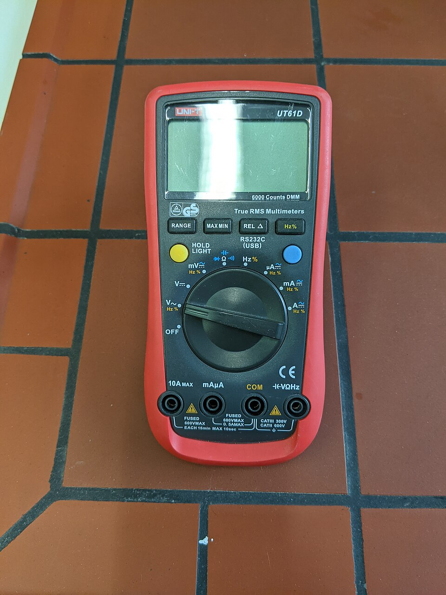
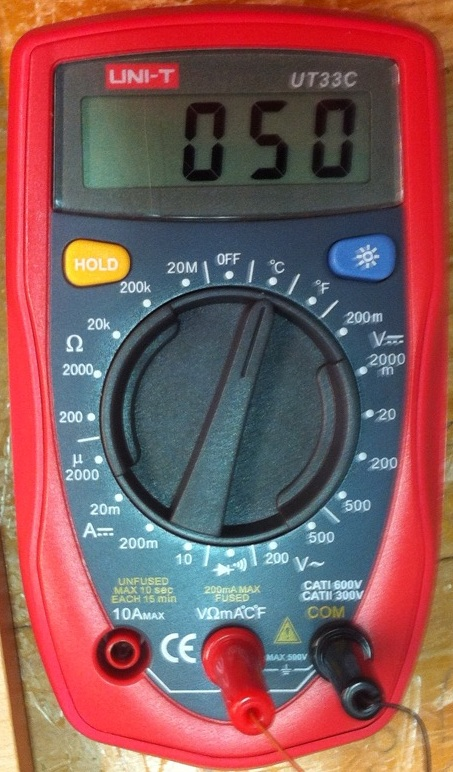
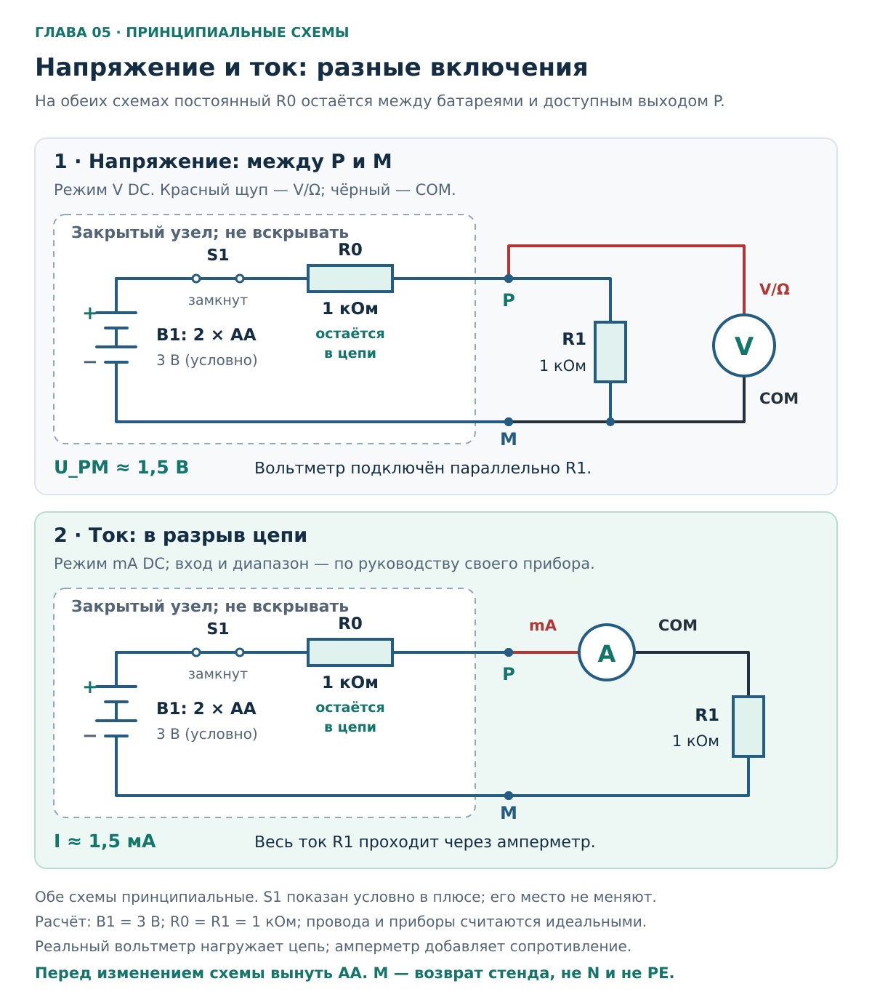
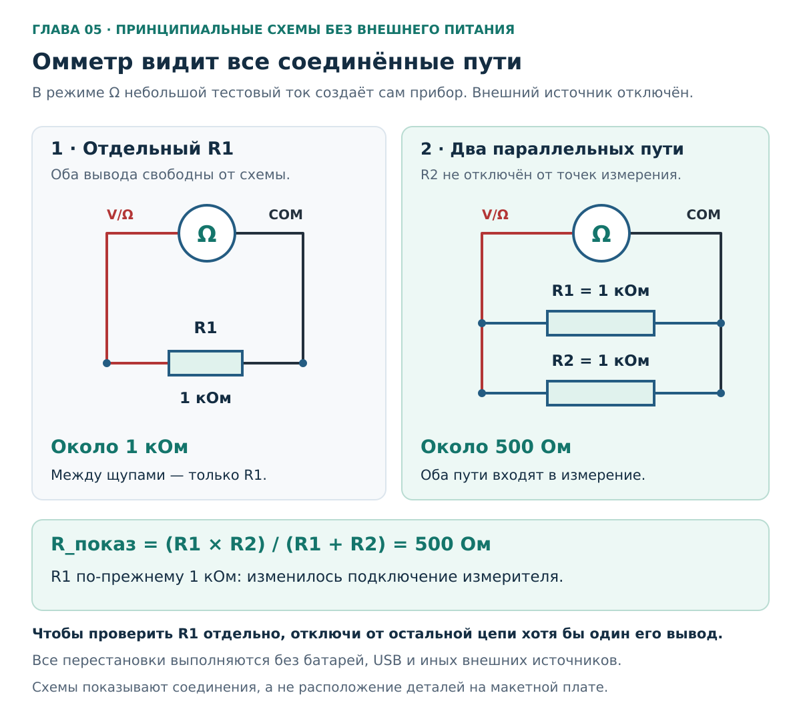
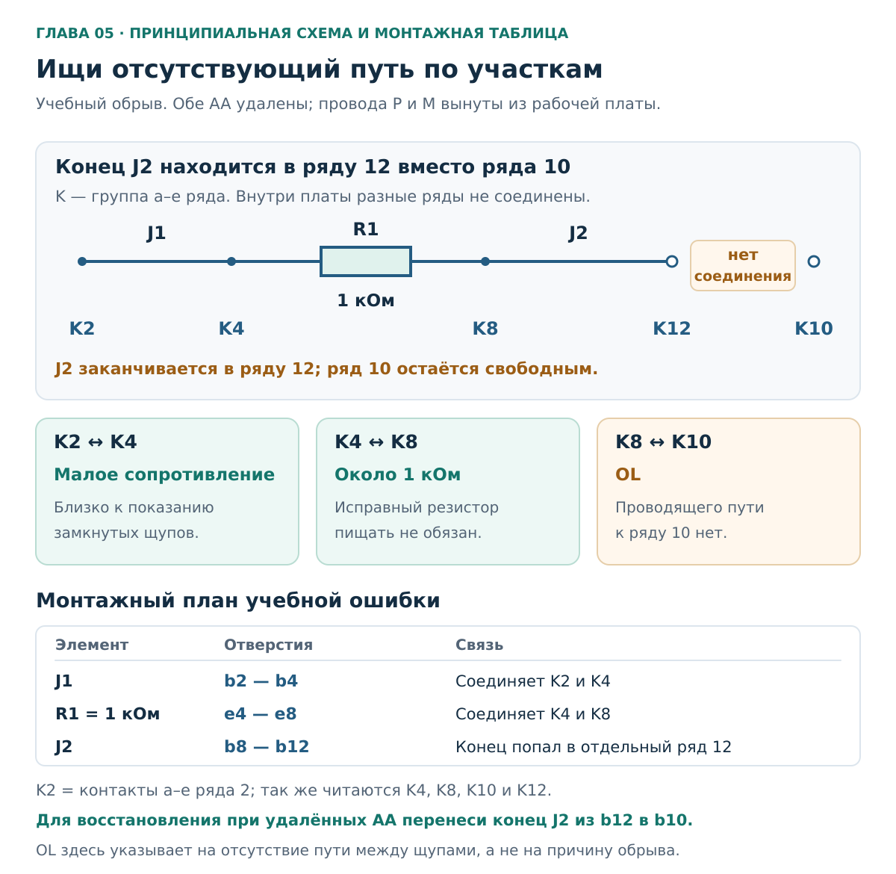

# Глава 05. Мультиметр без опасных привычек

[Главная](../README.md) · [Карта курса](../ROADMAP.md) · [Прогресс](../PROGRESS.md) · [Все главы](README.md)

**Дата технической проверки:** 2026-11-06.\
**Нужные предыдущие главы:** [01 — Безопасность](01-safety.md), [02 — Цепь, U, I, R](02-circuit-basics.md), [04 — Инструменты и стенд](04-tools-workbench.md). Для повторения единиц — [вводная физика A1](a1-physics-from-zero.md).\
**Практика:** отдельные обесточенные детали и батарейный стенд главы 04; квартирная проводка в упражнениях не участвует.\
**Время:** 30–40 минут чтения; 45–70 минут на основные упражнения. Их удобно разделить на два занятия.

## После главы ты сможешь

1. Перед подключением назвать величину, режим, диапазон, гнёзда и две точки измерения.
2. Читать число вместе с единицей, знаком и индикаторами `OL`, `HOLD`, `AC/DC`.
3. Выполнить первое включение подготовленного стенда и сравнить напряжение с нагрузкой и без неё.
4. Измерить отдельный резистор и найти разрыв в обесточенном учебном соединении.
5. Объяснить, почему токовый вход нельзя использовать как вход напряжения и почему измеритель влияет на цепь.

**Если стенд ещё не собран:** выполни упражнение A и бумажные части B–D. К включению переходи после сборки по главе 04. Ни наличие набора Arduino, ни прочитанный текст не означают, что макет уже подготовлен.

## 1. Две батарейки, а на экране полтора вольта

Представь: в держателе две AA, на выходе ожидаешь около 3 В, но прибор показывает около 1,5 В. Затем снимаешь питание, проверяешь резистор прозвонкой — тишина. Неужели сломаны и батарейки, и резистор?

В нашем стенде оба наблюдения могут быть нормальными. R0 и R1 делят напряжение, а исправный резистор 1 кОм обычно выше порога звуковой прозвонки. Чтобы отличить норму от неисправности, нужны **схема, правильный режим и ожидаемый результат**. Одно число без этих сведений мало что объясняет.

## 2. Гнездо и переключатель выбирают вместе

Мультиметр объединяет несколько приборов. В режиме напряжения он работает как вольтметр, сопротивления — как омметр, тока — как амперметр. При смене режима меняется способ взаимодействия с цепью.

### 2.1. Что означают надписи у гнёзд

| Обозначение | Назначение | Привычка для этой главы |
|---|---|---|
| `COM`, common | Общий вход измерения | Чёрный щуп. Это не PE и не обязательное соединение с землёй |
| `V`, `Ω` и дополнительные символы | Напряжение, сопротивление и другие перечисленные функции | Красный щуп для основных упражнений |
| `μA`, `mA` | Малые токи: микроамперы и миллиамперы | Только дополнительное упражнение E после проверки инструкции |
| `A`, `10 A`, иногда `20 A` | Другой токовый вход с собственными пределами | В этой главе не используется |

Это распространённая компоновка, а не расположение гнёзд твоего прибора. Например, у модели с тремя гнёздами вход **`VΩmA` может быть общим для нескольких функций**. Тогда правильного гнезда недостаточно: в токовом положении переключателя этот же вход работает иначе. Сверяй всю пару «гнездо + режим» с руководством. Пример раздельных входов — [Fluke 15B+/17B+/18B+, таблица 1, печатная с. 2](https://media.fluke.com/f8ca9de4-481a-4125-8a46-b2d9006f431f_original%20file.pdf).

Надпись `10 A` не означает, что прибор выдаёт 10 А или что через этот вход можно измерять всё подряд. Предел, длительность измерения и наличие предохранителя определяются документацией. Переключатель `OFF` тоже не следует считать гарантированным разрывом цепи между токовыми гнёздами: перед изменениями прибор отсоединяют.

### 2.2. Четыре задачи — четыре настройки

| Вопрос | Режим | Типичные гнёзда | Подключение | Состояние учебной цепи |
|---|---|---|---|---|
| Какое напряжение между P и M? | `V⎓`, `V DC` | `COM` и вход с `V` | Между P и M, параллельно нагрузке | Питание включено только на время чтения |
| Каково сопротивление R1? | `Ω` | `COM` и вход с `Ω` | К двум выводам снятого R1 | Источника нет |
| Соединены ли концы перемычки? | Звуковая прозвонка | Гнёзда по руководству, обычно те же | К концам отдельной перемычки | Источника нет |
| Какой ток проходит через R1? | `mA⎓`, `DC mA` | `COM` и разрешённый токовый вход | В разрыв ветви, последовательно | Собираем без батарей, включаем после проверки |

`⎓` — постоянное напряжение или ток: прямая линия над прерывистой. `~` — переменное. Для батарейного стенда нужны **DC**, а не `V~`. Если одна позиция ручки объединяет функции, их выбирают кнопкой `SELECT`, `FUNC` или её аналогом и проверяют обозначение на экране. Случайное показание в AC-режиме не отвечает на вопрос о напряжении батарей. [Fluke: измерение DC-напряжения](https://www.fluke.com/en-ie/learn/blog/digital-multimeters/how-to-measure-dc-voltage-with-a-digital-multimeter).

Общий принцип подключения V/A описан в [OpenStax, § 10.4](https://openstax.org/books/university-physics-volume-2/pages/10-4-electrical-measuring-instruments). Снятие питания перед Ω/прозвонкой и запрет подключения токового входа поперёк источника прямо указаны в [Fluke Safety Information, с. 2–3](https://media.fluke.com/67fa3ef8-72a0-424a-8ff6-b10800c0e635_original%20file.pdf).

## 3. Как прочитать экран целиком

### 3.1. Диапазон — сколько прибор способен показать в этой настройке

У прибора с ручным выбором возле `V⎓` могут стоять `200m`, `2000m`, `20`, `200`. Это пределы одной величины, а не четыре разных способа подключения. `2000 mV` — около 2 В: для выхода двух AA без нагрузки этого мало. Для нашего заранее известного источника выбираем доступный **DC V диапазон выше 3,4 В**, например 20 В. Число 3,4 В здесь — верхнее расчётное условие стенда из главы 04, не универсальная характеристика AA.

На `AUTO` прибор выбирает диапазон внутри выбранной функции. Он не обязан сам решить, что ты хотел измерить, и не исправляет ошибку гнезда. Для первых опытов оставь обычный `V DC`, без специальных `LoZ`, `Auto-V` и подобных режимов. У режима с низким входным сопротивлением нагрузка на стенд будет другой.

Если предел намного выше нужного, маленькое изменение может не попасть в последний разряд. Но больше цифр не означает автоматически большую точность. **Разрешение** — шаг показания; **погрешность** описывает, насколько результат может отличаться от значения измеряемой величины. Для сравнения 3 В и 1,5 В не нужно требовать точного совпадения последней цифры. [Fluke: диапазон, разрешение и точность](https://www.fluke.com/en-us/learn/blog/digital-multimeters/accuracy-precision).

### 3.2. Число без единицы — незаконченная запись

| На экране | Как записать в тетради |
|---|---|
| `1.50 V`, DC | Постоянное напряжение +1,50 В |
| `1500 mV` | 1500 мВ = 1,500 В |
| `0.998 kΩ` | 0,998 кОм = 998 Ом |
| `1.50 mA` | 1,50 мА = 0,00150 А |
| `−1.50 V`, DC | Красный щуп находится на потенциале на 1,50 В ниже чёрного |

На некоторых простых приборах единица определяется положением ручки и не подписывается на экране. Поэтому полезно записывать и диапазон: например, **«DC V, предел 20 V, показание 3,18 V»**.

Знак минус в DC не означает «батарейка с отрицательной ёмкостью». Прибор показывает разность потенциалов **красный относительно чёрного**. На нашем стенде при перестановке только измерительных щупов знак меняется, а модуль остаётся близким. Полярность установки самих батарей ради этого не меняют. [Fluke: полярность DC](https://www.fluke.com/en-ie/learn/blog/digital-multimeters/how-to-measure-dc-voltage-with-a-digital-multimeter).

### 3.3. OL, HOLD и другие причины удивительного результата

| Индикация или ситуация | Что она может означать | Следующее действие |
|---|---|---|
| `OL`, `O.L`, на некоторых моделях одинокая `1` | Значение не помещается в выбранный диапазон | Снять щупы; проверить режим, единицу и предел по инструкции |
| `OL` в Ω при разомкнутых щупах | Между ними нет измеряемого проводящего пути | Это ожидаемый результат; для проверки контакта сравнить с соединёнными щупами |
| `OL` на детали в Ω | Слишком большой R, плохой контакт, недостаточный диапазон или реальный обрыв | В обесточенной отдельной детали проверить контакт и подходящий диапазон |
| `HOLD`, `H`, иной символ фиксации | На экране сохранённое число | Отключить фиксацию перед измерением |
| `REL`, `Δ` | Может отображаться отклонение от ранее заданного значения | Для первых опытов отключить относительный режим |
| Значок разряда батареи мультиметра | Садится питание самого прибора | Прекратить измерения; обслужить прибор по его инструкции с отсоединёнными щупами |
| Экран погас | Возможны автоотключение или разряд | Не записывать это как «0 В» |

`OL` не является измерением бесконечности, а `0.00` не гарантирует математический ноль. Сначала проверяют условия получения показания. Работа диапазона и `OL` описана в [материале Fluke о разрешении](https://www.fluke.com/en-us/learn/blog/digital-multimeters/accuracy-precision), разомкнутые щупы в Ω — в [руководстве по сопротивлению](https://www.fluke.com/en-us/learn/blog/digital-multimeters/how-to-measure-resistance). Пример индикации `HOLD`, `REL` и питания — [руководство 15B+/17B+/18B+, с. 3–4, 11](https://media.fluke.com/f8ca9de4-481a-4125-8a46-b2d9006f431f_original%20file.pdf). Символы и доступность функций у своей модели нужно сверить отдельно.

## 4. Два реальных прибора — две разные панели

### 4.1. Отдельные токовые гнёзда

**Фото 1.** У UT61D слева находятся `10A` и `mA μA`, затем `COM` и многофункциональный вход с `V Ω`. Видны кнопки `RANGE` и `HOLD`. Щупы не подключены, экран пуст, ручка стоит у **V~**. Это фотография органов управления, не настройка батарейного опыта.

Автор **Anselm Schüler**, [Wikimedia Commons](https://commons.wikimedia.org/wiki/File:UT61D_digital_multimeter_front.jpg), [CC BY-SA 4.0](https://creativecommons.org/licenses/by-sa/4.0/). Использована уменьшенная версия Wikimedia, без других изменений.

### 4.2. Совмещённый вход и ручные пределы

**Фото 2.** У UT33C `COM` справа, а вход для V, Ω и малых токов совмещён. Вокруг ручки видны числовые пределы. Над отдельным входом `10A` нанесено `UNFUSED` — без предохранителя; у другого входа указано `FUSED`. Эти надписи относятся к показанному прибору.

В кадре подключён температурный датчик, ручка находится у **°C**. Число `050` нельзя подписать как «50 В». По фотографии также нельзя подтвердить исправность прибора или наличие штатного предохранителя внутри.

Автор **Neo139**, [Wikimedia Commons](https://commons.wikimedia.org/wiki/File:Multimeter_ut33c.JPG), общественное достояние, PD-self. Оригинал без изменений. Полные сведения о двух файлах — в [атрибуции](../assets/ATTRIBUTION.md). Марки приведены для чтения панелей, не как рекомендация к покупке.

## 5. Напряжение и ток: почему соединения разные

**Это две отдельные принципиальные схемы**, а не предложение подключить два прибора одновременно. Источник — два щелочных AA, условно 3 В; R0 = R1 = 1 кОм. R0 и исходные соединения остаются в закрытом узле главы 04. S1 показан включённым для чтения результата; собирают без батарей. Провода и источник в расчёте идеальные. P — выход после R0, M — возврат, не квартирная «земля».

### 5.1. Вольтметру нужны две точки

Вольтметр сравнивает потенциалы концов R1. Резистор остаётся подключённым, а прибор добавляется **параллельно** ему: красный к P, чёрный к M. Поэтому мы измеряем напряжение именно на R1, а не на паре батарей внутри закрытого узла.

Вольтметр стараются сделать с большим входным сопротивлением, чтобы через него шёл малый ток. Он всё же становится ещё одной ветвью цепи. Амперметр, наоборот, включают **последовательно**: ток исследуемой ветви проходит через него, поэтому его сопротивление стремятся сделать небольшим. [OpenStax: подключение измерительных приборов](https://openstax.org/books/university-physics-volume-2/pages/10-4-electrical-measuring-instruments).

Для идеальной модели стенда:

`I = 3 В / (1000 + 1000) Ом = 1,5 мА`;

`U_PM = I × R1 = 1,5 В`.

Если убрать R1, основной путь разомкнётся, ток через R0 сильно уменьшится и напряжение P–M станет близким к напряжению батарей. **Так работает эта схема, а не «просевшая вдвое батарейка».** Батареи, резисторы и измеритель реальны, поэтому точных 3,000 В и 1,500 В ждать не нужно.

Почему даже измерение «без нагрузки» немного нагружает источник

Примем для примера входное сопротивление вольтметра `R_V = 10 МОм`. Это выбранная модель расчёта. Для сравнения: у Fluke 15B+/17B+/18B+ в проверенной редакции указано **более 10 МОм** в V DC, но иная величина в mV; см. [таблицу на печатной с. 15](https://media.fluke.com/f8ca9de4-481a-4125-8a46-b2d9006f431f_original%20file.pdf). Параметр своего прибора проверяют для используемого режима.

Без R1 цепь всё же замыкается через вход прибора:

`U_PM = U_B × R_V / (R0 + R_V)`;

при `U_B = 3 В`: `U_PM ≈ 2,99970 В`.

С R1 прибор подключён параллельно ему:

`R_экв = R1 × R_V / (R1 + R_V) ≈ 999,90 Ом`;

`U_PM = U_B × R_экв / (R0 + R_экв) ≈ 1,499925 В`.

Здесь достаточно записать «около 3 В» и «около 1,5 В». Дополнительные знаки показывают расчётное влияние прибора, не обещают такую точность измерения. С низкоомным режимом результат будет заметно другим: поэтому для опыта выбран обычный V DC.

### 5.2. Сначала вычислим ток, затем при желании измерим напрямую

У снятого R1 можно измерить сопротивление, затем установить его обратно и узнать напряжение на нём. Закон Ома даст ток **через R1**:

`I_R1 = U_R1 / R1`.

Например, при измеренных 1,57 В и 0,998 кОм получим около **1,57 мА**. Это расчёт по двум измерениям; он позволяет пока оставить щупы во входах V/Ω. При подключённом вольтметре через R0 идёт ещё и малый ток входа прибора, поэтому строго это не совершенно одинаковые токи.

В дополнительном упражнении E амперметр займёт разрыв провода между P и R1. Внутри токового входа есть измерительное сопротивление, а также другие элементы токового пути. На них теряется часть напряжения, и ток может уменьшиться. В документации этот эффект описывает **burden voltage — падение напряжения на токовом входе**. [Fluke: Can you live with the burden?](https://www.fluke.com/en-gb/learn/blog/electrical/can-you-live-with-the-burden).

**При настройке на измерение тока нельзя подключать прибор между P и M, как вольтметр. Отдельный токовый вход также не используют для напряжения.** Это создаст малое сопротивление поперёк выхода. Постоянный R0 в нашем макете ограничивает последствия такой ошибки, но упражнение с намеренным замыканием не выполняем. На другом источнике последствия будут иными. Предохранитель прибора не заменяет правильного подключения. [Fluke Safety Information, с. 2](https://media.fluke.com/67fa3ef8-72a0-424a-8ff6-b10800c0e635_original%20file.pdf).

## 6. Омметр проверяет путь, а не читает этикетку детали

### 6.1. Почему требуется отсутствие внешнего питания

В режиме Ω мультиметр использует собственное питание для измерения сопротивления. Чужое напряжение нарушает условия такого измерения и может повредить прибор. Поэтому в наших опытах **оба AA вынуты, других источников нет, а проверяемая деталь снята со стенда**. Выключатель OFF сам по себе не заменяет это условие. [Fluke: измерение сопротивления](https://www.fluke.com/en-us/learn/blog/digital-multimeters/how-to-measure-resistance).

Этот порядок относится к известному пассивному макету. Вынутая вилка бытового прибора не гарантирует отсутствия энергии внутри него: там могут быть конденсаторы и другие источники. Такие устройства здесь не вскрываем и не прозваниваем.

### 6.2. Параллельный путь меняет показание

**Принципиальная схема измерения сопротивления. Внешних источников нет.** Слева один R1 = 1 кОм; справа к нему параллельно добавлен R2 = 1 кОм. Это отдельный учебный пример, не содержимое закрытого батарейного блока.

Справа ток омметра получает два пути. Для двух одинаковых резисторов общее сопротивление вдвое меньше: 500 Ом. R1 от этого не «испортился до 500 Ом». Чтобы проверить именно его, надо убрать обходной путь — например, отсоединить один вывод R1 от остальной цепи. В упражнениях мы полностью снимаем деталь. [Fluke: параллельные пути при измерении Ω](https://www.fluke.com/en-us/learn/blog/digital-multimeters/how-to-measure-resistance).

Не касайся одновременно обоих металлических выводов пальцами: тело тоже может стать дополнительным путём. На малых сопротивлениях заметен уже вклад самих щупов и контактов. Поэтому перед проверкой провода полезно узнать показание при соприкосновении только кончиков щупов.

### 6.3. Прозвонка — быстрый сигнал о малом сопротивлении

Пищалка помогает искать соединение, не глядя постоянно на экран. Она срабатывает при выполнении условий прибора, обычно ниже некоторого сопротивления. Точный порог и возможные задержки берут из инструкции; единого правила «всё до 50 Ом пищит» нет. [Fluke: проверка непрерывности](https://www.fluke.com/en-ca/learn/blog/digital-multimeters/how-to-test-for-continuity).

Отсюда три разных вывода:

- Короткая исправная перемычка должна давать малое сопротивление и, при выбранном режиме, обычно звуковой сигнал.
- Резистор **1 кОм может не пищать и оставаться полностью исправным**. Его оцениваем в Ω.
- Звук не подтверждает качество силового соединения, защитного проводника или изоляции. Малый тестовый ток мультиметра не воспроизводит рабочую нагрузку и специальные испытания.

## 7. Практика

### Общие условия для физических упражнений

**Нужно:** исправный мультиметр с инструкцией, щупы, R1 1 кОм и подготовленный закрытый узел главы 04 с постоянным R0 1 кОм; два выбранных щелочных AA; макетная плата и короткие совместимые с ней перемычки. Для D понадобятся две дополнительные перемычки J1/J2. Для E обязательны подходящие изолированные зажимы или мини-крючки, чтобы прибор был подключён устойчиво.

Работаем на сухом столе, без связи с розетками, USB, Arduino или другой аппаратурой. После LED-опыта главы 04 убраны LED и его перемычка `b3–b8`. R0 и исходные контакты закрыты; для измерений их не открывают. Если сборка не проверена по главе 04, включение откладываем.

**Правило перехода:** выключить S1 → снять щупы со стенда → вынуть обе AA → изменить монтаж или настройку. Для Ω и прозвонки источник дополнительно отсоединяется от проверяемой детали/платы. После сборки перед каждым включением вслух назвать: **«Измеряю …; ожидаю …; режим …; входы …; подключаюсь между …»**.

Толстый наконечник щупа не вставляют в отверстие макетки. Касайся доступного вывода сверху или используй совместимую перемычку как контактный вывод, держась за изоляцию. Для измерения P–M можно поставить такие выводы в `c2` и `c8`; их свободные концы разнести, чтобы они не касались друг друга. Если надёжно контактировать не получается, сначала подбери подходящие аксессуары.

**Остановиться до подачи питания:** неясны входы, режим, номинал R0 или монтаж; повреждены щупы; есть индикатор разряда прибора. **Прекратить начатый опыт:** течь, деформация, запах, дым или заметный нагрев. Отключать только при безопасном доступе; горячие или повреждённые элементы не брать голыми руками. Не выяснять нагрев прикосновением. Эти признаки ненормальны для рассчитанного макета; повторное включение — после установления причины.

### Упражнение A. Настройка без подключённой цепи

**Цель:** до первого измерения связать органы управления своего прибора с задачей. Нужны прибор, инструкция и тетрадь; щупы ни к какой цепи не подключены. Если модели нет под рукой, выполни по выбранному руководству на бумаге.

1. Запиши точную модель, ссылку и страницу инструкции. Перенеси из задания A главы 04 найденные входы, если уже заполнял его.
2. Найди обычный V DC и диапазон, охватывающий 3,4 В; Ω для примерно 1 кОм; прозвонку и способ её выбора.
3. Проверь, как отключаются HOLD/REL и как обозначается разряд батареи самого прибора. Не пытайся повторять кнопки другой модели.
4. Пока без подключения установи чёрный штекер в COM, красный — в разрешённое гнездо V/Ω. Выбери V DC, проверь положение ручки и экран.

| Что найти | Запись |
|---|---|
| Модель и руководство | … |
| Чёрный / красный вход для V и Ω | … / … |
| Режим и диапазон для выхода P–M | … |
| Режим и диапазон для R1 | … |
| Как включается прозвонка; порог по инструкции | … |
| Обозначения HOLD/REL/разряда | … |

**Бумажная часть:** прочитай `0.997 kΩ`, `−3.16 V DC`, `OL` при измерении резистора 1 кОм на пределе 200 Ω и `0.00 V` со значком HOLD. Какой результат требует смены диапазона, а какой пока нельзя считать текущим?

Разбор A

Это соответственно 997 Ом и −3,16 В относительно чёрного щупа. Исправные 1 кОм не помещаются в предел 200 Ω: снимай щупы и выбирай диапазон выше ожидаемого сопротивления, например 2 кОм. `0.00 V` с HOLD может быть сохранённым значением; сначала отключи фиксацию. По таблице должны быть понятны действия именно с твоей моделью. Если часть данных неизвестна, это конкретный пункт для уточнения, не разрешение попробовать случайную настройку.

### Упражнение B. Отдельный резистор и отдельный провод

**Цель:** различить малое сопротивление, примерно 1 кОм и открытый путь. Нужны R1, одна перемычка и мультиметр; оба AA вынуты. Полностью сними R1 и проверяемую перемычку с платы. При неизвестной настройке или неустойчивом контакте остановись до записи результата.

1. Выбери Ω с диапазоном для 1 кОм. Разведи щупы: запиши индикацию открытого пути.
2. Соедини **только кончики щупов**, не подключая их к источнику. Запиши малое сопротивление щупов и контакта: это может быть несколько десятых ома, а не строго ноль. При OL или явно нестабильном результате проверь настройку и соединения; стенд пока не включай.
3. Коснись двух выводов отдельного R1. Запиши значение с единицей. Не держи оба металлических вывода пальцами. Затем в том же режиме Ω измерь отдельную перемычку; для малого сопротивления можно выбрать более чувствительный предел по инструкции, предварительно сняв щупы с детали.
4. Сними щупы с R1, выбери прозвонку. Соприкосни кончики, затем разведи их: проверь наличие и исчезновение сигнала по инструкции.
5. Приложи щупы к концам отдельной перемычки. Ожидается малое сопротивление и сигнал. Затем проверь R1 тем же режимом: отсутствие сигнала сопоставь с уже измеренным сопротивлением.

| Объект | Ω: фактическая запись | Звук, если проверял |
|---|---|---|
| Разведённые щупы | … | … |
| Соприкасающиеся кончики | … | … |
| Отдельная перемычка | … | … |
| Отдельный R1 | … | … |

**Задача по схеме раздела 6:** R1 = R2 = 1 кОм, соединены параллельно. Какое сопротивление увидит прибор и что надо изменить для проверки только R1? Физически собирать эту дополнительную пару не обязательно.

Разбор B и пределы вывода

У отдельного R1 ожидается около 1 кОм. Для номинала 1 кОм ±5 % диапазон самой детали — 950–1050 Ом; к оценке показания добавляется погрешность прибора. Число у границы не повод сразу объявлять деталь неисправной. Значения порядка 100 Ом или 10 кОм требуют проверить маркировку, единицу и контакт.

У перемычки показание близко к показанию соединённых щупов. Это подтверждает проводящий путь при тестовом токе; состояние изоляции и пригодность к большой нагрузке так не устанавливаются. У R1 обычно нет звука: его сопротивление выше порога. Для двух идеальных 1 кОм параллельно получится **500 Ом**; снятие хотя бы одного вывода R1 исключит R2 из измерения R1.

Эта проверка выявляет грубые проблемы подключения. Она не является калибровкой мультиметра и не подтверждает его пригодность для сети.

### Упражнение C. Первое включение: без нагрузки, с R1 и обратный знак

**Цель:** получить три осмысленных показания напряжения. Нужны подготовленный стенд и прибор после A/B. R0 подтверждён при сборке, закрыт и остаётся на месте. Если выполнение сборки или проверка прибора не завершены, пока используй бумажные числа из разбора.

#### C1. Измерь выход без R1

1. При вынутых AA проверь рабочую плату: **P в `a2`, M в `a8`, R1 полностью снят**; иных деталей и перемычек между рядами нет. Если были измерительные выводы в `c2`/`c8`, они идут только к щупам и не соединены между собой.
2. Прибор отсоединён от платы. Выбери обычный V DC и диапазон выше 3,4 В либо авторегулировку V DC; чёрный — COM, красный — вход V. HOLD/REL выключены, значка разряда нет.
3. При OFF установи два выбранных AA по маркировке держателя и закрой крышку. Подключи чёрный щуп к M, затем красный к P. Держи пальцы за упорами щупов; не соединяй их металлические концы друг с другом.
4. Включи S1, дождись устойчивого показания и запиши **U₀** с единицей, знаком и режимом. Выключи S1, сними красный щуп, затем чёрный; при нормальном состоянии удали обе AA.

Без R1 ожидается напряжение, близкое к напряжению пары батарей: около 3 В, у новых щелочных элементов нередко немного выше. Это ещё не проверка их ёмкости. Если получилось OL, неожиданно отрицательное значение при заявленном подключении, около нуля либо выше принятого в стенде уровня 3,4 В, остановись: сначала без питания сверь источник, настройку, полярность и контакты. Не вскрывай узел R0 ради поиска показания. При неясной причине оставь стенд обесточенным для разбора.

#### C2. Повтори с нагрузкой

1. Обе AA вынуты, щупы сняты. Установи проверенный R1 между **`e2` и `e8`**, как в главе 04. P/M остаются в `a2`/`a8`.
2. Проследи путь при будущем включении: батареи → S1 → R0 → P → R1 → M → батареи. Вольтметр будет подключён между P и M параллельно R1.
3. Сохраняя R1 в `e2–e8`, выполни **шаги 2–4 C1**. Запиши **U₁** и сравни его с U₀: ожидается примерно половина, если оба резистора около 1 кОм.
4. По измеренному в B сопротивлению вычисли `I_R1 = U₁ / R1`. Подпиши столбец **«вычислено»**, а не «измерено в mA».

Если после установки R1 напряжение почти не изменилось, возможны неподключённый вывод или неверный ряд. Если стало близким к нулю, возможны непредусмотренная перемычка, неверный номинал или плохое питание. Это гипотезы, не диагноз по одному числу. Выключи, вынь AA и сверяй внешний монтаж; устранять причину изменением R0 нельзя.

#### C3. Проверь смысл знака

При вынутых AA и снятых щупах оставь монтаж R1 прежним. Штекеры и режим V DC сохраняются. При OFF установи AA, закрой крышку и **поменяй местами только точки касания щупов:** чёрный COM к P, красный V к M. Включи S1 и запиши показание: ожидается близкое по модулю отрицательное напряжение. Выключи, сними красный щуп, затем чёрный, удали AA. Батареи в держателе ради этого опыта не переворачиваются; обычный порядок щупов восстанавливают уже после отключения.

| Состояние | Предсказание | Фактическая запись |
|---|---|---|
| Без R1, красный P / чёрный M | Около +3 В | U₀ = … В |
| С R1, красный P / чёрный M | Около U₀ / 2 | U₁ = … В |
| С R1, красный M / чёрный P | Около −U₁ | … В |
| Ток через R1 по U₁ и измеренному R1 | Около 1,5 мА при условных 3 В | **Вычислено:** … мА |

Разбор C: пример журнала

**Условный пример, не выполненные измерения пользователя:** U₀ = 3,18 В, U₁ = 1,58 В, R1 = 0,997 кОм, при обратном подключении −1,58 В. Отношение U₁/U₀ ≈ 0,497 согласуется с двумя близкими сопротивлениями. Ток через R1: `1,58 / 997 ≈ 0,001585 А = 1,585 мА`, разумно записать около 1,58 мА с учётом точности исходных измерений.

Результат не обязан совпасть с расчётом для ровно 3 В: реальные батареи и резисторы отличаются, прибор имеет погрешность. В идеальной модели только с допусками R0/R1 по ±5 % доля напряжения на R1 составляет 0,475–0,525 напряжения источника. Это объясняет небольшое отклонение от половины, **не задаёт полный допуск приёмки реального стенда**.

Нулевое показание в неизвестной цепи не доказывает её безопасности: могут быть неверный режим, HOLD, плохой контакт или неисправные щупы. Здесь мы измеряли только заранее известный маломощный источник. Проверка отсутствия напряжения в квартирной установке — другая задача.

### Упражнение D. Найди отсутствующее соединение по участкам

**Цель:** перейти от «не работает» к конкретному участку пути. Нужны R1, плата, две проверенные перемычки J1/J2 и мультиметр в Ω; диапазон охватывает 1 кОм. **Обе AA удалены, P и M полностью вынуты из платы. В этом упражнении питание вообще не включается.** Если разводка платы неизвестна, выполни по рисунку на бумаге.

Обозначим **K2** группу `a–e` ряда 2, **K4** — такую же группу ряда 4 и далее. Это условные имена узлов на рисунке, не надписи на приборе. Боковые шины не используются.

**Сверху принципиальная схема, снизу монтажная таблица.** Здесь специально воспроизведено отсутствующее соединение на плате без источника. Ничего не режем и не повреждаем.

1. Убери прежние элементы рабочей части, включая временные измерительные выводы. Установи J1 в **`b2–b4`**, R1 в **`e4–e8`**, J2 в **`b8–b12`**. Ряд 10 должен остаться отдельно от этой цепочки.
2. Предскажи показания по таблице, затем измерь. Касайся доступного контакта соответствующей группы; если нужен отдельный контактный вывод, ставь его в свободное отверстие той же группы. Не замыкай им разные ряды.

| Между какими узлами | Какой участок проверяется | Предсказание / измерение |
|---|---|---|
| K2 и K4 | J1 и его контакты | … / … |
| K4 и K8 | R1 и его контакты | … / … |
| K8 и K10 | Ожидаемый обратный путь через J2 | … / … |
| K2 и K10 | Весь задуманный путь | … / … |

3. Для участка без проводящего пути проверь контакты щупов, затем сними J2 и измерь **саму перемычку отдельно**. Провод цел или отсутствовало его соединение с нужным рядом?
4. Установи исправную J2 в **`b8–b10`**. Повтори измерения K8–K10 и K2–K10. Теперь ожидаются соответственно малое сопротивление и около 1 кОм.
5. Сними щупы, убери J1/J2 и временные измерительные выводы. Верни базовый монтаж **P → `a2`, M → `a8`, R1 → `e2–e8`**. Обе AA остаются вынутыми.

Если вместо ожидаемого результата снова OL, сначала проверь прибор соприкосновением кончиков вдали от схемы, затем координаты и контакт. Не увеличивай усилие толстым щупом в отверстии. При непонятной разводке остановись и найди схему своей платы.

Разбор D

В исходной учебной ошибке K2–K4 даёт малое сопротивление; K4–K8 — около 1 кОм; K8–K10 и K2–K10 — OL. Резистор не обязан пищать, поэтому для средней части смотрим число в Ω.

J2 сама по себе исправна: она соединяет K8 с K12, **но не с K10**. Это разрыв задуманного пути из-за неправильного места подключения, а не оборванная металлическая жила. После переноса конца в `b10` весь путь K2–K10 включает один R1, поэтому получается около 1 кОм, а не ноль.

Измерение по участкам локализует проблему. Один OL на концах длинной цепочки ещё не говорит, где именно пропал контакт. Этот опыт не переносится на скрытую квартирную проводку: здесь известны все элементы, нет питания и сохранённой энергии.

### Упражнение E. Дополнительно: измерение тока в разрыве

**Можно пропустить:** основные навыки главы уже отработаны. Это упражнение нужно, чтобы сравнить схему амперметра с вольтметром, а не для завершения стенда.

**Условия допуска к этому опыту:** A–D понятны; монтаж восстановлен; R0 постоянно установлен и закрыт. В инструкции своего прибора найдены **предохранённый вход малых постоянных токов**, подходящий диапазон и способ проверки его предохранителя. Исправность токового входа проверена предусмотренным производителем способом без подключения к внешней цепи. Если способ не освоен, вход без предохранителя или документации нет — оставь E бумажным. Предохранитель не заменяют проволокой и не выбирают по внешнему сходству.

**Нужно дополнительно:** подходящие изолированные зажимы/мини-крючки и контактные выводы для платы. При ненадёжном креплении щупов опыт откладывают. Вход 10 A здесь не нужен.

1. S1 выключен, обе AA вынуты, прибор отсоединён. R1 стоит в `e2–e8`, M — в `a8`. Перенеси **P из `a2` в `a4`**. Между рядами 4 и 2 теперь нет провода: это место будущего амперметра. Убедись, что после D не осталось J1/J2.
2. Чёрный штекер оставь в COM; красный поставь в подтверждённый вход mA, либо общий вход согласно инструкции. Выбери **DC mA**. Начни с верхнего подходящего диапазона этого входа, например 200/400 мА, если именно так устроен прибор. Диапазон должен охватывать расчётный максимум стенда около 3,6 мА; `200 μA` для него не подходит.
3. При вынутых батареях закрепи красный щуп на узле **P, ряд 4**, чёрный — на **ряду 2, стороне R1**. Для зажимов можно использовать совместимые контактные выводы в `c4` и `c2`. Чёрный щуп в этом опыте **не соединён непосредственно с M**.
4. Проследи единственный путь: B1 → S1 → R0 → P → **вход mA, прибор, COM** → R1 → M → B1. Если прибор оказался параллельно R1 или P–M, включение не выполняй.
5. При OFF установи выбранные AA, закрой держатель и включи примерно на 10 секунд для записи. Ожидается ток порядка 1,5 мА для условных 3 В; фактический результат сравни с C. При OL или неожиданном показании выключи и удали AA. Не меняй входы и диапазон под питанием и не обходи R0 ради «проверки».
6. Выключи S1, удали AA, отсоедини прибор. **Верни красный штекер во вход V/Ω и выбери V DC**, затем убери контактные выводы и верни P из `a4` в `a2`. Запиши, что стандартная конфигурация восстановлена.

Если верхний диапазон слишком грубый, более чувствительный выбирают только после отключения по общему правилу и проверки его предела в инструкции. Нулевое показание может означать разрыв, проблему предохранителя, неправильную настройку или недостаточное разрешение; оно не разрешает переход к более мощному источнику.

Разбор E

При идеальном амперметре получилось бы `3 / (1000 + 1000) = 1,5 мА`. Реальный прибор добавляет сопротивление и может уменьшить ток; в руководстве ищут burden voltage. Сравниваются также погрешности, разрешение, фактические батареи и номиналы деталей. Небольшое расхождение с вычисленным в C током само по себе не говорит о поломке.

На схеме амперметр соединяет P с выводом R1, замыкая подготовленный разрыв. Вольтметр из C соединял P с M, сохраняя нагрузку параллельно себе. **Это разные пары точек.** Возврат красного щупа в V/Ω снижает вероятность перепутать их при следующем измерении, но не отменяет проверку режима, особенно у совмещённого входа.

## 8. Частые ошибки

| Ошибка | Что получается | Как исправить привычку |
|---|---|---|
| «Красный всегда в левое гнездо» | У разных приборов там разные функции | Читать обозначение и режим перед подключением |
| «AUTO сам всё поймёт» | Автодиапазон не исправляет выбор A вместо V | Сначала назвать величину, затем проверить AC/DC, диапазон и входы |
| Переключить на Ω, оставив батареи в цепи | Омметр получает внешнее напряжение | Отсоединить прибор, удалить источник, снять проверяемую деталь |
| «Не пищит — значит обрыв» | Исправный R1 выше порога прозвонки | Перейти в Ω и оценить число |
| Сразу записать OL как поломку детали | Не исключены диапазон и плохой контакт | Проверить прибор и измерить отдельную деталь на подходящем пределе |
| Записать сохранённый ноль с HOLD | Число относится к прошлому состоянию | Перед опытом отключить фиксацию и относительные режимы |
| Измерить R1 в цепи с другим параллельным путём | Получается сопротивление всей доступной сети | Отсоединить хотя бы один вывод; в наших заданиях снять деталь |
| «3 В без R1 и 1,5 В с R1 — неисправность батареи» | Не учтён последовательный R0 | Сначала посчитать деление напряжения |
| Токовый вход приложить к P–M | Прибор шунтирует выход малым сопротивлением | Для тока заранее подготовить разрыв ветви и проверить маршрут |
| Оставить после E красный штекер в mA | Следующее измерение легко начать неправильно | Сразу восстановить вход V/Ω, режим V DC и монтаж стенда |

## 9. Самопроверка

1. Ты хочешь измерить напряжение P–M. Какие пять вещей назовёшь перед подключением? Почему мало увидеть красный штекер в гнезде VΩmA?
2. У отдельного R1 номинал 1 кОм. На пределе 200 Ω — OL, на пределе 2 кОм — 0,996 кОм. Есть ли основание объявить обрыв?
3. На экране `0.00 V` и HOLD. Можно ли считать это текущим напряжением? Что означает погасший экран?
4. Почему исправная перемычка пищит, а исправный резистор 1 кОм может молчать? Что звук не проверяет?
5. Условно получены U₀ = 3,20 В, U₁ = 1,60 В и R1 = 1,00 кОм. Каков вычисленный ток через R1? Что будет со знаком U₁ при перестановке точек касания щупов?
6. К двум параллельным резисторам по 1 кОм подключили омметр. Какое показание ожидается? Доказывает ли оно, что один резистор стал 500 Ом?
7. В опыте D показания: K2–K4 мало, K4–K8 около 1 кОм, K8–K10 OL. Какой участок проверять дальше и зачем снимать J2 отдельно?
8. Можно ли в E подключить красный mA к P, чёрный COM к M? Куда должны идти щупы и что обязательно восстановить после опыта?

Ответы с объяснениями

**1.** Величина — постоянное напряжение; ожидается несколько вольт; режим — V DC; диапазон охватывает 3,4 В либо выбран Auto внутри V DC; гнёзда — COM и разрешённый V-вход; точки — P и M, параллельно нагрузке. Это пять групп проверки: величина, ожидаемое значение/диапазон, режим, входы, подключение. У совмещённого VΩmA назначение зависит также от переключателя. Один цвет или гнездо настройку не определяют.

**2.** Нет. 996 Ом не помещаются в предел 200 Ω, но нормально измеряются на 2 кОм. OL на первом пределе объясняется диапазоном. Полученное сопротивление близко к номиналу; окончательное сравнение учитывает допуск детали и погрешность прибора.

**3.** Нет: HOLD может сохранять прошлое число. Сначала отсоединить щупы, отключить фиксацию и проверить настройку. Погасший экран вообще не является численным результатом: возможны автоотключение или разряд. Ни то ни другое не доказывает отсутствия напряжения.

**4.** У перемычки сопротивление ниже порога, у R1 может быть выше. Прозвонка не определяет допустимый рабочий ток, качество изоляции и выполнение требований к защитному проводнику. Проверка провода в этом опыте подтверждает только проводящий путь при тестовом токе.

**5.** `I_R1 = 1,60 / 1000 = 0,00160 А = 1,60 мА`. После перестановки точек касания, при том же режиме и гнёздах, получится около −1,60 В. Это изменение направления сравнения потенциалов, а не перемена состояния батарей.

**6.** Около 500 Ом — сопротивление двух путей вместе. Чтобы измерить один R1, его надо отделить от параллельной ветви. Показание 500 Ом не устанавливает номинал каждого из двух резисторов по отдельности.

**7.** Проверять связь K8–K10: посадку концов J2, нужные ряды и саму перемычку. Отдельное малое сопротивление J2 покажет, что проводящая жила цела; тогда ошибка может быть в месте подключения или контакте. В заданной раскладке конец попал в `b12`, а должен быть в `b10`. Работы идут при вынутых батареях и отсоединённом источнике.

**8.** Нет: это соединит токовый вход поперёк выхода. В опыте E красный идёт к P в ряду 4, чёрный — к стороне R1 в ряду 2. Далее ток проходит через R1 к M. По завершении удаляют AA, отсоединяют прибор, возвращают красный штекер в V/Ω и режим V DC, убирают измерительные выводы и возвращают P в `a2`.

## 10. Готовность двигаться дальше

Теория усвоена, если ты объясняешь разницу V/A/Ω, читаешь единицы и знаки, отличаешь OL от нуля и понимаешь пределы прозвонки. Если путаются гнёзда, вернись к разделу 2 и упражнению A; если удивляют 1,5 В — к разделу 5.

**Практический результат основных упражнений:** заполнена настройка A, записаны измерения B/C, найден и устранён учебный разрыв D, базовый макет восстановлен и хранится без AA. E необязательно. При отсутствии деталей можно пройти теорию и бумажные задачи, отдельно указав, какие действия ещё не выполнены.

Для обратной связи достаточно модели мультиметра, заполненных таблиц и описания неожиданного результата. Не подставляй расчётные числа вместо своих показаний. В [PROGRESS.md](../PROGRESS.md) выполнение практики отмечается только после твоего сообщения; готовность текста не подтверждает ни сборку стенда, ни измерения.

## Источники и пределы применения

Проверено **2026-11-06**. Прямые ссылки стоят рядом с утверждениями; записи **S33–S37** добавлены в [общий реестр](../references/SOURCES.md). Инструкции производителей описывают конкретные приборы и принципы измерения, не устанавливают российские нормы квартирного монтажа.

| Тема | Первичный источник и границы использования |
|---|---|
| Входы, индикация, режимы, питание прибора | [Fluke 15B+/17B+/18B+ Users Manual](https://media.fluke.com/f8ca9de4-481a-4125-8a46-b2d9006f431f_original%20file.pdf), Rev. 3, 8/25, печатные с. 2–7, 11–15. Пороги, входное сопротивление и предохранители относятся к этим моделям |
| Правила обращения с входами | [Fluke 110–117 Safety Information](https://media.fluke.com/67fa3ef8-72a0-424a-8ff6-b10800c0e635_original%20file.pdf), PN5073105, 12/2019, с. 2–3; ранее S03 |
| DC-напряжение и диапазон | [Fluke: измерение DC](https://www.fluke.com/en-ie/learn/blog/digital-multimeters/how-to-measure-dc-voltage-with-a-digital-multimeter); [диапазон, разрешение и точность](https://www.fluke.com/en-us/learn/blog/digital-multimeters/accuracy-precision). Явные даты технических редакций вебстраниц не указаны |
| Ω и прозвонка | [Fluke: сопротивление](https://www.fluke.com/en-us/learn/blog/digital-multimeters/how-to-measure-resistance); [непрерывность цепи](https://www.fluke.com/en-ca/learn/blog/digital-multimeters/how-to-test-for-continuity). Примеры порогов не перенесены на неизвестный прибор |
| Включение V/A, влияние измерителя | [OpenStax, University Physics Vol. 2, § 10.4](https://openstax.org/books/university-physics-volume-2/pages/10-4-electrical-measuring-instruments), 2016; [Fluke: Can you live with the burden?](https://www.fluke.com/en-gb/learn/blog/electrical/can-you-live-with-the-burden), Chuck Newcombe, дата вебредакции не указана |
| Питание и монтаж стенда | [Глава 04](04-tools-workbench.md), первичные документы Energizer, WAGO и изготовителей компонентов в S25–S31 |

Упражнения, схемы, пример журнала, расчёт с входом 10 МОм и координаты платы разработаны для курса. Это не заводские схемы испытания и не отчёт о физически проверенном устройстве. Фотографии настоящие; атрибуция и сведения об изменениях — [в реестре изображений](../assets/ATTRIBUTION.md). Фото собранного стенда здесь нет.

## Навигация

**Предыдущая глава:** [04 — Инструменты и учебный стенд](04-tools-workbench.md).\
**Следующая тема:** 06 — «Переменный ток, фаза, ноль и земля». Задание — в [общем черновике](../COURSE_DRAFT.md#глава-06); актуальная точка продолжения — в [PROGRESS.md](../PROGRESS.md).
