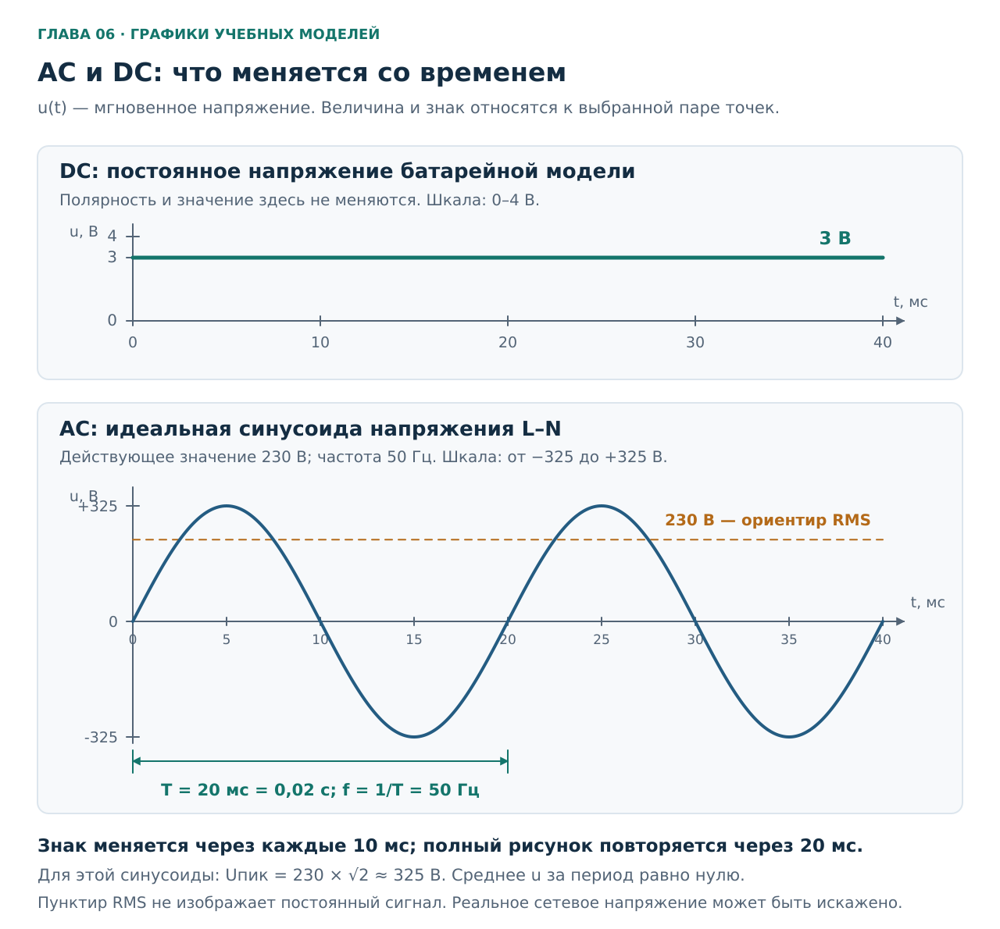
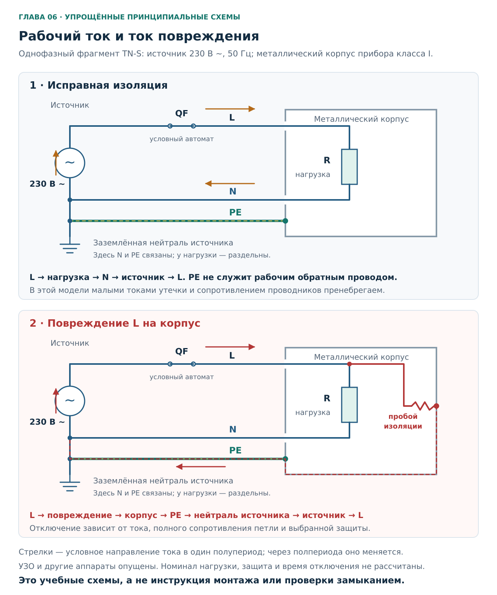
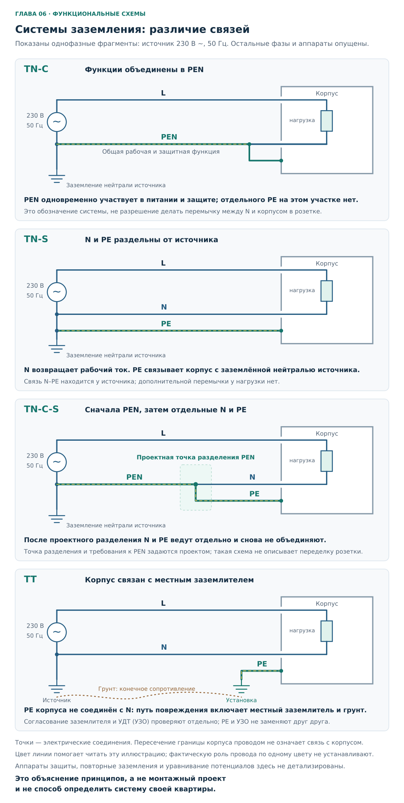
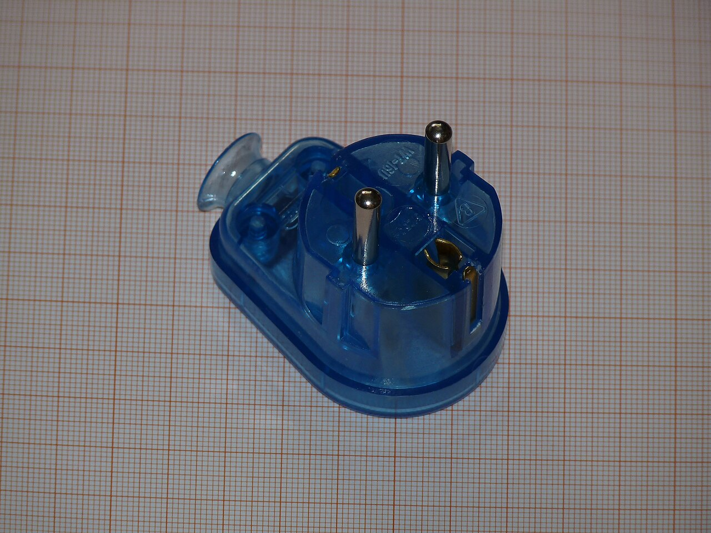
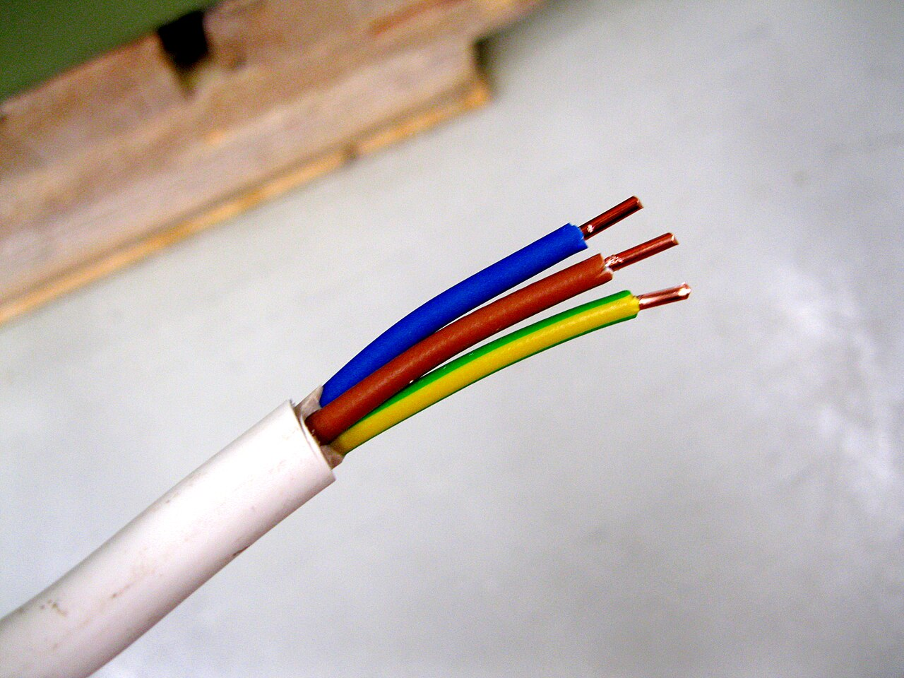
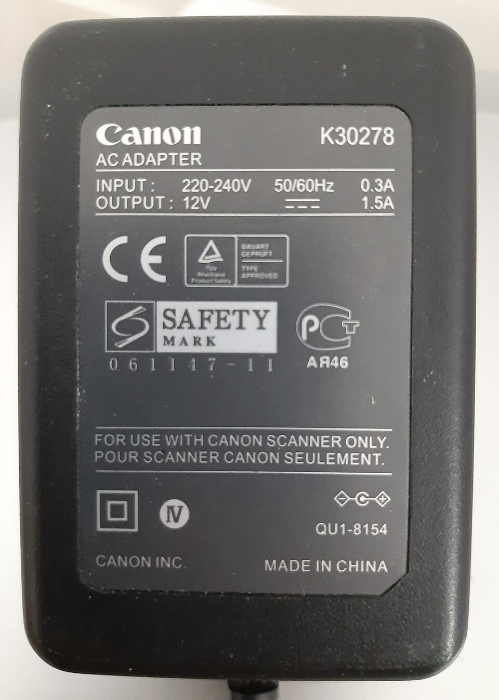

# Глава 06. Переменный ток, фаза, ноль и земля

[Главная](../README.md) · [Карта курса](../ROADMAP.md) · [Прогресс](../PROGRESS.md) · [Все главы](README.md)

**Дата технической проверки:** 2026-11-06.\
**Нужные предыдущие главы:** [01 — Безопасность](01-safety.md), [02 — Цепь, U, I, R](02-circuit-basics.md), [03 — Мощность и энергия](03-power-energy.md). Обозначения прибора разобраны в [главе 05](05-multimeter.md).\
**Практика:** бумажные схемы, расчёты и фотографии из главы.\
**Время:** 35–45 минут чтения и 25–40 минут упражнений.

## После главы ты сможешь

1. Объяснить, что означают `230 В ~ 50 Гц`, и отличить действующее напряжение от пикового.
2. Различать рабочие функции L и N, защитную функцию PE и совмещённую функцию PEN.
3. Проследить отдельные пути тока нагрузки и тока при повреждении изоляции.
4. Узнать TN-C, TN-S, TN-C-S и TT по заданной структуре соединений.
5. По фотографии отделить видимую конструкцию от сведений, которые требуют документов и проверки специалистом.

Стенд из двух AA здесь не нужен: он помогает изучать цепи постоянного тока, но не воспроизводит квартирную AC-сеть и действие её защиты. Вывод `GND` на Arduino и точка M батарейного стенда также не становятся квартирным PE из-за слова «земля».

## 1. Зачем третий контакт, если прибор работает без него?

Представь стиральную машину с металлическим корпусом, для которой изготовитель предусмотрел защитное заземление — прибор класса I. Два рабочих проводника питают двигатель, нагреватель и электронику. Третий соединён с доступными металлическими частями.

Если этот третий путь оборван, машина может продолжить стирать. Из этого следует только, что её рабочая цепь получает питание. **Способность работать и способность отключиться при повреждении — разные свойства.**

Чтобы понять роль третьего проводника, сначала разберём, чем питание розетки отличается от двух батареек. Затем вернёмся к корпусу и повреждению изоляции. Классы оборудования и защитные меры различаются: требование к конкретному прибору устанавливается его конструкцией и документацией, а не наличием любого металлического винта снаружи. Общая основа — [ГОСТ Р 50571.4.41-2022, разделы 411–412][protection].

## 2. Что меняется при переменном токе

### 2.1. DC и AC

У нашей батарейной цепи полярность сохраняется: точка P выше по потенциалу, чем M. При замкнутой резистивной цепи ток имеет одно направление. Это **DC**, direct current — постоянный ток. Реальная батарея постепенно разряжается; слово «постоянный» не обещает неизменного числа вольт навсегда.

В **AC**, alternating current — переменном токе, направление периодически меняется. Для резистора, подключённого к синусоидальному источнику, меняются и знак напряжения, и направление тока. На шильдиках и приборах встречаются `~` / `AC` и `⎓` / `DC`. Символ `⎓` изображает прямую линию над прерывистой. [OpenStax: AC Sources][ac].

**Это графики напряжения во времени**, не схема подключения. Вертикальные шкалы разные. Линия 3 В относится к идеализированному источнику двух AA, а не к нагруженному выходу P–M стенда, где в главе 05 получалось около 1,5 В. Для сети показана идеальная синусоида между L и N. Реальные формы могут иметь отклонения. В квартирную розетку ничего подключать для повторения графиков не нужно.

### 2.2. Частота: сколько полных циклов за секунду

**Частота `f`** измеряется в герцах: 1 Гц — один полный цикл за секунду. При 50 Гц синусоида совершает 50 циклов. **Период `T`** — длительность одного цикла:

`T = 1 / f = 1 / 50 с = 0,020 с = 20 мс`.

Один полупериод занимает 10 мс. На показанном графике через 20 мс повторяются и значение, и направление его изменения. Две точки с нулевым напряжением через 10 мс ещё не обозначают полный цикл: наклоны кривой у них противоположны.

Для идеальной синусоиды из рисунка:

| Время от выбранного начала | Мгновенное напряжение L относительно N |
|---|---:|
| 0 мс | 0 В; начинается положительный полупериод |
| 5 мс | Около +325 В |
| 10 мс | 0 В; начинается отрицательный полупериод |
| 15 мс | Около −325 В |
| 20 мс | 0 В; начинается следующий цикл |

Знак относится к **разности потенциалов между выбранными точками**. Отрицательный полупериод не превращает L в N: названия проводников определяются их соединениями и функциями. Прохождение синусоиды через ноль также не создаёт пригодного для работы «безопасного промежутка».

### 2.3. Почему говорят 230 В, если пик около 325 В

Сетевые 230 В — **действующее значение**, также `RMS`, root mean square. Его удобно понимать через нагрев: переменное напряжение 230 В RMS выделяет в одном и том же неизменном резисторе такую же **среднюю тепловую мощность**, как постоянные 230 В. [Fluke: физический смысл RMS][rms].

Это не среднее арифметическое напряжения со знаком. У симметричной синусоиды положительная и отрицательная площади взаимно сокращаются, но нагрев остаётся: в формуле `p = u²/R` квадрат отрицательного числа тоже положителен.

Для **синусоиды**:

`U_пик = √2 × U_RMS ≈ 1,414 × 230 ≈ 325 В`.

Здесь `U_пик` — наибольший модуль мгновенного напряжения. Коэффициент √2 нельзя автоматически переносить на любую импульсную или искажённую форму. Соотношение RMS и пика — [OpenStax, § 15.2][rms-theory].

Например, задан идеальный резистор `R = 529 Ом`. При 230 В RMS:

`P_ср = U_RMS² / R = 230² / 529 = 100 Вт`.

В момент положительного или отрицательного пика мощность примерно 200 Вт, у переходов через ноль — 0 Вт; средняя за цикл — 100 Вт. Усреднение мощности объясняет [OpenStax, § 15.4][ac-power]. Это расчётная модель. Она не предлагает включить выводной резистор из Arduino-набора в сеть: его допустимая мощность и изоляция совершенно иные.

Надпись **True RMS** на мультиметре относится к способу измерения и имеет ограничения по частоте и форме сигнала. Она не подтверждает пригодность прибора, щупов и пользователя для измерений в квартирной сети. Подготовку измерения мы разобрали в [главе 05](05-multimeter.md).

## 3. Что означают 230/400 В и 50 Гц

В [ГОСТ 29322-2014, раздел 3.1 и таблица 1][voltage] указана система **230/400 В, 50 Гц**: меньшее напряжение относится к паре «линейный проводник — нейтральный», большее — к паре линейных проводников разных фаз. Все эти AC-значения действующие.

| Между какими точками | Номинальное напряжение рассматриваемой системы |
|---|---:|
| L1 и N | 230 В |
| L2 и N или L3 и N | 230 В |
| L1 и L2, L2 и L3, L3 и L1 | 400 В |

У трёхфазного источника три фазных напряжения сдвинуты относительно друг друга на треть периода. Поэтому между разными фазами не `230 + 230 = 460 В`. Для симметричной синусоидальной системы отношение линейного напряжения к фазному равно √3: `230 × √3 ≈ 398 В`, что соответствует паре номиналов 230/400 В. Здесь достаточно понимать разницу двух пар точек; трёхфазный монтаж в практику не входит.

**Номинал характеризует систему, а не заменяет измерение.** Этот же стандарт учитывает продолжающееся существование сетей 220/380 В. Старая надпись «220 В» не означает автоматически неисправность, а слово «230 В» не гарантирует ровно 230,0 В в каждом месте и в каждый момент.

Номинальная частота 50 Гц также указана в области применения [ГОСТ 32144-2013][frequency]. Нормы качества, интервалы усреднения и оценка фактического напряжения — отдельная задача; по одному случайному показанию нельзя подтвердить ни качество электроснабжения, ни исправность защиты.

## 4. L, N, PE и PEN: четыре разных назначения

### 4.1. Рабочий путь и защитный путь

**Нейтральная точка** типичного трёхфазного источника — общая точка, где соединены по одному концу трёх его обмоток. От неё может отходить N; в рассматриваемых системах эту точку соединяют с землёй. На однофазных схемах ниже две другие обмотки и фазы не показаны.

| Обозначение | Как называется | Функция в рассматриваемой сети |
|---|---|---|
| **L**, в трёхфазной системе L1/L2/L3 | Линейный, в быту фазный проводник | Соединяет нагрузку с соответствующим линейным выводом источника |
| **N** | Нейтральный проводник, в быту рабочий ноль | Соединён с нейтральной точкой источника; участвует в передаче энергии нагрузке |
| **PE**, protective earth | Защитный проводник; в наших схемах — защитный заземляющий | Соединяет доступный проводящий корпус с предусмотренной системой защиты |
| **PEN** | Совмещённый защитный заземляющий и нейтральный проводник | Выполняет одновременно защитную функцию и функцию N на соответствующем участке |

Назначения и системы определены в [ГОСТ 30331.1-2013][systems], буквенные обозначения — в [ГОСТ 33542-2015, раздел 7][identification].

В нашей **однофазной цепи без утечек** ток нагрузки проходит и через L, и через N; его величина в этих двух проводниках одинакова. N не является пустым проводом, который «ничего не делает». Слово «возврат» удобно для прослеживания одного полупериода, но при AC направление меняется в обоих проводниках.

PE не используют вместо рабочего возврата. При этом утверждение «в PE никогда нет тока» слишком сильное: возможны, например, ёмкостные токи утечки при нормальном состоянии оборудования. В идеальной схеме ниже они опущены. При повреждении изоляции защитный путь должен участвовать в работе защиты. [ГОСТ Р 50571.5.54-2024, 543.6][earthing].

### 4.2. Почему «ноль» не означает «можно трогать»

У N есть электрическая связь с нейтралью источника, однако реальный проводник имеет сопротивление, несёт ток и может быть повреждён или ошибочно подключён.

Разберём **мысленный пример**, без измерений. В однофазной цепи перед резистивной нагрузкой оборвался N, а L остался подключён. Ток через нагрузку прекратился. Но участок N **со стороны нагрузки после обрыва** связан с L через эту нагрузку. В идеальной модели без других путей его потенциал относительно земли может оказаться близок к потенциалу L: отсутствие рабочего тока не доказывает отсутствия напряжения. Это применение модели разомкнутой цепи из [главы 02](02-circuit-basics.md).

Обрыв PEN ещё затрагивает защитную связь корпусов. Возможны опасные потенциалы на доступном металле; в многофазной системе с общей нейтралью могут нарушиться и напряжения нагрузок. Поэтому к целостности PEN предъявляются отдельные требования. Самодельная «проверка нуля» прикосновением или контрольной лампой не является способом установить его функцию.

### 4.3. Цвет помогает читать маркировку

Для рассматриваемых **изолированных проводников** [ГОСТ 33542-2015, 6.2–6.3][identification] задаёт следующие правила:

| Проводник | Маркировка, которую ожидаем увидеть |
|---|---|
| N | Синий; в бытовых описаниях часто говорят «голубой» |
| PE | Двухцветная жёлто-зелёная комбинация |
| Фазные проводники AC | Предпочтительны коричневый, чёрный и серый |
| PEN | Специальная комбинированная идентификация с дополнительными цветными метками на концах и в местах соединений; один цвет на участке не описывает всё правило |

Таблица объясняет, **как маркируют проводники по назначению**. Обратное заключение без проверки ненадёжно: синий провод могли подключить неверно, старую жилу — перемаркировать не полностью, а защитный контакт — оставить без соединения. Цвет также не устанавливает порядок фаз.

У батарейного «минуса», `COM` мультиметра и `GND` электронной платы свой смысл в соответствующей схеме. Эти надписи сами по себе не доказывают соединение с землёй и не обозначают PE. Наш батарейный стенд остаётся отдельным от квартирной установки.

## 5. Две цепи одного прибора

**Это принципиальные учебные схемы однофазного фрагмента TN-S.** Питание условно 230 В RMS, 50 Гц. Круг с синусоидой заменяет соответствующую часть источника; N связан с его заземлённой нейтралью. Прямоугольник R — нагрузка, QF — автоматический выключатель в фазной цепи. Контур корпуса изображает доступную металлическую часть, а не электрический провод рабочего возврата.

Стрелки выбраны для одного полупериода. В следующем их направление изменится, но состав путей сохранится. Для ясности опущены утечки, другие нагрузки, дополнительные защитные устройства и сопротивления отдельных участков. Сечение проводов, номинал QF и время его отключения здесь не выбираются. Цвета линий условны и не воспроизводят маркировку изоляции: назначение указано буквами L, N и PE.

### 5.1. Исправная работа

Проследи замкнутый рабочий путь: **линейный вывод источника → L и QF → R → N → нейтральный вывод → внутри источника обратно к линейному выводу**.

PE соединён с корпусом, но в этой идеальной модели не несёт тока нагрузки. Если мысленно убрать только PE, рабочая петля останется замкнутой. Так объясняется исходная ситуация: устройство может работать при нарушенной защитной цепи.

Это свойство схемы, а не опыт, который нужно проводить с прибором. Нам не требуется отключать защитный проводник, чтобы сделать вывод.

### 5.2. Повреждение изоляции

Теперь L касается металлического корпуса. Возникает дополнительный путь: **L → место повреждения → корпус → PE → заземлённая нейтраль источника → источник → L**.

В TN основной показанный путь замыкается по металлическим проводникам. Ток не исчезает в земле. Знак заземления у источника обозначает электрическую связь с землёй, а не «слив», в котором перестают действовать правила замкнутой цепи. Такой путь объясняет [Schneider Electric: принцип TN][tn-principle].

На рисунке предполагается защита от сверхтока автоматом. Её результат зависит от сопротивления всей петли и характеристики аппарата. Наличие нарисованного PE не доказывает, что реальный ток будет достаточным и отключение произойдёт вовремя. Связь этих величин установлена в [ГОСТ Р 50571.4.41-2022, 411.4.4–411.4.5][protection]. Расчёт и проверка этой связи относятся к работе специалиста; автоматы подробно изучим в главе 12.

Пока защита не отключила питание, на корпусе может сохраняться опасное напряжение. PE не означает обещания «корпус всегда ровно 0 В». Его непрерывность и согласованная защита нужны именно для ограничения опасности повреждения.

### 5.3. Где здесь УЗО

**УЗО — устройство защитного отключения**, здесь — реагирующее на дифференциальный ток; в стандарте используется термин **УДТ — устройство дифференциального тока**. Для нашего однофазного примера оно сопоставляет токи рабочих проводников. Если часть тока уходит по иному пути, возникает разность, на которую устройство реагирует в пределах своих характеристик.

УЗО и PE выполняют разные функции и не заменяют друг друга. УЗО без встроенной защиты от сверхтоков также не заменяет автомат. Детальную работу, выбор типа и ограничения оставим главе 13; здесь достаточно видеть связь между **путём повреждения** и **способом его отключения**. [ГОСТ Р 50571.4.41-2022, 411.4.5 и 411.5][protection].

## 6. TN-C, TN-S, TN-C-S и TT

### 6.1. Что описывают буквы

Это характеристика соединений **системы от источника до установки**, а не название формы розетки.

Первая буква описывает связь источника с землёй: **T** означает непосредственное заземление одной его точки. В рассмотренных вариантах это нейтраль.

Вторая буква описывает связь открытых проводящих частей оборудования: **N** — защитная связь с заземлённой точкой источника; **T** — заземление через заземляющее устройство установки, независимое от заземления источника в смысле защитного соединения.

Дополнительные **C** и **S** обозначают совмещённые (*combined*) либо раздельные (*separate*) нейтральную и защитную функции. Определения — [ГОСТ 30331.1-2013, 312.2][systems]. Существуют и другие системы, например IT; для бытовой основы ограничимся четырьмя ниже.

**Это функциональные схемы однофазных фрагментов**, а не проекты щита или инструкция замены проводки. Номинальное питание 230 В ~ 50 Гц. Показаны связи источника, нагрузки и корпуса; остальные фазы, аппараты защиты и детали заземляющих устройств опущены. Линия грунта в TT имеет сопротивление и не изображает металлическую перемычку между заземлителями.

| Система | Как связаны рабочая и защитная функции | На что обратить внимание |
|---|---|---|
| **TN-C** | На рассматриваемом участке обе функции выполняет PEN | PEN несёт рабочий ток и обеспечивает защитную связь. Его обрыв затрагивает обе функции |
| **TN-S** | N и PE разделены от источника до нагрузки | N приходит к рабочей цепи, PE — к корпусу; они не соединены у нагрузки |
| **TN-C-S** | На части пути есть PEN, затем функции разделены на N и PE | После предусмотренной точки разделения N и PE идут раздельно |
| **TT** | Рабочий N приходит от источника; корпуса через PE связаны с заземляющим устройством установки | В пути повреждения участвуют заземлители и грунт; N с местным PE не соединяют |

В TN-C-S раздельные провода внутри квартиры ещё не означают независимость от общего PEN выше по питанию. В TN-S и TN-C-S локальный участок может выглядеть одинаково. Чтобы различить их, нужно знать устройство питающей части. [Schneider Electric: устройство систем заземления][schneider-systems].

В TT цепь повреждения можно проследить так: **L → корпус → PE → местный заземлитель → грунт → заземлитель источника → нейтраль источника → источник**. Сопротивление такого пути может оказаться слишком большим для своевременного срабатывания обычного автомата. [Schneider Electric: принцип TT][tt-principle]. Для защиты при повреждении в TT стандарт предусматривает УДТ; применение одной сверхтоковой защиты допускается только при специально подтверждённых условиях постоянно низкого полного сопротивления петли. Поэтому схема TT не сводится к покупке штыря и провода. [ГОСТ Р 50571.4.41-2022, 411.5.2–411.5.4][protection].

УДТ не применяют в участке TN-C с совмещённой функцией PEN. Этот нормативный факт нельзя превращать в совет «в любой старой двухпроводной квартире УЗО бессмысленно»: сначала устанавливают фактическую схему и функции проводников. Вариант защиты и необходимые изменения определяет специалист. [Там же, 411.4.5][protection].

### 6.2. Почему нельзя сделать PE перемычкой в розетке

Возражение обычно такое: «У источника N и PE связаны. Почему не соединить их ещё раз возле прибора?»

Посмотри на рабочую цепь: N несёт ток нагрузки, PE предусмотрен для другой функции. Дополнительная связь создаёт непредусмотренные пути рабочего тока через защитную систему. При обрыве рабочего нуля перемычка может перенести опасный потенциал на корпус. Кроме того, она меняет условия работы дифференциальной защиты.

**После разделения нейтральной и защитной функций повторное соединение N с заземлённой частью установки не допускается** — [ГОСТ Р 50571.5.54-2024, 543.4.3][earthing]. Предусмотренное проектом разделение PEN и перемычка между случайным «нулём» и защитным контактом розетки не являются взаимозаменяемыми действиями. К самому PEN предъявляются отдельные требования к применению, сечению и непрерывности.

Две жилы старой линии не доказывают, что одна из них — пригодный PEN. Три жилы новой на вид линии не доказывают наличие исправного PE. Недостающие сведения нельзя восполнить перемычкой.

### 6.3. Почему труба и батарея отопления не заменяют PE

Труба может иметь пластиковую вставку, непроверенный стык или связь с другими доступными металлическими частями. Самовольное подключение корпуса к ней способно создать опасность за пределами одного прибора. Водопроводные и газовые трубы перечислены среди частей, которые не используют как защитные проводники: [ГОСТ Р 50571.5.54-2024, 543.2.3][earthing].

При этом **защитное уравнивание потенциалов** может предусматривать присоединение определённых металлических коммуникаций к защитной системе здания. Цель — уменьшить разность потенциалов между доступными частями. Это не использование трубы вместо PE розеточной линии; состав и соединения определяются проектом. Уже имеющиеся проводники уравнивания потенциалов также нельзя самовольно снимать.

## 7. Как это выглядит на настоящих предметах

### 7.1. Вилка с защитными контактами

**Фото 1.** Два круглых штыря предназначены для рабочих соединений. Отдельные боковые металлические поверхности — защитные контакты для розетки Schuko. У показанной совмещённой вилки E/F есть также отверстие с контактом под защитный штырь розетки типа E.

В розетке Schuko такую вилку можно повернуть на 180°, поэтому по положению её рабочего штыря на фотографии нельзя назначить ему постоянную роль L или N. Наличие защитных деталей показывает конструкцию, но не непрерывность цепи до корпуса подключаемого прибора и не тип заземления здания.

Фото **Dmitry G**, 2015-10-26, [Wikimedia Commons](https://commons.wikimedia.org/wiki/File:Schuko_plug_VT-16-US.JPG), [CC BY-SA 3.0](https://creativecommons.org/licenses/by-sa/3.0/). Готовая уменьшенная версия Wikimedia, без дополнительной обработки.

### 7.2. Оболочка кабеля и изоляция жил

**Фото 2.** Видны общая белая оболочка, отдельная изоляция трёх жил и выступающие металлические концы. Цвета соответствуют тем, которые мы обсуждали. Это снимок монтажного кабеля с монопроволочными жилами, а не гибкого шнура.

Фотография не показывает другой конец, электрические соединения и результаты проверок. Поэтому подпись «жёлто-зелёная изоляция» здесь достовернее заключения «исправный PE». Обозначение MMJ 3×2,5 S дано автором снимка; оно не является рекомендацией использовать именно этот кабель в квартире.

Фото **Santeri Viinamäki**, 2016-05-26, [Wikimedia Commons](https://commons.wikimedia.org/wiki/File:Installation_Cable_MMJ_3x2,5S.jpg), [CC BY-SA 4.0](https://creativecommons.org/licenses/by-sa/4.0/). Готовая уменьшенная версия Wikimedia, без дополнительных изменений.

### 7.3. AC на входе, DC на выходе

**Фото 3, повторно из главы 03.** В строке входа читаются `220–240 V` и `50/60 Hz`, в строке выхода — `12 V` со знаком постоянного напряжения и `1.5 A`. Теперь понятна новая часть маркировки: источник принимает переменное питание и выдаёт постоянное на выходе. `50/60 Hz` — допустимые номинальные частоты входа изделия, не частота его выходного постоянного напряжения.

Фото **Daniele Pugliesi**, 2019-09-26, [Wikimedia Commons](https://commons.wikimedia.org/wiki/File:Etichetta_di_identificazione_su_adattatore_AC_Canon.jpg), [CC BY-SA 4.0](https://creativecommons.org/licenses/by-sa/4.0/). Готовая уменьшенная версия Wikimedia, без дополнительных изменений.

**Почему некоторые приборы обходятся без PE?** У оборудования класса II защита основана на двойной или усиленной изоляции; характерная маркировка — квадрат внутри квадрата. Это самостоятельное защитное решение изготовителя. Отсутствие PE у такого изделия не разрешает убрать его у прибора класса I. На фото адаптера квадрат внутри квадрата виден в нижней левой части шильдика. Класс устанавливают по маркировке и документации, а не по числу видимых штырей. [Schneider Electric: оборудование класса II][class-ii]; [ГОСТ Р 50571.4.41-2022, 412.2.1][protection].

Все фотографии учебные; по ним не подтверждаются исправность и подлинность изделий. Полные сведения о файлах и лицензиях — в [ATTRIBUTION.md](../assets/ATTRIBUTION.md). Изображённые марки не являются рекомендацией к покупке.

## 8. Практика: пять упражнений

**Общие условия:** нужны эта глава, бумага или заметки и калькулятор. Работаем только с заданными моделями и опубликованными фотографиями. Ничего не вскрываем, не измеряем в розетке, не отсоединяем PE и не создаём повреждения. Если данных для вывода нет, правильная запись — «не установлено», затем список недостающих сведений.

### A. Прочитать переменное напряжение

**Цель:** связать частоту, период, пик и действующее значение.

Задан идеальный синусоидальный источник **230 В RMS, 50 Гц** и неизменный резистор **1150 Ом**. Начало отсчёта — как на графике раздела 2.

1. Найди длительность полного цикла и полупериода.
2. Определи напряжение через 5 и 15 мс, а также пиковый модуль.
3. Найди среднюю мощность в резисторе.
4. Объясни, почему нулевое среднее напряжение со знаком не означает нулевой нагрев.

Разбор A

1. `T = 1/50 = 0,020 с = 20 мс`; полупериод 10 мс.
2. При 5 мс — примерно +325 В, при 15 мс — примерно −325 В. Пиковый модуль `230√2 ≈ 325,3 В`.
3. `P_ср = 230²/1150 = 46 Вт`. Для проверки: `I_RMS = 230/1150 = 0,20 А`, затем `P = I²R = 46 Вт`.
4. При смене знака u меняется и знак i, поэтому `p = ui = u²/R` не становится отрицательной. Нулевое среднее u относится к знаку напряжения, а нагрев — к средней мощности.

Числа получены из идеальной модели, а не измерены. Условие не разрешает собирать такой опыт от сети.

### B. Назвать проводники по связям

**Цель:** определить функцию без подсказки цвета.

В учебной системе с раздельными рабочим и защитным проводниками известны соединения:

| Условный провод | Куда он подключён |
|---|---|
| X | От линейного вывода источника через автомат к первому выводу нагревателя |
| Y | От второго вывода нагревателя к нейтральной точке источника |
| Z | От металлического корпуса к защитной системе, связанной с заземлённой нейтралью источника |

1. Подпиши X, Y и Z буквами L, N, PE.
2. Запиши замкнутый путь рабочего тока, включая источник.
3. Запиши путь при повреждении «X касается корпуса».
4. Мысленно убери только Z. Сохранится ли нагрев и что это говорит о защите?

Разбор B

X — L, Y — N, Z — PE. Рабочая цепь: источник → X → нагреватель → Y → источник. При повреждении возникает путь источник → X → корпус → Z → заземлённая нейтраль → источник.

При удалённом только Z исправная рабочая цепь X–нагреватель–Y сохраняется. Нагрев не доказывает исправности защитной цепи. Отключится ли реальный аппарат при повреждении, по одним линиям схемы неизвестно: нужны параметры петли и защиты. Мысленное удаление провода не повторяют на настоящем приборе.

### C. Определить систему по заданным функциям

**Цель:** отличить структуру системы от количества видимых проводов.

Во всех четырёх случаях нейтраль источника заземлена. Функции проводников уже установлены в условии:

1. От источника рабочая нейтраль и защитная связь с корпусами идут отдельными проводниками по всему пути.
2. На начальном участке рабочую и защитную функции выполняет PEN; после предусмотренной точки разделения идут отдельные N и PE.
3. На всём рассматриваемом участке нейтральная и защитная функции совмещены в PEN.
4. Рабочая нейтраль приходит от источника; корпуса соединены с отдельным заземляющим устройством установки, без металлической защитной связи с нейтралью источника.

Назови системы. Затем ответь: можно ли по трём жилам у одного прибора различить первый и второй случаи? Можно ли по двум жилам неизвестной линии доказать третий?

Разбор C

1 — **TN-S**, 2 — **TN-C-S**, 3 — **TN-C**, 4 — **TT**.

Три жилы на конечном участке не различают TN-S и TN-C-S: неизвестно, были ли функции совмещены выше по питанию. Две неизвестные жилы не доказывают TN-C: мы не установили функцию и пригодность одного из проводников как PEN. Названия следуют из подтверждённых связей, которые в этой задаче даны словами.

В TT при повреждении ток также возвращается к источнику; грунт и заземлители входят в этот путь. Они не являются идеальным проводником с нулевым сопротивлением.

### D. Проверить объяснения знакомого

**Цель:** найти ошибку и дать точное объяснение. Оцени четыре фразы:

1. «На кабеле жёлто-зелёная жила, значит заземление точно исправно».
2. «N и PE где-то соединены, значит перемычка в розетке ничего не изменит».
3. «Труба уже участвует в уравнивании потенциалов, значит можно использовать её вместо защитной жилы».
4. «У прибора только два штыря, значит изготовитель обязательно забыл заземление».

Разбор D

1. Видна маркировка, но не установлены соединения, непрерывность и защитные характеристики. По фотографии записываем цвет, а исправность оставляем непроверенной.
2. Дополнительная связь меняет пути тока. После разделения функций повторное соединение запрещено; точка разделения PEN должна быть предусмотрена системой. Перемычку не делаем.
3. Уравнивание потенциалов и использование трубы как PE — разные функции. Соединение коммуникации с защитной системой не превращает трубу в замену проводнику розеточной линии. Существующие защитные связи самовольно не изменяем.
4. Возможна конструкция класса II с двойной или усиленной изоляцией. Нужно читать маркировку и документацию конкретного изделия. По двум штырям нельзя ни доказать класс II, ни объявить изделие неисправным.

Объяснения относятся к условиям задач, а не служат заключением о какой-либо квартире.

### E. Составить короткое задание на проверку

**Цель:** превратить неопределённость в полезные вопросы специалисту.

Условная квартира: видны розетки с защитными контактами, приборы работают, есть внешняя фотография закрытого щита. Исполнительной схемы и протоколов проверки нет. Других сведений не дано.

Запиши три блока: **что известно**, **что пока неизвестно**, **что попросить установить**. Достаточно 6–10 строк. Не придумывай тип системы, номиналы и историю ремонта.

Пример ответа E

**Известно:** у розеток предусмотрены защитные контакты; подключённые приборы получают питание; есть внешний снимок щита.

**Не установлено:** тип заземления системы; происхождение и непрерывность PE; наличие и место разделения PEN; правильность раздельных цепей N/PE; соответствие защиты фактическим линиям; выполнение условий отключения при повреждении.

**Задание специалисту:** установить схему питания и защитные связи по доступной документации и обследованию; проверить непрерывность защитных проводников и отсутствие ошибочных соединений N–PE; проверить согласование линий с защитой, условия автоматического отключения и работу УДТ, если они предусмотрены. Зафиксировать результаты и необходимые исправления.

Это постановка задачи, а не самостоятельная процедура испытаний. Специалист определяет безопасное отключение, объём измерений и подходящее оборудование. Один звуковой сигнал бытового мультиметра не заменяет весь комплекс проверки.

## 9. Частые ошибки

| Ошибка | Что упущено | Как исправить рассуждение |
|---|---|---|
| «230 В — это пик синусоиды» | В номинале сети используют действующее значение | Для синусоиды пик равен `230√2`, около 325 В |
| «50 Гц — это 50 полупериодов» | Полный цикл содержит два полупериода | Найти период 20 мс и увидеть оба участка графика |
| «В отрицательный полупериод фаза становится нулём» | Название определяется функцией, а знак — выбранной разностью потенциалов | Сохранять подписи L/N при изменении стрелок тока |
| «N безопасен, потому что называется нулём» | Ток, падение напряжения, повреждения и ошибочные связи | Не выводить безопасность прикосновения из названия |
| «Раз прибор работает, PE исправен» | Рабочая и защитная цепи различаются | Отдельно проследить путь повреждения |
| «Вся земля одинаковая: PE, GND, труба» | Смешаны защитная функция, опорная точка электроники и сторонний металл | Каждый раз уточнять соединения и назначение |
| «Три контакта означают TN-S» | Система включает питающую часть, которой на фото нет | Запросить схему и проверку защитных связей |

## 10. Самопроверка

1. Что физически означает 230 В RMS для резистора? Каков пик синусоиды?
2. Сколько длится цикл при 50 Гц? Меняются ли названия L и N вместе со знаком напряжения?
3. Через какой проводник идёт ток нагрузки в простой однофазной цепи — L или N?
4. Почему правильно говорить «PE не используют для рабочего возврата», но неправильно — «в PE ток невозможен»?
5. Чем предусмотренное разделение PEN отличается от добавленной перемычки N–PE возле прибора?
6. Куда возвращается ток повреждения в TT? Почему недостаточно увидеть заземляющий штырь?
7. Почему обрыв PEN опасен даже без повреждения изоляции внутри подключённого прибора?
8. Доказывают ли надписи GND на плате и COM на мультиметре наличие защитного заземления?

Ответы с объяснениями

1. В том же неизменном резисторе такое AC-напряжение создаёт ту же среднюю тепловую мощность, что DC 230 В. Для синусоиды пик около 325 В. Для иной формы множитель √2 не гарантирован.
2. `1/50 с = 20 мс`. L и N сохраняют свои функции; меняется мгновенная разность потенциалов и направление тока.
3. Через оба. Без утечек и других ответвлений токи по величине одинаковы: это участки одной замкнутой рабочей цепи. Вопрос не переносится без изменений на общую нейтраль нескольких фаз.
4. Защитный проводник не должен подменять рабочий N. Однако возможны токи утечки и ток повреждения; в последнем случае путь через PE участвует в отключении питания.
5. В точке разделения исходный проводник выполняет подтверждённые функции PEN и должен соответствовать требованиям системы. Ниже функции разделены. Местная перемычка меняет рабочие и защитные пути и может перенести опасный потенциал на корпус; произвольный N не становится PEN.
6. Через PE, заземлитель установки, грунт и заземлитель источника — к источнику. Нужны проверенные параметры всего пути и защитного отключения. Видимый электрод не подтверждает ни их, ни исправность УДТ.
7. PEN одновременно участвует в рабочей цепи и защитной связи. После его обрыва токи и связи нагрузок могут поднять потенциал связанных корпусов относительно земли. Целая внутренняя изоляция прибора не восстанавливает внешнюю защитную цепь.
8. Нет. Это обозначения опорной точки или общего входа конкретной электронной/измерительной схемы. Связь с PE может определяться конструкцией оборудования, но не следует из одних букв. Наш батарейный стенд с квартирной защитной системой не соединяют.

## 11. Готовность двигаться дальше

Можно переходить к чтению схем, если ты умеешь:

- отличить 230 В RMS от пика и получить 20 мс из 50 Гц;
- назвать функции L, N, PE и PEN без опоры на цвет;
- проследить обе петли рисунка раздела 5 и объяснить работу прибора при оборванном PE;
- различить четыре системы по заданным соединениям;
- назвать, чего не доказывают цвет жилы, защитный контакт и работающий прибор.

Если путаются величины, вернись к разделу 2; если пути тока — к разделу 5; если названия систем — к упражнению C. Прочитанный текст и выполненные задания учитываются отдельно. В [прогрессе](../PROGRESS.md) практика останется «не сообщено», пока ты не расскажешь о её выполнении.

## Источники и пределы применения

Проверка выполнена **2026-11-06**. Российские стандарты использованы для терминов, номинальных значений, маркировки и описанных защитных принципов. Статусы и зарегистрированные изменения сверены по карточкам Росстандарта. Полные тексты по ссылкам ниже — копии официальных изданий в открытых библиотеках; сами библиотеки не являются органами стандартизации.

| Источник | Что проверено и как использовано |
|---|---|
| [OpenStax, University Physics Volume 2, 15.1][ac] и [15.2][rms-theory] и [15.4][ac-power] | Samuel J. Ling, Jeff Sanny, William Moebs; учебник 2016. AC, частота, синусоида, резистивная модель, связь RMS и пика. Примеры напряжений разных стран из учебника не приняты за российскую норму |
| [Fluke: True RMS][rms] | Тепловой смысл действующего значения и зависимость измерений от формы сигнала. Дата редакции вебстраницы не указана; сетевые процедуры из неё не включены в практику |
| [ГОСТ 29322-2014, текст с изменением № 1 и поправкой][voltage] · [Росстандарт][voltage-status] | Действует; изменение № 1 введено 01.06.2021, поправка ИУС 4-2022. Разделы 2 и 3.1, таблица 1: номинал, действующие значения, 230/400 В и продолжающееся существование 220/380 В |
| [ГОСТ 32144-2013, карточка Росстандарта][frequency] | Действует; учтена регистрация изменения № 1 с 01.11.2024. Использована область применения — сети 50 Гц. Численные допуски напряжения и процедура оценки качества в главе не устанавливаются |
| [ГОСТ 33542-2015, текст][identification] · [Росстандарт][identification-status] | Действует с 01.10.2016. Разделы 6.2, 6.3 и 7: ожидаемая цветовая и буквенная идентификация. Правила маркировки не заменяют установление фактических соединений |
| [ГОСТ 30331.1-2013, текст][systems] · [Росстандарт][systems-status] | Действует с 01.07.2015. Раздел 312.2: системы и обозначения. Статус и перечень поправок, включая ИУС 6-2025, сверены по Росстандарту; использована классификация раздела 312.2 |
| [ГОСТ Р 50571.4.41-2022][protection] · [Росстандарт][protection-status] | Введён 01.10.2022 взамен ГОСТ Р 50571.3-2009. Разделы 411.4, 411.5 и 412: автоматическое отключение, различие TN/TT, УДТ, двойная или усиленная изоляция. Таблицы времени и подбор защитных аппаратов здесь не воспроизводятся |
| [ГОСТ Р 50571.5.54-2024][earthing] · [Росстандарт][earthing-status] | Действует с 01.08.2024 взамен редакции 2013 года. 543.2.3, 543.4, 543.6: защитные проводники, PEN, запрет повторного объединения функций и токи утечки. Это не инструкция проектирования ввода |
| Schneider Electric: [определения систем][schneider-systems], [их характеристики][schneider-characteristics], принципы [TN][tn-principle] и [TT][tt-principle], [класс II][class-ii] | Физический смысл связей, защитных путей и двойной изоляции; просмотрены 06.11.2026. Зарубежные монтажные ограничения не выдаются за требования РФ |

Применимость требований к конкретной существующей установке определяется её документацией, устройством и характером работ. Глава не является заключением о соответствии квартиры и не заменяет проект реконструкции. Расчёты, вопросы и SVG разработаны для курса; физические испытания не проводились. Источники зарегистрированы также в [общем реестре](../references/SOURCES.md).

## Навигация

**Предыдущая глава:** [05 — Мультиметр без опасных привычек](05-multimeter.md).\
**Следующая тема:** 07 — «Чтение схем и электрические группы». Задание — в [общем черновике](../COURSE_DRAFT.md#глава-07); актуальная точка продолжения — в [PROGRESS.md](../PROGRESS.md).

[ac]: https://openstax.org/books/university-physics-volume-2/pages/15-1-ac-sources
[rms-theory]: https://openstax.org/books/university-physics-volume-2/pages/15-2-simple-ac-circuits
[rms]: https://www.fluke.com/en/learn/blog/electrical/true-measurements-of-non-linear-loads-require-a-true-rms-measurement-tool
[voltage]: https://files.stroyinf.ru/Data/584/58416.pdf
[voltage-status]: https://protect.gost.ru/gost/details/43f3a069-152a-4de3-b4c5-769a7bada6e3
[frequency]: https://protect.gost.ru/gost/details/198e3b90-1710-4ca8-ab15-c891d8012f39
[identification]: https://www.elec.ru/files/2019/01/21/gost_33542-2015.pdf
[identification-status]: https://protect.gost.ru/gost/details/ea6fcbd7-13d2-4fdd-a653-858a784e4a96
[systems]: https://www.elec.ru/files/2018/06/28/gost_30331.1-2013.pdf
[systems-status]: https://protect.gost.ru/gost/details/da5e15d6-8003-4b6e-8afb-6722364cc236
[protection]: https://www.elec.ru/files/2022/11/09/gostr50571441-2022.pdf
[earthing]: https://www.elec.ru/files/2024/08/06/gostr50571554-2024.pdf
[earthing-status]: https://protect.gost.ru/gost/details/45fc74f0-6fce-4163-8982-f2a89c8d1792
[schneider-systems]: https://www.electrical-installation.org/enwiki/Definition_of_standardised_earthing_schemes
[schneider-characteristics]: https://www.electrical-installation.org/enwiki/Characteristics_of_TT,_TN_and_IT_systems
[ac-power]: https://openstax.org/books/university-physics-volume-2/pages/15-4-power-in-an-ac-circuit
[tn-principle]: https://www.electrical-installation.org/enwiki/TN_system_-_Principle
[tt-principle]: https://www.electrical-installation.org/enwiki/TT_system_-_Principle
[class-ii]: https://www.electrical-installation.org/enwiki/Class_II_equipment
[protection-status]: https://protect.gost.ru/gost/details/ce4bedcf-0ab7-43a7-9f3e-cab5a14e6580
