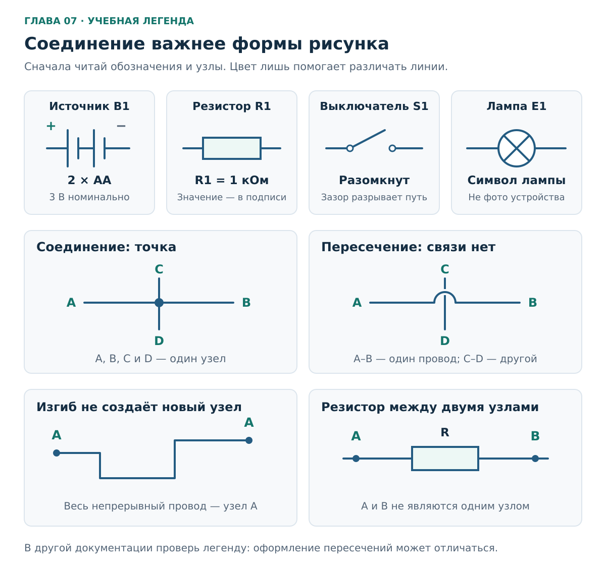
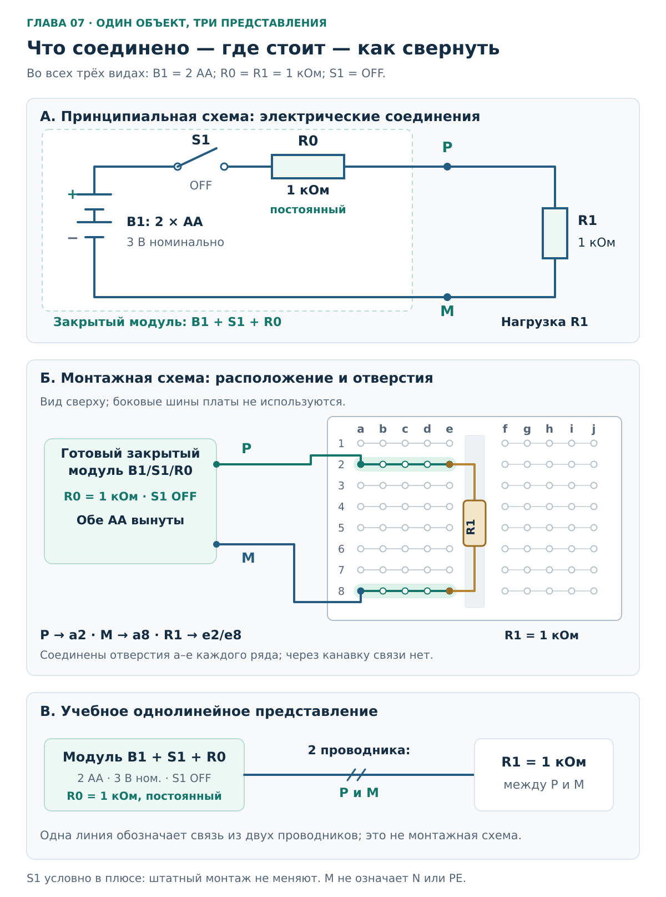
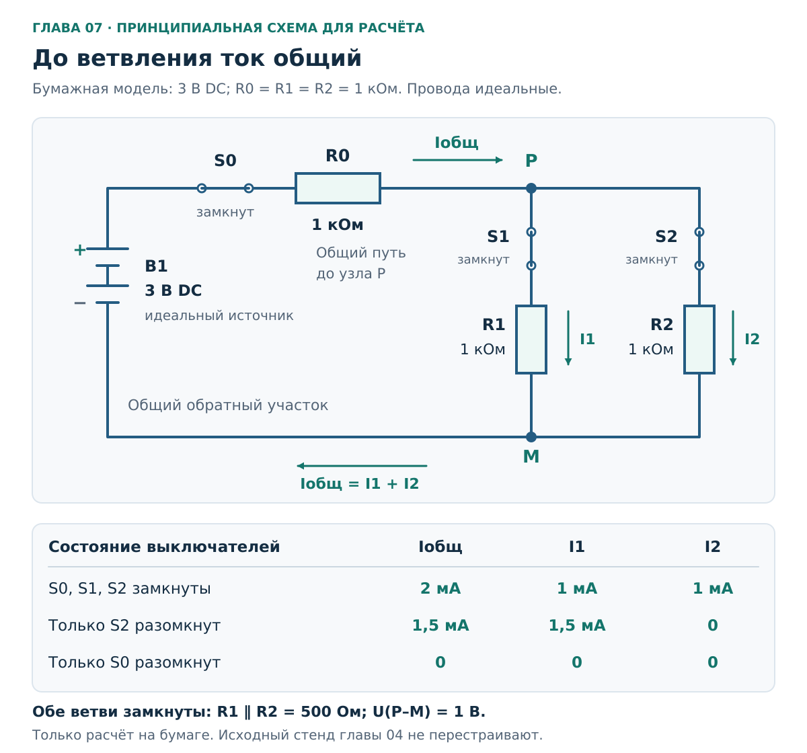
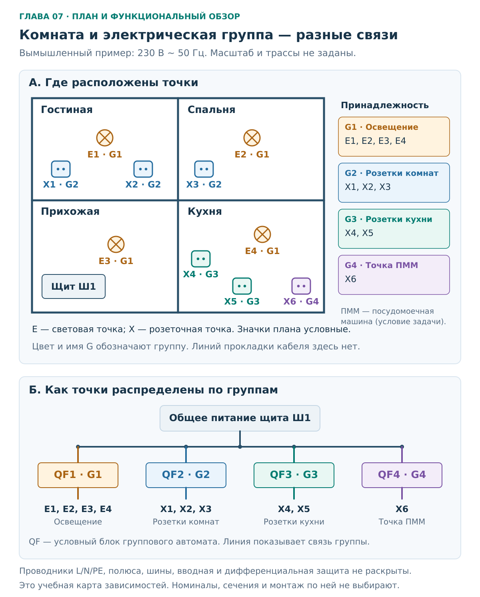
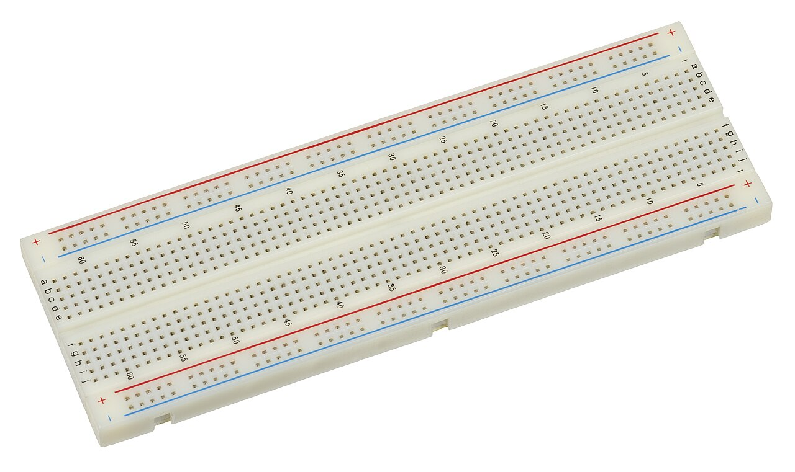
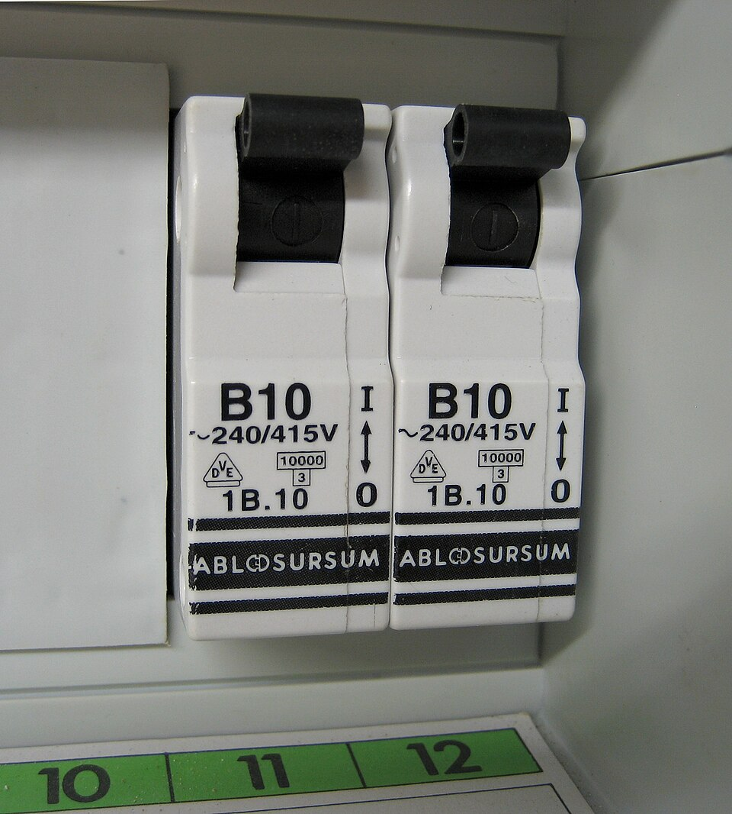
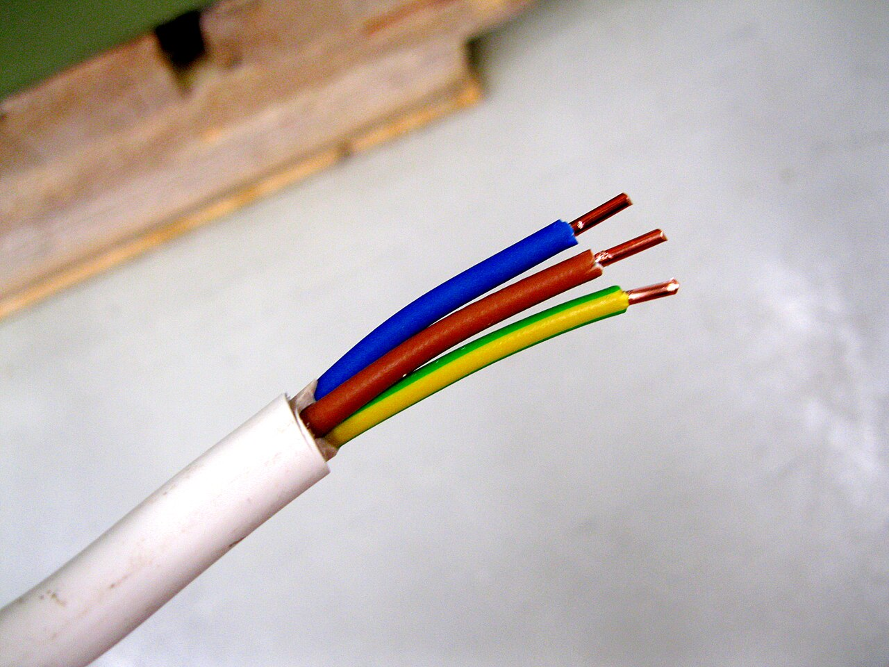

# Глава 07. Чтение схем и электрические группы

[Главная](../README.md) · [Карта курса](../ROADMAP.md) · [Прогресс](../PROGRESS.md) · [Все главы](README.md)

**Дата технической проверки:** 2026-11-09.\
**Нужные предыдущие главы:** [02 — цепи](02-circuit-basics.md), [04 — стенд](04-tools-workbench.md), [05 — мультиметр](05-multimeter.md), [06 — L, N, PE](06-ac-and-earthing.md).\
**Уровень практики:** бумажные схемы; при наличии собранного стенда — внешний осмотр с вынутыми батареями.\
**Время:** примерно 40–50 минут чтения и 30–45 минут упражнений.

## После главы ты сможешь

- Отличить соединённые проводники от простого пересечения линий и найти общий электрический узел.
- Узнать одну цепь на принципиальном рисунке, монтажном виде и в однолинейном представлении.
- Проследить путь тока через нагрузку и найти общий участок двух ветвей.
- Составить учебную таблицу «аппарат защиты → группа → точки на плане».
- Отделить сведения, заданные схемой, от предположений по фотографии или расположению комнат.

## 1. Бытовой вопрос: почему пропало питание сразу в двух комнатах?

На плане условной квартиры розетка у телевизора находится в гостиной, а розетка у кровати — за стеной, в спальне. Они относятся к одной электрической группе. Другая пара розеток расположена рядом на кухне, но входит в разные группы.

Противоречия нет: **комната описывает расположение, а группа — электрические связи**. Чтобы понять, от чего зависит питание точки, нужно проследить её цепь до аппарата защиты. Расстояние до соседней розетки этого не объясняет.

В этой главе сначала научимся читать маленькую знакомую цепь. Затем применим тот же способ рассуждения к вымышленной квартире. Все группы квартиры будут прямо заданы в условии; сведений о проводке твоего жилья у нас пока нет.

## 2. Грамматика электрической схемы

### 2.1. Рисунок показывает связи, а не внешний вид

На принципиальной схеме длинный извилистый провод можно нарисовать короткой прямой линией. Резистор может оказаться справа от батареи, хотя на столе лежит слева. Если соединения выводов сохранены, электрическая цепь осталась той же.

Поэтому сначала спрашивай **«что с чем соединено?»**, затем — «где это находится?». Различие электрического взаимодействия и физических соединений разобрано в учебнике [EIT / IDC Technologies, разделы 5 и 7][drawing-types].

**Рисунок 1 — словарь условных обозначений этой главы.** Это учебная легенда, а не полный перечень символов для профессионального проекта. Прямоугольник обозначает резистор; на других схемах встречается зигзаг. У обозначения элемента питания длинная черта относится к положительному выводу. Круг с крестом обозначает лампу, но не задаёт её мощность или тип. Общие принципы чтения обозначений: [SparkFun, How to Read a Schematic][symbols].

Буквы рядом с символами — имена элементов и связей. Для наших рисунков договоримся о следующем:

| Обозначение | Значение в примере | Чего обозначение само по себе не сообщает |
|---|---|---|
| B1 | Источник: две AA последовательно | Фактическое напряжение и состояние батарей |
| R0, R1, R2 | Разные резисторы; номер отличает один от другого | Сопротивление: его пишем отдельно, например 1 кОм |
| S0, S1, S2 | Выключатели в соответствующей схеме | Пригодность конкретного изделия для сети |
| P, M | Выходы знакомого батарейного модуля | Это не обозначения квартирных N и PE |
| QF1–QF4 | Групповые автоматы в условной квартире | Номинал, характеристику, число полюсов и достаточность защиты |
| G1–G4 | Идентификаторы четырёх учебных групп | Не номера комнат и не обязательный стандарт надписей |
| E1–E4, X1–X6 | Световые и розеточные точки на нашем плане | Не заводская маркировка изделий |

Например, `R1 = 1 кОм` читается так: «резистор с именем R1 имеет сопротивление один килоом». Единица в имени и единица в номинале выполняют разные задачи. Аналогично `QF3` означает третий аппарат в принятой нумерации, а не автомат на 3 А.

### 2.2. Узел — это электрическая общность

**Узел в нашей идеальной схеме** — совокупность точек, соединённых проводниками без промежуточной нагрузки или другого элемента. Такой узел может занимать половину листа. Жирная точка обозначает место соединения линий, но весь непрерывный провод по обе стороны этой точки тоже принадлежит узлу.

На рисунках главы используем явные правила:

- Пересечение **с жирной точкой** — соединение всех подходящих линий.
- Пересечение **с мостиком, без точки** — линии проходят друг над другом и не соединяются.
- Поворот непрерывной линии не создаёт нового узла.
- Две стороны резистора — разные узлы: резистор связывает их как элемент, но не заменяет соединительный провод.

Встречаются схемы, где пересечение без соединения рисуют без мостика. На старом скане точка может пропасть. Поэтому не додумывай невидимое соединение: проверь легенду, более чёткую копию или описание. Система точек и именованных связей описана у [SparkFun][symbols]; мостик здесь добавлен для наглядности.

**Оговорка модели:** проводник считаем идеальным. В настоящем длинном проводе или плохом контакте бывает падение напряжения. Назвать точки одним узлом на учебном рисунке — не значит измерением подтвердить качество реального соединения. Эту разницу уже показывала [глава 03](03-power-energy.md).

### 2.3. Как читать схему по порядку

1. Найди источник и условия: постоянный или переменный ток, какое напряжение, что принято идеальным.
2. Прочитай легенду, номиналы и состояние выключателей. Разомкнутый контакт означает разрыв именно показанного пути.
3. Выбери одну нагрузку. Проследи путь к одному её выводу и обратный путь от другого вывода к источнику.
4. На каждом разветвлении проверь точку соединения. Переходить на пересекающую линию через мостик нельзя.
5. Найди участки, по которым должен пройти ток нескольких нагрузок.
6. Проверь, какой информации рисунок не содержит: реальные координаты, номера клемм, защитные проводники, параметры аппаратов или часть установки.

Для DC-цепей дальше используем условное направление тока от плюса источника через внешнюю цепь к минусу. Это способ прослеживания цепи; он не означает, что ток «заканчивается» в нагрузке.

## 3. Один стенд в трёх представлениях

Возьмём **основной резисторный стенд главы 04**: источник B1 из двух AA, штатный S1, постоянный R0 = 1 кОм у источника, выходы P/M и нагрузка R1 = 1 кОм. R0 закрыт в модуле и остаётся на месте.

**Рисунок 2.** Номинальный источник — 3 В DC, две AA последовательно. Во всех представлениях S1 выключен. Провода и контакты идеализированы; рисунок не заменяет [полную инструкцию сборки](04-tools-workbench.md). При практической перерисовке обе батареи вынуты.

| Представление | На какой вопрос отвечает | Что важно прочитать |
|---|---|---|
| **Принципиальная схема** | Как работают и соединены элементы? | Через какие элементы проходит единственный замкнутый путь при включённом S1 |
| **Монтажный вид / схема соединений** | Какие конкретные выводы и точки соединены? | P в `a2`, M в `a8`, выводы R1 в `e2` и `e8`; внутренняя разводка платы |
| **Обзорное однолинейное представление** | Как связаны источник и нагрузка, если часть проводников свернуть в одну линию? | Одна связь обозначает **два проводника P и M**; R1 включён между ними |

**«Однолинейная» — способ изображения, а не строго отдельный вид рядом с принципиальной.** Например, принципиальная схема распределения питания может быть выполнена однолинейно. В третьей панели мы показываем обзор с сокращённой детализацией, поэтому подписали и назначение рисунка, и число проводников. Применение такого представления, включая простые DC-цепи, описано у [EIT, § 4.1.1–4.1.5][drawing-types].

### 3.1. Что сохранилось при переходе между рисунками

При будущем замыкании S1 внешний путь тока один:

**плюс B1 → S1 → R0 → P → R1 → M → минус B1.**

На макетной плате роль части проводов выполняют скрытые металлические полоски. В выбранной раскладке пять отверстий `a–e` одного ряда соединены; половина `f–j` за центральной канавкой — отдельная группа. Соседние нумерованные ряды также разделены. Устройство платы объясняет [NYU ITP, Setting Up a Breadboard][breadboard]; конкретную плату сверяют по её документации.

| Электрическая связь | Где она находится на монтажном рисунке |
|---|---|
| P и первый вывод R1 соединены | P в `a2`, вывод R1 в `e2`; между ними общая полоска ряда 2 |
| M и второй вывод R1 соединены | M в `a8`, вывод R1 в `e8`; между ними общая полоска ряда 8 |
| P и M — разные узлы | Между рядами 2 и 8 нет скрытой полоски; их связывает R1 |
| R0 остаётся последовательным | Он внутри закрытого модуля, до выхода P |

Резистор расположен вдоль одной буквенной колонки `e`, но его выводы принадлежат **разным рядам**. Близость отверстий и одинаковая буква не делают их одним узлом.

### 3.2. Что однолинейное сокращение скрывает

В третьей панели не исчезли ни обратный провод M, ни R0. Они учтены в подписях. Одна линия между блоками не означает, что можно соединить источник с резистором единственным проводом.

Также не исчезает падение напряжения на R0. При идеальных 3 В, замкнутом S1 и двух точных резисторах по 1 кОм ток равен 1,5 мА, а напряжение P–M — 1,5 В. Подробный расчёт уже был в главе 04. Подпись «источник 3 В» и напряжение на выходе **после ограничителя** — разные величины.

## 4. Ветви и общий участок: что зависит от чего

Нагрузки соединены **параллельно**, если их ветви подключены между одной и той же парой узлов. Последовательное соединение означает единственный путь через элементы без разветвления между ними. То, что детали нарисованы одна за другой, ничего не доказывает. Физические признаки соединений и правила для токов разобраны в [OpenStax, § 10.2][parallel].

Рассмотрим следующую схему **только на бумаге**. Это отдельная модель с добавленной ветвью. Здесь общий выключатель назван **S0**, а S1 и S2 относятся к ветвям; не путай эти имена со штатным S1 предыдущего рисунка.

**Рисунок 3 — принципиальная схема расчётной DC-модели.** B1 — идеальный источник ровно 3 В; R0 = R1 = R2 = 1 кОм. На основном рисунке все выключатели замкнуты. Провода, закрытые контакты и источник считаем идеальными; R0 сохраняет своё сопротивление. Перестраивать реальный стенд для этой задачи не требуется.

### 4.1. Два маршрута и их пересечение

Маршрут первой нагрузки: **B1 → S0 → R0 → P → S1 → R1 → M → B1**.

Маршрут второй: **B1 → S0 → R0 → P → S2 → R2 → M → B1**.

Общими оказались источник, S0, R0, провод до разветвления P и обратный провод от объединения M к источнику. Ветви P–S1–R1–M и P–S2–R2–M различаются.

Отсюда получаем три вывода непосредственно по соединениям:

- Если разомкнуть S2, исчезнет ток второй ветви, но путь через R1 останется.
- Если разомкнуть S0, разорвутся оба маршрута.
- Разрыв общего обратного провода тоже нарушит оба маршрута. Искать общую часть только возле плюса было бы ошибкой.

Это рассуждение о заданной исправной схеме и единственном изменении. Оно не позволяет по факту «не работают два прибора» назвать единственную причину неисправности квартиры.

### 4.2. Общий ток складывается, но напряжение тоже нужно учитывать

При замкнутых S1 и S2 эквивалентное сопротивление двух одинаковых параллельных нагрузок равно:

`Rнагрузки = (R1 × R2) / (R1 + R2) = 500 Ом`.

С учётом последовательного R0:

`Iобщ = 3 В / (1000 + 500) Ом = 2 мА`.

На паре P–M:

`U_PM = Iобщ × Rнагрузки = 0,002 А × 500 Ом = 1 В`.

Поэтому `I1 = I2 = 1 В / 1000 Ом = 1 мА`, а `Iобщ = I1 + I2 = 2 мА`. Такой же суммарный ток проходит по общему обратному проводу; нагрузка не «расходует ток».

Теперь разомкнём только S2. В цепи останутся последовательно R0 и R1:

`I1 = Iобщ = 3 В / 2000 Ом = 1,5 мА`, `I2 = 0`.

**Ток оставшейся ветви вырос**, хотя её резистор не изменился. Причина — уменьшилось падение напряжения на общем R0, а напряжение P–M выросло с 1 до 1,5 В. Параллельность гарантирует общее напряжение ветвей в данном состоянии, но не обещает неизменность этого напряжения при изменении всей цепи. Здесь помогает уже знакомая [модель последовательного сопротивления источника](02-circuit-basics.md).

### 4.3. Почему «шлейфом» не означает «последовательно через приборы»

Кабель может физически проходить от одной розеточной точки к следующей. При этом подключённые нагрузки могут получать питание от одной пары L/N: ток второй нагрузки не обязан проходить через первую нагрузку. Это параллельное подключение потребителей, хотя путь кабеля последовательно посещает несколько мест.

Важны конкретные соединения жил. Общий участок и промежуточное соединение могут влиять сразу на несколько точек. Конструкцию соединений и требования к PE будем разбирать отдельно в главах 09–10; данное объяснение не предлагает способ монтажа розеток.

## 5. Электрические группы на плане квартиры

### 5.1. Что будем называть группой

В нашем примере с радиальной разводкой **группа — отходящая цепь со своим аппаратом защиты от сверхтока и подключёнными к ней точками**. «Радиальная» здесь означает, что питание группы идёт от щита по одному заданному направлению с возможными ответвлениями, без кольца. Дальше под групповой защитой в рисунке понимается автомат QF, а не любой аппарат в щите.

Одна группа может обслуживать несколько комнат. В одной комнате могут присутствовать несколько групп. Принцип разделения цепей по назначению и его пользу для сохранения питания других частей установки поясняет [Schneider Electric, Residential electrical installation — Circuits][groups]. Численные рекомендации этого зарубежного руководства здесь не используются как требования для РФ.

Выключатель конкретного светильника управляет нагрузкой **внутри** группы. От этого он не становится групповым автоматом. Несколько групп могут также находиться после общего УЗО — устройства защитного отключения. У обычного УЗО без встроенной защиты от сверхтока другая задача; несколько отходящих автоматов после него остаются отдельными групповыми защитами. Пример такой структуры: [Eaton, § 9.3, рисунки 77–79][rcd-groups]. Подробности — в главах 12–13.

### 5.2. Условная квартира: четыре группы

**Рисунок 4 — учебный план принадлежности точек и функциональный однолинейный обзор.** Условная однофазная установка 230 В AC, 50 Гц. Размеры и расстановка точек произвольны. На плане не показаны кабельные трассы; цвет обозначает группу и дублируется её именем, а не обозначает L, N или PE.

В обзорной части одна линия показывает связь группы с питанием. Конкретные проводники, полюса аппаратов, шины, вводная и дифференциальная защита не раскрыты. Отсутствие этих деталей на обзоре **не означает, что они не нужны**. Схема не показывает разрыв PE автоматом и не предлагает соединять N с PE. Тип заземления, сечения и номиналы не заданы: это не проект щита.

Все связи для задачи перечислены здесь:

| Группа | Её автомат | Точки | Где находятся |
|---|---|---|---|
| G1 — освещение | QF1 | E1, E2, E3, E4 | Гостиная, спальня, прихожая, кухня |
| G2 — розетки комнат | QF2 | X1, X2, X3 | X1/X2 — гостиная; X3 — спальня |
| G3 — кухонные розетки | QF3 | X4, X5 | Кухня |
| G4 — отдельная точка ПММ | QF4 | X6 | Кухня; в примере предназначена для посудомоечной машины |

Выделение X6 в отдельную группу — **условие учебной задачи**, не готовое заключение о любой машине или квартире. Для настоящего решения нужны нагрузка, документы оборудования, параметры линии и проектные требования.

Разберём три пары:

- **X2 и X3:** разные комнаты, общий QF2.
- **X5 и X6:** одна кухня и небольшое расстояние, разные QF3 и QF4.
- **E4 и X4:** оба на кухне, но свет входит в G1, а розетка — в G3.

Если по условию отключить только QF3, питание потеряют X4 и X5. На исправной заданной схеме E4 и X6 продолжат получать питание через свои группы. Это рассуждение предполагает сохранённое общее питание и отсутствие других изменений; оно не утверждает, как поведёт себя неизвестная реальная установка при повреждении.

### 5.3. Связь групп и общая защита — разные уровни

Дополним пример **словесно**: пусть G2 и G3 находятся после одного общего УЗО, а их групповые автоматы остаются QF2 и QF3. Тогда:

| Что отключилось в этом заданном варианте | Какие точки потеряют питание |
|---|---|
| Только QF2 | X1, X2, X3 |
| Только QF3 | X4, X5 |
| Общее для G2/G3 УЗО | X1, X2, X3, X4, X5 |

Групп по-прежнему две. У них появилась общая зависимость выше по схеме. Словесное условие не дополняет рисунок монтажными соединениями и не определяет порядок срабатывания аппаратов при аварии.

### 5.4. Хорошая карта оставляет место для неизвестного

В реальной документации полезно связывать три сущности: **идентификатор аппарата, перечень точек и основание для такого перечня**. Надпись «кухня» сообщает слишком мало: это могут быть свет, часть розеток или отдельная линия техники.

| Поле записи | Пример для учебной карты |
|---|---|
| Аппарат и группа | QF3 / G3 |
| Точки | X4, X5 |
| Назначение | Две кухонные розеточные точки |
| Откуда известна связь | Задана таблицей этой главы |
| Не установлено | Длина, трасса, сечение, номинал защиты, состояние соединений |

Для своей квартиры можно подготовить пустой план и переписать уже имеющиеся подписи без доступа к проводникам. Если связь не проверена, так и записать: «по старой наклейке; не подтверждено». Само составление плана не требует открывать щит или начинать эксперимент с отключениями.

Задача специалиста — установить фактические связи, сверить подписи и документацию, определить необходимые проверки защитных цепей и согласования линии с аппаратами. Для работ с проводниками отдельно обеспечивают безопасное отключение и проверяют отсутствие напряжения. **Погасшая лампа и положение рычага этого не доказывают**; общий принцип поясняет [HSE][isolation]. Это источник по безопасности, а не российское нормативное предписание или самостоятельное упражнение курса.

## 6. Как это выглядит в жизни

### 6.1. Макетная плата: геометрия отверстий и скрытые связи

**Что найти:** буквенные обозначения, нумерацию рядов и центральную канавку. Они позволяют перейти от имени узла на принципиальной схеме к координатам на монтажной. Красная и синяя линии по краям — печать на пластике, не источник питания.

**Чего снимок не подтверждает:** исправность контактов и точную разводку именно твоей платы. В нашем стенде боковые шины не используются. Сам собранный стенд на этой фотографии не изображён.

Фото **Evan-Amos**, 2018-08-01, [Wikimedia Commons][photo-board], общественное достояние (PD-self). Повторно использована версия 1280 × 761 без новых изменений.

### 6.2. Два автомата: маркировка изделия и номер места

**Что найти:** одинаковую надпись `B10` на двух аппаратах и отдельные номера на зелёной полосе панели. Это разные виды информации: маркировка изделия и обозначение места. `B10` не означает «группа B, розетка 10», а номер под аппаратом не перечисляет подключённые комнаты. Подробную расшифровку заводских параметров оставим главе 12.

**Чего снимок не подтверждает:** какие точки питаются через эти аппараты, что находится за панелью и верны ли подписи. Одинаковая маркировка не объединяет автоматы в одну группу.

Фото **Nogo**, 2010-08-03, [Wikimedia Commons][photo-breakers], общественное достояние (PD-self). Повторно использована версия 960 × 1066 без новых изменений.

### 6.3. Один кабель — несколько жил

**Что найти:** одну внешнюю оболочку и три отдельные изолированные жилы. Это помогает понять, почему одна линия на обзорном рисунке может представлять несколько проводников.

**Чего снимок не подтверждает:** фактические подключения, тип заземления, пригодность кабеля для выбранной трассы и его принадлежность к группе. Из фотографии кабеля нельзя восстановить цепь. Цвета мы уже разбирали в [главе 06](06-ac-and-earthing.md): назначение подтверждают соединения и документация.

Фото **Santeri Viinamäki**, 2016-05-26, [Wikimedia Commons][photo-cable], [CC BY-SA 4.0](https://creativecommons.org/licenses/by-sa/4.0/). Повторно использована версия 1280 × 960 без новых изменений.

Страницы происхождения трёх фотографий и сами файлы проверены для этой главы. Полные сведения — в [ATTRIBUTION.md](../assets/ATTRIBUTION.md). Новых фотографий или изображений квартиры пользователя в главу не добавлено.

## 7. Практика: пять упражнений

**Общие условия:** бумага или редактор заметок, схемы главы, при необходимости калькулятор. Все отключения ниже — изменения рисунка или заданной модели. Реальную квартирную сеть не переключаем и не измеряем. В B можно рассматривать уже собранный батарейный стенд при отдельно указанных условиях; если его нет, монтажного рисунка достаточно.

### A. Соединение или пересечение?

**Цель:** определить электрические связи независимо от формы рисунка.

1. Провод A–B пересекает провод C–D. В пересечении нарисован мостик, точки нет. Перечисли пары соединённых концов и число отдельных узлов.
2. Теперь вместо мостика поставлена жирная точка. Какие концы входят в один узел?
3. Между A и B нарисован резистор R1. Можно ли стереть его и считать A/B одним узлом, потому что «через резистор тоже проходит ток»?
4. На нечёткой копии нельзя различить наличие точки. Какой результат чтения нужно записать?

Разбор A

1. A соединён с B, C — с D. Между этими парами связи нет: два отдельных узла.
2. A, B, C и D входят в один узел: все линии соединены в отмеченном пересечении.
3. Нельзя. Резистор является элементом между двумя узлами; замена его проводом изменит сопротивление и работу цепи. Возможность протекания тока через элемент не делает его идеальным проводником.
4. «Соединение в этом месте не установлено». Нужна чёткая схема, легенда или подтверждённое описание. Угадывание по удобному варианту меняет цепь.

### B. Переведи монтаж в схему

**Цель:** получить из координат платы электрические связи и обратно.

**Что понадобится:** рисунок 2, лист бумаги. Дополнительно — уже собранный по главе 04 стенд, если он есть; инструмент не нужен.

**Исходные условия для физического осмотра:** S1 выключен, обе AA вынуты, стенд не соединён с USB, Arduino, прибором или другим источником. Закрытый R0 не вскрывается; перемычки и детали не переставляются.

**Когда остановиться:** нельзя подтвердить отсутствие питания, есть повреждение, неизвестна разводка платы или видимая раскладка отличается от исходной. В таком случае продолжи по рисунку и запиши расхождение; не исправляй его подключением батарей.

Задан монтаж: P находится в `a2`, M — в `a8`, R1 — между `e2` и `e8`; внутри модуля сохранены B1, S1 и R0.

1. Запиши, какие отверстия объединяют P с первым выводом R1, а M — со вторым.
2. Нарисуй принципиальную схему, разместив батарею **справа**, а R1 **слева**. Подпиши источник, S1, R0, R1, P и M. S1 оставь разомкнутым.
3. Нарисуй тот же объект в обзорном виде одной связью между модулем источника и нагрузкой. Подпиши, какие два проводника эта связь заменяет.
4. На бумаге проверь ошибку: оба вывода R1 оказались в `d2` и `e2`. Между какими узлами он включён? Есть ли предусмотренный путь от P через R1 к M?
5. Запиши одну вещь, которую верная перерисовка не доказывает о реальном стенде.

**Ожидаемый результат:** две согласованные схемы и перечень связей. При наличии стенда он остаётся в прежней конфигурации, без батарей.

Разбор B

1. Группа `a2–e2` объединяет P с одним выводом R1; `a8–e8` — M с другим. Центральная канавка не соединяет эти группы с `f–j`.
2. Несмотря на новое расположение элементов, при замыкании S1 должен получаться единственный маршрут: плюс B1 → S1 → R0 → P → R1 → M → минус B1. Полярность источника остаётся той же по функциям выводов; её нельзя копировать только по положению «слева/справа».
3. Внутри блока источника названы B1/S1/R0. Одна связь подписана «два проводника P и M»; нагрузка R1 включена между ними. Это сокращённое представление, не однопроводная цепь.
4. `d2` и `e2` принадлежат одному узлу P. Между выводами R1 в идеальной модели нет разности потенциалов. К M резистор вообще не подключён, поэтому предусмотренный рабочий путь не собран. Это ошибка места подключения, а не доказательство неисправности резистора. Перемычку P–M для «проверки» не добавляют.
5. Рисунок не доказывает, например, надёжность контакта, фактический номинал R0/R1 или исправность батарей. Он подтверждает только согласованность описанных связей. Измерения выполняются по отдельным упражнениям главы 05.

### C. Найди общий ток при разных нагрузках

**Цель:** отличить общий участок от ветви и учесть влияние R0.

Используй топологию рисунка 3, но задай **R2 = 2 кОм**. Остальное: идеальные 3 В DC, R0 = R1 = 1 кОм, все контакты замкнуты. Это бумажная задача; детали стенда не меняются.

1. Вычисли эквивалентное сопротивление R1/R2 и общий ток через R0.
2. Найди U_PM, I1 и I2. Проверь сумму токов.
3. Теперь разомкнут только S1. Найди новый ток через R2. Объясни, почему он отличается от предыдущего.
4. Верни оба ветвевых выключателя в замкнутое состояние и мысленно разорви общий обратный провод M–B1. Что произойдёт с токами в этой идеальной DC-модели после завершения переходного процесса?

Разбор C

1. `Rнагрузки = 1000 × 2000 / (1000 + 2000) ≈ 666,7 Ом`. Полное сопротивление — около 1666,7 Ом. `Iобщ = 3 / 1666,7 ≈ 0,0018 А = 1,8 мА`.
2. `U_PM = 0,0018 × 666,7 ≈ 1,2 В`. `I1 = 1,2 / 1000 = 1,2 мА`; `I2 = 1,2 / 2000 = 0,6 мА`. Проверка: `1,2 + 0,6 = 1,8 мА`. Через общий обратный участок идёт тот же суммарный ток.
3. Остались последовательно R0 и R2: `I2 = 3 / (1000 + 2000) = 1 мА`. На R2 теперь 2 В. Ток его ветви вырос с 0,6 до 1 мА, поскольку изменилось напряжение P–M. Резистор R2 не изменился.
4. Оба установившихся тока равны нулю: у обеих ветвей отсутствует полный обратный путь к источнику. Из этого не следует исчезновение всех напряжений и не выводится безопасность неизвестной сетевой установки.

### D. Собери карту групп

**Цель:** согласовать план, список точек и функциональные связи.

Возьми исходные данные таблицы из раздела 5.2 и на отдельном листе нарисуй четыре помещения. Сначала поставь только имена E1–E4 и X1–X6, затем присвой точки группам по условию. Цвет использовать необязательно.

1. Составь четыре строки «QF → G → точки». Проверь: каждая из десяти точек перечислена ровно один раз.
2. Отметь, какие точки потеряют питание при отключении только QF3, если общее питание и остальные группы исправны.
3. Найди одну пару точек из разных комнат с общим групповым автоматом и одну близкую пару с разными автоматами.
4. Добавь словесное условие: у G2 и G3 общее УЗО. Какие точки зависят от его включённого состояния? Сколько групп оно обслуживает?
5. Можно ли по такой карте назначить сечения кабелей, номиналы автоматов или места сверления стены?

Разбор D

| Аппарат | Группа | Точки |
|---|---|---|
| QF1 | G1 | E1, E2, E3, E4 |
| QF2 | G2 | X1, X2, X3 |
| QF3 | G3 | X4, X5 |
| QF4 | G4 | X6 |

Всего `4 + 3 + 2 + 1 = 10` точек. После отключения только QF3 без питания останутся X4 и X5; E4 и X6 в заданной исправной схеме сохранят питание.

X2/X3 — пример разных комнат при общем QF2. X5/X6 — пример соседства на кухне при разных QF3/QF4.

Общее УЗО G2/G3 обслуживает две группы и влияет на X1–X5. Наличие общего вышестоящего аппарата не стирает отдельные отходящие группы.

Сечения и номиналы карта не определяет: не заданы нагрузки и условия линий. Трассы скрытой проводки вообще не показаны, поэтому выбирать по этому плану место сверления нельзя.

### E. Что можно утверждать по фотографии и старой подписи?

**Цель:** оформить неизвестное так, чтобы оно помогало дальнейшей проверке.

Перед тобой только фото двух автоматов из раздела 6.2 и условная старая запись владельца: «11 — кухня». Подключения не проверялись. Никаких новых действий с квартирной сетью для задачи не требуется.

Для каждого утверждения напиши: **«видно на фото»**, **«есть в старой записи, не подтверждено»** или **«не установлено»**.

1. На двух аппаратах одинаковая надпись B10.
2. Позиция 11 имеет отношение к кухне.
3. Все кухонные розетки относятся к позиции 11.
4. Кухонный свет отключается тем же аппаратом.
5. Установлены исправная защитная цепь PE и подходящий для проводки автомат.

Затем составь короткое задание специалисту: что именно нужно установить, чтобы из этой записи получилась полезная карта.

Разбор E

1. **Видно на фото.** Сравнение надписей возможно без предположений о подключении.
2. **Есть в старой записи, не подтверждено.** Нужно сохранить и формулировку, и её происхождение.
3–5. **Не установлено.** Обобщение «вся кухня», связь света и розеток, защитные проводники и согласование защиты требуют данных, которых фото не содержит.

Пример задания: «Есть старая подпись “11 — кухня”, перечень точек не подтверждён. Нужно установить соответствие аппаратов розеточным и световым точкам, отметить общие вышестоящие устройства, проверить актуальность обозначений и определить необходимые проверки линии и защитных цепей. Результат оформить таблицей с датой и основанием каждой связи».

Такой запрос определяет результат обследования, но не предписывает новичку вскрытие щита или сетевые измерения. Карта групп и протокол проверки исправности — документы с разными задачами.

## 8. Частые ошибки

| Ошибка | Почему вывод неверен | Как проверить себя |
|---|---|---|
| Все пересёкшиеся линии соединены | На схеме бывает пересечение без соединения | Найти точку, мостик и легенду |
| Узел — только чёрная точка | Узел включает все соединённые идеальными проводами точки | Обвести весь непрерывный путь без промежуточных элементов |
| Одинаковый потенциал означает физическое соединение | Две отдельные точки могут случайно иметь равное напряжение | Устанавливать связь по соединениям, а не по одному совпавшему показанию |
| На однолинейной схеме хватает одного провода | Одна линия сокращает изображение нескольких проводников | Прочитать подпись и мысленно восстановить обратный путь |
| После отключения параллельной ветви ток другой всегда прежний | Напряжение на ветвях может измениться из-за общего сопротивления | Учесть R0 и заново вычислить U_PM |
| Кабель идёт от розетки к розетке — значит приборы последовательны | Геометрический маршрут кабеля и подключение нагрузок — разные вещи | Проследить оба вывода каждой нагрузки |
| Одна комната — один автомат | Границы помещений не определяют электрические цепи | Сопоставить имена точек и группы по подтверждённым данным |
| Общее УЗО означает одну группу | После него могут быть несколько отходящих автоматов | Различать уровень общей защиты и уровень групп |
| «Свет погас» означает «можно касаться проводов» | Наблюдение не доказывает отсутствие напряжения | Не превращать карту питания в процедуру безопасного отключения |

## 9. Самопроверка

1. Резистор на одном рисунке справа от батареи, на другом — слева. Как установить, одна ли это цепь?
2. Чем жирная точка отличается от мостика на схемах этой главы?
3. Почему выводы R1 в `e2` и `e8` относятся к разным узлам, хотя буква одинаковая?
4. Что означает одна линия между источником и нагрузкой в третьей панели рисунка 2? Куда делся R0?
5. Что общего у маршрутов через R1 и R2 на рисунке 3? Есть ли общий участок после нагрузок?
6. На рисунке 3 все резисторы по 1 кОм. После размыкания S2 каким станет ток R1 и почему?
7. X5 и X6 находятся рядом, но относятся к G3 и G4. Что произойдёт при отключении только QF3 в исправной заданной схеме?
8. Старой подписью установлено только «кухня». Можно ли записать в проверенную карту все кухонные точки? Каких сведений не хватает?

Ответы с объяснениями

**1.** Сравнить соединения выводов, состояния выключателей, полярность и номиналы. Геометрическое положение элементов на принципиальной схеме само по себе не определяет её работу.

**2.** Точка объединяет подходящие линии. Мостик без точки показывает пересечение без соединения; переходить по нему в другую ветвь нельзя.

**3.** В выбранной плате соединены отверстия `a–e` внутри одного номера ряда. Ряды 2 и 8 разделены. Одинаковая колонка не является общей шиной.

**4.** Это связь по двум проводникам P/M. R0 остался внутри подписанного модуля источника; на подробном рисунке его видно отдельно. Однолинейное сокращение не отменяет элементов и обратного пути.

**5.** Общими являются B1, S0, R0, участок до P и обратный путь от M к источнику. Последний тоже несёт суммарный ток обеих ветвей.

**6.** 1,5 мА вместо 1 мА. После размыкания S2 остаются последовательно R0 и R1 по 1 кОм, поэтому `I = 3/2000 А`. Напряжение на R1 выросло до 1,5 В.

**7.** X5 потеряет питание вместе с X4. X6 останется с питанием через G4/QF4 при сохранении общей питающей цепи. Расположение рядом не объединяет их в одну группу.

**8.** Нет. Нужен подтверждённый перечень точек, соответствующий аппарат, сведения об общей защите и основание проверки. Пока запись обозначается как неподтверждённая. Даже готовая карта групп сама по себе не подтверждает исправность проводки.

## 10. Готовность двигаться дальше

Можно переходить к кабелям, если ты умеешь:

- На небольшом рисунке найти соединения, разрывы и общий обратный путь.
- Перевести координаты `a2/a8/e2/e8` в связи P–R1–M и сохранить R0 у источника.
- Объяснить разницу между видом схемы и однолинейным способом изображения.
- Составить четыре группы по заданному перечню точек, не выводя их из комнат.
- Записать «не установлено», когда фотография или наклейка не дают нужного подтверждения.

Если трудно со связями — вернись к упражнениям A/B; если с общим участком — к C; если с группами и неопределённостью — к D/E. Для завершения бумажных упражнений не нужно сначала покупать детали или собирать стенд.

**Готовность главы и твоя практика учитываются отдельно.** Пока ты не сообщишь результаты, прохождение упражнений не отмечается. В следующей главе разберём провода и кабели: материал, сечение, изоляцию и условия прокладки — то, чего пока нет на нашей карте.

## Источники и пределы применения

Источники проверены **09.11.2026**. Схемы, план вымышленной квартиры, числа и упражнения разработаны для курса. Расчёты относятся к явно заданным моделям; физических испытаний стенда и обследования квартиры не проводилось.

| Источник | Что использовано и как проверено |
|---|---|
| [EIT / IDC Technologies — Electrical Drawings and Schematics][drawing-types] | Разделы 4, 5 и 7: назначение схем, сокращение проводников в однолинейном представлении, физические соединения. Веб-текст доступен; дата последней технической редакции не установлена. Используются общие принципы, а не зарубежные требования к проектам |
| [SparkFun — How to Read a Schematic][symbols] | Обозначения и раздел Junctions and Nodes. Содержание соответствующих разделов проверено по поисковому извлечению официального сайта; прямое открытие HTML/PDF возвращало 403. Последняя редакция не установлена. Легенда собственных SVG задана явно |
| [OpenStax / Rice University — University Physics Volume 2, § 10.2][parallel] | Признаки соединений, эквивалентное сопротивление, токи и напряжения. Книга опубликована 06.10.2016; веб-раздел повторно прочитан. Числа задачи с R0 рассчитаны отдельно |
| [NYU ITP — Lab: Setting Up a Breadboard][breadboard] | Группы отверстий и разделение платы. Веб-раздел повторно прочитан; дата редакции не указана. Его схемы питания от USB/стабилизатора не переносятся в наши упражнения |
| [Schneider Electric — Residential electrical installation — Circuits][groups] | Разделение цепей по назначению и питание нескольких помещений одной цепью. Страница изменена 05.08.2026. Приведённые там числа, сечения и рекомендации не назначают требования для квартиры в РФ |
| [Eaton — Residual Current Devices, Application Guide BR019003EN][rcd-groups] | § 9.3, печатная с. 33, рисунки 77–79: несколько отходящих автоматов после общего УЗО. На выходной странице документа — September 2025, отдельно сохранён © 2017. Использован принцип структуры, без копирования схем и нормативных исключений |
| [HSE — пример недостаточного отключения установки][isolation] | Различие отключения и подтверждения отсутствия напряжения; предотвращение повторного включения. Страница обновлена 03.04.2025. Британские юридические положения не переносятся в РФ |

Схемы имеют учебную легенду; полное соответствие оформлению по ГОСТ или IEC не заявляется. В главе не устанавливаются обязательные количества групп, номиналы аппаратов, сечения и монтажные размеры. Для проекта эти решения потребуют применимых документов и исходных данных. Регистрация источников — [S15, S26 и S46–S50](../references/SOURCES.md); происхождение фотографий — [реестр изображений](../assets/ATTRIBUTION.md).

## Навигация

**Предыдущая глава:** [06 — Переменный ток, фаза, ноль и земля](06-ac-and-earthing.md).\
**Следующая глава:** [08 — Провода, кабели и условия прокладки](08-cables.md). Актуальная точка продолжения — в [PROGRESS.md](../PROGRESS.md).

[drawing-types]: https://www.eit.edu.au/resources/electrical-drawings-and-schematics/
[symbols]: https://learn.sparkfun.com/tutorials/how-to-read-a-schematic/
[parallel]: https://openstax.org/books/university-physics-volume-2/pages/10-2-resistors-in-series-and-parallel
[breadboard]: https://itp.nyu.edu/physcomp/labs/breadboard/
[groups]: https://www.electrical-installation.org/enwiki/Residential_electrical_installation_-_Circuits
[rcd-groups]: https://www.eaton.com/content/dam/eaton/products/electrical-circuit-protection/circuit-breakers/xeffect-rccb/eaton-rcd-application-guide-br019003en-en-us.pdf
[isolation]: https://www.hse.gov.uk/electricity/maintenance/isolate.htm
[photo-board]: https://commons.wikimedia.org/wiki/File:Electronics-White-Breadboard.jpg
[photo-breakers]: https://commons.wikimedia.org/wiki/File:Circuit_breaker_10amps.jpg
[photo-cable]: https://commons.wikimedia.org/wiki/File:Installation_Cable_MMJ_3x2,5S.jpg

