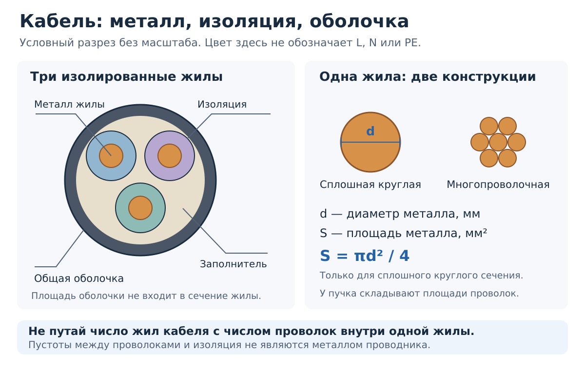
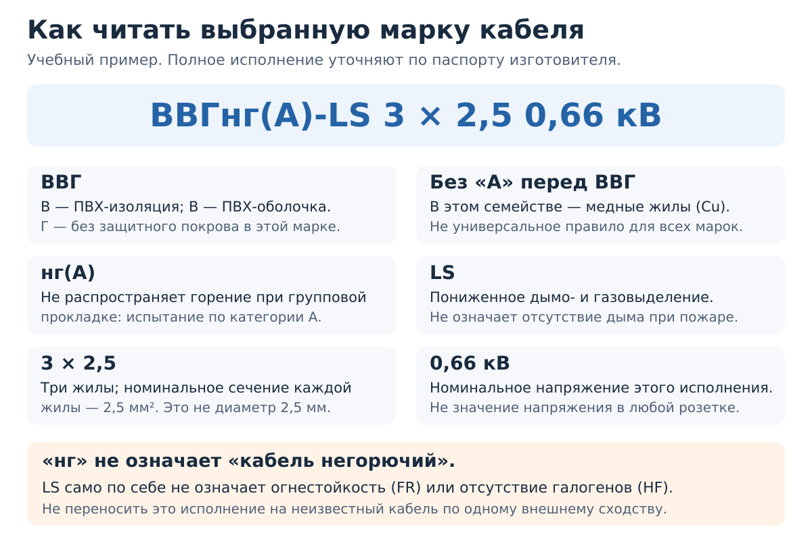
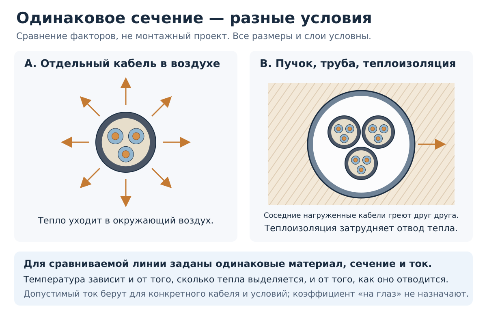
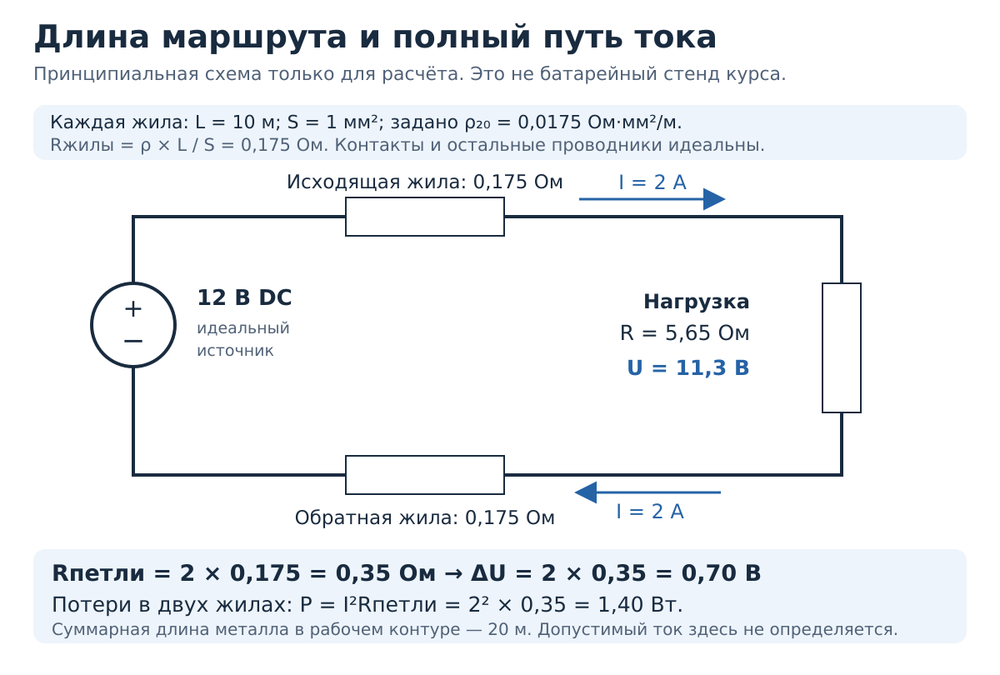
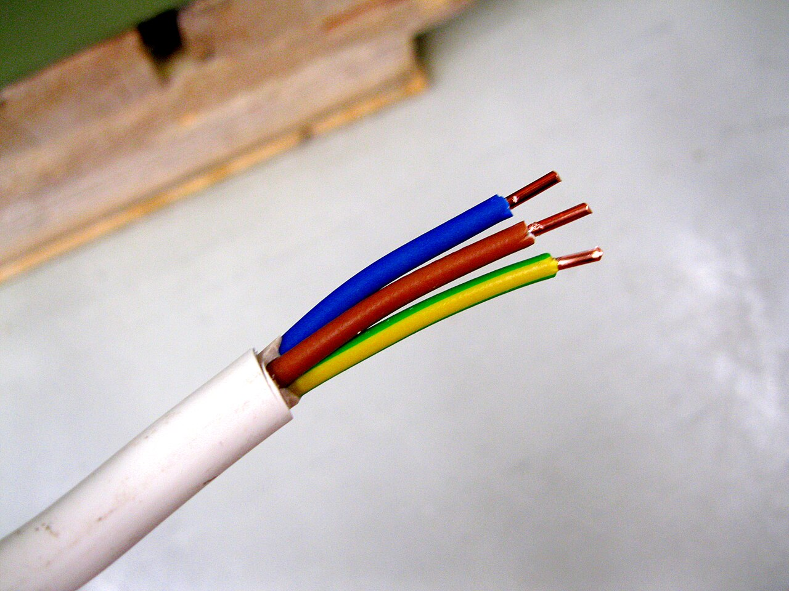
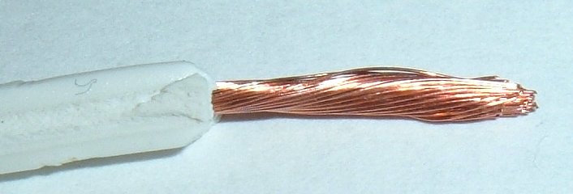
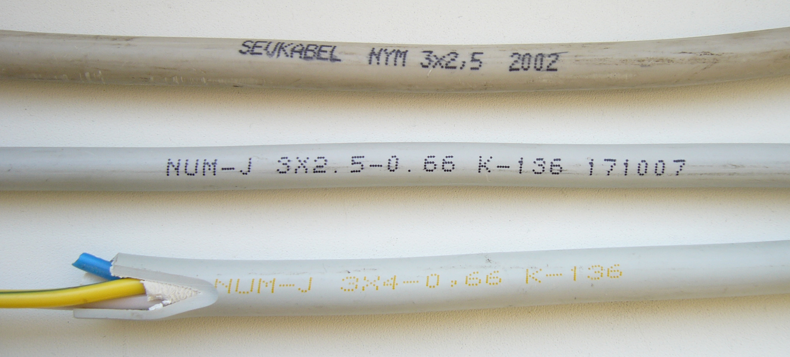

# Глава 08. Провода, кабели и условия прокладки

[Главная](../README.md) · [Карта курса](../ROADMAP.md) · [Прогресс](../PROGRESS.md) · [Все главы](README.md)

**Дата технической проверки:** 2026-11-09.\
**Нужные предыдущие главы:** [02 — цепь и сопротивление](02-circuit-basics.md), [03 — мощность и нагрев](03-power-energy.md), [06 — L, N, PE](06-ac-and-earthing.md), [07 — схемы и группы](07-schematics-groups.md).\
**Уровень практики:** бумажные расчёты, чтение паспортов и фотографий; по желанию — осмотр отдельных, ни к чему не подключённых образцов.\
**Время:** примерно 40–50 минут чтения и 30–45 минут упражнений.

## После главы ты сможешь

- Различить жилу, отдельную проволоку, изоляцию и оболочку кабеля.
- Объяснить разницу между диаметром в миллиметрах и сечением в квадратных миллиметрах.
- Прочитать основную маркировку конкретного кабеля и найти недостающие сведения в документации.
- Оценить сопротивление и падение напряжения в простой двухпроводной модели.
- Объяснить, почему одинаковое сечение не означает одинаковую допустимую нагрузку при любой прокладке.

## 1. Бытовой вопрос: на обоих кабелях написано «3 × 2,5». Они равноценны?

Представь две линии одной длины, с одинаковыми медными жилами и изоляцией. Первая проложена отдельно в условиях, позволяющих хорошо отводить тепло. Вторая проходит вместе с несколькими нагруженными линиями через участок теплоизоляции. По рассматриваемой линии в обоих случаях течёт одинаковый ток.

Надпись `3 × 2,5` сообщает число жил и их номинальное сечение. Она не описывает, насколько легко тепло уйдёт из кабеля. Поэтому по этой надписи нельзя закончить выбор линии и назначить ей автомат.

В [главе 07](07-schematics-groups.md) мы выясняли, **что с чем соединено**. Теперь добавим свойства настоящих проводников: материал, размер, сопротивление и условия работы. На схеме две точки могли считаться одним идеальным узлом; в длинной реальной линии между ними появляется небольшая разность напряжений.

## 2. Что находится внутри кабеля

**Рисунок 1 — конструктивная иллюстрация, не схема подключения.** Размеры и цвета условны; назначение L/N/PE не задано. Не у каждого изделия есть показанный заполнитель. Пример реальной конструкции с медными жилами, отдельной изоляцией и общей оболочкой приведён в [карточке «Подольсккабеля»][vvg].

| Часть | Для чего нужна | С чем не путать |
|---|---|---|
| **Токопроводящая жила** | Металлический проводник, по которому может течь ток | С одной тонкой проволокой: жила может состоять из многих проволок |
| **Изоляция жилы** | Отделяет её металл от других проводящих частей | С общей наружной оболочкой |
| **Заполнитель, если предусмотрен** | Заполняет промежутки и помогает сформировать конструкцию кабеля | С дополнительной токопроводящей жилой |
| **Оболочка** | Охватывает внутренние части; её материал и исполнение определяют часть защитных свойств изделия | С универсальным разрешением класть кабель в воду, землю или на солнце |

Выражение **«изолированная жила»** включает металлическую жилу вместе с её изоляцией. Когда считаем сопротивление металла или его геометрическую площадь, изоляцию не учитываем.

Кабель бывает одножильным, а провод — не обязательно одной голой проволокой. Назначение изделия выясняют по марке и документам, а не по бытовому правилу «тонкое — провод, толстое — кабель». Одинаковый внешний диаметр тоже мало говорит о количестве металла: разную долю размера могут занимать изоляция, оболочка и заполнитель.

### 2.1. Медь и алюминий

Обозначения **Cu** и **Al** означают медь и алюминий. При одинаковых длине, площади и температуре сопротивление зависит от материала; у обычного алюминиевого проводника оно выше, чем у медного. Связь материала с сопротивлением рассматривается в [OpenStax, § 9.3][resistance].

Это не делит материалы на «всегда хороший» и «всегда плохой». Важна вся конструкция. Нельзя заменить один материал другим, сохранив только число квадратных миллиметров и прежнее соединение. У соединителя должны быть разрешены **материал, сечение и конструкция жилы**. Пример ограничений именно по алюминию есть в [документации WAGO][aluminium]; разрешение для одной серии не распространяется на все клеммы этого производителя.

В этой главе ничего не соединяем. Подготовка жил и выбор контакта — тема главы 09. Наличие старого алюминиевого участка в реальной квартире также нельзя установить по возрасту дома или по одной внешней фотографии розетки.

## 3. Сечение, диаметр и гибкость — разные характеристики

### 3.1. Почему «2,5 квадрата» не означает диаметр 2,5 мм

**Сечение `S`** — площадь поперечного среза металла. Единица — **мм²**. **Диаметр `d`** — расстояние от края до края круглого среза через центр; единица — **мм**.

Для одной сплошной круглой проволоки геометрия даёт:

`S = π × d² / 4`, где `π ≈ 3,14`.

Например, для заданного диаметра голой проволоки `d = 1,78 мм`:

`S ≈ 3,14 × 1,78² / 4 ≈ 2,49 мм²`.

А круг с **диаметром** 2,5 мм имеет площадь около 4,91 мм². Разница почти вдвое: число без единицы легко вводит в заблуждение.

У многопроволочной жилы в простейшей модели суммируются площади отдельных проволок. Для `n` одинаковых круглых проволок:

`Sметалла ≈ n × π × dпроволоки² / 4`.

Диаметр всего пучка подставлять в первую формулу нельзя: между проволоками есть промежутки. Формулы также не описывают напрямую секторные или уплотнённые жилы произвольной формы. Указанная площадь относится к металлу, а не к кругу вместе с изоляцией.

### 3.2. Номинальное сечение — характеристика изделия

В маркировке пишут **номинальное сечение**: стандартное обозначение размера жилы. Согласно [ГОСТ 22483-2021, п. 2.2 и разделам 5–7][conductors], его не проверяют непосредственным измерением площади; оценивают предусмотренные стандартом характеристики, в том числе конструкцию и электрическое сопротивление с приведением к 20 °C.

Поэтому расчёт по диаметру полезен для понимания геометрии и предварительной оценки. Он не заменяет проверку соответствия кабеля. И обратная ошибка: слово «номинальное» не разрешает производителю произвольно уменьшать количество металла — требования стандарта к жиле остаются.

Обычный мультиметр тоже не становится полноценным проверочным прибором для короткого образца кабеля. Сопротивление такого образца может быть сравнимо с сопротивлением щупов и контактов. Показание около нуля или сигнал прозвонки не подтверждают заявленное сечение и допустимый ток. Ограничения измерений малых сопротивлений уже обсуждались в [главе 05](05-multimeter.md).

### 3.3. Многожильный и многопроволочный

Здесь два разных счёта:

- **Трёхжильный кабель** содержит три отдельные жилы.
- **Многопроволочная жила** состоит из нескольких или множества проволок, работающих как один проводник.

Следовательно, трёхжильный кабель может содержать три многопроволочные жилы. Количество тонких проволок внутри одной жилы не превращает её в несколько независимых цепей.

[ГОСТ 22483-2021][conductors] содержит **шесть классов жил**. Для первого знакомства полезны три примера:

| Класс | Что важно понимать на этом этапе |
|---|---|
| **1** | В привычных небольших сечениях обычно одна проволока. У больших сечений стандарт допускает и многопроволочные конструкции |
| **2** | Многопроволочная жила для изделий стационарной прокладки; это ещё не то же самое, что гибкий шнур прибора |
| **5** | Один из классов гибких жил, составленных из тонких проволок |

Классы 3, 4 и 6 также существуют. Класс — характеристика жилы; он не задаёт сразу все свойства кабеля и допустимое число изгибов. Гибкое изделие не становится автоматически подходящим для любой стационарной линии, но и запрет «всё гибкое нельзя прокладывать стационарно» неверен. Нужны назначение конкретного изделия, условия прокладки и совместимость соединений. Не проверяй гибкость многократным перегибанием образца до повреждения.

## 4. Как читать маркировку и паспорт

### 4.1. Один конкретный пример

Разберём запись **`ВВГнг(А)-LS 3 × 2,5 0,66 кВ`**. Конструкция и размер такого изделия представлены в [карточке «Подольсккабеля»][vvg], расшифровка букв — на [странице производителя «Камкабель»][marking]. Это учебный пример, а не рекомендация купить кабель для неизвестной трассы.

**Рисунок 2 — пояснение маркировки данного семейства.** Это не электрическая схема. Буквы в иных семействах читают по соответствующему стандарту и документации.

| Часть записи | Как прочитать в этом примере |
|---|---|
| Нет `А` перед `ВВГ` | Медные жилы; алюминиевое исполнение этого семейства обозначают с начальной `А` |
| Первая `В` | Изоляция жил из поливинилхлоридного пластиката — ПВХ |
| Вторая `В` | Оболочка из ПВХ-пластиката |
| `Г` | Отсутствие защитного покрова, например брони, в данном обозначении; изоляция и оболочка при этом есть |
| `нг(А)` | Нераспространение горения при установленном испытании групповой прокладки по категории А |
| `LS` | Пониженное дымо- и газовыделение; от английского Low Smoke |
| `3 × 2,5` | Три жилы номинальным сечением по 2,5 мм² каждая |
| `0,66 кВ` | Номинальное напряжение данного исполнения: 660 В; это не напряжение, которое кабель создаёт |

Буква `А` в **скобках после `нг`** — категория испытания, а не алюминий. В строке `3 × 2,5` не нужно складывать площади трёх жил и выбирать защиту «как для 7,5 мм²»: жилы выполняют разные функции и не объявлены параллельно соединёнными проводниками.

### 4.2. Чего не обещают пожарные индексы

`нг` не означает, что кабель вообще не может гореть. `LS` не означает отсутствия дыма и само по себе не подтверждает сохранение работоспособности в огне. Огнестойкие исполнения имеют отдельные обозначения, например `FR`; отсутствие галогенов также является отдельным свойством, а не следствием надписи `LS`. Отдельные свойства можно сопоставить в заводских примерах [ВВГнг(А)-FRLS с огнестойкостью][fr-example] и [КППГнг(А)-HF с изоляцией и оболочкой без галогенов][hf-example]. Эти примеры показывают различие свойств, не предлагают взаимозаменяемые изделия.

Нельзя выводить требуемое исполнение только из фразы «это квартира». Назначение помещения, способ прокладки и требования к линии рассматривают вместе. Здесь мы учимся понимать надпись; универсальное правило пожарного исполнения для всех объектов не устанавливаем. Статус и предел проверки российских документов указаны в [реестре источников, S56–S57](../references/SOURCES.md#s56).

### 4.3. Паспорт дополняет короткую надпись

Для выбранного изделия найди следующие сведения:

| Что искать | Какой вопрос это закрывает |
|---|---|
| Производитель, точная марка, стандарт или ТУ | О каком именно изделии идёт речь? |
| Число жил, номинальные сечения, материал и класс | Что находится внутри? |
| Назначение и допустимая среда применения | Стационарная это линия, шнур прибора или другое изделие? |
| Материалы изоляции и оболочки, пожарное исполнение | Какие свойства заявлены и какими испытаниями? |
| Номинальное напряжение | Для какого класса напряжения изготовлено изделие? |
| Температуры эксплуатации, монтажа и жилы | Какой предел относится к воздуху, какой — к металлу, а какой — к укладке? |
| Радиус изгиба и механические ограничения | Насколько допустимо изгибать и нагружать кабель при монтаже? |
| Условия таблицы допустимых токов, если она приведена | Для какого способа прокладки и температуры справедливы числа? |

Не заполняй отсутствующее поле предположением. Например, общая картинка серии с однопроволочной жилой ещё не доказывает конструкцию каждого поставляемого размера. Температура воздуха и максимально допустимая температура жилы — тоже не одно и то же число.

## 5. Откуда берётся нагрев и почему важна прокладка

У металла есть сопротивление. Уже знакомая [формула мощности](03-power-energy.md) для нагрева сопротивления выглядит так:

`Pпотерь = I² × R`.

Здесь `I` — ток в амперах, `R` — сопротивление рассматриваемого участка в омах, `Pпотерь` — выделяемая на нём мощность в ваттах. При **неизменном сопротивлении** удвоение тока увеличивает тепловыделение в четыре раза. Физическая основа: [OpenStax, § 9.5][power].

Но ватты тепла ещё не равны температуре. Один и тот же нагрев может давать разные температуры в зависимости от того, как быстро тепло уходит. Две одинаково тёплые бутылки, одна на столе, другая под одеялом, охлаждаются по-разному. У кабеля к этому добавляется нагрев соседними линиями.

**Рисунок 3 — сравнение тепловых условий, не монтажный проект.** У рассматриваемой линии одинаковы материал, сечение и заданный рабочий ток; справа изменены окружающие условия. Все численные пределы намеренно не заданы. Для точного расчёта важны также геометрия, температура, другие нагруженные линии и свойства материалов.

В [руководстве Schneider Electric по расчёту кабелей][sizing] отдельно учитываются материал и изоляция, способ установки, температура среды, количество нагруженных проводников и группировка цепей. Табличное значение относится к определённым исходным условиям. Подходящую таблицу и поправки выбирают после описания трассы.

Поэтому фразы «в гофре», «под штукатуркой» или «в стене» недостаточно: существенны материал вокруг, соседние кабели, наличие теплоизоляции и конкретный участок. Труба может решать определённую механическую задачу, но сама по себе не гарантирует хорошее охлаждение.

**Короткий неблагоприятный участок тоже нельзя пропустить.** Например, основная трасса может охлаждаться хорошо, а переход через утеплённую зону — хуже. В проекте оценивают существенные участки, а не усредняют условия словами «в основном всё открыто».

Нагрев контакта — ещё одна задача. Даже подходящий кабель не устраняет плохое соединение. В [главе 03](03-power-energy.md) тепло выделялось на сопротивлении контакта; здесь мы отдельно рассматриваем сопротивление жил и отвод тепла от линии. К контактам вернёмся в главе 09.

## 6. Длина линии и падение напряжения

### 6.1. Сопротивление растёт с длиной

Для однородного проводника постоянного сечения при заданной температуре:

`R = ρ × l / S`.

| Символ | Что означает | Единица в наших примерах |
|---|---|---|
| `R` | Сопротивление одной жилы | Ом |
| `ρ` — «ро» | Удельное сопротивление материала | Ом·мм²/м |
| `l` | Длина именно этой жилы | м |
| `S` | Площадь металла в принятой модели | мм² |

Смысл формулы: длиннее путь — больше сопротивление; больше площадь металла — меньше сопротивление. Удельное сопротивление зависит от материала и температуры. У меди и алюминия при нагревании оно возрастает. Это объясняется в [OpenStax, § 9.3][resistance].

Для реального кабеля удобнее брать паспортное сопротивление жилы на единицу длины и учитывать температуру. Формула с приблизительным `ρ` не заменяет его испытаний и не учитывает сама по себе все особенности конструкции.

### 6.2. Ток должен вернуться: считаем обе жилы

Пусть расстояние от источника до нагрузки — 10 м. В нашей DC-цепи ток идёт по одной жиле к нагрузке и по второй возвращается. **Маршрут 10 м превращается в 20 м токопроводящего пути.**

**Рисунок 4 — принципиальная схема только для расчёта.** Источник идеальный, 12 В DC; это не инструкция сборки и не изменение стенда из двух AA. Рабочий путь состоит из двух жил. Квартирные L/N/PE и устройства защиты на рисунке не рассматриваются.

Зададим для этой модели:

- длину каждой жилы `l = 10 м` и сечение `S = 1 мм²`;
- учебное значение `ρ = 0,0175 Ом·мм²/м` при фиксированной температуре около 20 °C;
- ток `I = 2 А`; на рисунке он обеспечен нагрузкой `Rнагрузки = 5,65 Ом`;
- идеальные контакты и отсутствие дополнительного сопротивления источника.

Значение `ρ` — **исходное условие задачи**, близкое к сопротивлению медного проводника, а не паспорт любого кабеля и не число из таблицы OpenStax. При расчёте реального изделия исходные данные берут из его документации.

Получаем:

| Шаг | Расчёт | Результат |
|---|---|---|
| Одна жила | `0,0175 × 10 / 1` | `0,175 Ом` |
| Прямая и обратная жилы вместе | `0,175 + 0,175` | `Rпетли = 0,35 Ом` |
| Падение напряжения на обеих жилах | `ΔU = I × Rпетли = 2 × 0,35` | `0,70 В` |
| Напряжение на нагрузке | `12 − 0,70` | `11,30 В` |
| Мощность тепловых потерь в обеих жилах | `I² × Rпетли = 2² × 0,35` | `1,40 Вт` |

Проверка всей цепи: `I = 12 / (5,65 + 0,35) = 2 А`. На нагрузке выделяется `2² × 5,65 = 22,6 Вт`, в жилах — 1,4 Вт; источник отдаёт `12 × 2 = 24 Вт`. Баланс энергии сошёлся.

Это **1,4 Вт по суммарной длине обеих жил**, а не 1,4 Вт в одной точке контакта. Из расчёта не следует определённая температура: для неё ещё нужны тепловые условия. Также он не означает, что любому кабелю 1 мм² разрешён указанный ток.

### 6.3. Что изменится в настоящей линии

Длинная линия может ограничиваться не только нагревом, но и напряжением у потребителя. В AC-расчёте дополнительно учитывают свойства нагрузки и реактивное сопротивление линии; формула DC-примера не является полной моделью каждого двигателя или электронного прибора. Различия и роль длины разобраны в [Schneider Electric, Calculation of voltage drop][voltage-drop].

Если увеличить сопротивление проводов при **неизменном резисторе нагрузки**, ток тоже изменится. Нельзя одновременно считать сопротивление нагрузки прежним и без обоснования оставлять ток прежним. В сравнительных задачах ниже одинаковый ток задаётся отдельно там, где это нужно.

В квартирной однофазной цепи нормальный рабочий ток идёт по L и N. PE не добавляют к ним как третий параллельный рабочий путь; его функция объяснялась в [главе 06](06-ac-and-earthing.md). Проверка защитного отключения использует свои цепи и условия и не сводится к этому расчёту падения напряжения.

## 7. Как связаны кабель, нагрузка и автомат

У этих трёх частей разные роли:

| Часть | Что требуется установить |
|---|---|
| **Нагрузка** | Какой ток ожидается при работе и какие кратковременные режимы возможны |
| **Линия** | Какой ток допускают её проводники в конкретных условиях; каковы потери напряжения и соединения |
| **Защита** | Согласованы ли номинал и характеристики аппарата с линией и требуемым отключением при повреждении |

В инженерной записи одно из условий согласования выглядит так:

`I_B ≤ I_n ≤ I_Z`.

`I_B` — расчётный рабочий ток; `I_n` — номинальный ток либо соответствующая уставка защиты; `I_Z` — длительно допустимый ток проводника **для рассматриваемых условий**. Смысл условия: нагрузка согласована с защитой, а защита — с возможностями проводника. Это **только часть проверки**: отдельно рассматриваются характеристики срабатывания, перегрузка и короткое замыкание, отключение при повреждении и другие условия. Источник и ограничения: [Schneider Electric, Practical values for a protective scheme][coordination]. Подробный разбор — в главе 12.

Поэтому вопрос «какой автомат ставить на 2,5?» пока неполон. Неизвестны как минимум точное изделие, материал, условия трассы, нагрузка, соединения и требуемые параметры защиты. Популярная таблица может содержать корректные числа **для своих условий**, но при удалении этих условий превращается в ненадёжную подсказку.

Общий участок из главы 07 важен и здесь: через него может проходить суммарный ток нескольких ветвей. Наличие отдельных автоматов дальше по цепи не делает пропускную способность общего участка бесконечной. А замена отключающегося автомата на больший без проверки линии меняет защиту, не улучшая сам кабель.

## 8. Как выглядит в жизни

### Фото 1. Три жилы и одна оболочка

Здесь хорошо различимы три металлические жилы, выполненные одной проволокой каждая. Изоляция охватывает каждую отдельно, а оболочка — весь набор. Название MMJ 3×2,5 S дано автором фотографии; из пикселей мы не измеряли сечение.

**Что нельзя установить:** фактическое подключение L/N/PE, электрическую исправность и допустимый ток. Цвет изоляции не заменяет проверку назначения.

Фото **Santeri Viinamäki**, [CC BY-SA 4.0][photo-solid-license], [страница оригинала][photo-solid]. Повторно используется версия из главы 06 без новых изменений; сведения — в [атрибуции](../assets/ATTRIBUTION.md).

### Фото 2. Много проволок — одна жила

Смотри на тонкие проволоки: вместе они образуют один проводник. Этот снимок помогает не путать число жил кабеля с числом проволок внутри одной жилы.

**Что нельзя установить:** класс по ГОСТ, точное сечение, допустимую нагрузку или совместимость с конкретной клеммой. Распушённый конец на фотографии не является образцом подготовленного соединения.

Фото **Scott Ehardt**, public domain; [оригинал и разрешение автора][photo-stranded]. Использована исходная версия без изменений; полная запись — в [атрибуции](../assets/ATTRIBUTION.md).

### Фото 3. Похожие образцы, разные надписи

На верхнем образце читаются `SEVKABEL NYM 3×2,5 2002`; на среднем — `NUM-J 3×2.5-0.66`; на нижнем — `NUM-J 3×4-0,66`. Точки и запятые здесь разделяют целую и дробную части числа. У нижнего образца видны оболочка, заполнитель и изоляция жил.

Полезная привычка: **переписать точные буквы**, а не исправлять незнакомую марку на похожую знакомую. Расшифровку ВВГ из § 4 не переносим автоматически на NYM или NUM-J. Историческая фотография не является каталогом доступных сейчас изделий.

**Что нельзя установить:** соответствие стандарту, подлинность, состояние или разрешённый способ монтажа. Оценочное название файла у автора не используется как техническое заключение о показанных образцах.

Фото **BPK**, [CC0 1.0][photo-marking-license], [страница оригинала][photo-marking]. Без изменений; происхождение и лицензия — в [атрибуции](../assets/ATTRIBUTION.md).

## 9. Практика: пять заданий

### Общие условия

Понадобятся глава, калькулятор, лист или заметка и открытая карточка изделия. **Все задания можно выполнить без физического кабеля.** Для необязательного осмотра допустим только отдельный образец, который лежит на столе и никуда не подключён; резать или зачищать его в этой главе не требуется.

Если происхождение образца неизвестно, он связан с установкой, имеет острые торчащие проволоки или повреждения, используй фотографии. Не открывай розетки и щит ради чтения маркировки. По результатам заданий не включают новую нагрузку и не меняют защиту.

Батарейный стенд оставляем в прежнем виде: сопротивление коротких соединительных проводов мало по сравнению с его резисторами по 1 кОм. Снимать R0, увеличивать ток или специально нагревать провод ради наглядности не нужно. Здесь результат практики — прочитанная документация и правильное объяснение ограничений.

### A. Составь карточку одного кабеля

**Цель:** отделить сведения производителя от собственных предположений.\
**Источник:** [ВВГнг(А)-LS 3×2,5, «Подольсккабель»][vvg]. Если страница недоступна, используй данные примера § 4 и пометь источник как недоступный для повторной проверки.

1. Запиши производителя, марку, число жил, номинальное сечение каждой, материал, напряжение и документ изготовления.
2. Найди назначение изделия и материалы изоляции/оболочки.
3. Укажи, подтверждён ли именно для выбранного исполнения класс или конструкция жилы.
4. Отдельно запиши сведения, которых не хватает для выбора защиты и прокладки в квартире.

**Когда остановиться:** точная марка или размер не совпадают с карточкой; нужное поле отсутствует; описание относится ко всей серии. В таком поле пиши «не установлено», не подставляй число из похожего изделия.

**Ожидаемый результат:** заполненная карточка изделия и отдельный список неизвестного; для неподтверждённых полей стоит «не установлено». Она описывает выбранный товар, но не подтверждает наличие такого кабеля у тебя дома.

Разбор A

На дату проверки: производитель — «Подольсккабель»; марка — ВВГнг(А)-LS; три жилы по 2,5 мм²; материал — медь; номинальное напряжение выбранной карточки — 660 В; документ — ТУ 16.К71-310-2001. Назначение — стационарные электротехнические установки. Изоляция и оболочка — ПВХ-пластикат пониженной пожароопасности.

Общее описание серии предусматривает разные конструкции. Без уточнения исполнения не приписываем образцу конкретный класс только по картинке. Также неизвестны будущая нагрузка, длина и условия трассы, температура, группировка, соединения и параметры установки. Поэтому номинал автомата из этой карточки не получаем.

Если на странице изменились сведения, запиши расхождение с датой и уточни документ у производителя. Старый ответ курса не должен подменять паспорт новой поставки.

### B. Миллиметры и квадратные миллиметры

Даны две **идеальные сплошные круглые** проволоки: диаметр первой 1,40 мм, второй 1,80 мм. Изоляция в размеры не входит.

1. Оцени площадь каждой через `π × d² / 4`.
2. У многопроволочного учебного образца 28 одинаковых проволок диаметром 0,25 мм. Найди суммарную площадь металла без промежутков.
3. Можно ли по этим ответам объявить реальные изделия соответствующими маркировке или назначить автомат?

Разбор B

- Первая: `π × 1,40² / 4 ≈ 1,54 мм²`.
- Вторая: `π × 1,80² / 4 ≈ 2,54 мм²`.
- Пучок: `28 × π × 0,25² / 4 ≈ 1,37 мм²`.

Это геометрия заданных объектов. Первые числа близки к привычным обозначениям 1,5 и 2,5 мм², но одного совпадения недостаточно для проверки номинального сечения по стандарту. У реального образца ещё есть погрешность измерения, форма и конструкция жилы, свойства металла и требования к сопротивлению. Нагрузка и защита здесь вообще не заданы.

### C. Два проводника длинной линии

Только бумажная DC-модель. Источник даёт 12 В. Маршрут до нагрузки — **20 м в одну сторону**. Прямая и обратная жилы одинаковы: `S = 2,5 мм²`, заданное `ρ = 0,0175 Ом·мм²/м`. Температура фиксирована, контакты идеальны. Рабочий ток **задан равным 3 А**; его допустимость для реального изделия мы не утверждаем.

1. Найди сопротивление одной жилы и всей рабочей петли.
2. Рассчитай падение напряжения, напряжение нагрузки и суммарные тепловые потери в жилах.
3. Как изменится сопротивление петли при удвоении длины, если материал, сечение и температура прежние?
4. Какие данные ещё нужны, чтобы назвать температуру кабеля и проверить допустимость нагрузки?

Разбор C

Одна жила: `R = 0,0175 × 20 / 2,5 = 0,14 Ом`. Две: `Rпетли = 0,28 Ом`.

Падение: `ΔU = 3 × 0,28 = 0,84 В`. На нагрузке: `12 − 0,84 = 11,16 В`. Потери: `P = 3² × 0,28 = 2,52 Вт` по обеим жилам вместе. Для проверки согласованности резистивная нагрузка этого режима имела бы `11,16 / 3 = 3,72 Ом`.

После удвоения длины сопротивление петли станет 0,56 Ом. **Ток после такого изменения мы не назначали.** При прежнем резисторе нагрузки он уменьшился бы; для нового падения напряжения пришлось бы пересчитать всю цепь.

Для температуры и допуска нужны точное изделие и изоляция, окружающая температура, прокладка, соседние нагруженные кабели, условия отвода тепла и применимые исходные данные. Полученные ватты — не разрешение эксплуатации и не результат физического измерения.

### D. Сравни два участка прокладки

Одинаковая рассматриваемая линия работает с одним и тем же заданным током:

- **А:** проходит отдельно с хорошим доступом окружающего воздуха.
- **Б:** проходит вместе с другими нагруженными кабелями в общей трубе через теплоизоляцию.

Материал жилы, сечение, длина и тип кабеля одинаковы. Численные температуры и геометрия не заданы.

1. Где ожидаются менее благоприятные условия охлаждения и почему?
2. Достаточно ли одинакового сечения, чтобы перенести табличный допустимый ток из А в Б?
3. Назови не менее четырёх уточнений для расчёта Б.

Разбор D

Менее благоприятен сценарий Б: отвод тепла затруднён, рядом есть другие источники нагрева. Это качественное сравнение, а не вычисленный температурный режим.

Переносить число без проверки условий нельзя. Потребуются точный способ прокладки и геометрия, протяжённость теплоизолированного участка, температура среды, число и загрузка соседних цепей, количество нагруженных жил и температурные пределы выбранного изделия. Затем выбирают применимую методику и её поправки. Из условия нельзя честно получить ни точный допустимый ток, ни номинал автомата.

### E. Вместо угадывания — задание специалисту

Учебная ситуация: «На части оболочки видно `3 × 2,5`. Кабель белый, конец скрыт. Хочу подключить ещё один мощный прибор и увеличить автомат».

1. Запиши, что известно точно, а что пока является предположением.
2. Составь короткий запрос специалисту с минимум пятью недостающими группами данных.
3. Объясни, почему замена автомата по одному числу не решает задачу.

Разбор E

Известна видимая запись и внешний цвет оболочки. Не подтверждены даже полная марка и материал жилы, не говоря о всей трассе и её состоянии. Видимая надпись описывает маркировку участка, а не автоматически все скрытые участки линии.

Пример запроса: «Нужно проверить возможность подключения дополнительного прибора. Уточните полную марку, материал и конструкцию кабелей на линии; длину и условия прокладки; существующие и новые нагрузки; соединения и их состояние; установленную защиту и условия необходимого отключения. После обследования и нужных испытаний предложите согласованное решение для линии и защиты».

Здесь перечислены основные группы исходных данных. Их получение может требовать работы и измерений специалиста; упражнение не предлагает самостоятельно вскрывать установку. Больший автомат не увеличивает сечение, не улучшает охлаждение и не исправляет контакты. Он меняет условия срабатывания защиты.

## 10. Частые ошибки

| Ошибка | Что перепутано | Как исправить рассуждение |
|---|---|---|
| «Диаметр 2,5 мм — это 2,5 квадрата» | Длина и площадь | Подписать единицы; для круглого металла применить формулу площади |
| «Измерил наружный диаметр — узнал сечение» | Металл, изоляция и оболочка | Разделить части конструкции; не выдавать геометрию за проверку изделия |
| «Внутри много проволок, значит много жил» | Конструкция одной жилы и число проводников | Сосчитать отдельные жилы и отдельно рассмотреть их металл |
| «нг(А)-LS вообще не горит и не дымит» | Заявленные показатели испытаний и абсолютное обещание | Читать пожарные свойства по документации |
| «В гофре можно больше: она защищает» | Механическая защита и отвод тепла | Описать окружающие материалы и группировку |
| «До прибора 20 м — сопротивление считаем по 20 м» | Односторонний маршрут и полный рабочий путь | В нашей двухпроводной модели учесть обе жилы |
| «Прозвонка пищит — провод выдержит нагрузку» | Непрерывность цепи и её нагрузочная способность | Проверять назначение, документы, условия и соединения отдельно |
| «Поставим автомат больше, чтобы не отключался» | Причина отключения и параметры защиты | Сначала установить нагрузку, свойства линии и причину проблемы |

## 11. Самопроверка

1. Чем изоляция жилы отличается от оболочки? Почему нельзя измерить наружный диаметр кабеля и считать весь круг медью?
2. Может ли трёхжильный кабель содержать многопроволочные жилы? Сколько тогда у него отдельных проводников?
3. Что сообщает `3 × 2,5`, и почему это не «одна линия сечением 7,5 мм²»?
4. Почему класса 5 недостаточно, чтобы выбрать провод для любой задачи? А почему «всё гибкое запрещено в стационарных линиях» — тоже ошибка?
5. Означает ли `нг(А)-LS` полное отсутствие горения, дыма и сохранение работы в пожаре?
6. В бумажной модели сопротивление рабочей петли 0,40 Ом, ток задан 2 А. Каковы падение напряжения и потери? Что изменится при заданных 4 А и том же сопротивлении?
7. Почему по числу сечения и номиналу автомата нельзя подтвердить пригодность неизвестной линии?
8. Какие полезные результаты этой главы можно получить без вскрытия квартирной проводки и без включения батарейного стенда?

Ответы с объяснениями

1. Изоляция охватывает отдельную жилу; оболочка охватывает конструкцию кабеля. В наружный диаметр входят неметаллические части и промежутки, поэтому площадь внешнего круга не равна площади проводящего металла.
2. Да. У кабеля остаются три жилы; множество проволок внутри каждой образует один проводник. Число проволок влияет на конструкцию и гибкость, а не создаёт отдельные электрические цепи само по себе.
3. Три жилы номинальным сечением по 2,5 мм². Они не объявлены параллельными проводниками одного назначения. В обычном примере L/N/PE функции различны, PE не служит дополнительным рабочим проводом.
4. Класс описывает жилу. Ещё нужны назначение изделия, изоляция, среда, допустимые условия изгиба и соединитель. Некоторые гибкие изделия допускают стационарное применение; другие рассчитаны на иные задачи. Ответ даёт документация конкретного изделия, а не слово «гибкий».
5. Нет. Нераспространение горения в определённом испытании, пониженное дымо- и газовыделение и огнестойкость — разные показатели. Отдельно проверяют, какие показатели нужны линии и какие подтверждены для изделия.
6. При 2 А: `ΔU = 2 × 0,40 = 0,80 В`, `P = 2² × 0,40 = 1,60 Вт`. При заданных 4 А: `ΔU = 1,60 В`, `P = 6,40 Вт`. Падение выросло вдвое, мощность тепловыделения — вчетверо. Сопротивление здесь специально оставлено постоянным; в реальности оно зависит и от температуры.
7. Неизвестны материал и точное изделие, прокладка и температура, нагрузка, соединения, другие участки линии и характеристики защиты. Нужны согласованные исходные данные и проверки, а не два числа отдельно от установки.
8. Прочитать фото и паспорт, отличить жилы от проволок, решить геометрические и электрические задачи, сравнить условия охлаждения и составить список вопросов специалисту. Это учебный результат; он не удостоверяет состояние квартиры или выполнение практики другим человеком.

## 12. Готовность двигаться дальше

Ты готов к теме соединений, если можешь:

- объяснить `мм` и `мм²`, число жил и число проволок;
- прочитать выбранную маркировку и честно отметить неизвестные поля паспорта;
- учесть обратную жилу в простой модели и не спутать потери мощности с температурой;
- назвать влияние прокладки на охлаждение и границы таблицы допустимых токов;
- объяснить, почему кабель и аппарат защиты выбирают согласованно с нагрузкой и условиями линии.

Если путаются расчёты — вернись к § 3 и § 6; если хочется выбрать автомат по одной надписи — к § 5 и § 7. Выполнение заданий записывается отдельно от готовности текста главы. Практика пользователя и устройство его реальной проводки этой публикацией не подтверждаются.

## Источники и пределы применения

Все источники проверены **2026-11-09**. Расчёты и SVG созданы для курса; примеры не являются проектом квартирной линии. Подробный реестр — [S51–S57](../references/SOURCES.md#s51).

- **[ГОСТ 22483-2021, официальная карточка][conductors-status] и [текст издания 2023 года][conductors].** Проверены определение номинального сечения, классы и требования к сопротивлению. Учтены отмеченные в издании поправки; документ о жилах не выдаётся за полную методику выбора квартирного кабеля.
- **[«Подольсккабель», ВВГнг(А)-LS 3×2,5][vvg]; [«Камкабель», расшифровка маркировки][marking] и карточки [FRLS][fr-example]/[HF][hf-example].** Конкретное изделие и свойства маркировки. Документация производителя не заменяет проект и не подтверждает характеристики неизвестного образца.
- **[OpenStax, § 9.3][resistance] и [§ 9.5][power].** Физика сопротивления, температуры и тепловыделения. Числа и нагрузки наших задач заданы отдельно; их не следует читать как допустимые токи кабеля.
- **Schneider Electric: [расчёт сечения][sizing], [падение напряжения][voltage-drop], [согласование защиты][coordination].** Общие инженерные принципы. Зарубежные таблицы, коэффициенты и нормативные ссылки не перенесены автоматически в требования РФ.
- **[WAGO, материал проводников и ограничения соединений][aluminium].** Подтверждает необходимость учитывать материал и конкретный соединитель; подробные монтажные операции в этой главе не назначаются.
- **[ГОСТ 31565-2012][fire-status] и [ГОСТ Р 50571.5.52-2011][wiring-status], официальные карточки.** Проверены действующий статус и наличие поправок, включая 2025 год. Полный текст этих поправок через карточки не получен; новые численные нормативные требования и универсальные правила пожарного исполнения на этой проверке не основаны.
- **Фотографии:** страницы авторов и условия использования перечислены рядом со снимками и в [ATTRIBUTION.md](../assets/ATTRIBUTION.md). Снимки показывают внешний вид, не результаты испытаний.

## Навигация

← [Глава 07. Чтение схем и электрические группы](07-schematics-groups.md)\
Следующая: **09 — Контакты, клеммы и качество соединений**. Полная глава будет подготовлена отдельно; актуальная точка продолжения — в [PROGRESS.md](../PROGRESS.md).

[conductors]: https://www.energokab.ru/upload/medialibrary/303/bf58edrksk2lv1p69za0qs0zho8fqv5d.pdf
[conductors-status]: https://protect.gost.ru/gost/details/c65a687b-68c4-47a9-b625-e99bdad691c4
[vvg]: https://podolskkabel.ru/catalog/kabeli-silovye/vvgng-a-ls/vvgng-a-ls-3-2-5/
[marking]: https://promo.kamkabel.ru/
[fr-example]: https://kamkabel.ru/product/60466/
[hf-example]: https://kamkabel.ru/product/57645/
[resistance]: https://openstax.org/books/university-physics-volume-2/pages/9-3-resistivity-and-resistance
[power]: https://openstax.org/books/university-physics-volume-2/pages/9-5-electrical-energy-and-power
[sizing]: https://www.electrical-installation.org/enwiki/General_method_for_cable_sizing
[voltage-drop]: https://www.electrical-installation.org/enwiki/Calculation_of_voltage_drop_in_steady_load_conditions
[coordination]: https://www.electrical-installation.org/enwiki/Practical_values_for_a_protective_scheme
[aluminium]: https://www.wago.com/global/products/material-specifications
[fire-status]: https://protect.gost.ru/gost/details/1ec12685-51c3-482f-aa46-84d87e03a378
[wiring-status]: https://protect.gost.ru/gost/details/9ad936e3-1370-4745-a211-ad1c7737bb68
[photo-solid]: https://commons.wikimedia.org/wiki/File:Installation_Cable_MMJ_3x2,5S.jpg
[photo-solid-license]: https://creativecommons.org/licenses/by-sa/4.0/
[photo-stranded]: https://commons.wikimedia.org/wiki/File:Stripped_wire.jpg
[photo-marking]: https://commons.wikimedia.org/wiki/File:NYM_cable_and_clones.JPG
[photo-marking-license]: https://creativecommons.org/publicdomain/zero/1.0/
