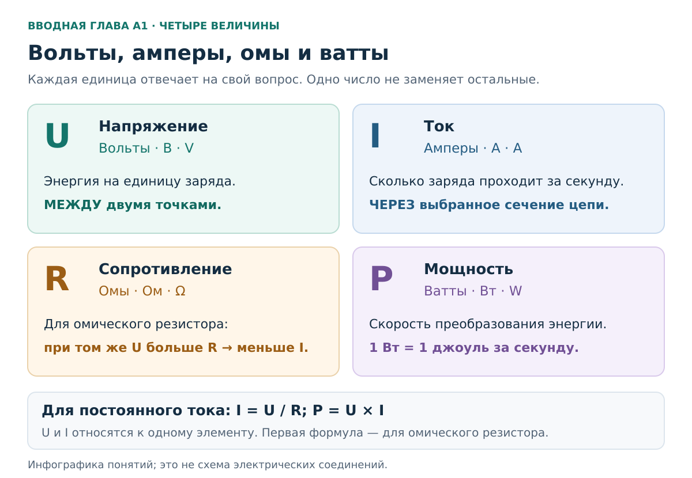
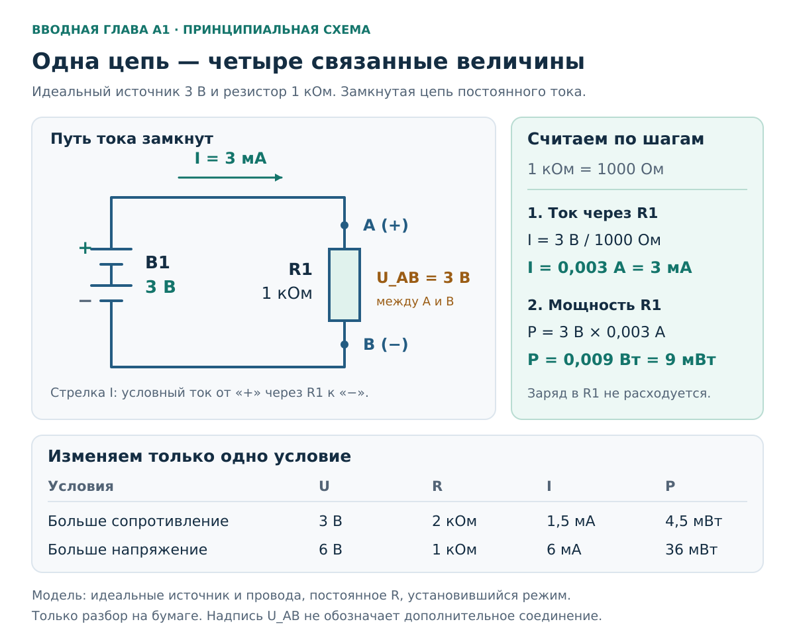
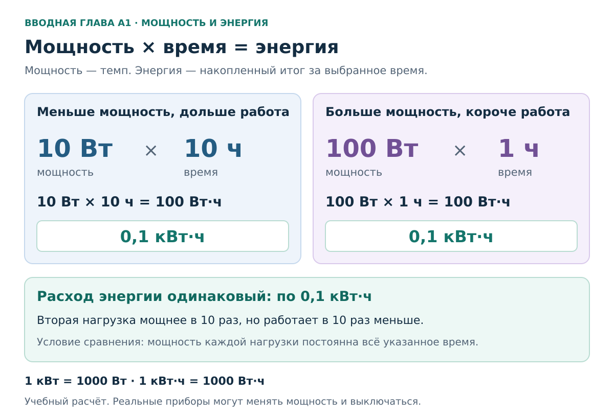
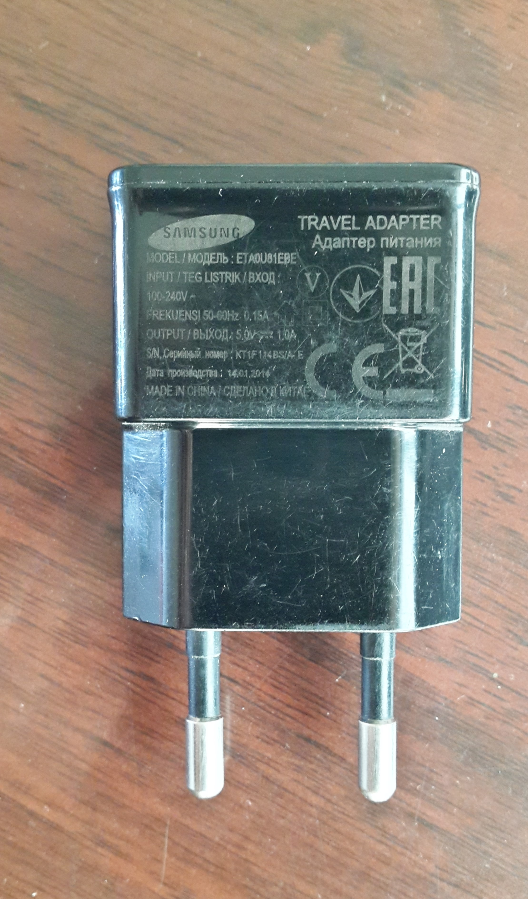
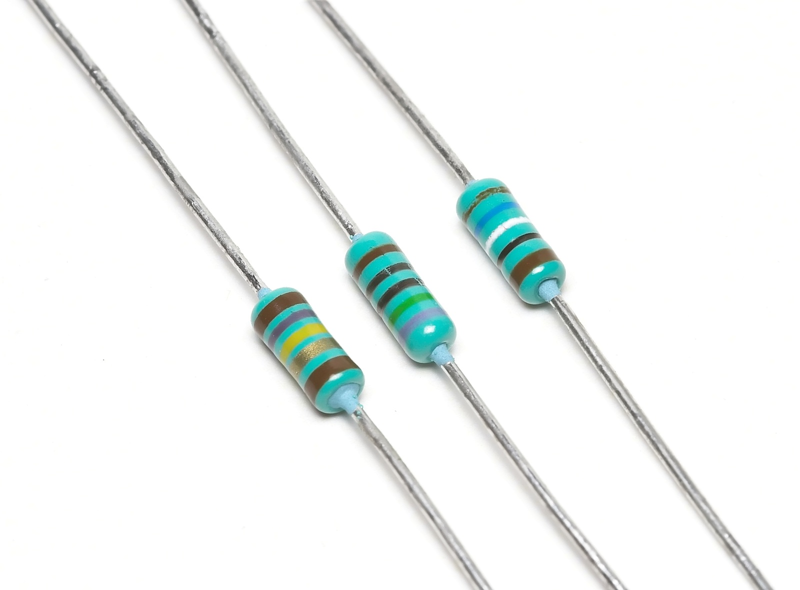
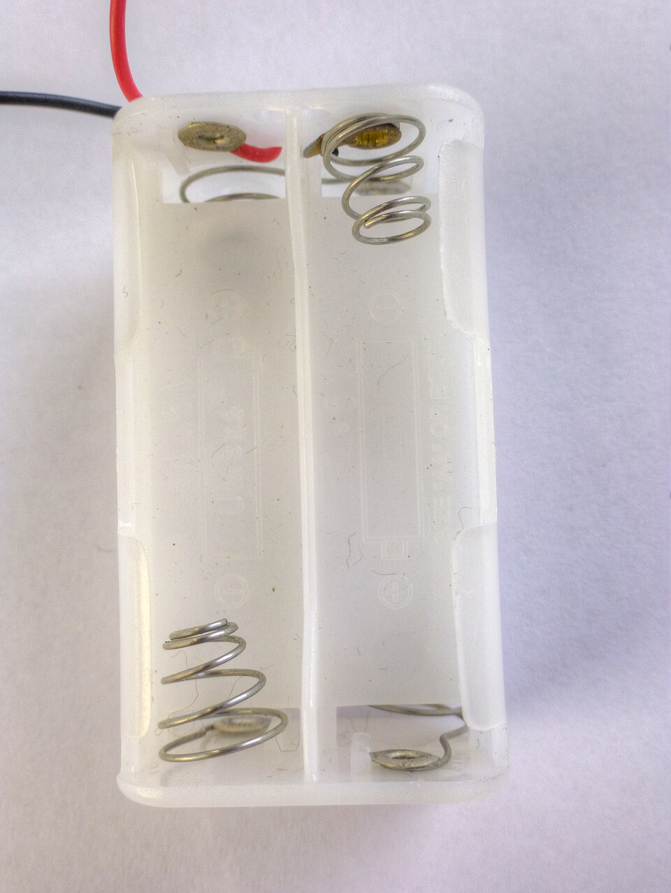

# Вводная глава A1. Физика с нуля: вольты, амперы, омы и ватты

[Главная](../README.md) · [Карта курса](../ROADMAP.md) · [Прогресс](../PROGRESS.md) · [Все главы](README.md)

**Дата технической проверки:** 2026-11-06.  
**Перед чтением:** [01 — Безопасность и устройство курса](01-safety.md). Школьные формулы помнить не нужно.  
**Практика:** фотографии, бумага и калькулятор; без подключения приборов и измерений.  
**Время:** 30–45 минут на чтение и 25–40 минут на упражнения. Можно пройти в два подхода.

Читай эту главу **после 01, перед 02–03**, если школьная физика забылась. Здесь разбираем смысл величин; дальше применим их к цепям, бытовым нагрузкам и нагреву контактов.

## После главы ты сможешь

1. Своими словами различить напряжение, ток, сопротивление и мощность.
2. Прочитать `5 V`, `1 A`, `1000 Ω` и `2000 W`, понимая, какие вопросы отвечают эти числа.
3. По заданным условиям выбрать нужную формулу и получить ответ с единицами.
4. Перевести миллиамперы в амперы, ватты в киловатты и минуты в часы.
5. Объяснить разницу между возможностями источника, текущим потреблением прибора и энергией за время работы.

## 1. Знакомые предметы, непонятные числа

Представь три надписи:

- на зарядном адаптере — `OUTPUT: 5 V, 2 A`;
- на условном чайнике — `230 V, 2300 W`;
- на упаковке учебного резистора — `1 kΩ`.

Все они про электричество, но сообщают **разные сведения**. Вольты описывают напряжение, амперы — ток, омы — сопротивление, ватты — мощность. Сравнить «5 вольт больше или меньше 2 ампер» нельзя, как нельзя сравнить два метра с тремя килограммами. Разберём каждую величину и научимся связывать их расчётом.

## 2. Величина, число и единица — три разных вещи

В записи «длина стола 2 метра» длина — то, что измеряем; 2 — число; метр — единица. С электричеством точно так же.

`U = 5 В` читается: «напряжение равно пяти вольтам».

- `U` — короткое обозначение напряжения в формулах этого курса.
- `5` — численное значение.
- `В` — вольты, единица измерения.

| Величина | Буква в формулах | Русская единица | Международная надпись |
|---|---|---|---|
| Напряжение | `U` | вольт, `В` | `V` |
| Сила тока, далее просто ток | `I` | ампер, `А` | `A` |
| Сопротивление | `R` | ом, `Ом` | `Ω` — греческая омега |
| Мощность | `P` | ватт, `Вт` | `W` |
| Энергия | `E` | джоуль, `Дж`; в бытовых расчётах также `Вт·ч`, `кВт·ч` | `J`, `Wh`, `kWh` |

`I` — латинская буква, не цифра 1. `P` обозначает мощность, а `W` после числа — её единицу. В английском учебнике напряжение могут обозначать буквой `V`; в этом курсе используем `U`.

Названия и связи единиц: [NIST — электрические единицы](https://www.nist.gov/pml/owm/si-units-electric-current), [NIST — таблица производных единиц](https://www.nist.gov/pml/special-publication-811/nist-guide-si-chapter-4-two-classes-si-units-and-si-prefixes).

**Словарь величин, не схема соединений.** Держи его рядом с задачами.

### Приставки: большие и маленькие количества

**Кило-** означает тысячу, **милли-** — тысячную долю. Они работают так же, как в словах «километр» и «миллиметр».

| Исходная запись | Та же величина без приставки | Как считать |
|---|---|---|
| `2 кВт` | `2000 Вт` | Умножить на 1000 |
| `1 кОм` | `1000 Ом` | Умножить на 1000 |
| `2,2 кОм` | `2200 Ом` | Умножить на 1000 |
| `500 мА` | `0,5 А` | Разделить на 1000 |
| `3 мА` | `0,003 А` | Разделить на 1000 |
| `9 мВт` | `0,009 Вт` | Разделить на 1000 |

Обратный пример: `0,002 А × 1000 = 2 мА`. Единица стала мельче, поэтому численное значение стало больше. На иностранной маркировке `mA` — миллиамперы, `kΩ` — килоомы; `0.5 A` означает `0,5 А`.

Источник значений приставок: [NIST, Metric (SI) Prefixes](https://www.nist.gov/pml/owm/metric-si-prefixes).

## 3. Что вообще происходит в электрической цепи

Представь батарейку, два провода и лампочку. Батарейка — **источник**, лампочка — **нагрузка**, получатель электрической энергии. Для устойчивого тока нужен полный проводящий путь через лампу к обоим выводам источника. В батарейке запасена химическая энергия; в работающей лампе электрическая энергия преобразуется в свет и тепло.

Электрический заряд — свойство частиц вещества; у электронов он отрицательный. Заряженные частицы уже есть в проводниках. Источник поддерживает напряжение между выводами, создавая условия для направленного движения заряда — **тока**. Его величина зависит от всей цепи. [OpenStax — ток и замкнутая цепь](https://openstax.org/books/college-physics-2e/pages/20-1-current).

В расчётах возьмём **резистор** — деталь с заданным сопротивлением. Его поведение проще, чем поведение двигателя или электронной схемы лампы.

### Аналогия с водой — первая опора

Можно представить замкнутую систему с насосом и трубами:

| Водяная система | Электрическая подсказка |
|---|---|
| Перепад давления между концами участка | Напряжение |
| Количество воды, проходящее за секунду | Ток |
| Участок, затрудняющий поток | Сопротивление |
| Скорость передачи энергии потоком | Мощность |

При закрытом кране поток может отсутствовать, а перепад давления сохраняться. Так проще представить напряжение без тока.

Аналогия ограничена: нагрузка преобразует энергию, но **заряд в ней не расходуется**. В установившейся цепи без ответвлений ток перед резистором и после него одинаков. Подробнее — [глава 02](02-circuit-basics.md) и [OpenStax, последовательная цепь](https://openstax.org/books/university-physics-volume-2/pages/10-2-resistors-in-series-and-parallel).

## 4. Вольты: напряжение между двумя точками

**Напряжение показывает, какое изменение электрической энергии приходится на единицу заряда между выбранными точками.** Для первого чтения можно держать в голове «электрический перепад», подобный перепаду высот или давлений. Вольт — единица этого перепада. [OpenStax — разность потенциалов](https://openstax.org/books/college-physics-2e/pages/19-1-electric-potential-energy-potential-difference).

Почему две точки? Как высота ступеньки задаётся относительно пола, напряжение задаётся относительно второй точки. «Между плюсом и минусом источника 3 В» понятно; «в проводе 3 В» оставляет вопрос: **относительно чего?**

**Пример.** К идеальному источнику 3 В ничего не подключено. Между выводами остаются 3 В, а внешний ток равен нулю: замкнутого пути нет. «Идеальный» здесь означает, что внутренние потери и утечки в модели не учитываются.

Таким образом, напряжение может существовать без тока. Одни вольты также не сообщают ни будущий ток нагрузки, ни запас энергии батареи.

Если хочется понять точное значение одного вольта

**Джоуль** — единица энергии, **кулон** — единица электрического заряда. Один вольт соответствует одному джоулю на кулон: `1 В = 1 Дж/Кл`. Эти две новые единицы не нужно заучивать ради бытовых расчётов. Они поясняют смысл: напряжение говорит об энергии **на определённое количество заряда**, а не о количестве заряда за секунду. Последнее описывает ток.

## 5. Амперы: сколько заряда проходит за секунду

**Ток показывает скорость переноса электрического заряда через выбранное сечение проводника.** Ампер — его единица. При вдвое большем токе за то же время через сечение проходит вдвое больше заряда. [OpenStax — определение тока](https://openstax.org/books/college-physics-2e/pages/20-1-current).

Правильная фраза: «**через** нагрузку идёт ток 0,5 А». Напряжение — **между** выводами; ток — **через** элемент. Эти два предлога помогают не путаться.

### Почему адаптер «2 А» не загоняет в телефон ровно 2 А

На исправном **источнике постоянного напряжения** написано `5 V, 2 A`. Здесь 5 В — выходное напряжение, а 2 А — ток, который источник способен отдавать в предусмотренных условиях.

Если подключённое устройство в данном режиме потребляет 0,6 А, через него и проходит 0,6 А. Оставшиеся «1,4 А» никуда не нужно девать: они не были обязательным потоком. Производитель [Plugable объясняет этот принцип для USB-зарядки](https://plugable.helpjuice.com/usb-hubs-cables-switches/usb-device-charging).

Это справедливо для **совместимого устройства**: должны подходить напряжение, разъём, полярность и способ согласования питания. Драйвер, специально поддерживающий заданный ток, работает иначе.

### Ток не хранится в батарейке как вода в бутылке

В батарее запасена химическая энергия; ток зависит от подключённой цепи. Поэтому спрашивай точнее: «какой ток сейчас проходит через нагрузку?» или «какой ток способен отдавать источник?»

## 6. Омы: как элемент ограничивает ток

**Сопротивление характеризует связь напряжения на элементе и тока через него.** Для простого резистора с неизменным сопротивлением при одном и том же напряжении большее сопротивление означает меньший ток. Ом — единица сопротивления. [OpenStax — сопротивление и закон Ома](https://openstax.org/books/college-physics-2e/pages/20-2-ohms-law-resistance-and-simple-circuits).

Не смешивай два слова:

- **Сопротивление** — величина, измеряемая в омах.
- **Резистор** — специально изготовленная деталь, имеющая определённое сопротивление.

У провода и соединительного контакта тоже бывает сопротивление. А вот телефон, двигатель или светодиод нельзя во всех режимах представить одним неизменным резистором. Даже сопротивление обычного проводника зависит от его материала, размеров и температуры. [OpenStax — сопротивление проводников](https://openstax.org/books/university-physics-volume-2/pages/9-3-resistivity-and-resistance).

Для резистора **1 Ом** означает связь `1 В / 1 А`. При сопротивлении 2 Ом и напряжении 1 В ток равен 0,5 А. Детали для физического опыта подберём отдельно в главе 04.

## 7. Закон Ома: первая формула без зубрёжки

Условие расчёта: постоянное напряжение и резистор с постоянным сопротивлением. Такой элемент называют **омическим**: его ток пропорционален приложенному напряжению.

**`I = U / R`**

Читаем словами: «ток равен напряжению на резисторе, делённому на его сопротивление».

Смысл виден ещё до расчёта:

- при прежнем сопротивлении увеличили напряжение — ток увеличился;
- при прежнем напряжении увеличили сопротивление — ток уменьшился.

### Считаем медленно: 3 В и 1 кОм

**Дано:** на резисторе 3 В, сопротивление 1 кОм. Найти ток через него.

1. Переписываем величины: `U = 3 В`, `R = 1 кОм`.
2. Убираем приставку: `1 кОм = 1000 Ом`.
3. Выбираем формулу: `I = U / R`.
4. Считаем: `I = 3 / 1000 = 0,003 А`.
5. Для удобства переводим: `0,003 А = 3 мА`.

**Ответ: 3 мА.** Если получилось 3 А, скорее всего, потерялась приставка «кило-»: это ошибка в тысячу раз.

### Если неизвестна другая величина

Это одна связь, записанная тремя способами:

| Что ищем | Формула | Небольшой пример |
|---|---|---|
| Ток | `I = U / R` | `3 В / 1000 Ом = 0,003 А` |
| Напряжение | `U = I × R` | `0,002 А × 1500 Ом = 3 В` |
| Сопротивление | `R = U / I` | `3 В / 0,002 А = 1500 Ом` |

У `U`, `I` и `R` должен быть **один и тот же рассматриваемый элемент**. Нельзя брать выходные 5 В адаптера и входной ток из другой строки этикетки.

Проверь ответ обратной подстановкой: `0,003 А × 1000 Ом = 3 В`.

Закон Ома и его ограничения: [OpenStax, § 20.2](https://openstax.org/books/college-physics-2e/pages/20-2-ohms-law-resistance-and-simple-circuits). Постоянное сопротивление — свойство выбранной модели; оно не обещано для любого устройства.

## 8. Ватты: как быстро передаётся энергия

**Мощность — скорость передачи или преобразования энергии.** Чем больше мощность, тем больше энергии передаётся за одинаковое время. Ватт — единица мощности; `1 Вт = 1 Дж/с`. [NIST — ватт и джоуль](https://www.nist.gov/pml/special-publication-811/nist-guide-si-chapter-4-two-classes-si-units-and-si-prefixes).

При постоянных 100 Вт за минуту передаётся в десять раз больше энергии, чем при 10 Вт. Расход **за день** зависит ещё и от длительности работы.

### Как связаны вольты, амперы и ватты

Для постоянных напряжения и тока на выбранной нагрузке:

**`P = U × I`**

| Напряжение на нагрузке | Ток через неё | Электрическая мощность |
|---|---|---|
| 5 В | 1 А | `5 × 1 = 5 Вт` |
| 5 В | 2 А | `5 × 2 = 10 Вт` |
| 12 В | 1 А | `12 × 1 = 12 Вт` |
| 12 В | 2 А | `12 × 2 = 24 Вт` |

Таблица сравнивает четыре заданных режима: одних ампер для расчёта мощности мало. Для адаптера из раздела 5 выход при 0,6 А составляет `5 × 0,6 = 3 Вт`, а возможность отдать 2 А соответствует `5 × 2 = 10 Вт`.

U и I должны относиться к **одной стороне** устройства. У адаптера вход из сети и выход в USB различаются; между ними возникают потери преобразования. [OpenStax — электрическая мощность](https://openstax.org/books/college-physics-2e/pages/20-4-electric-power-and-energy).

### Чайник: из ваттов получаем амперы

Зададим **бумажную модель нагревателя**: 230 В, потребляемая мощность 2300 Вт, нагрузка чисто резистивная — то есть ведёт себя как резистор.

Из `P = U × I` получаем:

`I = P / U = 2300 Вт / 230 В = 10 А`.

При одинаковом напряжении резистивный прибор большей мощности потребляет больший ток. Этот расчёт не проверяет состояние розетки и проводки.

### Короткая оговорка о розетке и электронике

Батарейные примеры используют **постоянный ток**, `DC`. Сеть — **переменный ток**, `AC`: напряжение и ток меняются во времени. Поэтому `P = U × I` применяем здесь к постоянным U и I либо к заданному резистивному нагревателю, для которого берём действующие значения U и I. Для произвольной LED-лампы, двигателя или блока питания одних ваттов недостаточно, чтобы найти точный ток.

Почему для сетевой электроники формула сложнее

Для однофазной нагрузки `P = U × I × PF`, где `PF` — **коэффициент мощности**. U и I здесь — действующие значения, связанные с тепловым действием переменного тока. Для чистого резистора `PF = 1`; другим приборам это значение автоматически не присваивают. Расчёт и отличие PF от КПД разобраны в [главе 03, разделе 4](03-power-energy.md#4-когда-мощность-можно-просто-разделить-на-напряжение). [Schneider Electric — определение PF](https://www.electrical-installation.org/enwiki/Definition_of_Power_Factor).

## 9. Все четыре величины в одной цепи

**Принципиальная схема для расчёта на бумаге.** `B1` — идеальный источник 3 В, `R1` — постоянное сопротивление 1 кОм, провода идеальны. Стрелка показывает условный ток от плюса через нагрузку к минусу. Надпись `U_AB` обозначает напряжение между A и B, не дополнительный провод.

Сначала получаем `I = 3/1000 = 0,003 А`, затем `P = 3 × 0,003 = 0,009 Вт`. Таким образом, 3 В, 3 мА, 1 кОм и 9 мВт **описывают один режим с разных сторон**. Это модель; монтаж стенда будет в главе 04.

### Что будет, если изменить одно условие

| Условия бумажной модели | Ток `I = U/R` | Мощность `P = U×I` | Сравнение с первой строкой |
|---|---|---|---|
| 3 В, 1000 Ом | 3 мА | 9 мВт | Исходный режим |
| 3 В, 2000 Ом | 1,5 мА | 4,5 мВт | Вдвое больше сопротивление → вдвое меньше ток и мощность |
| 6 В, 1000 Ом | 6 мА | 36 мВт | Вдвое больше напряжение → вдвое больше ток, вчетверо больше мощность |

В последней строке выросли **оба множителя** U и I: мощность увеличилась вчетверо. Для реального устройства допустимое напряжение задаёт его документация.

### Почему фраза «больше омов — больше нагрев» неполна

Нужно знать, **что остаётся постоянным**. При прежнем напряжении большее R уменьшает мощность, как в таблице. При прежнем токе большее R увеличивает тепловыделение: `P = I² × R`, где `I²` означает `I × I`. В главе 03 применим это к плохому контакту и учтём изменение тока всей цепи. Температура зависит ещё и от отвода тепла. [OpenStax — мощность резистора](https://openstax.org/books/university-physics-volume-2/pages/9-5-electrical-energy-and-power).

## 10. Киловатт-часы: сколько энергии ушло за время

Полезная аналогия: скорость автомобиля и пройденное расстояние. Скорость 60 км/ч ещё не говорит, сколько километров пройдено: нужно время. Аналогично мощность 1000 Вт ещё не говорит, сколько энергии потрачено.

При **постоянной мощности**:

**`E = P × t`**,

где `E` — энергия, `P` — мощность, `t` — время. Для бытовой записи удобно брать мощность в киловаттах, время — в часах; ответ получится в киловатт-часах. [OpenStax — энергия за время работы](https://openstax.org/books/university-physics-volume-2/pages/9-5-electrical-energy-and-power).

**Ватты и киловатты — мощность. Ватт-часы и киловатт-часы — энергия.** Точка между кВт и ч означает умножение. Запись `кВт/ч` с делением обозначает другую величину и для расхода энергии здесь не подходит.

`1 кВт·ч = 1000 Вт·ч = 3 600 000 Дж`: это 1000 джоулей в секунду на протяжении 3600 секунд.

**Два заданных режима.** Мощность отличается в десять раз, время — тоже, итоговая энергия одинакова.

### Сначала переведи минуты в часы

В одном часе 60 минут:

| Минуты | Расчёт | Часы |
|---|---|---|
| 6 | `6 / 60` | 0,1 |
| 15 | `15 / 60` | 0,25 |
| 30 | `30 / 60` | 0,5 |
| 45 | `45 / 60` | 0,75 |

`15 минут` — это **0,25 часа**, а не 0,15. Десятичная дробь обозначает долю часа, а не переносит цифры с часов.

### Чайник и лампа

Для постоянной мощности на каждом указанном интервале:

| Нагрузка | Перевод единиц | Энергия |
|---|---|---|
| Нагреватель 2300 Вт, 6 минут | 2,3 кВт; `6/60 = 0,1 ч` | `2,3 × 0,1 = 0,23 кВт·ч` |
| Лампа 10 Вт, 5 часов | 0,01 кВт; 5 ч | `0,01 × 5 = 0,05 кВт·ч` |

Если мощность меняется, считай отдельные интервалы и складывай энергию. Работу термостата, среднюю мощность и расчёт стоимости разберём в [главе 03](03-power-energy.md#3-энергия-мощность-нужно-связать-со-временем).

## 11. Как это выглядит на настоящих предметах

На фотографиях учимся узнавать детали и читать маркировку. Надписи сообщают заявленные параметры, а не текущие показания; марка не означает рекомендацию к покупке.

### Фото 1. Вход и выход адаптера

[Открыть фотографию крупно](../assets/photos/a1-usb-adapter-label.jpg).

*Фото: Slcreza, [Samsung Travel Adapter 2.jpg](https://commons.wikimedia.org/wiki/File:Samsung_Travel_Adapter_2.jpg), 2018-02-27, [CC BY-SA 4.0](https://creativecommons.org/licenses/by-sa/4.0/). Оригинал без изменений. Полная запись — в [атрибуции](../assets/ATTRIBUTION.md).*

На этом конкретном снимке читаются:

| Строка | Как понимать |
|---|---|
| `INPUT / ВХОД: 100–240 V ~` | Заявленный диапазон входного переменного напряжения; это сторона сети |
| `50–60 Hz` | Заявленная входная частота; `Hz` означает герцы, тему раскроем в главе 06 |
| `0.15 A` | Заявленный входной ток; это не постоянное показание в любом режиме |
| `OUTPUT / ВЫХОД: 5.0 V` и знак постоянного тока | Заявленное выходное постоянное напряжение 5,0 В |
| `1.0 A` | Заявленный выходной ток 1,0 А |

На фото **1 А**. Выходная мощность по этим параметрам: `5,0 В × 1,0 А = 5 Вт`. Это расчёт по маркировке, а не измерение.

Не умножай выходные 5 В на входные 0,15 А: это разные стороны адаптера. Фактический выход зависит от совместимой нагрузки.

### Фото 2. Сопротивление и резистор

*Фото: Afrank99, [3 Resistors.jpg](https://commons.wikimedia.org/wiki/File:3_Resistors.jpg), [CC BY-SA 2.5](https://creativecommons.org/licenses/by-sa/2.5/), без изменений; повторное использование из главы 02.*

Это **резисторы**; цветные полосы кодируют параметры. Номинал 1 кОм в задачах задан условием и не приписывается деталям на фото.

У резистора указывают также **допустимую мощность**. Например, 0,25 Вт — предел рассеяния при оговорённых производителем условиях, а не постоянное потребление. Резистор 1 кОм при 3 В рассеивает рассчитанные 9 мВт; называть его «потребителем 0,25 Вт» было бы ошибкой. Допустимая мощность зависит, в частности, от температуры; см. [пример паспорта Vishay](https://www.vishay.com/docs/28724/mrs16m25.pdf). Параметры резисторов на снимке этим примером не устанавливаются.

### Фото 3. Держатель ещё не источник

*Фото: © Nevit Dilmen, [Battery holder box 2xAA 3V 1480283 4 5 HDR Enhancer.jpg](https://commons.wikimedia.org/wiki/File:Battery_holder_box_2xAA_3V_1480283_4_5_HDR_Enhancer.jpg), [CC BY-SA 3.0](https://creativecommons.org/licenses/by-sa/3.0/); уменьшенная Wikimedia версия из главы 02, дополнительных изменений нет.*

В **пустом держателе** видны места для элементов, контакты и провода. Источником он станет после установки подходящих батареек; `3V` в названии фото не является измерением. Сборку стенда пройдём в главе 04.

## 12. Практика: пять заданий без оборудования

**Понадобятся:** изображения главы, бумага или заметки, калькулятор.\
**Условия:** работаем только с задачами и фотографиями, без подключений и измерений. Если надпись не читается или данных для формулы нет, запиши, чего не хватает, и сверь объяснение.

В ответе указывай **число, единицу и смысл**: «3 мА — ток через заданный резистор».

### A. Научись узнавать величины

1. Для каждой записи назови величину: `12 V`; `0.5 A`; `2.2 kΩ`; `60 W`; `0.3 kWh`.
2. Переведи: 750 мА в амперы; 4,7 кОм в омы; 1800 Вт в киловатты; 15 минут в часы.
3. Ответь: можно ли сказать «12 В больше, чем 2 А»?

**Ожидаемый результат:** пять подписанных величин, четыре перевода и объяснение последнего вопроса.

Разбор задания A

`12 V` — напряжение 12 В. `0.5 A` — ток 0,5 А. `2.2 kΩ` — сопротивление 2,2 кОм. `60 W` — мощность 60 Вт. `0.3 kWh` — энергия 0,3 кВт·ч.

`750 мА = 750/1000 = 0,75 А`.

`4,7 кОм = 4,7 × 1000 = 4700 Ом`.

`1800 Вт = 1800/1000 = 1,8 кВт`.

`15 минут = 15/60 = 0,25 часа`.

Сравнивать 12 В и 2 А как большее и меньшее нельзя: это разные величины. Это похоже на сравнение «два метра больше, чем три килограмма».

### B. Прочитай схему и рассчитай режим

Для схемы раздела 9 — один идеальный источник и один резистор в замкнутой цепи — подставь условия таблицы и найди `I` и `P`.

| Вариант | Напряжение на резисторе | Сопротивление |
|---|---|---|
| 1 | 3 В | 1500 Ом |
| 2 | 3 В | 3000 Ом |
| 3 | 6 В | 1500 Ом |

1. Запиши `I = U/R` и получи ток сначала в амперах, потом в миллиамперах.
2. Запиши `P = U×I` и подставь ток **в амперах**.
3. Объясни, почему в варианте 3 мощность отличается от варианта 1 в четыре раза.

**Ожидаемый результат:** три пары ток/мощность и объяснение через два множителя.

Разбор задания B

| Вариант | Ток | Мощность |
|---|---|---|
| 1 | `3/1500 = 0,002 А = 2 мА` | `3 × 0,002 = 0,006 Вт = 6 мВт` |
| 2 | `3/3000 = 0,001 А = 1 мА` | `3 × 0,001 = 0,003 Вт = 3 мВт` |
| 3 | `6/1500 = 0,004 А = 4 мА` | `6 × 0,004 = 0,024 Вт = 24 мВт` |

При переходе от 1 к 2 напряжение прежнее, сопротивление вдвое больше: ток и мощность уменьшаются вдвое. От 1 к 3 сопротивление прежнее, напряжение вдвое больше: ток тоже удваивается. В произведении `P = U×I` оба множителя выросли вдвое, результат — в четыре раза.

Если получил 6 Вт вместо 6 мВт в первой строке, в формулу подставлены 2 мА как 2 А. Расчёт при этом завышен в тысячу раз.

### C. Прочитай настоящий шильдик

Открой фото адаптера из раздела 11. Работай только с фотографией.

1. Выпиши отдельно входную и выходную строки с единицами.
2. Найди заявленную выходную мощность по выходным 5,0 В и 1,0 А.
3. По отдельному условию задачи совместимое устройство получает с выхода 5,0 В и потребляет 0,4 А. Какова фактическая выходная мощность в этом режиме?
4. Объясни, почему ответы 2 и 3 различаются и почему нельзя использовать входные 0,15 А вместе с выходными 5 В.

**Ожидаемый результат:** две строки маркировки, два расчёта, объяснение границ вывода.

Разбор задания C

Вход: `100–240 V ~`, `50–60 Hz`, `0.15 A`. Выход: `5.0 V` постоянного тока, `1.0 A`.

По выходной маркировке: `5,0 × 1,0 = 5 Вт`.

По заданному фактическому режиму: `5,0 × 0,4 = 2 Вт`.

5 Вт — заявленная выходная возможность в соответствующих условиях. 2 Вт — мощность в отдельно заданном режиме. Никакого противоречия. Выходные вольты и входные амперы относятся к разным сторонам преобразователя, поэтому их произведение не является искомой выходной мощностью.

Входную мощность без сведений о потерях не определить. Связь входа и выхода через КПД изучим в главе 03.

### D. Рассчитай энергию, не потеряв время

Даны три **независимых** режима с постоянной мощностью:

| Нагрузка | Мощность | Время |
|---|---|---|
| Условная лампа | 10 Вт | 5 часов |
| Условный нагреватель | 2000 Вт | 15 минут |
| Условное устройство | 100 Вт | 30 минут |

1. Переведи мощность в кВт, время в часы.
2. Для каждой строки вычисли `E = P×t`.
3. Какие два режима дают одинаковую энергию? Какой даёт наибольшую?

**Ожидаемый результат:** три значения в кВт·ч и сравнение.

Разбор задания D

Лампа: `0,01 кВт × 5 ч = 0,05 кВт·ч`.

Нагреватель: `2 кВт × 0,25 ч = 0,5 кВт·ч`.

Устройство: `0,1 кВт × 0,5 ч = 0,05 кВт·ч`.

Первая и третья строки дают одинаковую энергию, хотя мощность и время разные. Нагреватель в заданном режиме потребил в десять раз больше энергии, чем каждая из этих двух нагрузок.

### E. Найди недостающие данные

Для каждого вопроса запиши: можно ответить числом или сначала нужно уточнение?

1. «У источника 12 В. Какой ток пойдёт?»
2. «На LED-лампе написано 10 Вт. Значит, её точный ток из сети 230 В равен `10/230`?»
3. «Адаптер может отдавать до 2 А. Значит, телефон всегда потребляет 2 А?»
4. «Прибор 1 кВт был включён два часа. Известно, что всё время он потреблял ровно 1 кВт. Сколько энергии ушло?»

**Ожидаемый результат:** три объяснения, чего не хватает, и один расчёт.

Разбор задания E

**1.** Нужны нагрузка и схема. Напряжение само по себе ток не задаёт. Для идеального резистора дополнительно нужно его сопротивление; для сложного устройства — характеристики и режим.

**2.** Точный ток так не определить: коэффициент мощности не дан. Даже если 10 Вт и 230 В относятся к одному реальному режиму, для переменного тока требуется `I = P/(U×PF)`. По фотографии лампы неизвестный `PF` не назначаем.

**3.** Нет. Предельная возможность источника и текущий ток устройства — разные вещи. Требуются сведения о совместимости и фактическом режиме нагрузки.

**4.** Здесь условия достаточны: `1 кВт × 2 ч = 2 кВт·ч`. Если бы постоянство мощности не было задано, одной надписи «1 кВт» могло бы не хватить.

## 13. Частые ошибки

| Ошибка | В чём проблема | Как проверить себя |
|---|---|---|
| «Вольты — это ток» | Напряжение и ток отвечают на разные вопросы | Напряжение **между**, ток **через** |
| «2 А на адаптере — всегда 2 А в телефоне» | Возможность источника принята за фактическое потребление | Отдели маркировку от условия текущего режима |
| `3 мА = 3 А` | Потеряна тысячная доля | Запиши `3/1000 = 0,003 А` |
| `15 минут = 0,15 часа` | Минуты перенесены в десятичную дробь без перевода | Раздели на 60 |
| «Потребил 2 кВт за вечер» | Мощность подменяет энергию | Если известен расход за время, нужны кВт·ч |
| «Мощность выросла вдвое, потому что вдвое больше вольт» | Ток тоже мог измениться | Проверь, что осталось постоянным |
| «Чем больше сопротивление, тем всегда горячее» | Не задано постоянство напряжения или тока | Назови неизменную величину и рассматриваемый участок |

## 14. Самопроверка

Отвечай своими словами. Если получилось, затем сверь с разбором.

1. Чем отличаются `U = 12 В` и `I = 2 А`? Укажи «между» и «через».
2. Может ли у отключённого от нагрузки идеального источника быть 3 В и нулевой внешний ток одновременно?
3. На резисторе 6 В, его сопротивление 2 кОм. Чему равны ток и мощность?
4. В двух разных цепях постоянного тока заданы режимы: 12 В и 2 А; 24 В и 1 А. Одинакова ли мощность? Следует ли из этого взаимозаменяемость источников для одного устройства?
5. На исправном совместимом источнике напряжения указано 5 В, до 2 А. Устройство в заданном режиме потребляет 0,8 А. Какова выходная мощность в этом режиме и какова заявленная предельная мощность при 5 В?
6. Условный прибор постоянно потребляет 800 Вт в течение 45 минут. Сколько это кВт·ч?
7. В резистивной модели напряжение удвоили, сопротивление оставили прежним. Как изменились ток и мощность?
8. Фото показывает пустой держатель с двумя проводами. Достаточно ли этого, чтобы записать «на выходе измерено 3 В»? Что делать, если для задачи не хватает данных?

Ответы с объяснениями

**1.** `U = 12 В` — напряжение **между двумя указанными точками**, например выводами источника. `I = 2 А` — ток **через выбранный элемент или сечение**. Это разные физические величины, связанные устройством цепи.

**2.** Да. Источник может поддерживать разность потенциалов без внешнего замкнутого пути. Нулевой внешний ток не означает нулевого напряжения между выводами.

**3.** `2 кОм = 2000 Ом`. `I = 6/2000 = 0,003 А = 3 мА`. `P = 6 × 0,003 = 0,018 Вт = 18 мВт`. Подстановка `6 × 3` без перевода миллиампер дала бы неправильный масштаб.

**4.** В обоих режимах 24 Вт: `12 × 2 = 24`, `24 × 1 = 24`. Но напряжения различаются. Равенство ваттов не делает источники взаимозаменяемыми: устройству нужно подходящее напряжение и прочие условия питания.

**5.** Фактически: `5 × 0,8 = 4 Вт`. По заявленному пределу: `5 × 2 = 10 Вт`. Неиспользованный запас возможности источника не превращается в обязательный ток.

**6.** `800 Вт = 0,8 кВт`; `45 минут = 0,75 часа`. `E = 0,8 × 0,75 = 0,6 кВт·ч`. Условие постоянной мощности позволяет обойтись одним умножением.

**7.** Ток удвоился по `I = U/R`; мощность увеличилась вчетверо по `P = U×I`. Вывод относится к неизменному сопротивлению, а не ко всем бытовым приборам.

**8.** Недостаточно: держатель пуст и результата измерения нет. Запиши недостающие сведения. В этой главе пользуемся условиями задачи и фотографиями.

## 15. Памятка и готовность к следующим главам

| Если нужно… | Сначала спроси… | Затем используй… |
|---|---|---|
| Найти ток резистора | Известны ли напряжение на нём и его постоянное сопротивление? | `I = U/R` |
| Найти мощность в цепи постоянного тока | Относятся ли U и I к одной нагрузке и одному режиму? | `P = U×I` |
| Найти ток заданного резистивного нагревателя | Мощность потребления и напряжение относятся к одному режиму? | `I = P/U` |
| Найти энергию | Сколько времени и с какой мощностью работал прибор? | `E = P×t` при постоянной мощности; иначе сумма интервалов |
| Понять маркировку | Это вход, выход, номинал, предел или фактический режим? | Сначала прочитай контекст надписи |

Можно переходить к подробным цепям главы 02, если ты без подсказки:

- отличаешь четыре величины по их смыслу и единицам;
- переводишь `500 мА` в `0,5 А` и `1 кОм` в `1000 Ом`;
- получаешь ток по заданным U и R, а затем мощность;
- объясняешь, почему 10 Вт за 10 часов и 100 Вт за час дают одинаковую энергию;
- замечаешь, когда данных для численного ответа недостаточно.

Если путаются приставки — повтори раздел 2 и задание A. Если путаются ватты и амперы — разделы 8–9 и задание B. Если расход энергии — раздел 10 и задание D. Если маркировка кажется текущим измерением — раздел 11 и задание C.

Результаты можно прислать как «A: …; B: …; C: …». Практика отмечается в [PROGRESS.md](../PROGRESS.md) после сообщения о выполнении.

## Источники и пределы применения

Источники проверены **2026-11-06**. Эта глава объясняет физические величины и учебные модели; она не устанавливает монтажных требований РФ, не выбирает проводку, защиту или конкретный адаптер. Численные примеры, задания, ответы и SVG разработаны для курса. Параметры реальной этикетки отдельно названы наблюдениями по фотографии.

| Первичный источник | Для чего использован |
|---|---|
| [NIST, SI Units — Electric Current](https://www.nist.gov/pml/owm/si-units-electric-current) | Названия электрических единиц и связи вольта, ампера и ома |
| [NIST, Guide to the SI, Chapter 4](https://www.nist.gov/pml/special-publication-811/nist-guide-si-chapter-4-two-classes-si-units-and-si-prefixes) | Производные единицы: ватт, джоуль, кулон; используем таблицу единиц, а не исторические определения базовых единиц из других разделов SP 811 |
| [NIST, Metric (SI) Prefixes](https://www.nist.gov/pml/owm/metric-si-prefixes) | Множители милли- и кило- |
| [OpenStax, College Physics 2e, 19.1](https://openstax.org/books/college-physics-2e/pages/19-1-electric-potential-energy-potential-difference), [20.1](https://openstax.org/books/college-physics-2e/pages/20-1-current), [20.2](https://openstax.org/books/college-physics-2e/pages/20-2-ohms-law-resistance-and-simple-circuits), [20.4](https://openstax.org/books/college-physics-2e/pages/20-4-electric-power-and-energy) | Смысл напряжения и тока, закон Ома, мощность в простой цепи; иностранные бытовые номиналы и примеры защиты не переносятся в курс |
| [OpenStax, University Physics Volume 2, 9.3](https://openstax.org/books/university-physics-volume-2/pages/9-3-resistivity-and-resistance), [9.5](https://openstax.org/books/university-physics-volume-2/pages/9-5-electrical-energy-and-power), [10.2](https://openstax.org/books/university-physics-volume-2/pages/10-2-resistors-in-series-and-parallel) | Свойства сопротивления, энергия за время, формулы для резистора, ток в последовательной цепи |
| [Schneider Electric, Definition of Power Factor](https://www.electrical-installation.org/enwiki/Definition_of_Power_Factor) | Коэффициент мощности; страница изменена 2026-08-05; используется физическое определение, не зарубежные монтажные правила |
| [Plugable, USB Device Charging](https://plugable.helpjuice.com/usb-hubs-cables-switches/usb-device-charging) | Различие возможностей USB-источника и тока нагрузки, необходимость совместимости; дата на странице 2020-11-20. Исторические пределы отдельных USB-стандартов не выдаются за универсальные современные возможности |
| [Vishay, MRS16/MRS25](https://www.vishay.com/docs/28724/mrs16m25.pdf) | Редакция 07-Mar-2016, раздел Application Information: допустимая мощность связана с температурой и теплоотводом. Номинал 0,25 Вт в тексте — отдельный учебный пример, не параметр этих моделей; см. также [S28](../references/SOURCES.md#s28) |

Подробности проверки и ограничения источников — в [списке для A1](../references/A1-PHYSICS-SOURCES.md). Даты просмотра не означают, что любой документ содержит актуальные нормы для квартиры. Фотографии, авторы и лицензии — в [ATTRIBUTION.md](../assets/ATTRIBUTION.md).

## Навигация

**Перед A1:** [01 — Безопасность и устройство курса](01-safety.md).  
**После A1:** [02 — Цепь, напряжение, ток и сопротивление](02-circuit-basics.md), затем [03 — Мощность, энергия и нагрев](03-power-energy.md). Актуальное продолжение основного курса указано в [PROGRESS.md](../PROGRESS.md).
